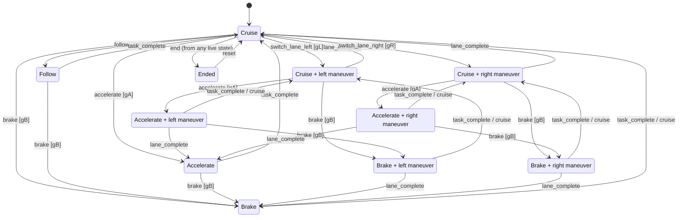
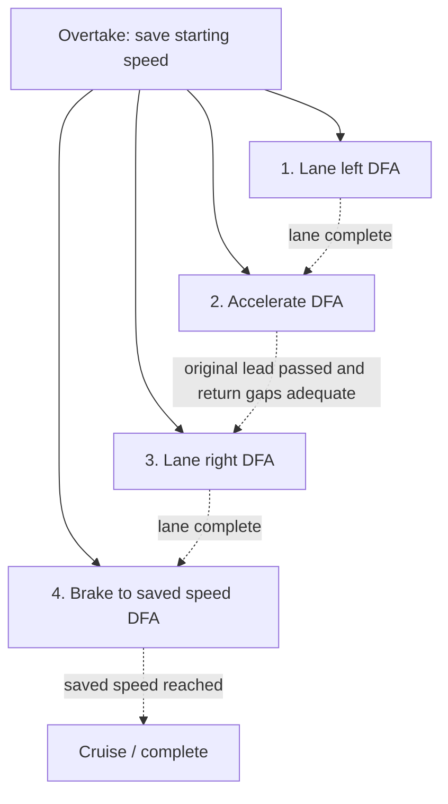

# Driving-task DFA

`task_dfa.py` is the executable DFA used by `mainV3.py`. Four live graphs show
ego and three tracked traffic cars below the road and controls. `TASK_DFA.dot` contains the
complete graph, including every transition and self-loop.

Ego's graph is driven by executed task events. The three other graphs use
`live_dfa.py` to infer modes from observed acceleration, same-lane following
and lateral motion. Their independent DFAs do not issue commands to traffic.
Green/blue/amber/purple graph colors match the EGO/A/B/C road badges. Vehicle
identities stay pinned on each reset/demo load. The live view starts at each
car's current DFA state and branches only to its currently enabled tasks.
Task boxes represent outgoing choices; unavailable tasks and their arrows are
omitted. The internal 11-state automaton and its full static DOT export remain
the reference for transitions and lifecycle events. The control groups are Simulator controls,
Task controls and Demos. Rebind lane and its T shortcut have been removed.

Availability is evaluated independently for all four cars. For each traffic
car, a local snapshot treats that car as `ego` in the existing state alphabet;
every other vehicle remains an obstacle. Separate predicate histories retain
gap hysteresis and lead braking estimates. Task-relevant geometric state facts
update at 5 Hz, staggered across motion ticks to avoid a four-car pause, while
speed, maneuver and missing/crashed-car checks update on motion
ticks. Rendering reads these results without advancing the simulation.
The traffic graphs show possible V3 tasks from those states; IDM still controls
their actual movement.

V3's `LaneGapConfig` uses a 2 m base gap, 0.3 s follower headway, 0.6 s closing
allowance and 0.25 m switch-on margin for both front and rear. The existing
one-second trajectory prediction and overlap rejection still apply. Following
uses its separate original V2 headway.

The traffic state is continuous, so task availability is evaluated by the
existing symbolic guards and runtime checks **before** a request enters the
DFA. An enabled request emits its task ID; a disabled request emits `reject`.
This makes the finite automaton deterministic without pretending the task names
alone encode lane availability, speeds or gaps.

The DFA is `M = (Q, Sigma, delta, q0, F)`:

- `Q`: 11 states. Four longitudinal modes with no maneuver (`cruise`,
  `accelerate`, `follow_car`, `brake`), three modes with a left maneuver
  (`cruise`, `accelerate`, `brake`), the same three with a right maneuver,
  and `ended`.
- `Sigma`: the six validated task IDs plus `lane_complete`, `task_complete`,
  `reject`, `tick`, `end`, `reset`.
- `q0 = (cruise, none)`.
- `F = {(cruise, none)}`: a finite task sequence is settled in Cruise with
  no unfinished lane change. This is independent of an example's success flag.
- `delta`: the table below; it is defined for every state/input pair.

Keeping longitudinal and lateral modes together matters: Brake can operate
while a previously accepted lane change finishes. A single six-state diagram
would lose that maneuver state.

| Input event | Next state from live state `(mode, lateral)` |
| --- | --- |
| `switch_lane_left` | `(cruise, left)` if lateral is `none`; otherwise unchanged |
| `switch_lane_right` | `(cruise, right)` if lateral is `none`; otherwise unchanged |
| `accelerate` | `(accelerate, lateral)` |
| `brake` | `(brake, lateral)` |
| `cruise` | `(cruise, lateral)` |
| `follow_car` | `(follow_car, none)` if lateral is `none`; otherwise unchanged |
| `lane_complete` | `(mode, none)` |
| `task_complete` | `(cruise, lateral)` |
| `reject`, `tick` | Unchanged |
| `end` | `ended` |
| `reset` | `(cruise, none)` |

`ended` self-loops on every event except `reset`. Task completion means the
speed limit was reached, braking reached its zero or saved-speed target, or an active
task's guard failed. Lane completion uses measured lane index, offset and
heading. A queued request does not transition the DFA until execution starts.

This readable view shows common transitions; the complete table above also
allows replacing any active longitudinal task with another enabled task:



`gL/gR` require an existing reachable lane and adequate front/rear gaps, with no
lane change already in progress. `gF` requires the lead role ahead in ego's
lane, with no maneuver in progress. `gA` requires available acceleration speed
and no configured lead/intruder hazard. `gB` requires moving ego. Every guard
also requires an uncrashed ego and a live episode. See `generate_task_vocabulary`
for the exact requirements and the interface for the current availability.

## Overtake a slower lead car

The **Overtake** button executes this ordered composition in the current scene.
`overtake.py` owns one child `TaskDFA` for each stage; each child records actual
task activation and completion events. The live tree highlights its lifecycle
as ready, running and done, and distinguishes queued/waiting/planned children.
The parent activates children in numbered order using the same guarded queue
as manual tasks. State facts and the four per-car DFA views remain accessible.



The tree is a plan of dependent tasks; the bottom four graphs continue to show
only each car's currently enabled task choices. The maneuver view shows the
captured speed, measured speed and guard reasons when a child must wait.
Manual tasks and Cancel stop the sequence. Reset and episode end clear or
end its execution. Normal Brake stops the car; the composite's final Brake
has a positive speed target captured before the first lane change.

```powershell
.\.venv\Scripts\python.exe mainV3.py --example overtake
```

Ego starts at 24 m/s behind a 16 m/s lead car, with room on the left. The
supervisor issues only the same guarded tasks available to a human:

1. `switch_lane_left` when `lane_exists(left)` and both gap predicates hold.
2. Wait for physical lane-change completion, then `accelerate`.
3. Track the original lead's identity as ego passes it. Wait until it is behind
   ego **and** both right-lane gap predicates allow returning.
4. `switch_lane_right`, wait for completion, then `brake` to the captured 24 m/s.
5. When that speed is reached within 0.1 m/s, hold it with `cruise`.

The representative trace is left at 0 s, Accelerate at 1.6 s, right at 6.6 s,
Brake at 8.2 s, and completion at about 11 s with Cruise at 24 m/s.
Ego finishes in its original lane ahead of the passed car.
The accelerator may first return to Cruise automatically at the speed limit.
Actual completion is measured; the supervisor does not use these times as gates.

## Brake when passing is unavailable

```powershell
.\.venv\Scripts\python.exe mainV3.py --example brake
```

Ego starts at 18 m/s, 60 m behind a stopped lead car. Cars alongside occupy
both adjacent lanes. `present(lead)`, `slower_than(lead,ego)` and
`closing_on(ego,lead)` hold while both lane changes are unavailable.
The supervisor selects `brake`, waits for the stopped threshold, then selects
`cruise` with a zero speed target. The example finishes around 6 s before
reaching the lead car.

Use the **Overtake demo** / **Brake demo** buttons to load these scenarios and
start playback, or Step through them. Selecting a manual task takes control
from the example supervisor. Reset restores normal heterogeneous IDM traffic.

For reproducible console traces:

```powershell
.\.venv\Scripts\python.exe mainV3.py --example overtake --headless-steps 80
.\.venv\Scripts\python.exe mainV3.py --example brake --headless-steps 40
```

These small scenarios demonstrate task composition; they do not implement a
general autonomous overtaking policy for arbitrary traffic.
