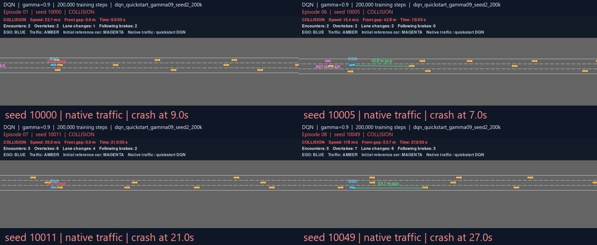

# dqn_quickstart_gamma09_seed2_200k

Final DQN model, gamma 0.9, 200,000 training steps.

Full saved evaluation: **5/50 collisions (10%)**.

[Watch all eight episodes](all_episodes.mp4) | [Watch collision replays](collisions_only.mp4)

Collision replays show the last six seconds at half speed and hold the terminal frame for two seconds.

These examples deliberately include four crashes. Use the full 50-episode evaluation above for the collision rate.

Every recording reproduced its saved evaluation outcome, reward, duration and policy-step count.

| Episode | Seed | Slot | Outcome | Simulated seconds | Video | Collision replay |
| --- | --- | --- | --- | ---: | --- | --- |
| 1 | 10000 | - | COLLISION | 9.0 | [Watch](episode_01_seed10000_collision.mp4) | [Half speed](collision_01_seed10000_slow.mp4) |
| 2 | 10001 | - | COMPLETED | 30.0 | [Watch](episode_02_seed10001_completed.mp4) |  |
| 3 | 10002 | - | COMPLETED | 30.0 | [Watch](episode_03_seed10002_completed.mp4) |  |
| 4 | 10003 | - | COMPLETED | 30.0 | [Watch](episode_04_seed10003_completed.mp4) |  |
| 5 | 10004 | - | COMPLETED | 30.0 | [Watch](episode_05_seed10004_completed.mp4) |  |
| 6 | 10005 | - | COLLISION | 7.0 | [Watch](episode_06_seed10005_collision.mp4) | [Half speed](collision_06_seed10005_slow.mp4) |
| 7 | 10011 | - | COLLISION | 21.0 | [Watch](episode_07_seed10011_collision.mp4) | [Half speed](collision_07_seed10011_slow.mp4) |
| 8 | 10049 | - | COLLISION | 27.0 | [Watch](episode_08_seed10049_collision.mp4) | [Half speed](collision_08_seed10049_slow.mp4) |

[All evaluation collisions and seeds](collisions.csv) | [Recording metadata](episodes.json)
