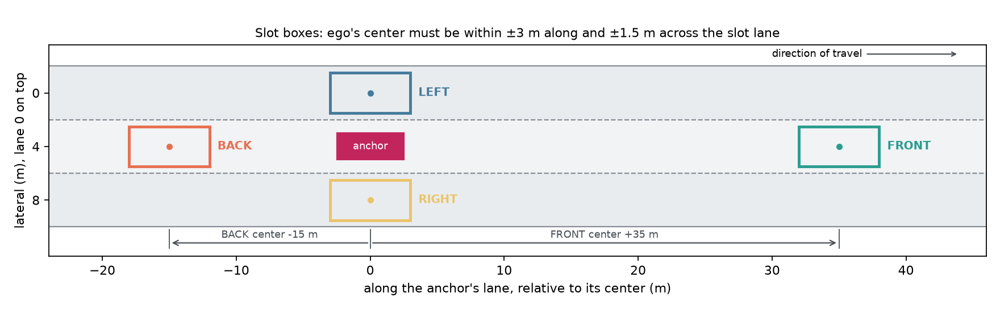
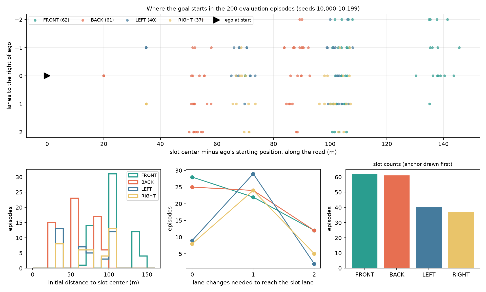
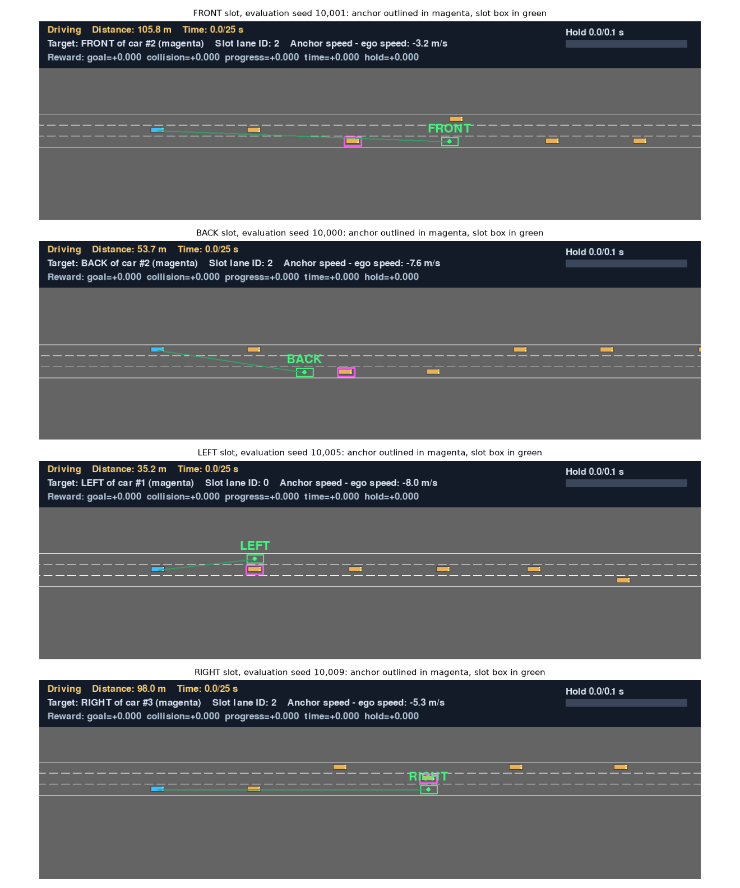
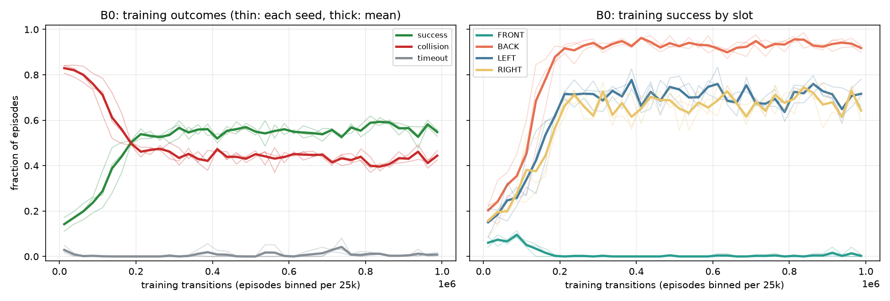
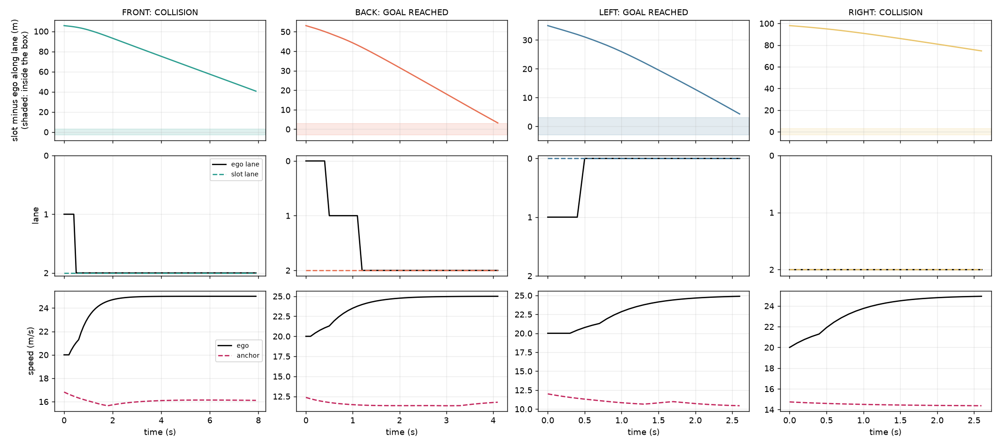
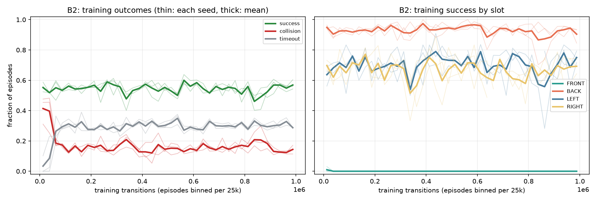
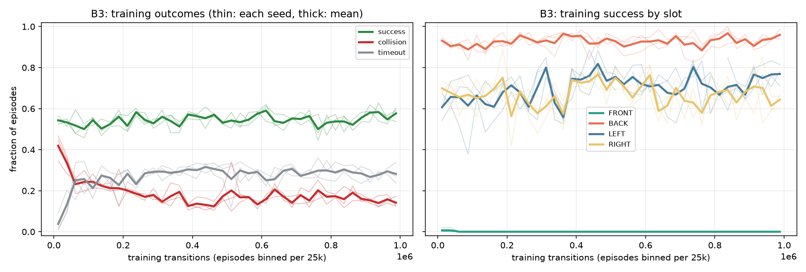

# Experiment notes: reaching a slot of a moving car

A living record of the dynamic-waypoint *reach* experiments. Each step is added at the end of
the [experiment log](#9-experiment-log), and every decision gets a line in the
[decision log](#10-decision-log). All numbers come from files in this folder.

**Status (2026-11-09, 15:00).** Steps 0–6 are done. Step 6 (B4, crash weight 150) did not reduce crashes; Step 7 is proposed and **waiting for review**. Since 2026-11-09 FRONT is set aside and the target is BACK/LEFT/RIGHT (138 of the 200 evaluation episodes).

| Arm | Change | Success | Crash | BACK/LEFT/RIGHT reached of 138 (seeds 7, 8, 9) | Main failure |
|---|---|---:|---:|---|---|
| B0 | Reward R0 = 50 × success | 55% | 44% | | Ramming: FRONT hits the anchor; elsewhere the lead car |
| B1 | Crash weight 0 → 50, trained from scratch | 1% | 1% | | Collapse: drives at 10 m/s and never reaches anything |
| B2 | B1, but training starts from B0's policy | 53% | 16% | | Gives up on FRONT entirely; same lead-car crashes as B0 |
| B3 | B2 + potential-based progress toward the slot | 56% | 14% | 113, 112, 112 | Still gives up on FRONT; rams a slower car in the slot's lane |
| B3m | B3 trained again on the Mac (IV: machine) | 56% | 14% | 111, 113, 110 | Same as B3 |
| B4 | Crash weight 50 → 150 | 52% | 16% | 113, 110, 89 | Same crashes as B3m; the critic prices them, the policy does not brake |
| Scripted | Rule-based driver, reads the true state | 76.5% | 2.5% | 113 | Waits behind a slower car until time runs out (22) |

- Step 5 (diagnosis, no training) found one failure mode on BACK/LEFT/RIGHT: a slower car in the slot's lane between ego and the slot. PPO drives into it; the scripted driver waits behind it.
- Example videos and figures for every stage: [`results/examples/README.md`](results/examples/README.md). Where to look for failures: [section 11](#11-investigating-failures-yourself).

## 1. Aim and working rules

**Aim.** Train PPO to drive ego into a slot (FRONT, BACK, LEFT or RIGHT) of a moving traffic
car. Start from the simplest reward and add to it step by step, so that every part of the
final design is backed by a measured effect.

**Rules.**

1. **One independent variable (IV) per comparison.**
   - An arm is defined in [`config.py`](config.py) as its parent arm plus exactly one changed setting.
   - [`ivcheck.py`](ivcheck.py) compares the saved configurations of two runs and refuses to train or compare them if anything else differs, including package versions and the machine.
2. **Paired replicates.**
   - Every arm trains on the same three seeds (7, 8, 9).
   - Every policy and every arm is measured on the same 200 evaluation episodes.
3. **A prediction before the results.** Each step states what we expect and why, before training starts.
4. **A reason for every decision**, recorded in the decision log.
5. **Failures stay.** No run is deleted or repeated to get a better number. `train.py` refuses to overwrite an existing run.
6. **Simple first.** No reward term is added without a measured failure that it addresses.

**Earlier work is context only.** The earlier study ([`../baseline_dynamic_waypoint/RESULTS.md`](../baseline_dynamic_waypoint/RESULTS.md)) used a different task (hold) and a different reward. Nothing here is concluded from comparing with it.

## 2. The task: reach

| | |
|---|---|
| Road | 3 straight lanes, each 4 m wide. Lane 0 is the leftmost. |
| Ego | Starts at 20 m/s. Makes one decision every 0.1 s (10 Hz). |
| Traffic | 8 IDM cars at 12–17 m/s. A 12 m/s lead car starts 35 m ahead of ego, in ego's lane. |
| Anchor | Chosen uniformly from the traffic cars 30–120 m ahead of ego. Its lane changes are switched off, so its LEFT/RIGHT slot never leaves the road. IDM still sets its speed. |
| Slot | Chosen uniformly from the slots that are on the road for the anchor's lane: no LEFT in lane 0, no RIGHT in lane 2. |
| Slot box | ±3 m along the slot lane, ±1.5 m across it (figure in section 3). The box moves with the anchor. |
| **Success** | **The first decision where ego's center is inside the box, without a crash.** Speed does not matter. |
| Episode end | Success or a crash ends the episode (a crash wins if both happen on the same decision). Reaching 25 s cuts it off as a timeout. If the anchor crashes or leaves the road, the episode is cut off as "anchor lost". |

In code, reach is the inherited hold task with `hold_seconds = 0.1`, which is one decision. The environment code is unchanged.

**Why reach before hold.**
- Holding is reaching plus staying.
- In the earlier study, the scripted driver succeeded equally often with 1 s and 5 s holds (76%), so arriving is the hard part.
- Step 0 confirms this: the same scripted driver reaches the slot in 76.5% of episodes.
- Holding will come back later as a one-IV step: `hold_seconds` 0.1 → 1.

## 3. Goals: sampling, geometry, and samples

**The four slots around one anchor, to scale.** A FRONT slot center is 35 m ahead of the anchor, a BACK slot center is 15 m behind it, and the LEFT and RIGHT slots sit beside it in the next lane:



**Where the goal starts in all 200 evaluation episodes**, relative to ego's starting position ([data](figures/goal_samples.json)):



**One real frame per slot at reset**, as the viewer draws it: ego in blue, the anchor outlined in magenta, the slot box in green.



What the samples show:

- **Slot counts:** FRONT 62, BACK 61, LEFT 40, RIGHT 37. LEFT and RIGHT are rarer because the anchor is drawn first, and an anchor in an edge lane has no slot on that side.
- **Distance:** the median initial distance to the slot center is FRONT 104 m, BACK 55 m, LEFT 70 m and RIGHT 72 m. FRONT is farthest because its slot sits 35 m beyond the anchor.
- **Lane changes needed:**

  | Slot | 0 | 1 | 2 |
  |---|---:|---:|---:|
  | FRONT | 28 | 22 | 12 |
  | BACK | 25 | 24 | 12 |
  | LEFT | 9 | 29 | 2 |
  | RIGHT | 8 | 24 | 5 |

- **The inherited lead car is the anchor in 51 of the 200 episodes (25%).**
  - It is always 12 m/s and always starts 35 m ahead in ego's lane.
  - That is why the top plot has tight clusters at 20 m (its BACK slot) and at 35 m one lane over (its LEFT/RIGHT slots).
  - These episodes are much easier: random actions succeed in 15 of 51 of them, against 8 of the other 149.
  - We keep this unchanged and report it, because it is part of the inherited task. Removing it would be its own IV.

## 4. Observation space (53 inputs, unchanged from the earlier study)

PPO's `MultiInputPolicy` flattens these into one vector of 53 numbers. Every entry, with its real value at reset on evaluation seed 10,000, is labelled in [`figures/observation_sample.md`](figures/observation_sample.md).

| Key | Size | What it holds | Scale | Why it is there |
|---|---:|---|---|---|
| `vehicles` | 7 × 5 | Ego and the 6 nearest cars (cars behind ego included): presence, x, y, vx, vy. Other cars are relative to ego. Ego's x is its progress since reset. | x / 200 m, y / 12 m, vx / 30 m/s, vy / 10 m/s, clipped to [-1, 1] | To see the traffic it must avoid. This is highway-env's standard `Kinematics` observation. |
| `achieved_goal` | 2 | Ego's position in the episode frame (origin: ego's start x, road y = 0) | / [200, 12] m | Inherited from the static-goal task |
| `desired_goal` | 2 | The slot's position in the same frame. It moves with the anchor. | / [200, 12] m | Inherited from the static-goal task |
| `goal_delta` | 2 | Slot minus ego | / [200, 12] m | Where the goal is, at long range |
| `anchor` | 4 | Anchor minus ego: x, y, vx, vy | Same as `vehicles`, clipped | How the goal moves |
| `slot` | 4 | One-hot: FRONT, BACK, LEFT, RIGHT | 0/1 | Which slot is the target |
| `hold_progress` | 1 | Decisions held in the box divided by decisions required | [0, 1] | **Does nothing in reach:** it is always 0 before success. Kept so that reach → hold later changes only one setting. |
| `slot_error` | 3 | Slot minus ego along the slot lane and across it, and anchor speed minus ego speed | / 10 m, / 4 m, / 10 m/s, clipped | Where the goal is, at short range: the ±3 m box spans ±0.3 here, against ±0.015 in `goal_delta` |

Known properties, recorded here, not changed:
- `achieved_goal` and `desired_goal` are redundant with `goal_delta` for a moving goal.
- `slot_error` saturates beyond 10 m along and beyond 4 m across. In the sample above, a slot two lanes away reads +1.0 (+4 m) instead of +8 m.
- Each of these is a candidate IV (section 8).

## 5. Action space

There are 5 discrete actions, one decision every 0.1 s:
- `LANE_LEFT` / `LANE_RIGHT` start a lane change, steered by highway-env's own controller.
- `FASTER` / `SLOWER` move the target speed one step on the grid 10, 12.5, …, 25 m/s.
- `IDLE` keeps the current targets.

## 6. Reward functions

### R0 (Step 1): success only

```text
r_t = 50 · [ego reached the slot box at decision t, without a crash]
```

[`config.py`](config.py) (`R0`) sets the inherited terms `collision`, `progress`, `time` and `hold` to weight 0. The environment is unchanged.

**Why this reward.**
- It is the scored outcome and nothing else, so there is no term to justify yet.
- The value 50 is Marcos's goal bonus. When a later arm turns on one of his terms at his weight, only that term changes, not also the overall scale.
- Within R0 alone the scale barely matters, because PPO normalizes advantages.

**What R0 implies.**
- A crash and a timeout both earn 0. The agent avoids crashing only when a crash would cost it the goal.
- The discount (γ = 0.99) still favors arriving sooner: a goal k decisions away is worth 50 · 0.99^k now.

### Marcos's reward, for reference: not used as a single arm

```text
r_t = 50 · success − 50 · crash + 0.1 · (previous distance − distance) − 0.05
```

- This is **not** highway-env's reward. Marcos wrote it for his fixed-point task, replacing highway-env's own reward, which is speed + right lane + crash for `highway-v0`.
- Compared with R0 it changes three terms at once, so it cannot be one comparison.
- If the evidence calls for them, its terms will be added one per step.

**A note for later shaping terms.**
- Shaping preserves the best policy only in the form `γ·Φ(s′) − Φ(s)` (Ng, Harada and Russell, 1999).
- The earlier study's "telescoping" terms used `Φ(s) − Φ(s′)`, which leaves out γ, so strictly they could change the best policy.
- Any shaping term added here will use the γ form.

## 7. Fixed protocol (the same for every arm)

**Training.**
- Stable-Baselines3 PPO with `MultiInputPolicy`, and separate 64-64 networks for the policy and the value function.
- Learning rate 3e-4; 256 steps × 3 environments = 768 transitions per update; batch 256; 5 epochs; γ 0.99; GAE λ 0.95; clip 0.2; entropy 0.01; value coefficient 0.5; gradient clip 0.5; CPU.
- 1,000,000 requested transitions, which becomes 1,000,704 with whole rollouts.
- Seeds 7, 8 and 9. Each run's 3 workers use seed, seed+1 and seed+2.
  - Checked 2026-11-09: a worker's sequence of starting layouts (traffic, anchor, slot) depends only on its seed, not on what the policy does. So runs 7 and 8 train on the same layout streams in 2 of their 3 workers (8 and 9), runs 8 and 9 likewise (9 and 10), and runs 7 and 9 in 1 (9). The replicates still differ in starting weights (from B2 on: B0_seed7/8/9), action sampling and minibatch order. They are therefore somewhat less independent than three fully separate runs, and the spread between seeds may understate the true run-to-run spread. Kept as it is: changing it now would change every later arm's protocol against its parent. Evaluation is not affected.

**Evaluation.**
- Episodes: seeds 10,000–10,199, with goals sampled exactly as in training (section 3).
- Policies, on identical episodes:
  - PPO with deterministic actions;
  - uniform random actions (a fixed random stream per episode);
  - the scripted driver from [`../baseline_dynamic_waypoint/scripted.py`](../baseline_dynamic_waypoint/scripted.py). It reads the true simulator state, so it is a yardstick, not a competitor.
- Automatic checks:
  - every episode has exactly one outcome;
  - its reward terms add up to its return;
  - all policies start from identical episodes.

**Metrics.**
- Success rate with a 95% Wilson interval.
- Crash, timeout and anchor-lost rates.
- The same broken down by slot.
- Time to reach (successes only) and final distance.

**Machine and packages.**
- B0 to B3: Windows 11, Intel (32 logical cores), Python 3.13.1.
- From B3m on (2026-11-09): macOS, Apple M1 Max, Python 3.12.13. The packages are the same on both.
- highway-env 1.12.1, gymnasium 1.4.0, stable-baselines3 2.9.2, torch 2.15.0, numpy 2.5.4.
- These are the versions of the lock file and of the earlier study's runs.
- The machine is part of every run's saved configuration, so `ivcheck` refuses to compare a Mac run with a PC run. The one exception is arm B3m, whose declared IV is the machine itself ([Step 5b](#step-5b-b3m-b3-repeated-on-the-mac)).
- Evaluation does not depend on the machine: the three PC-trained B3 policies, evaluated again on the Mac, give the same 1,800 rows as on the PC (`results/B3_seedN/evaluation_mac/`). Training may differ, which is what B3m measures.

## 8. Inherited settings and candidate IVs

Everything except the task and the reward is inherited unchanged from the earlier study's last runs.

| Setting | Value | Reason given when it was chosen | Still sound for reach? |
|---|---|---|---|
| Speed grid | 10–25 m/s in 2.5 m/s steps | A step also limits acceleration (about step / 0.6 s). With 1 m/s steps braking was too weak; with 5 m/s steps speeds could not be matched. Measured with the scripted driver. | Braking authority still matters; fine speed matching matters less for reach. |
| FRONT offset | 35 m | Once ego is ahead, the anchor's IDM follows it and pushes a closer slot away. That reason was about **holding**. | To re-check: a closer FRONT slot might be reachable once. |
| BACK offset | 15 m | Keeps the box clear of the anchor's 5 m body | Yes |
| Box | ±3 m along, ±1.5 m across | ±1.5 m excludes the neighbouring lane; ego moves at most about 1.5 m relative per decision, so it cannot skip the box | Yes |
| Episode length | 25 s | The same for every hold time | Yes; the scripted driver times out in 21% of episodes, mostly FRONT and RIGHT |
| Traffic | 12–17 m/s, plus a 12 m/s lead car 35 m ahead | Marcos's slow traffic: ego meets cars early | Yes. The lead car is the anchor in 25% of episodes (section 3). |
| Observation | 53 inputs | Earlier study sections 1–3 | Yes, with the redundancies noted in section 4 |
| PPO settings, 3 envs, 1M | See section 7 | Marcos's PPO settings; the 3 envs and 1M of the last runs | Not under test; it changes only if diagnostics point to optimization |

**Candidate IVs, deliberately not changed yet:**
- dropping redundant or inert inputs;
- drawing the slot before the anchor, which would balance the slot counts;
- the FRONT offset;
- removing the injected lead car;
- 4 environments instead of 3.

## 9. Experiment log

### Step 0: the task before any training

No training. Uniform random actions and the scripted driver were run on the 200 evaluation episodes. Files: [`results/step0_B0/`](results/step0_B0/).

| Policy | Success [95% CI] | Crash | Timeout | FRONT | BACK | LEFT | RIGHT | Time to reach |
|---|---:|---:|---:|---:|---:|---:|---:|---:|
| Uniform random | 11.5% [7.8, 16.7] | 79.0% | 9.5% | 2/62 | 12/61 | 5/40 | 4/37 | 6.2 s |
| Scripted | 76.5% [70.2, 81.8] | 2.5% | 21.0% | 40/62 | 58/61 | 32/40 | 23/37 | 7.5 s |

What this tells us:
- **R0's reward is seen by chance.** A freshly initialized PPO policy acts almost uniformly at random, so about one episode in nine pays the +50 from the start. The rate varies by slot: BACK 20%, LEFT 13%, RIGHT 11% and FRONT 3%.
- **The task is feasible with these actions**, as the scripted driver's 76.5% shows. FRONT is the hardest slot even for the scripted driver (40/62), and its failures are mostly timeouts.
- **Random actions mostly crash** (79%). Ego starts faster than all traffic and is heading toward a 12 m/s car 35 m ahead.
- **The lead-car episodes are easier**: random 15/51 versus 8/149 otherwise; scripted 51/51 versus 102/149.

### Step 1: B0, the root (reward R0)

- **Parent:** none. **IV:** none.
- **Configuration:** sections 2–7. Compared with the earlier study's last run, B0 differs in `goal_config.hold_seconds` (1.0 → 0.1) and in the reward weights; nothing else differs. A test checks this.
- **Runs:** `B0_seed7`, `B0_seed8`, `B0_seed9`, each 1,000,704 transitions.
- **Motivation:** establish what the simplest possible reward achieves, as the root of every later comparison.

**Prediction (written 2026-11-08, before training):**

1. **R0 learns.**
   - *Expected:* overall success clearly above random (11.5%) and below the scripted driver (76.5%); best guess 35–60%.
   - *Why:* the reward is seen in about 11% of episodes from the start, enough for PPO to find it.
2. **The slots rank in the order of their chance success rates.**
   - *Expected:* BACK highest (70% or more), LEFT and RIGHT in between, FRONT lowest (15% or less).
   - *Why:* random FRONT successes are rare (2/62), and FRONT needs a long overtake before any reward arrives.
3. **Crashes are the main failure overall.**
   - *Expected:* they fall far below random's 79%, but stay the largest failure category.
   - *Why:* under R0 a crash costs nothing beyond the missed goal, which is the same as a timeout. For FRONT, timeouts may dominate instead.
4. **The three seeds agree within about ±10 points** of overall success.

**First attempt, interrupted.**
- The first launch (12:50) ran inside the assistant's session and was killed at about 286k transitions when that session ended. It had saved no models.
- Its logs are kept in [`results/interrupted/`](results/interrupted/).
- The runs were restarted at 13:03 with identical settings, as detached processes.
- **Check of the restart:** the restarted runs reproduced every episode of the interrupted attempt exactly: 5,214, 5,404 and 5,404 episodes for seeds 7, 8 and 9. With the same seed on the same machine, training is fully deterministic.

**Results.** Files:
- per-seed folders: [`results/B0_seed7/`](results/B0_seed7/), [`results/B0_seed8/`](results/B0_seed8/), [`results/B0_seed9/`](results/B0_seed9/);
- summary: [`results/B0_summary.md`](results/B0_summary.md);
- crash analysis: `results/B0_seed*/crash_diagnosis.md`;
- rollouts: [`results/B0_seed7/rollouts/`](results/B0_seed7/rollouts/).

| Policy | Success [95% CI] | Crash | Timeout | FRONT | BACK | LEFT | RIGHT |
|---|---:|---:|---:|---:|---:|---:|---:|
| PPO B0, seed 7 | 57.0% [50, 64] | 42.5% | 0.5% | 0/62 | 58/61 | 32/40 | 24/37 |
| PPO B0, seed 8 | 53.0% [46, 60] | 47.0% | 0.0% | 1/62 | 57/61 | 27/40 | 21/37 |
| PPO B0, seed 9 | 55.5% [49, 62] | 43.5% | 1.0% | 0/62 | 58/61 | 29/40 | 24/37 |
| **PPO B0, mean ± sd** | **55.2% ± 2.0** | | | | | | |
| Uniform random | 11.5% [8, 17] | 79.0% | 9.5% | 2/62 | 12/61 | 5/40 | 4/37 |
| Scripted | 76.5% [70, 82] | 2.5% | 21.0% | 40/62 | 58/61 | 32/40 | 23/37 |

The random and scripted rows reproduce Step 0 exactly.



**The prediction, checked:**
1. **Correct:** 55.2% overall, inside the predicted 35–60%.
2. **Correct:** the slot order is BACK 93–95%, then LEFT 68–80% and RIGHT 57–65%, with FRONT at 0–1 of 62.
3. **Partly correct:** crashes are the failure (42.5–47%) and timeouts are near 0. **Wrong for FRONT**, where I expected timeouts: 60–61 of 62 FRONT episodes end in a crash.
4. **Correct:** the seeds agree within 4 points.

**What we learned.**
- **Without FRONT, R0 already matches the scripted driver.** BACK + LEFT + RIGHT successes are 114, 105 and 111 of 138 per seed, against 113 for the scripted driver, which reads the true state.
- **Learning plateaus by about 200k transitions.**
  - Training success is 54–55% between 200k and 400k, and 56–57% between 800k and 1M.
  - The training FRONT success briefly reaches about 10% near 100k, then falls to 0 as the policy commits to speed.
  - A larger budget is not what R0 is missing.
- **The behavior is one simple rule** (rollout traces below): move to the slot's lane at once, accelerate to the top speed (25 m/s), and never brake.
- **Every crash is a rear-end into a slower car directly ahead.** The crash replay matched the evaluation outcome in all 600 episodes.
  - **FRONT:** 58, 56 and 56 of 62 episodes end with ego hitting **the anchor itself**, at a median closing speed of 8–12 m/s, 6–8 s in. The slot is 35 m beyond the anchor in its own lane, and the policy drives at it straight through the car.
  - **BACK, LEFT, RIGHT:** 3–16 crashes per slot, almost all at about 2.6 s with about 13 m/s closing speed. This is ego at 25 m/s hitting the 12 m/s lead car that starts 35 m ahead.
- **Why R0 produces this:**
  - R0 pays only for arriving, and the discount pays more for arriving sooner. A crash costs nothing beyond the missed goal, so flat out is R0's best strategy wherever it usually works.
  - In FRONT episodes the return is 0 whatever the policy does. Nothing in R0 shapes FRONT behavior, so FRONT simply inherits the other slots' rule.



### Step 2: B1, adding the crash penalty

- **Parent:** B0. **IV:** `environment.reward_weights.collision`, 0 → 50. `ivcheck` confirmed this is the only difference from B0's runs.
- **Reward R1:** `r_t = 50 · [success at t] − 50 · [crash at t]`.
- **Motivation:** B0's only failure is crashing: 42–47% of episodes, nearly all rear-ending a slower car directly ahead, and in FRONT the anchor itself. R0 scores a crash exactly like a timeout, so nothing in the reward teaches the agent to avoid one. A crash penalty is also the first FRONT learning signal of any kind, since every FRONT return under R0 is 0.
- **Why 50:** it is Marcos's inherited crash weight, equal in size to the goal. Any other value would be an untested new choice.

**Alternatives considered, and why not now:**

| Alternative | Why not now |
|---|---|
| Progress shaping toward the slot | FRONT gets no reward signal, but progress toward the FRONT slot points *through* the anchor. Without a crash cost it would reinforce the measured failure. Revisit after B1. |
| Time penalty | There are no timeouts to fix (0–1%), and it would make an early crash relatively cheaper. |
| More training | B0 is flat from 200k to 1M. |
| PPO settings | PPO already equals the scripted driver on three slots. |
| Task changes (FRONT offset, the lead car) | They change the problem rather than how it is learned. They stay candidate IVs. |

**Prediction** (formed at 13:48 before B1 was launched, written here before any B1 result):
1. **Crashes:** the crash rate falls far below B0's 42–47%, to under 20%.
2. **Timeouts:** they appear (B0: 0–1%), mainly in FRONT. Avoiding the anchor without a way past it means following it until time runs out.
3. **BACK/LEFT/RIGHT:** success is at least B0's, i.e. 105 or more of 138 per seed. The early lead-car crashes should become successes, since slowing down or changing lanes still leaves time to reach the slot. Some extra caution may add a few timeouts.
4. **FRONT:** success stays low, 10 or fewer of 62 per seed. The penalty tells ego what not to do, not how to get ahead of the anchor and merge back.
5. **Overall success:** between B0's 55% and B0 + 10 points.

**Runs.**
- The first launch at 13:49 failed after about 25 s on all three seeds. The training workers died without an error message, all at the same moment. That attempt is kept in [`results/interrupted/`](results/interrupted/).
- A smoke run of B1 then trained normally, so the configuration is not the cause.
- The runs were relaunched unchanged at 13:51.

**Interim finding during training: B1 collapses (training logs at 80–260k transitions, all three seeds).**
- From about 20–40k transitions onward, every training episode is a timeout: 0 crashes, 0 successes, and every episode runs the full 250 decisions.
- The agent stopped crashing by stopping driving toward goals altogether. Every slot is ahead of ego, so slowing below traffic speed guarantees a return of 0.
- **This contradicts predictions 3 and 5** (prediction 2, timeouts appearing, held, far more than expected).
- **Why it happens:**
  - The starting policy is close to uniform random, which crashes in 79% of episodes and succeeds in 11.5% (Step 0).
  - Under R1, trying is worth about 0.115 · 50 − 0.79 · 50 ≈ −34, while giving up is worth 0.
  - PPO finds the safe policy long before it can learn to reach safely, and once there, exploration rarely produces a success.
- *Context only:* the earlier study's 62–90% timeouts with Marcos's reward (`RESULTS.md` section 2) look like the same mechanism.
- B1 continues to 1M transitions, to measure whether it ever recovers.

**Results (1M transitions).** Files:
- per-seed folders: `results/B1_seed*/`;
- summary: [`results/B1_summary.md`](results/B1_summary.md);
- rollouts: [`results/B1_seed7/rollouts/`](results/B1_seed7/rollouts/).

| Policy | Success [95% CI] | Crash | Timeout | FRONT | BACK | LEFT | RIGHT |
|---|---:|---:|---:|---:|---:|---:|---:|
| PPO B1, seed 7 | 0.5% [0, 3] | 1.0% | 98.5% | 0/62 | 1/61 | 0/40 | 0/37 |
| PPO B1, seed 8 | 3.5% [2, 7] | 1.5% | 95.0% | 0/62 | 7/61 | 0/40 | 0/37 |
| PPO B1, seed 9 | 0.0% [0, 2] | 0.5% | 99.5% | 0/62 | 0/61 | 0/40 | 0/37 |
| **PPO B1, mean ± sd** | **1.3% ± 1.9** | | | | | | |

**What happened.**
- **B1 never recovers.** Training success is 0 for more than 900k of its 1M transitions.
- **The behavior** (rollouts, seed 7, all four slots): ego slows from 20 m/s to the minimum 10 m/s within 3 s and stays there. All traffic drives at 12–17 m/s, so every slot moves away, and episodes end 60–220 m short.
- **It is not a lack of exploration.** The policy's entropy stays at 0.84–1.04 nats (the maximum is 1.61), but random actions from a 10 m/s policy almost never reach a slot.

**The prediction, checked:**
1. **Correct:** crashes fell to 0.5–1.5%.
2. **Correct, far beyond what was expected:** timeouts appeared, in 95–99.5% of episodes.
3. **Wrong.**
4. **Correct only trivially:** FRONT is 0, like everything else.
5. **Wrong:** overall success was 1.3%, not 55–65%.

**Lesson.** A crash penalty as large as the goal, introduced from scratch, makes giving up the best policy within reach of a random start. The penalty itself is not the problem; the moment it meets the policy is.

### Step 3: B2, starting B1's training from B0's policy

- **Parent:** B1. **IV:** `init_policy`, None (random weights) → `B0`.
  - The policy and value networks start from B0's trained weights on the same seed; the optimizer starts fresh.
  - Reward (R1), task, PPO settings and budget are all B1's.
  - The run checked its configuration against B1's *defined* configuration (`--parent-in-progress`), because B1 had not saved its sidecars yet. It will be re-checked with `ivcheck` against the saved sidecars when B1 finishes.
- **Decided at 13:57 on B1's training logs, before B1 finished.** The collapse was complete and identical on all three seeds for 60–200k transitions.
- **Motivation:**
  - The B0 policy already reaches the slot in 55% of episodes, so under R1 trying is worth about 0.55 · 50 − 0.45 · 50 ≈ +5 from the first update, not −34.
  - The crash penalty can then teach the policy to avoid crashes rather than to stop driving.
  - This builds the policy step by step, the same way the reward is built: learn to reach under R0, then learn not to crash under R1.
  - What this IV includes, stated plainly: B2's starting point carries B0's 1M transitions of experience.

**Alternatives considered, and why not now:**

| Alternative | Why not now |
|---|---|
| Potential-based progress shaping (prepared in [`environment.py`](environment.py) and tested) | For any fixed policy it leaves the advantages unchanged: the shaped value is the old value minus Φ(s), which cancels in the advantage. The incentive to give up stays. It helps only through how the critic generalizes, so it is not a fix for the collapse. Kept for FRONT later. |
| A smaller crash penalty | Trying beats giving up from a random start only if the penalty is below about 7. That value would be picked to make this calculation work, and it keeps most of B0's risky driving. |
| A higher entropy coefficient | More exploration does not change the fact that giving up is worth more than trying. |
| Removing the injected lead car | It causes most early crashes, but removing it changes the task, not how the task is learned. |

**Prediction** (written at 13:59, before any B2 result):
1. **No collapse:** training success stays at or above 40% throughout, starting from B0's level of about 55%.
2. **Crashes:** below 20% in evaluation, against B0's 42–47%.
3. **BACK/LEFT/RIGHT:** success at least B0's, i.e. 105 or more of 138 per seed. Their crashes were mostly early rear-ends into the lead car, which braking avoids with time to spare.
4. **FRONT:** crashes into the anchor turn into timeouts (following the anchor), and FRONT success stays at 10 or fewer of 62 per seed. Under R1 every FRONT episode of the B0 policy costs −50, so the quickest fix is to stop pursuing FRONT.
5. **Overall:** 50–65% success, crashes under 20%, and most other episodes FRONT timeouts. Far above B1 if B1 stays collapsed.

**Runs.**
- A first B2 launch at 13:58 was refused by the one-IV guard, because B1 had no saved sidecars yet. It did not train.
- The runs were relaunched at 13:58 with `--parent-in-progress`.
- **Re-check after B1 finished:** `ivcheck B1_seedN B2_seedN` finds exactly one difference on every seed, `init_policy: <missing> → 'B0'`.

**Results (1M transitions).** Files:
- per-seed folders: `results/B2_seed*/`;
- summary: [`results/B2_summary.md`](results/B2_summary.md);
- crash analysis: `results/B2_seed*/crash_diagnosis.md`.

| Policy | Success [95% CI] | Crash | Timeout | FRONT | BACK | LEFT | RIGHT |
|---|---:|---:|---:|---:|---:|---:|---:|
| PPO B2, seed 7 | 53.0% [46, 60] | 16.0% | 31.0% | 0/62 | 51/61 | 31/40 | 24/37 |
| PPO B2, seed 8 | 56.5% [50, 63] | 12.5% | 31.0% | 0/62 | 58/61 | 31/40 | 24/37 |
| PPO B2, seed 9 | 48.5% [42, 55] | 20.5% | 31.0% | 0/62 | 51/61 | 26/40 | 20/37 |
| **PPO B2, mean ± sd** | **52.7% ± 4.0** | | | | | | |
| B0, for reference (same seeds) | 57.0 / 53.0 / 55.5% | 42.5 / 47.0 / 43.5% | 0.5 / 0 / 1.0% | 0 / 1 / 0 | 58 / 57 / 58 | 32 / 27 / 29 | 24 / 21 / 24 |



**The prediction, checked:**
1. **Correct:** no collapse. Training success stays between 46% and 60% throughout.
2. **Mostly correct:** crashes are 16.0%, 12.5% and 20.5%, against B0's 42.5%, 47.0% and 43.5%.
3. **Wrong.**
   - BACK + LEFT + RIGHT successes are 106, 113 and 97 of 138, against B0's 114, 105 and 111.
   - Crashes in those slots are 32, 25 and 41, against B0's 24, 33 and 27.
   - No improvement.
4. **Correct:** FRONT is 0/62 on every seed. **All 62 FRONT episodes time out**, where B0 crashed into the anchor in 60–61 of them.
5. **Mostly correct:** 53.0%, 56.5% and 48.5% (one seed just under 50%), far above B1's 1.3%.

**What we learned.**
- **The whole drop in crashes, 44% → 16%, comes from abandoning FRONT.** The curves show it: within the first 60k transitions crashes fall by the size of the FRONT share and timeouts rise by the same amount. FRONT success is 0 throughout.
- **BACK/LEFT/RIGHT crashes are unchanged in kind and in number.** They are still the same early rear-end into the 12 m/s lead car, at about 2.6 s and about 13 m/s closing speed.
- **Why they persist** (a hypothesis that fits the evidence, not yet tested):
  - The policy still explores: its entropy stays at 1.1–1.15 nats throughout.
  - Even so, the BACK/LEFT/RIGHT training crash rate is flat: 23% → 20%, 23% → 17% and 20% → 20% between the first and last 100k transitions.
  - Under R1 a crash costs exactly what a success pays. When the alternative to flooring it is a timeout (0), flooring it is worth taking whenever it succeeds more often than it crashes. **R1 itself tolerates up to about 50% crash risk** in those episodes.
  - So the remaining crashes look like the risk R1 accepts, not a failure to explore.
- **Paired by seed, B2 minus B0:** success −4.0, +3.5 and −7.0 points; crashes −26.5, −34.5 and −23.0 points.

### Step 4: B3, adding potential-based progress (option A below, approved 2026-11-08)

The two candidates are kept below as they were proposed. Option A was approved, and B stays a candidate.

- **Parent:** B2. **IV:** `environment.reward_weights.potential_progress`, absent → `{"weight": 0.1, "gamma": 0.99}`.
- Everything else is B2's, including `init_policy = B0`.
- **Reward R3:**

  ```text
  r_t = 50 · success − 50 · crash + 0.1 · (0.99 · Φ(s_{t+1}) − Φ(s_t))
  Φ(s) = −(distance to the slot center, m);  Φ = 0 once the episode has ended (success or crash)
  ```

- The term is implemented in [`environment.py`](environment.py) and tested:
  - with the term off, the environment is identical to the inherited one;
  - with it on, the discounted sum of the term over a finished episode is exactly 0.1 × the initial distance, whatever the car does.
- **Prediction:** as written for option A below.

**Runs.**
- Launched at 15:12.
- **At 15:43 all three runs received a console interrupt (`^C` in their logs), seconds after Windows logged a session transition (Kernel-Power event 566 at 15:42:50).**
  - Seeds 7 and 9 lost their environment workers at about 727k transitions. Their status is `failed`; they are kept in [`results/interrupted/`](results/interrupted/).
  - Seed 8 had finished training (`trained`, 1,000,704 transitions) but was interrupted during evaluation.
- **The same cause explains B1's failed first launch.** Event 566 was logged at 13:49:21, and those workers died about 10 s later. Other session transitions that day (13:20, 13:30, 14:10, 15:00, 15:31) did no harm.
- **Fix** ([`train.py`](train.py), `ignore_console_interrupts`): the learner and every environment worker now ignore console Ctrl+C and Ctrl+Break. Detached runs are stopped with `taskkill` instead. This does not change anything that is computed.
- **Recovery:**
  - Seed 8's saved model was evaluated with the unchanged measurement into its own folder.
  - Seeds 7 and 9 were relaunched at 15:46. Training is deterministic, so their first 727k transitions should repeat the interrupted attempt exactly; this is checked below.
- **The relaunch failed too, and the cause is not the code.**
  - The relaunched seeds 7 and 9, and seed 8's evaluation, all died about 9 s after starting (15:46:27), with no `^C`.
  - A 60-second test script, also launched detached, died after 4 s (15:49:47).
  - Windows logged no crash, no resource exhaustion and no session event at those moments, so the processes were terminated from outside.
  - Kill times since 15:42 were 15:42:50, 15:46:27 and 15:49:47. Before 15:42, runs survived for 40+ minutes.
  - Another session was training a GPU notebook on this machine at the time; commit memory stood at 56 of 65.8 GB. No transcript shows any session issuing a kill.
  - The cause is still unknown.

- **What works:** a single evaluation launched as a background job *inside* the assistant's session (15:52–15:56) ran to completion.
  - Seed 8's evaluation is that run.
  - Seeds 7 and 9 were relaunched the same way at about 15:57.
  - The second attempt's models and logs are in `results/interrupted/*_attempt2/`. Its result folders, at most about 9 s of logging, were deleted by mistake before being moved.

**Interim evidence from training logs** (sampling policy, not the evaluation): seed 8 to 1M; seeds 7 and 9 to about 727k from the interrupted attempt.
- FRONT training success is **0.00 on all three seeds from 50k transitions onward**: FRONT episodes end in timeouts 81–97% of the time, and the rest are crashes.
- BACK/LEFT/RIGHT training success is 73–82%, with crashes at 18–25%, the same range as B2.
- So by the training logs, progress shaping did **not** get PPO to the front spot within 1M transitions.

**Reproducibility check:** the relaunched seeds 7 and 9 repeated every episode of the interrupted first attempt exactly (7,024 and 6,972 episodes). Ignoring console signals did not change anything that is computed.

**Results (1M transitions, all three seeds).** Files:
- per-seed folders: `results/B3_seed*/`;
- summary: [`results/B3_summary.md`](results/B3_summary.md);
- crash analysis: `results/B3_seed*/crash_diagnosis.md`.

| Policy | Success [95% CI] | Crash | Timeout | FRONT | BACK | LEFT | RIGHT |
|---|---:|---:|---:|---:|---:|---:|---:|
| PPO B3, seed 7 | 56.5% [50, 63] | 13.5% | 30.0% | 0/62 | 58/61 | 31/40 | 24/37 |
| PPO B3, seed 8 | 56.0% [49, 63] | 14.0% | 30.0% | 0/62 | 58/61 | 32/40 | 22/37 |
| PPO B3, seed 9 | 56.0% [49, 63] | 15.5% | 28.5% | 0/62 | 58/61 | 31/40 | 23/37 |
| **PPO B3, mean ± sd** | **56.2% ± 0.3** | | | | | | |
| B2, for reference (same seeds) | 53.0 / 56.5 / 48.5% | 16.0 / 12.5 / 20.5% | 31.0% each | 0 / 0 / 0 | 51 / 58 / 51 | 31 / 31 / 26 | 24 / 24 / 20 |



**The prediction, checked:**
1. **FRONT above 0 (at least 5/62 on at least two seeds): wrong.** FRONT is 0/62 on every seed, and training FRONT success is 0 from 50k to 1M.
2. **BACK/LEFT/RIGHT unchanged within about 5: wrong, in the better direction.**
   - B3 reaches 113, 112 and 112 of 138, against B2's 106, 113 and 97.
   - That is B0's level (114, 105, 111) and the scripted driver's (113).
3. **"Possibly more FRONT crashes": correct, but small.** There are 2, 2 and 5 FRONT crashes (B2: 0), slow bumps into traffic about 9–10 s in. The other 57–60 FRONT episodes time out.

**What we learned.**
- **Progress shaping did not open FRONT.** Under every reward so far the car either rams the anchor (R0) or gives up (R1, R1 + shaping). It never once completes the overtake and merge in evaluation. That points at the maneuver itself, which is long and has to happen in traffic, rather than at the reward.
- **Shaping may have made BACK/LEFT/RIGHT learning more consistent.**
  - BACK is 58/61 on every seed (B2: 51, 58, 51), and the spread of overall success across seeds fell from ±4.0 to ±0.3 points.
  - Paired by seed, B3 minus B2: success +3.5, −0.5 and +7.5 points.
  - With three seeds this is a hint, not an established effect.
- **The early lead-car rear-ends remain.** BACK/LEFT/RIGHT crashes are 25, 26 and 26 per seed, the same kind as before. That is consistent with R1's risk tolerance (Step 3), which option B would test.

### Proposed Step 5 (2026-11-08; not run, see the Step 5 below)

The user set FRONT aside on 2026-11-09, so option A below was not run. The three options stay as they were written. Option B (crash weight) comes back as the proposal for Step 6.

Three reward variants have not produced a single FRONT success, so the next step should **find out what blocks FRONT** before adding more reward terms. One IV from B3 in each case:

**A (recommended): FRONT slot 35 m → 15 m ahead of the anchor** (`goal_config.slot_offsets.front`).
- **What it tests:** whether the length of the maneuver is the barrier. FRONT would then mirror BACK at 15 m; the pass and the merge are still required, but ego only has to get 15 m ahead rather than 35 m.
- **Why the offset can change:** the 35 m value was chosen for *holding*, because the anchor's driver pushes a close slot away (section 8, already flagged to re-check). It is the same "easier version first" idea as reach before hold.
- **This does change the task for FRONT**, which earlier steps avoided. The reason for it now is diagnosis.
- **Reading the result:**
  - if FRONT becomes learnable, grow the offset back toward 35 m;
  - if it does not, the pass-and-merge itself is the barrier, and the next candidate is starting from a policy that imitates the scripted driver (40/62 on FRONT).
- **Prediction:** FRONT success above 0 (at least 5/62 on at least two seeds); BACK/LEFT/RIGHT unchanged within 5.

**B: crash weight 50 → 150.** Unchanged from Step 4. It targets the BACK/LEFT/RIGHT crashes and tests R1's risk tolerance.

**C: start from a policy that imitates the scripted driver.** It is the most direct route to FRONT, but it adds a new component (collecting demonstrations and supervised pretraining), so it should come after A has shown where the barrier is.

Two candidates. Each is one IV from B2, and both keep `init_policy = B0`, like their parent.

**A (recommended): add potential-based progress toward the slot.**
- Setting: `reward_weights.potential_progress = {"weight": 0.1, "gamma": 0.99}`. The weight is Marcos's progress scale; γ is PPO's.
- **Target: FRONT**, the largest gap. It is 31% of episodes, with 0 successes against the scripted driver's 40/62.
- The term does not change the best policy (section 6), so any change is in what PPO manages to find.
- **To be honest about its odds:** for an exact critic it leaves the advantages unchanged. It acts through the critic and GAE (λ = 0.95), giving immediate per-step credit before the critic has learned.
  - If it does nothing for FRONT, that is informative: FRONT would then need a curriculum or demonstrations rather than reward shaping.
- **Prediction:** FRONT success above 0 (at least 5/62 on at least two seeds); BACK/LEFT/RIGHT unchanged within about 5; possibly more FRONT crashes.

**B: crash weight 50 → 150.**
- A crash would then cost 3× the goal, so a gamble is worth taking only at better than 3:1 odds.
- **Target: the BACK/LEFT/RIGHT crashes.** It directly tests the risk-tolerance explanation above.
- **Prediction:** BACK/LEFT/RIGHT crashes under 10%, with somewhat fewer successes there and more timeouts.

**Why A first:**
- FRONT is the larger loss: about 31 points of episodes, against about 14 for the BACK/LEFT/RIGHT crashes.
- B mostly turns crashes into timeouts, while A is the only candidate aimed at new successes.

### Step 5: what still fails on BACK/LEFT/RIGHT (diagnosis, no training; 2026-11-09)

**Change of focus (decided by the user on 2026-11-09).**
- FRONT is set aside for now: it is the hardest slot, and three reward variants left it at 0.
- The target is BACK/LEFT/RIGHT: fewer failures there, and a clear lead over the scripted driver.
- Nothing in the task changes. FRONT is still sampled in training and evaluation and still reported.
- **Primary metric from here on:** success on the 138 BACK/LEFT/RIGHT episodes among the same 200 evaluation episodes.
- The proposal above (A: FRONT offset 35 → 15 m) is therefore not run. A, B and C stay as candidates.

**What the saved evaluation rows already showed (read on 2026-11-09, before this step's script existed).**
- On the 138 episodes B3 reaches 113, 112 and 112; the scripted driver reaches 113.
- The three seeds fail the *same* episodes: 108 episodes succeed for all three seeds and the scripted driver, and 24 episodes crash on all three seeds.
- 18 of those 24 share two columns of the evaluation table: `lane_changes_required = 0` and the anchor is not the lead car. The slot is then 67–107 m ahead in ego's own lane, with the 12 m/s lead car in between.
- On the other 111 episodes B3 succeeds in 310 of 333 seed-episodes (93%) and the scripted driver in 102 of 111 (92%).

**Hypothesis.** BACK/LEFT/RIGHT is learned except when a slower car sits in the slot's lane between ego and the slot ("blocked"). B3 rams that car; the scripted driver waits behind it until the time runs out. Getting past a blocker is the pass-and-merge that FRONT needs, in a shorter form.

**Method.** A new script, [`blocked.py`](blocked.py), with no training:
1. **Tag** each of the 200 evaluation episodes at reset as *blocked* or *clear*. Blocked: at least one car is in the slot's lane, ahead of ego and behind the slot center. The tag depends only on the episode, not on any policy.
2. **Join** the tag with the saved evaluation rows of every arm, every seed and the scripted driver.
3. **Probe** B3: replay it and record, per episode, the critic's value at reset, the actions of the first 2 s and, for crashes, which car was hit.

**Prediction (written 2026-11-09, before `blocked.py` was run; the tag did not exist yet):**
1. At least 20 of the 24 episodes that fail on all three B3 seeds are blocked.
2. On clear BACK/LEFT/RIGHT episodes B3 succeeds at least 95% of the time and at least as often as the scripted driver.
3. B3 does not react to the blocker: its actions in the first 2 s are the same mix in blocked and clear episodes, and when it crashes in a blocked episode, the car it hits is the blocker.
4. The critic does know: its value at reset is clearly lower in blocked episodes than in clear ones (the 53 inputs include the nearest cars).

**One more probe, added after the first results (prediction written 2026-11-09 13:31, before `blocked.py brake` existed).**
The results below show that B3 never brakes behind a blocking car. So: how much is braking alone worth?
- *Probe:* replay B3 unchanged, but override its action with the scripted driver's following rule (`scripted.py`, the three lines on `leader_gap`): when the gap to the car ahead in ego's lane is below 12 m + 0.8 s × ego speed, the target speed may not exceed the anchor's speed (10 m/s below a 9 m gap). Lane choice stays B3's. This is not an arm and nothing is trained; it is B3 plus one hand-written rule, a ceiling for "learn to brake".
- *Prediction:* 116–120 of 138 BACK/LEFT/RIGHT episodes on every seed (B3: 113, 112, 112; scripted: 113). BACK/LEFT/RIGHT crashes fall from 25, 26, 26 to 5 or fewer. Where the blocking car stays in its lane, success stays at about 2 of 19 (the failures turn from crashes into timeouts), because braking does not pass anything.
- *If it holds:* braking removes the crashes but adds only a few successes; a clear lead over the scripted driver needs passing.

**Check first: is the measurement the same on this Mac?** Yes.
- The PC-trained `B3_seed7/8/9` were re-evaluated here with the unchanged `evaluate.py` into `results/B3_seedN/evaluation_mac/`.
- All 1,800 rows (3 runs × 3 policies × 200 episodes) have the same outcome and the same length as the PC's rows. One PPO episode that fails on both machines (seed 7, episode 10085) ends 0.25 m apart.
- So a difference between a PC run and a Mac run is a *training* difference, not an evaluation difference.

**Results** (files in [`results/step5_blocked/`](results/step5_blocked/)).

*1. The tag* ([`summary.md`](results/step5_blocked/summary.md), [`episodes.csv`](results/step5_blocked/episodes.csv)). Of the 138 BACK/LEFT/RIGHT episodes, 93 are clear and 45 are blocked. All 62 FRONT episodes are blocked by definition (the anchor is between ego and the slot). Three seeds added up:

| BACK/LEFT/RIGHT | Episodes | B0 | B2 | B3 | Scripted |
|---|---:|---:|---:|---:|---:|
| clear | 93 | 263/279 (94%) | 247/279 (89%) | 269/279 (96%) | 87/93 (94%) |
| blocked | 45 | 67/135 (50%) | 69/135 (51%) | 68/135 (50%) | 26/45 (58%) |

- Blocked episodes have been at 50% since B0. The crash penalty (B2) and the progress term (B3) did not move them.
- B3's failures are all crashes (77 of 77). The scripted driver's 25 failures are 22 timeouts and 3 crashes.

*2. What B3 does in blocked episodes* ([`probe_B3.md`](results/step5_blocked/probe_B3.md), [`passing_B3.md`](results/step5_blocked/passing_B3.md)). The replay reproduces the saved evaluation on all three seeds.
- In all 27 blocked episodes with the slot in ego's own lane, B3 drives straight ahead with FASTER. Ego reaches the 12 m/s lead car after 2.6 s.
- **Success is decided by the blocking car, not by ego.** Other cars change lane by their own model (MOBIL); the anchor never does.

| Blocking car (seeds 7, 8 / seed 9) | Episodes | Reached | Crashed into it | Crashed into another car |
|---|---:|---:|---:|---:|
| stays in its lane | 19 | 2 / 2 | 17 / 17 | 0 / 0 |
| leaves its lane by itself | 26 | 21 / 20 | 1 / 2 | 4 / 4 |

- Ego passes a blocking car that is still in its lane in **0 of 45** episodes, on every seed.
- The two successes with a staying blocker (10082, 10158) are not passes either: that car is faster than the anchor and drives past the slot before ego arrives.
- B3 almost never brakes. Episodes with at least one SLOWER, clear / blocked: seed 7 35/93 and 12/45; seed 8 0/93 and 0/45; seed 9 1/93 and 2/45.
- The 10 failures in clear episodes are the same thing a moment later: a slow car moves into the slot's lane after reset and ego drives into it at 22–25 m/s. In 10030 and 10109 it is the 12 m/s lead car, which changes into the slot's lane at the same time as ego; in 10084 it is a car from the middle lane. The other two (10018, 10039; seed 8 only) hit the anchor at 25 m/s next to the slot.

*3. The critic sees it; the actor does not act on it.*
- Value at reset with the shaping removed, clear / blocked: 26.6 / 0.8, 21.8 / −7.6, 28.2 / 3.2. It separates clear from blocked with AUC 0.85–0.88 and reached from failed with AUC 0.93–0.94.
- In episode 10106 the value jumps from about 0 to 22 at the moment the lead car leaves ([figure](results/examples/B3_seed7/back_seed10106.png)). So it reads the car, not only the geometry.
- It does not price the crash itself: 0.1 s before ramming the blocker the mean value is −8.6, −22.0 and −9.2, against −50 for the crash.
- **For the agent, ramming and giving up are worth the same.** In blocked episodes ramming succeeds half the time: 50 × ½ − 50 × ½ ≈ 0, the same as a timeout. That is why B2 gave up on FRONT (ramming there is clearly negative) but kept ramming here.

*4. The four predictions.*

| # | Prediction | Result |
|---|---|---|
| 1 | At least 20 of the 24 all-seed failures are blocked | **Holds:** 22 of 24 |
| 2 | Clear: B3 at least 95% and at least the scripted driver | **Holds:** 96.4% (90, 89, 90 of 93) against 87 of 93 |
| 3a | Same first-2-s actions in blocked and clear episodes | **Not testable as written.** Clear episodes need a lane change far more often, so the action mix differs for that reason alone. What can be said is above: no braking and no passing. |
| 3b | Blocked crashes hit the blocker | **Holds:** 20/22, 20/22, 21/23 hit a car tagged at reset |
| 4 | Value at reset clearly lower in blocked episodes | **Holds:** AUC 0.85–0.88 |

The "who gets out of whose way" table was not predicted. It was built after the probe showed the 50% split, so it is a description, not a test.

*5. The braking what-if* ([`brake_B3.md`](results/step5_blocked/brake_B3.md)). B3 with the scripted driver's following rule laid over it:

| Seed | B3: reached / crash / timeout | B3 + rule: reached / crash / timeout | Scripted |
|---|---|---|---|
| 7 | 113 / 25 / 0 | 113 / 3 / 22 | 113 / 3 / 22 |
| 8 | 112 / 26 / 0 | 112 / 6 / 20 | 113 / 3 / 22 |
| 9 | 112 / 26 / 0 | 112 / 5 / 21 | 113 / 3 / 22 |

- **The success prediction failed:** 113, 112, 112 instead of 116–120. Braking gains 3–4 blocked episodes and loses 3–4 others, where ego now waits behind a slow car that B3 used to get past in time.
- The crash prediction holds on seeds 7 and 9 (3 and 5) and misses by one on seed 8 (6). The "blocking car stays" prediction holds (3 of 18 reached; 12–13 become timeouts).
- **B3 on seed 7 plus this one rule has the same outcome as the scripted driver in all 138 episodes** (133 and 136 of 138 on seeds 8 and 9). So after 3 arms PPO has learned the scripted driver's lane choice and full speed, without its following rule.
- What I got wrong: I counted the crashes that braking removes and forgot that B3's small lead in clear episodes (90 against 87) comes from the same missing rule.

**Reading.**
- BACK/LEFT/RIGHT has one failure mode: a slower car in the slot's lane between ego and the slot, at reset or a few seconds later.
- B3 and the scripted driver reach the same 113 episodes. They differ in how the rest end: B3 crashes (25), the scripted driver waits (22 timeouts, 3 crashes). **On safety B3 is worse than the scripted driver, not better.**
- Braking is worth about 20 fewer crashes and no extra success. A lead over the scripted driver in success needs **passing**: about 22 episodes end behind a slower car for both.
- Passing a blocker is the FRONT maneuver in a shorter form, so progress here is also progress toward FRONT.

**The examples for this step** are indexed in [`results/examples/README.md`](results/examples/README.md); see "Investigating failures yourself" below.

### Step 5b: B3m, B3 repeated on the Mac

- **Parent:** B3. **IV:** `platform` (the machine, its operating system and its Python version, which change together). No setting changes: `arm_config("B3m")` is B3's configuration, and training starts from the same three PC-trained `B0_seedN.zip` files (their hashes are in the sidecars).
- **Why:** later arms are trained here, and `ivcheck` refuses a child whose machine differs from its parent's. B3m is the parent they can be compared with. It also measures how far two trainings of the same arm differ when only the machine changes, which is the noise floor for reading later arms.
- **Prediction** (in the approved plan, written before training started at 13:16): overall success within 5 points of B3 on every seed; FRONT stays at 0 of 62.
- Tests added: a machine arm has exactly its parent's configuration; with IV `platform`, machine differences pass and any other difference is refused.

**Results** (trained 13:16–13:47 on 2026-11-09; [`B3m_summary.md`](results/B3m_summary.md)).

- `ivcheck B3_seedN B3m_seedN --iv platform` passes on all three seeds and lists only `platform.*` (machine, node, processor, Python, OS release, system).
- The automatic evaluation checks pass on all three seeds.

| Seed | B3 overall | B3m overall | B3 BACK/LEFT/RIGHT | B3m BACK/LEFT/RIGHT | Same outcome, episode by episode | FRONT (B3m) |
|---|---:|---:|---:|---:|---:|---:|
| 7 | 56.5% | 55.5% | 113 | 111 | 134 of 138 | 0/62 |
| 8 | 56.0% | 56.5% | 112 | 113 | 135 of 138 | 0/62 |
| 9 | 56.0% | 55.0% | 112 | 110 | 134 of 138 | 0/62 |

- **The prediction holds:** within 1 point overall on every seed, and FRONT stays at 0.
- By tag, summed over seeds: clear 266/279 (B3: 269), blocked 68/135 (B3: 68). The same 24 BACK/LEFT/RIGHT episodes fail on all three seeds in both arms.
- The episodes that differ (seed 7: 10064, 10094, 10194 lost and 10109 gained; seed 8: 10109 lost, 10018 and 10039 gained; seed 9: 10034, 10106, 10119 lost, 10136 gained) are all crashes or reaches against a car in the slot's lane, the same kind as before.
- The training curves ([figure](results/B3m_learning_curves.png)) are flat from about 200k transitions on: success about 55%, crash about 15%, timeout about 30% (FRONT). Training longer would not change the picture; B2 and B3 look the same.
- The braking what-if gives the same answer as for B3 ([`brake_B3m.md`](results/step5_blocked/brake_B3m.md)): reached / crash / timeout with the following rule 111/5/22, 112/4/22, 113/3/22, against the scripted driver's 113/3/22.
- Examples: [`results/examples/B3m_seed7/`](results/examples/B3m_seed7/), the watch list plus the changed episodes 10064, 10094 and 10109. All 73 recorded episodes so far match the saved evaluations.

**What this gives later steps.**
- B3m is the parent for every arm trained on the Mac.
- **A noise floor.** Two trainings of the same arm differ in 3–4 of the 138 BACK/LEFT/RIGHT episodes per seed (between seeds of one arm: 131–137 of 138 the same). A change of 1–3 successes per seed is noise; an effect should be larger than about 5 per seed and in the same direction on all three seeds.

### Step 6: B4, crash weight 50 → 150 (option A below, approved 2026-11-09; prediction failed)

The user approved option A on 2026-11-09 and noted two limits, which the prediction below already expects:
- it should lower the crash rate, but it cannot teach **passing**, which many failures need;
- in some episodes the slower car never leaves, so waiting behind it ends in a timeout whatever the crash weight.

Arm `B4` in [`config.py`](config.py): parent B3m, IV `environment.reward_weights.collision` 50 → 150, `init_policy = B0` as in the parent. Training started 14:03 on the Mac, seeds 7, 8, 9 in parallel. The proposal and prediction below were written before training and are kept as they were.


**Goal of this stage (the user's, 2026-11-09):** on BACK/LEFT/RIGHT, first be as safe as the scripted driver, then better than it.

**Where we are (B3m, mean of three seeds, 138 episodes):** reached 111 (scripted 113), crashes 27 (scripted 3), timeouts 0 (scripted 22).

**Why a reward change, and why this one.**
- Step 5 shows the policy can tell a blocked episode from a clear one (critic AUC 0.85–0.88) but does not act on it. At crash weight 50 ramming and waiting are worth about the same to it, and the training crash rate on these slots stays near 20% for the whole 1M transitions in B2, B3 and B3m.
- Waiting is actually the better choice even now: the scripted driver, which only waits, reaches 26 of 45 blocked episodes; B3 reaches 23 per seed by ramming and crashes in the rest. PPO does not find it because it almost never brakes, and nothing in R3 makes a crash much worse than a timeout.

**Proposal A (recommended): crash weight 50 → 150** (`environment.reward_weights.collision`).
- Parent B3m; everything else B3m's, including `init_policy = B0` and potential-based progress.
- A crash then costs 3× the goal. Ramming with even odds is worth about −40 instead of about 0, and waiting (0, or +50 when the car leaves) becomes clearly better.
- **Prediction** (written before any training):
  - BACK/LEFT/RIGHT crashes at most 10 of 138 on every seed (now 25–28);
  - BACK/LEFT/RIGHT success 105–116 per seed (now 110–113): fewer lucky rams, a few more successes after waiting;
  - the freed episodes mostly become timeouts;
  - FRONT stays 0/62, with fewer FRONT crashes;
  - B3m + the following rule (the braking what-if) is the ceiling for this step: about 112 reached, 4 crashes.
- **Risk:** B1 (crash 50, trained from scratch) collapsed into crawling at 10 m/s. Starting from B0 with progress shaping, clear episodes are still worth +45 or so per episode, so I expect no collapse there; if success on clear episodes drops below 85/93 on two seeds, I read it as the collapse coming back.
- **What it will not do:** beat the scripted driver in success. Both would end about 22 episodes behind a slower car.

**Alternatives (each one IV from B3m):**
- **B: entropy coefficient 0.01 → 0.03.** More random actions while training, aimed at finding the pass. It does not address the crashes, and the pass is long (pull out, overtake, merge back), so random exploration is unlikely to find it.
- **C: train without FRONT** (sample only BACK/LEFT/RIGHT; FRONT still evaluated). FRONT is 31% of training episodes with no success. This changes the training task, so it needs your decision; it may also speed up B/L/R learning, which is already flat.
- **D: an input for the car ahead in ego's lane at a local scale** (gap ÷ 30 m and closing speed, as the scripted driver uses).
  - The policy does see the blocker: in 10002 and 10045 (B3m seed 7) its `vehicles` row is present, in ego's lane (y = 0) and closing at 13 m/s (vx −0.44) from the first step. P(SLOWER) stays at 1–9% the whole way, and the policy picks FASTER every step until the crash at 2.6 s.
  - But the rows use a ±200 m range: the last 30 m before the crash move the input only from 0.17 to 0.03. This is the same problem `slot_error` fixed for the slot in the earlier study (±3 m was ±0.015 of `goal_delta`).
  - Against it: the critic reads the blocker well enough (AUC 0.85–0.88), so the signal is usable. A new input also changes the network's input size, so B0's weights cannot be loaded as they are (the new input's weights would have to start at zero).

**After Step 6:** with a safe base, the next target is **passing** a slower car, which is where a lead over the scripted driver must come from (about 22 episodes) and is FRONT in a shorter form. Candidates then: C, a reward for overtaking the blocker, or starting from a policy that imitates the scripted driver's lane choice.

**Results** (trained 14:03–14:30 on 2026-11-09; [`B4_summary.md`](results/B4_summary.md), [learning curves](results/B4_learning_curves.png)).

- `ivcheck B3m_seedN B4_seedN` passes on all three seeds: the only difference is `environment.reward_weights.collision: 50.0 -> 150.0`. Every crash row in training and evaluation carries −150.

| Seed | B3m BACK/LEFT/RIGHT reached / crash / timeout | B4 reached / crash / timeout | Same outcome as B3m | B4 overall |
|---|---|---|---:|---:|
| 7 | 111 / 27 / 0 | 113 / 25 / 0 | 132 of 138 | 56.5% |
| 8 | 113 / 25 / 0 | 110 / 28 / 0 | 135 of 138 | 55.0% |
| 9 | 110 / 28 / 0 | 89 / 29 / 20 | 100 of 138 | 44.5% |

**The prediction failed.**
- Crashes on BACK/LEFT/RIGHT: 25, 28, 29 per seed, not "at most 10". Blocked episodes: 66 crashes of 135, against 67 for B3m.
- Success: 113 and 110 on seeds 7 and 8 (inside 105–116), but 89 on seed 9, where the policy turned timid on RIGHT (8 of 37 reached, 14 timeouts) without crashing less.
- The training curves show no change either: the crash rate on BACK/LEFT/RIGHT stays at 20–30% for the whole 1M transitions, as in B3m.

**What the probe shows** ([`probe_B4.md`](results/step5_blocked/probe_B4.md), [`passing_B4.md`](results/step5_blocked/passing_B4.md), [`brake_B4.md`](results/step5_blocked/brake_B4.md)):
- **The critic learned the new price; the actor did not change.** Value at reset in blocked episodes (shaping removed): −5.4, −49.6, −26.7 (B3: 0.8, −7.6, 3.2). Just before ramming: −12.5, −70.2, −39.6. Yet the policy's sampling probability of SLOWER behind the blocking car is 6.8%, 0.5%, 6.5% (B3: 10.7%, 1.0%, 0.2%). Passes: 0, 0, 1 of 45.
- **Holding back is almost never experienced in training.** Of about 6,300 BACK/LEFT/RIGHT training episodes per seed, about 30 end in a timeout and about 1,460 in a crash (B3m: 4–25 timeouts).
- **Holding back is physically easy.** In episode 10002 (fixed action scripts from reset): no braking crashes at 3.6 s; one SLOWER at the start and then IDLE reaches the slot at 17.2 s; braking at any time in the first 1.5 s avoids the crash (timeout). The scripted driver reaches it with 17 SLOWER decisions in the first 3 s.
- The braking what-if no longer gives the scripted driver's outcomes: with the following rule, seeds 7 and 9 reach only 83 and 70 (55 and 54 timeouts). Their policies mostly choose IDLE and do not accelerate again once the rule has slowed them. Seed 8 (mostly FASTER) gives 110 / 4 / 24, as before.

**Reading.**
- The incentive was not the missing piece. A crash is now clearly worse than waiting, and the critic knows it, but PPO's updates do not move the policy to the simple behavior that avoids it.
- Two explanations fit and are not yet separated:
  1. *Representation.* The blocking car is the same lead car that starts 35 m ahead in every episode; what differs is only whether the slot is in ego's lane. FASTER is right in the two thirds of episodes where ego leaves the lane, and the car rows are on a ±200 m scale, so lowering FASTER in blocked states may also lower it where it is needed.
  2. *Credit assignment.* Avoiding the crash needs one early SLOWER and then no FASTER for a few seconds. With FASTER sampled 18–70% of the time behind the blocker, that sequence is rare, and a single SLOWER followed by FASTER still crashes and gets blamed.
- Raising the penalty further would not help for the same reason.
- **Lane changes show the same trap** (B4 seed 9, deterministic replay, checked 2026-11-09). In 10051 and 10139 ego pulls out of the slot's lane and comes back within about 0.5 s, five or six times (`L--R--L--R…`), always still behind the blocking car, and crashes at 3–4 s. A pass needs about 4 s in the next lane at 20–25 m/s against 12 m/s; each single lane change followed by the usual "return to the slot's lane" gains nothing, so it is never reinforced. In 10045 (ego and slot in lane 0) it chooses LANE_LEFT 36 times, which does nothing in the leftmost lane, and crashes at 20 m/s.

### Proposed Step 7 (waiting for review)

One IV from B4 (crash weight 150 stays; each arm still starts from B0's weights). Two candidates that act on the policy rather than the reward:

**A (recommended): a safety shield, the scripted driver's following rule, enforced in training and evaluation.**
- Setting: `environment.shield = "following"`. When the car ahead in ego's lane is closer than 12 m + 0.8 s × speed, FASTER is replaced by IDLE, and SLOWER is forced while the target speed is above the allowed one (the rule in `blocked.py brake`). The agent learns from its own sampled action; the executed action and every override are logged.
- **Why:** it removes the failure PPO could not learn its way out of, so training experience shifts to being behind a slow car with time left. From there a pass needs a lane change and FASTER, a short sequence that the policy already samples (lane changes 4–30% of decisions behind the blocker), unlike the long "hold back" sequence.
- **What it changes:** part of the behavior becomes a hand-written rule, so the agent is "policy + shield". This is the standard shielding approach in safe RL. Both the shielded agent and, as a diagnostic, the policy alone are evaluated.
- **Prediction:** BACK/LEFT/RIGHT crashes at most 8 per seed; reached at least 113 (the scripted driver) on at least two seeds; passes of a blocking car that stays in its lane in at least 5 of 45 blocked episodes on at least two seeds; FRONT at most 10 of 62.

**B: an input for the car ahead in ego's lane at a local scale** (gap ÷ 30 m and closing speed ÷ 10 m/s, clipped to ±1).
- Tests explanation 1 directly and keeps everything learned.
- The network input grows from 53 to 55; B0's weights are loaded with zero weights for the new inputs, so the starting policy is unchanged.
- **Prediction:** BACK/LEFT/RIGHT crashes at most 15 per seed and SLOWER behind the blocker above 20%; passing not expected.

**Not proposed now:** a larger entropy coefficient (raises every action's probability, not the sequence that matters); starting from a policy that imitates the scripted driver (a new component; it would also copy the never-pass behavior).

Nothing is trained for Step 7 until it is chosen.


## 10. Decision log

| Date | Decision | Reason |
|---|---|---|
| 2026-11-08 | Restart the dynamic-waypoint study as a chain with one IV per comparison | Meeting notes; the earlier study changed several settings per step, so effects could not be separated |
| 2026-11-08 | Study reach before hold (`hold_seconds` 0.1) | Arriving is the hard part (scripted: 76% for 1 s and 5 s holds alike) |
| 2026-11-08 | Root reward R0 = 50 × success | Simplest reward equal to the scored outcome; 50 matches Marcos's scale for later one-term additions |
| 2026-11-08 | Marcos's reward is not one arm | It differs from R0 in three terms; each can be added alone later. It is also not highway-env's reward. |
| 2026-11-08 | Keep every other setting inherited, unchanged | Changing them would add IVs to the root. They are listed as candidate IVs (section 8). |
| 2026-11-08 | 3 paired seeds; 200 fixed evaluation episodes with natural goal sampling; Wilson intervals | The earlier study used 1–2 seeds and 50 episodes; per-slot counts of 8 were too small to compare |
| 2026-11-08 | `ivcheck.py` checks every run against its parent and its sibling seeds | Makes the one-IV rule enforced by code rather than by memory |
| 2026-11-08 | Rollout episodes: for each slot, the first evaluation seed with that slot (10,001 FRONT, 10,000 BACK, 10,005 LEFT, 10,009 RIGHT) | Fixed before training, so examples are not picked for their outcome |
| 2026-11-08 | Launch training as detached processes | The first B0 launch died when the assistant's session ended |
| 2026-11-08 | Add `diagnose.py`, a crash replay | Choosing the next IV needs to know *what* fails, not only how often |
| 2026-11-08 | Step 2 = B1: crash weight 0 → 50 | B0 fails only by rear-end crashes, and R0 scores a crash like a timeout. Alternatives are listed under Step 2. |
| 2026-11-08 | Add an optional potential-based progress term (`environment.py`); keep it unused for now | It is ready for FRONT later. Tests show that with the term off, the environment is identical to the inherited one, and that it telescopes exactly when on. `train.py` requires its γ to equal PPO's. |
| 2026-11-08 | Step 3 = B2: `init_policy` None → B0, decided on B1's training logs | B1 collapsed to giving up on all seeds. Starting from a policy that already reaches makes trying worth more than giving up. Alternatives are listed under Step 3. |
| 2026-11-08 | `ivcheck` treats a setting that older sidecars lack as its default (None) | `init_policy` was added after B0 and B1 were saved. Any real value is still a difference. |
| 2026-11-08 | B1 recorded as a collapse (1.3% success at 1M) | It never recovers. Kept as the evidence for why the crash penalty needs a policy that already reaches. |
| 2026-11-08 | B2 recorded: crashes fall only by abandoning FRONT | FRONT 62/62 timeouts; BACK/LEFT/RIGHT crashes unchanged, consistent with R1's ~50% risk tolerance |
| 2026-11-08 | Step 4 not launched; A (progress shaping, for FRONT) recommended over B (crash 150) | B2 finished after the 2:30 PM autonomy window. FRONT is the larger gap. |
| 2026-11-08 | Step 4 = B3 (option A), approved by the user; launched 15:12 | `ivcheck` against B2's saved sidecars: the only difference is the new term |
| 2026-11-08 | Training ignores console Ctrl+C/Ctrl+Break | Two batches died right after Windows session transitions (13:49 and 15:42) delivered a console interrupt. This changes nothing computed. |
| 2026-11-08 | After 15:46, launch runs as background jobs inside the assistant's session | Detached processes kept being terminated from outside (cause unknown); in-session jobs completed |
| 2026-11-08 | B3 recorded: FRONT still 0; BACK/LEFT/RIGHT back to the scripted level | Progress shaping does not open FRONT within 1M transitions |
| 2026-11-08 | Step 5 proposed: A (FRONT offset 35 → 15 m) recommended, as a diagnosis | Three reward variants left FRONT at 0; first find whether the maneuver's length is the barrier |
| 2026-11-09 | FRONT set aside; primary metric = success on the 138 BACK/LEFT/RIGHT evaluation episodes | The user's decision: FRONT is the hardest slot and three reward variants left it at 0. Nothing in the task changes; FRONT is still sampled and reported. |
| 2026-11-09 | Work continues on the Mac; arm B3m repeats B3 here with declared IV `platform` | `ivcheck` refuses a Mac child of a PC parent. B3m gives later arms a parent trained on the same machine. Evaluation was first shown to be identical on both machines (1,800 of 1,800 rows). |
| 2026-11-09 | Step 5 is a diagnosis without training: `blocked.py` (tag, probe, passing, brake) | The saved rows showed the same 24 episodes failing on every seed; first find out why |
| 2026-11-09 | A fixed watch list of 10 evaluation episodes, recorded for every stage by `examples.py` | The user asked for saved examples per stage. The same episodes for every stage show a change in the same situation. Chosen from the tag, before any recording. |
| 2026-11-09 | The recording loop of `document.py rollouts` moved into `record_episode`, shared with `examples.py` | One recorder, not two. Re-running `rollouts` for B0 and B1 gives the committed traces (largest difference 3e-15). |
| 2026-11-09 | The braking what-if is reported as a probe, not as an arm | It is B3 plus a hand-written rule. It bounds what "learn to brake" can give; it is not a trained policy. |
| 2026-11-09 | B3m kept as the parent for Mac arms | It matches B3 within 1 point per seed; the same 24 episodes fail. It also sets the noise floor: 3–4 of 138 episodes per seed change between two trainings of one arm. |
| 2026-11-09 | Step 6: crash weight 50 → 150 from B3m, arm B4 (approved by the user; alternatives kept: entropy, no FRONT in training, a car-ahead input) | Step 5: the policy tells blocked from clear but ramming and waiting are worth the same to it; the braking what-if shows safety can be bought without losing success. Passing is the next target after it. |
| 2026-11-09 | B4 result: the prediction failed; crashes unchanged | Kept as a failure. The critic learned the higher price but the policy did not change; the incentive was not the missing piece. |
| 2026-11-09 | `blocked.py` reads the crash weight from the arm's configuration in its report text | The probe and passing reports said "a crash is −50", wrong for B4. Numbers were unaffected. |
| 2026-11-09 | Step 7 proposed from B4: a following-rule shield (recommended) or a local car-ahead input | Both act on the policy rather than the reward. Waiting for the user's choice. |
| 2026-11-09 | B3m and B4 example videos re-recorded; the recorder now refuses a blank frame | They had been recorded with `SDL_VIDEODRIVER=dummy`, which makes the renderer return all-black frames. Outcomes were right (the check compares outcomes, not pictures), the videos were not. All 86 videos re-checked frame by frame; the value axis label now shows the run's own crash weight. |

## 11. Investigating failures yourself

Everything below is a file in this folder; commands run from the repository root.

| Question | Where to look |
|---|---|
| Which episodes fail, for which stage and seed? | [`results/step5_blocked/episodes.csv`](results/step5_blocked/episodes.csv): one row per evaluation episode (column `seed` is the episode). Slot, lanes, the blocked tag, the blocking car's gap and speed, and one outcome letter (S reached, C crash, T timeout, L anchor lost) per run and for the scripted driver. Sort or filter it in a spreadsheet. |
| The failing BACK/LEFT/RIGHT episodes of the newest arm, as a list | [`results/step5_blocked/failures.md`](results/step5_blocked/failures.md) |
| How do blocked and clear episodes end, per arm and slot? | [`results/step5_blocked/summary.md`](results/step5_blocked/summary.md) |
| The same situations under every stage, with video | [`results/examples/README.md`](results/examples/README.md): the watch list, one row per episode, one column per stage |
| What happened in one episode? | `results/examples/<run>/<slot>_seed<episode>.mp4` (video) and `.png` (frames, then slot error, lanes, speeds, gap to the car ahead, actions and critic value per step). The numbers behind the figure are in `results/examples/<run>/traces.json`. |
| Does the blocking car leave, does ego pass it, what does the critic say? | `results/step5_blocked/passing_<ARM>.md` and `.json`, `probe_<ARM>.md` and `.json` |
| What would braking alone change? | `results/step5_blocked/brake_<ARM>.md` and `.json` |
| Raw numbers per episode | `results/<run>/evaluation_episodes.csv` (filter `policy == ppo` and `success == 0`) |
| Which car was hit, where, when? | `results/<run>/crash_diagnosis.md` and `.json` (B0 to B2), and the `crash_kind` fields of `probe_<ARM>.json` |
| Learning over time, per slot | `results/<ARM>_learning_curves.png`, `results/<run>/training_episodes.csv` |

```bash
# Watch one episode live in a window (close it to stop; --speed 0.5 is half speed):
.venv/bin/python -B baseline_dynamic_reach/examples.py show B3_seed7 --episode 10002
.venv/bin/python -B baseline_dynamic_reach/examples.py show scripted --episode 10002

# Record any episodes of any run (video, figure and trace into results/examples/<run>/), then refresh the index:
.venv/bin/python -B baseline_dynamic_reach/examples.py record B3_seed8 --episodes 10018 10039
.venv/bin/python -B baseline_dynamic_reach/examples.py index

# After a new arm is evaluated: refresh the tables, then record its watch list and up to 3 changed episodes.
.venv/bin/python -B baseline_dynamic_reach/blocked.py tag
.venv/bin/python -B baseline_dynamic_reach/examples.py record B3m_seed7 --changed
```

**Where to start.**
- Blocked episode, the blocking car stays: `B3_seed7/back_seed10002` (crash at 2.6 s), next to `scripted/back_seed10002` (reaches at 11.4 s).
- The same start, but the blocking car leaves by itself after 1.1 s: `B3_seed7/back_seed10106`. Compare the value curves of the two figures.
- A car moves into the slot's lane after reset: `B3_seed7/right_seed10084`. Ego commands LANE_RIGHT 68 times in the rightmost lane and never brakes; the value drops only 1.4 s before the crash.
- Reached although the blocking car stayed: `B3_seed7/right_seed10082`.

**Limits to keep in mind.**
- Videos and figures are of training seed 7 only; the three letters in the index are seeds 7, 8, 9. Record another seed with `record B3_seed8 ...`.
- Every recorded episode is checked against its row in the saved evaluation; the index reports the count and any mismatch.
- "Blocked" is measured at reset. A car that moves into the slot's lane later is tagged clear (10030, 10084, 10109).

