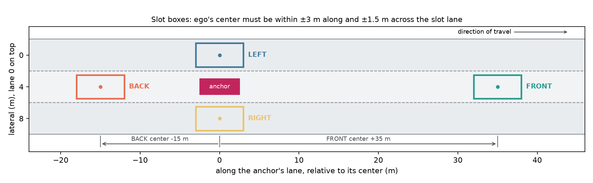
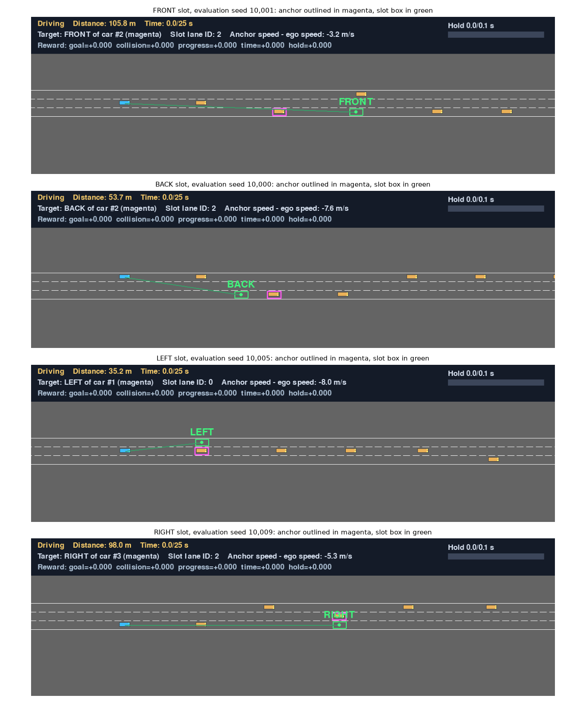
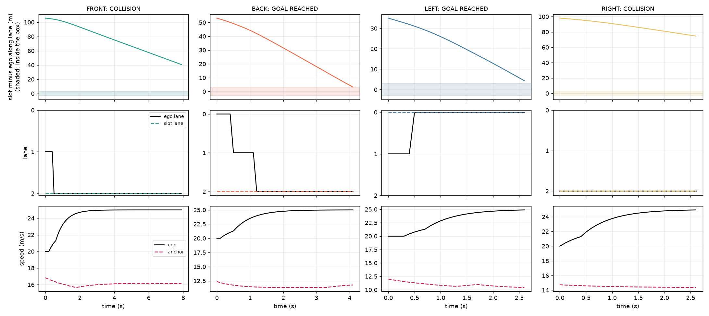

# Experiment notes: reaching a slot of a moving car

A living record of the dynamic-waypoint *reach* experiments. Each step is added at the end of
the [experiment log](#9-experiment-log), and every decision gets a line in the
[decision log](#10-decision-log). All numbers come from files in this folder.

**Status (2026-11-15, evening).** Step 7a: training audit; B5 fixed a gradient-clip throttle without changing outcomes. Steps 7b–7e on the passing task (blocked episodes, slow car held in its lane): P1 learned to pass once and gave up; P1s, P2 and P3 (mixed practice starts) give up from the start. Cause: from fresh weights most attempts crash, and with crash = −goal stopping is learned first (B1's collapse). Step 7f (success-only reward first, then the crash cost, as B0 → B2): **P4 passes** (34–50% of the natural-start passing episodes, scripted 2.5%) but crashes in the rest; **P5** (crash cost from P4's policy) passes in 62–64% on seeds 7 and 8 and reaches 119 and 121 of 138 BACK/LEFT/RIGHT on the full task, the first arms above the scripted driver's 113 (seed 9 ends in a checkpoint dip). **P6** (full task from P5's policy) reaches 123–134 of 138 BACK/LEFT/RIGHT on every seed (scripted 113) and 41–48 of 62 FRONT on two seeds (scripted 40); crashes remain, mostly on FRONT. Since 2026-11-09 FRONT is set aside. **Step 7h (2026-11-18, held-out episodes 40,000–40,199, no training):** P6's own success is unchanged on fresh episodes (±1.6 points) and it beats B5 on every seed (significant); only seed 7 beats the scripted driver beyond noise, while seeds 8 and 9 match it in success and crash 5–6× as often. **Step 8 (planned 2026-11-18):** a staged grid to settle network width, training order (no practice / practice / practice with easy starts / the original P4→P5→P6) and reward (crash cost 0–2 × progress on/off), scored as reached − crash. Step 8-0 (training speed on the PC) is done: training is bit-identical with today's code, and up to 32 runs at once give 2.3× the old throughput. **8a:** 64-64 is kept (256-256 missed the bar). **8b:** the rule chooses no practice (N), and the original order (O) scores highest within noise, so both got the reward grid. **8c and 8c2 (2026-11-19):** across 12 rewards per order, none beats success only (c0w0) by the rule; P6's reward (c1w01) scores highest in both orders. **8d:** the winner is no practice with crash 0.5 and a small time cost (N_c05w0t1). It is level with every other crash-cost recipe, including P6's, and below the scripted driver on the final test (−0.146, p 0.029). The whole gap is FRONT, where runs give up or crash. **8e (2026-11-20):** 256 wide and 3M more training (round 4) for three finalists on all 8 seeds. By the bars written beforehand nothing changes (64-64, 6M, N_c05w0t1). But 256 removes the FRONT give-up (13 → 2 of 24 runs), makes the original order beat no practice, and O_c1w0t4 at 256 and 9M is above the scripted driver on every seed (+0.797 against +0.725, selection episodes). Its learning curves are flat over the last 1M at both widths, so no further round; at 256 the original order already reaches that level by the end of its practice rounds (4M). **8f (2026-11-22), 500 fresh episodes:** the 256-wide original-order recipe (O_c1w0t4, 6M) beats the 64-wide winner by +0.177 (p 0.006, ahead on 8 of 8), without more crashes and with no seed giving up, so it is adopted as the Step 8 recipe. It is level with the scripted driver (+0.033, p 0.16): it reaches far more but crashes about four times as often, mostly on FRONT (23% against 4%). **8g (2026-11-23, diagnosis):** 91% of those FRONT crashes are rear-ends at full speed (25 m/s, 12 m/s faster than the car hit, almost never braking). It passes but does not brake, which is the B chain's old failure moved to FRONT. **Step 9 (2026-11-23, consecutive goals, evaluation only, adopted recipe):** chaining breaks in every condition. Later goals score about 0.4 below the first, because the model reaches each slot at full speed and then rams a car right after the switch; with the same car, it also cannot drop back to a slot behind. With a new car the scripted driver drops too (0.25, by timing out), so the model's own part there is about 0.16; with the same car the scripted driver does better on later goals, so the whole drop is the model's. Every attempt so far has its own page in [`attempts/`](attempts/README.md).

| Arm | Change | Success | Crash | BACK/LEFT/RIGHT reached of 138 (seeds 7, 8, 9) | Main failure |
|---|---|---:|---:|---|---|
| B0 | Reward R0 = 50 × success | 55% | 44% | | Ramming: FRONT hits the anchor; elsewhere the lead car |
| B1 | Crash weight 0 → 50, trained from scratch | 1% | 1% | | Collapse: drives at 10 m/s and never reaches anything |
| B2 | B1, but training starts from B0's policy | 53% | 16% | | Gives up on FRONT entirely; same lead-car crashes as B0 |
| B3 | B2 + potential-based progress toward the slot | 56% | 14% | 113, 112, 112 | Still gives up on FRONT; rams a slower car in the slot's lane |
| B3m | B3 trained again on the Mac (IV: machine) | 56% | 14% | 111, 113, 110 | Same as B3 |
| B4 | Crash weight 50 → 150 | 52% | 16% | 113, 110, 89 | Same crashes as B3m; the critic prices them, the policy does not brake |
| Scripted | Rule-based driver, reads the true state | 76.5% | 2.5% | 113 | Waits behind a slower car until time runs out (22) |

- Step 5 (diagnosis, no training) found one failure mode on BACK/LEFT/RIGHT: a slower car in the slot's lane between ego and the slot. PPO drives into it; the scripted driver waits behind it.
- Example videos and figures for every stage: [`results/examples/README.md`](results/examples/README.md). Where to look for failures: [section 11](#11-investigating-failures-yourself).

## 1. Aim and working rules

**Aim.** Train PPO to drive ego into a slot (FRONT, BACK, LEFT or RIGHT) of a moving traffic
car. Start from the simplest reward and add to it step by step, so that every part of the
final design is backed by a measured effect.

**Rules.**

1. **One independent variable (IV) per comparison.**
   - An arm is defined in [`config.py`](config.py) as its parent arm plus exactly one changed setting.
   - [`ivcheck.py`](ivcheck.py) compares the saved configurations of two runs and refuses to train or compare them if anything else differs, including package versions and the machine.
2. **Paired replicates.**
   - Every arm trains on the same three seeds (7, 8, 9).
   - Every policy and every arm is measured on the same 200 evaluation episodes.
3. **A prediction before the results.** Each step states what we expect and why, before training starts.
4. **A reason for every decision**, recorded in the decision log.
5. **Failures stay.** No run is deleted or repeated to get a better number. `train.py` refuses to overwrite an existing run.
6. **Simple first.** No reward term is added without a measured failure that it addresses.

**Earlier work is context only.** The earlier study ([`../baseline_dynamic_waypoint/RESULTS.md`](../baseline_dynamic_waypoint/RESULTS.md)) used a different task (hold) and a different reward. Nothing here is concluded from comparing with it.

## 2. The task: reach

| | |
|---|---|
| Road | 3 straight lanes, each 4 m wide. Lane 0 is the leftmost. |
| Ego | Starts at 20 m/s. Makes one decision every 0.1 s (10 Hz). |
| Traffic | 8 IDM cars at 12–17 m/s. A 12 m/s lead car starts 35 m ahead of ego, in ego's lane. |
| Anchor | Chosen uniformly from the traffic cars 30–120 m ahead of ego. Its lane changes are switched off, so its LEFT/RIGHT slot never leaves the road. IDM still sets its speed. |
| Slot | Chosen uniformly from the slots that are on the road for the anchor's lane: no LEFT in lane 0, no RIGHT in lane 2. |
| Slot box | ±3 m along the slot lane, ±1.5 m across it (figure in section 3). The box moves with the anchor. |
| **Success** | **The first decision where ego's center is inside the box, without a crash.** Speed does not matter. |
| Episode end | Success or a crash ends the episode (a crash wins if both happen on the same decision). Reaching 25 s cuts it off as a timeout. If the anchor crashes or leaves the road, the episode is cut off as "anchor lost". |

In code, reach is the inherited hold task with `hold_seconds = 0.1`, which is one decision. The environment code is unchanged.

**Why reach before hold.**
- Holding is reaching plus staying.
- In the earlier study, the scripted driver succeeded equally often with 1 s and 5 s holds (76%), so arriving is the hard part.
- Step 0 confirms this: the same scripted driver reaches the slot in 76.5% of episodes.
- Holding will come back later as a one-IV step: `hold_seconds` 0.1 → 1.

## 3. Goals: sampling, geometry, and samples

**The four slots around one anchor, to scale.** A FRONT slot center is 35 m ahead of the anchor, a BACK slot center is 15 m behind it, and the LEFT and RIGHT slots sit beside it in the next lane:



**Where the goal starts in all 200 evaluation episodes**, relative to ego's starting position ([data](figures/goal_samples.json)):


**One real frame per slot at reset**, as the viewer draws it: ego in blue, the anchor outlined in magenta, the slot box in green.



What the samples show:

- **Slot counts:** FRONT 62, BACK 61, LEFT 40, RIGHT 37. LEFT and RIGHT are rarer because the anchor is drawn first, and an anchor in an edge lane has no slot on that side.
- **Distance:** the median initial distance to the slot center is FRONT 104 m, BACK 55 m, LEFT 70 m and RIGHT 72 m. FRONT is farthest because its slot sits 35 m beyond the anchor.
- **Lane changes needed:**

  | Slot | 0 | 1 | 2 |
  |---|---:|---:|---:|
  | FRONT | 28 | 22 | 12 |
  | BACK | 25 | 24 | 12 |
  | LEFT | 9 | 29 | 2 |
  | RIGHT | 8 | 24 | 5 |

- **The inherited lead car is the anchor in 51 of the 200 episodes (25%).**
  - It is always 12 m/s and always starts 35 m ahead in ego's lane.
  - That is why the top plot has tight clusters at 20 m (its BACK slot) and at 35 m one lane over (its LEFT/RIGHT slots).
  - These episodes are much easier: random actions succeed in 15 of 51 of them, against 8 of the other 149.
  - We keep this unchanged and report it, because it is part of the inherited task. Removing it would be its own IV.

## 4. Observation space (53 inputs, unchanged from the earlier study)

PPO's `MultiInputPolicy` flattens these into one vector of 53 numbers. Every entry, with its real value at reset on evaluation seed 10,000, is labelled in [`figures/observation_sample.md`](figures/observation_sample.md).

| Key | Size | What it holds | Scale | Why it is there |
|---|---:|---|---|---|
| `vehicles` | 7 × 5 | Ego and the 6 nearest cars (cars behind ego included): presence, x, y, vx, vy. Other cars are relative to ego. Ego's x is its progress since reset. | x / 200 m, y / 12 m, vx / 30 m/s, vy / 10 m/s, clipped to [-1, 1] | To see the traffic it must avoid. This is highway-env's standard `Kinematics` observation. |
| `achieved_goal` | 2 | Ego's position in the episode frame (origin: ego's start x, road y = 0) | / [200, 12] m | Inherited from the static-goal task |
| `desired_goal` | 2 | The slot's position in the same frame. It moves with the anchor. | / [200, 12] m | Inherited from the static-goal task |
| `goal_delta` | 2 | Slot minus ego | / [200, 12] m | Where the goal is, at long range |
| `anchor` | 4 | Anchor minus ego: x, y, vx, vy | Same as `vehicles`, clipped | How the goal moves |
| `slot` | 4 | One-hot: FRONT, BACK, LEFT, RIGHT | 0/1 | Which slot is the target |
| `hold_progress` | 1 | Decisions held in the box divided by decisions required | [0, 1] | **Does nothing in reach:** it is always 0 before success. Kept so that reach → hold later changes only one setting. |
| `slot_error` | 3 | Slot minus ego along the slot lane and across it, and anchor speed minus ego speed | / 10 m, / 4 m, / 10 m/s, clipped | Where the goal is, at short range: the ±3 m box spans ±0.3 here, against ±0.015 in `goal_delta` |

Known properties, recorded here, not changed:
- `achieved_goal` and `desired_goal` are redundant with `goal_delta` for a moving goal.
- `slot_error` saturates beyond 10 m along and beyond 4 m across. In the sample above, a slot two lanes away reads +1.0 (+4 m) instead of +8 m.
- Each of these is a candidate IV (section 8).

## 5. Action space

There are 5 discrete actions, one decision every 0.1 s:
- `LANE_LEFT` / `LANE_RIGHT` start a lane change, steered by highway-env's own controller.
- `FASTER` / `SLOWER` move the target speed one step on the grid 10, 12.5, …, 25 m/s.
- `IDLE` keeps the current targets.

## 6. Reward functions

### R0 (Step 1): success only

```text
r_t = 50 · [ego reached the slot box at decision t, without a crash]
```

[`config.py`](config.py) (`R0`) sets the inherited terms `collision`, `progress`, `time` and `hold` to weight 0. The environment is unchanged.

**Why this reward.**
- It is the scored outcome and nothing else, so there is no term to justify yet.
- The value 50 is Marcos's goal bonus. When a later arm turns on one of his terms at his weight, only that term changes, not also the overall scale.
- Within R0 alone the scale barely matters, because PPO normalizes advantages.

**What R0 implies.**
- A crash and a timeout both earn 0. The agent avoids crashing only when a crash would cost it the goal.
- The discount (γ = 0.99) still favors arriving sooner: a goal k decisions away is worth 50 · 0.99^k now.

### Marcos's reward, for reference: not used as a single arm

```text
r_t = 50 · success − 50 · crash + 0.1 · (previous distance − distance) − 0.05
```

- This is **not** highway-env's reward. Marcos wrote it for his fixed-point task, replacing highway-env's own reward, which is speed + right lane + crash for `highway-v0`.
- Compared with R0 it changes three terms at once, so it cannot be one comparison.
- If the evidence calls for them, its terms will be added one per step.

**A note for later shaping terms.**
- Shaping preserves the best policy only in the form `γ·Φ(s′) − Φ(s)` (Ng, Harada and Russell, 1999).
- The earlier study's "telescoping" terms used `Φ(s) − Φ(s′)`, which leaves out γ, so strictly they could change the best policy.
- Any shaping term added here will use the γ form.

## 7. Fixed protocol (the same for every arm)

**Training.**
- Stable-Baselines3 PPO with `MultiInputPolicy`, and separate 64-64 networks for the policy and the value function.
- Learning rate 3e-4; 256 steps × 3 environments = 768 transitions per update; batch 256; 5 epochs; γ 0.99; GAE λ 0.95; clip 0.2; entropy 0.01; value coefficient 0.5; gradient clip 0.5; CPU.
- 1,000,000 requested transitions, which becomes 1,000,704 with whole rollouts.
- Seeds 7, 8 and 9. Each run's 3 workers use seed, seed+1 and seed+2.
  - Checked 2026-11-09: a worker's sequence of starting layouts (traffic, anchor, slot) depends only on its seed, not on what the policy does. So runs 7 and 8 train on the same layout streams in 2 of their 3 workers (8 and 9), runs 8 and 9 likewise (9 and 10), and runs 7 and 9 in 1 (9). The replicates still differ in starting weights (from B2 on: B0_seed7/8/9), action sampling and minibatch order. They are therefore somewhat less independent than three fully separate runs, and the spread between seeds may understate the true run-to-run spread. Kept as it is: changing it now would change every later arm's protocol against its parent. Evaluation is not affected.

**Evaluation.**
- Episodes: seeds 10,000–10,199, with goals sampled exactly as in training (section 3).
- Policies, on identical episodes:
  - PPO with deterministic actions;
  - uniform random actions (a fixed random stream per episode);
  - the scripted driver from [`../baseline_dynamic_waypoint/scripted.py`](../baseline_dynamic_waypoint/scripted.py). It reads the true simulator state, so it is a yardstick, not a competitor.
- Automatic checks:
  - every episode has exactly one outcome;
  - its reward terms add up to its return;
  - all policies start from identical episodes.

**Metrics.**
- Success rate with a 95% Wilson interval.
- Crash, timeout and anchor-lost rates.
- The same broken down by slot.
- Time to reach (successes only) and final distance.

**Machine and packages.**
- B0 to B3: Windows 11, Intel (32 logical cores), Python 3.13.1.
- From B3m on (2026-11-09): macOS, Apple M1 Max, Python 3.12.13. The packages are the same on both.
- highway-env 1.12.1, gymnasium 1.4.0, stable-baselines3 2.9.2, torch 2.15.0, numpy 2.5.4.
- These are the versions of the lock file and of the earlier study's runs.
- The machine is part of every run's saved configuration, so `ivcheck` refuses to compare a Mac run with a PC run. The one exception is arm B3m, whose declared IV is the machine itself ([Step 5b](#step-5b-b3m-b3-repeated-on-the-mac)).
- Evaluation does not depend on the machine: the three PC-trained B3 policies, evaluated again on the Mac, give the same 1,800 rows as on the PC (`results/B3_seedN/evaluation_mac/`). Training may differ, which is what B3m measures.

## 8. Inherited settings and candidate IVs

Everything except the task and the reward is inherited unchanged from the earlier study's last runs.

| Setting | Value | Reason given when it was chosen | Still sound for reach? |
|---|---|---|---|
| Speed grid | 10–25 m/s in 2.5 m/s steps | A step also limits acceleration (about step / 0.6 s). With 1 m/s steps braking was too weak; with 5 m/s steps speeds could not be matched. Measured with the scripted driver. | Braking authority still matters; fine speed matching matters less for reach. |
| FRONT offset | 35 m | Once ego is ahead, the anchor's IDM follows it and pushes a closer slot away. That reason was about **holding**. | To re-check: a closer FRONT slot might be reachable once. |
| BACK offset | 15 m | Keeps the box clear of the anchor's 5 m body | Yes |
| Box | ±3 m along, ±1.5 m across | ±1.5 m excludes the neighbouring lane; ego moves at most about 1.5 m relative per decision, so it cannot skip the box | Yes |
| Episode length | 25 s | The same for every hold time | Yes; the scripted driver times out in 21% of episodes, mostly FRONT and RIGHT |
| Traffic | 12–17 m/s, plus a 12 m/s lead car 35 m ahead | Marcos's slow traffic: ego meets cars early | Yes. The lead car is the anchor in 25% of episodes (section 3). |
| Observation | 53 inputs | Earlier study sections 1–3 | Yes, with the redundancies noted in section 4 |
| PPO settings, 3 envs, 1M | See section 7 | Marcos's PPO settings; the 3 envs and 1M of the last runs | Not under test; it changes only if diagnostics point to optimization |

**Candidate IVs, deliberately not changed yet:**
- dropping redundant or inert inputs;
- drawing the slot before the anchor, which would balance the slot counts;
- the FRONT offset;
- removing the injected lead car;
- 4 environments instead of 3.

## 9. Experiment log

### Step 0: the task before any training

No training. Uniform random actions and the scripted driver were run on the 200 evaluation episodes. Files: [`results/step0_B0/`](results/step0_B0/).

| Policy | Success [95% CI] | Crash | Timeout | FRONT | BACK | LEFT | RIGHT | Time to reach |
|---|---:|---:|---:|---:|---:|---:|---:|---:|
| Uniform random | 11.5% [7.8, 16.7] | 79.0% | 9.5% | 2/62 | 12/61 | 5/40 | 4/37 | 6.2 s |
| Scripted | 76.5% [70.2, 81.8] | 2.5% | 21.0% | 40/62 | 58/61 | 32/40 | 23/37 | 7.5 s |

What this tells us:
- **R0's reward is seen by chance.** A freshly initialized PPO policy acts almost uniformly at random, so about one episode in nine pays the +50 from the start. The rate varies by slot: BACK 20%, LEFT 13%, RIGHT 11% and FRONT 3%.
- **The task is feasible with these actions**, as the scripted driver's 76.5% shows. FRONT is the hardest slot even for the scripted driver (40/62), and its failures are mostly timeouts.
- **Random actions mostly crash** (79%). Ego starts faster than all traffic and is heading toward a 12 m/s car 35 m ahead.
- **The lead-car episodes are easier**: random 15/51 versus 8/149 otherwise; scripted 51/51 versus 102/149.

### Step 1: B0, the root (reward R0)

- **Parent:** none. **IV:** none.
- **Configuration:** sections 2–7. Compared with the earlier study's last run, B0 differs in `goal_config.hold_seconds` (1.0 → 0.1) and in the reward weights; nothing else differs. A test checks this.
- **Runs:** `B0_seed7`, `B0_seed8`, `B0_seed9`, each 1,000,704 transitions.
- **Motivation:** establish what the simplest possible reward achieves, as the root of every later comparison.

**Prediction (written 2026-11-08, before training):**

1. **R0 learns.**
   - *Expected:* overall success clearly above random (11.5%) and below the scripted driver (76.5%); best guess 35–60%.
   - *Why:* the reward is seen in about 11% of episodes from the start, enough for PPO to find it.
2. **The slots rank in the order of their chance success rates.**
   - *Expected:* BACK highest (70% or more), LEFT and RIGHT in between, FRONT lowest (15% or less).
   - *Why:* random FRONT successes are rare (2/62), and FRONT needs a long overtake before any reward arrives.
3. **Crashes are the main failure overall.**
   - *Expected:* they fall far below random's 79%, but stay the largest failure category.
   - *Why:* under R0 a crash costs nothing beyond the missed goal, which is the same as a timeout. For FRONT, timeouts may dominate instead.
4. **The three seeds agree within about ±10 points** of overall success.

**First attempt, interrupted.**
- The first launch (12:50) ran inside the assistant's session and was killed at about 286k transitions when that session ended. It had saved no models.
- Its logs are kept in [`results/interrupted/`](results/interrupted/).
- The runs were restarted at 13:03 with identical settings, as detached processes.
- **Check of the restart:** the restarted runs reproduced every episode of the interrupted attempt exactly: 5,214, 5,404 and 5,404 episodes for seeds 7, 8 and 9. With the same seed on the same machine, training is fully deterministic.

**Results.** Files:
- per-seed folders: [`results/B0_seed7/`](results/B0_seed7/), [`results/B0_seed8/`](results/B0_seed8/), [`results/B0_seed9/`](results/B0_seed9/);
- summary: [`results/B0_summary.md`](results/B0_summary.md);
- crash analysis: `results/B0_seed*/crash_diagnosis.md`;
- rollouts: [`results/B0_seed7/rollouts/`](results/B0_seed7/rollouts/).

| Policy | Success [95% CI] | Crash | Timeout | FRONT | BACK | LEFT | RIGHT |
|---|---:|---:|---:|---:|---:|---:|---:|
| PPO B0, seed 7 | 57.0% [50, 64] | 42.5% | 0.5% | 0/62 | 58/61 | 32/40 | 24/37 |
| PPO B0, seed 8 | 53.0% [46, 60] | 47.0% | 0.0% | 1/62 | 57/61 | 27/40 | 21/37 |
| PPO B0, seed 9 | 55.5% [49, 62] | 43.5% | 1.0% | 0/62 | 58/61 | 29/40 | 24/37 |
| **PPO B0, mean ± sd** | **55.2% ± 2.0** | | | | | | |
| Uniform random | 11.5% [8, 17] | 79.0% | 9.5% | 2/62 | 12/61 | 5/40 | 4/37 |
| Scripted | 76.5% [70, 82] | 2.5% | 21.0% | 40/62 | 58/61 | 32/40 | 23/37 |

The random and scripted rows reproduce Step 0 exactly.


**The prediction, checked:**
1. **Correct:** 55.2% overall, inside the predicted 35–60%.
2. **Correct:** the slot order is BACK 93–95%, then LEFT 68–80% and RIGHT 57–65%, with FRONT at 0–1 of 62.
3. **Partly correct:** crashes are the failure (42.5–47%) and timeouts are near 0. **Wrong for FRONT**, where I expected timeouts: 60–61 of 62 FRONT episodes end in a crash.
4. **Correct:** the seeds agree within 4 points.

**What we learned.**
- **Without FRONT, R0 already matches the scripted driver.** BACK + LEFT + RIGHT successes are 114, 105 and 111 of 138 per seed, against 113 for the scripted driver, which reads the true state.
- **Learning plateaus by about 200k transitions.**
  - Training success is 54–55% between 200k and 400k, and 56–57% between 800k and 1M.
  - The training FRONT success briefly reaches about 10% near 100k, then falls to 0 as the policy commits to speed.
  - A larger budget is not what R0 is missing.
- **The behavior is one simple rule** (rollout traces below): move to the slot's lane at once, accelerate to the top speed (25 m/s), and never brake.
- **Every crash is a rear-end into a slower car directly ahead.** The crash replay matched the evaluation outcome in all 600 episodes.
  - **FRONT:** 58, 56 and 56 of 62 episodes end with ego hitting **the anchor itself**, at a median closing speed of 8–12 m/s, 6–8 s in. The slot is 35 m beyond the anchor in its own lane, and the policy drives at it straight through the car.
  - **BACK, LEFT, RIGHT:** 3–16 crashes per slot, almost all at about 2.6 s with about 13 m/s closing speed. This is ego at 25 m/s hitting the 12 m/s lead car that starts 35 m ahead.
- **Why R0 produces this:**
  - R0 pays only for arriving, and the discount pays more for arriving sooner. A crash costs nothing beyond the missed goal, so flat out is R0's best strategy wherever it usually works.
  - In FRONT episodes the return is 0 whatever the policy does. Nothing in R0 shapes FRONT behavior, so FRONT simply inherits the other slots' rule.



### Step 2: B1, adding the crash penalty

- **Parent:** B0. **IV:** `environment.reward_weights.collision`, 0 → 50. `ivcheck` confirmed this is the only difference from B0's runs.
- **Reward R1:** `r_t = 50 · [success at t] − 50 · [crash at t]`.
- **Motivation:** B0's only failure is crashing: 42–47% of episodes, nearly all rear-ending a slower car directly ahead, and in FRONT the anchor itself. R0 scores a crash exactly like a timeout, so nothing in the reward teaches the agent to avoid one. A crash penalty is also the first FRONT learning signal of any kind, since every FRONT return under R0 is 0.
- **Why 50:** it is Marcos's inherited crash weight, equal in size to the goal. Any other value would be an untested new choice.

**Alternatives considered, and why not now:**

| Alternative | Why not now |
|---|---|
| Progress shaping toward the slot | FRONT gets no reward signal, but progress toward the FRONT slot points *through* the anchor. Without a crash cost it would reinforce the measured failure. Revisit after B1. |
| Time penalty | There are no timeouts to fix (0–1%), and it would make an early crash relatively cheaper. |
| More training | B0 is flat from 200k to 1M. |
| PPO settings | PPO already equals the scripted driver on three slots. |
| Task changes (FRONT offset, the lead car) | They change the problem rather than how it is learned. They stay candidate IVs. |

**Prediction** (formed at 13:48 before B1 was launched, written here before any B1 result):
1. **Crashes:** the crash rate falls far below B0's 42–47%, to under 20%.
2. **Timeouts:** they appear (B0: 0–1%), mainly in FRONT. Avoiding the anchor without a way past it means following it until time runs out.
3. **BACK/LEFT/RIGHT:** success is at least B0's, i.e. 105 or more of 138 per seed. The early lead-car crashes should become successes, since slowing down or changing lanes still leaves time to reach the slot. Some extra caution may add a few timeouts.
4. **FRONT:** success stays low, 10 or fewer of 62 per seed. The penalty tells ego what not to do, not how to get ahead of the anchor and merge back.
5. **Overall success:** between B0's 55% and B0 + 10 points.

**Runs.**
- The first launch at 13:49 failed after about 25 s on all three seeds. The training workers died without an error message, all at the same moment. That attempt is kept in [`results/interrupted/`](results/interrupted/).
- A smoke run of B1 then trained normally, so the configuration is not the cause.
- The runs were relaunched unchanged at 13:51.

**Interim finding during training: B1 collapses (training logs at 80–260k transitions, all three seeds).**
- From about 20–40k transitions onward, every training episode is a timeout: 0 crashes, 0 successes, and every episode runs the full 250 decisions.
- The agent stopped crashing by stopping driving toward goals altogether. Every slot is ahead of ego, so slowing below traffic speed guarantees a return of 0.
- **This contradicts predictions 3 and 5** (prediction 2, timeouts appearing, held, far more than expected).
- **Why it happens:**
  - The starting policy is close to uniform random, which crashes in 79% of episodes and succeeds in 11.5% (Step 0).
  - Under R1, trying is worth about 0.115 · 50 − 0.79 · 50 ≈ −34, while giving up is worth 0.
  - PPO finds the safe policy long before it can learn to reach safely, and once there, exploration rarely produces a success.
- *Context only:* the earlier study's 62–90% timeouts with Marcos's reward (`RESULTS.md` section 2) look like the same mechanism.
- B1 continues to 1M transitions, to measure whether it ever recovers.

**Results (1M transitions).** Files:
- per-seed folders: `results/B1_seed*/`;
- summary: [`results/B1_summary.md`](results/B1_summary.md);
- rollouts: [`results/B1_seed7/rollouts/`](results/B1_seed7/rollouts/).

| Policy | Success [95% CI] | Crash | Timeout | FRONT | BACK | LEFT | RIGHT |
|---|---:|---:|---:|---:|---:|---:|---:|
| PPO B1, seed 7 | 0.5% [0, 3] | 1.0% | 98.5% | 0/62 | 1/61 | 0/40 | 0/37 |
| PPO B1, seed 8 | 3.5% [2, 7] | 1.5% | 95.0% | 0/62 | 7/61 | 0/40 | 0/37 |
| PPO B1, seed 9 | 0.0% [0, 2] | 0.5% | 99.5% | 0/62 | 0/61 | 0/40 | 0/37 |
| **PPO B1, mean ± sd** | **1.3% ± 1.9** | | | | | | |

**What happened.**
- **B1 never recovers.** Training success is 0 for more than 900k of its 1M transitions.
- **The behavior** (rollouts, seed 7, all four slots): ego slows from 20 m/s to the minimum 10 m/s within 3 s and stays there. All traffic drives at 12–17 m/s, so every slot moves away, and episodes end 60–220 m short.
- **It is not a lack of exploration.** The policy's entropy stays at 0.84–1.04 nats (the maximum is 1.61), but random actions from a 10 m/s policy almost never reach a slot.

**The prediction, checked:**
1. **Correct:** crashes fell to 0.5–1.5%.
2. **Correct, far beyond what was expected:** timeouts appeared, in 95–99.5% of episodes.
3. **Wrong.**
4. **Correct only trivially:** FRONT is 0, like everything else.
5. **Wrong:** overall success was 1.3%, not 55–65%.

**Lesson.** A crash penalty as large as the goal, introduced from scratch, makes giving up the best policy within reach of a random start. The penalty itself is not the problem; the moment it meets the policy is.

### Step 3: B2, starting B1's training from B0's policy

- **Parent:** B1. **IV:** `init_policy`, None (random weights) → `B0`.
  - The policy and value networks start from B0's trained weights on the same seed; the optimizer starts fresh.
  - Reward (R1), task, PPO settings and budget are all B1's.
  - The run checked its configuration against B1's *defined* configuration (`--parent-in-progress`), because B1 had not saved its sidecars yet. It will be re-checked with `ivcheck` against the saved sidecars when B1 finishes.
- **Decided at 13:57 on B1's training logs, before B1 finished.** The collapse was complete and identical on all three seeds for 60–200k transitions.
- **Motivation:**
  - The B0 policy already reaches the slot in 55% of episodes, so under R1 trying is worth about 0.55 · 50 − 0.45 · 50 ≈ +5 from the first update, not −34.
  - The crash penalty can then teach the policy to avoid crashes rather than to stop driving.
  - This builds the policy step by step, the same way the reward is built: learn to reach under R0, then learn not to crash under R1.
  - What this IV includes, stated plainly: B2's starting point carries B0's 1M transitions of experience.

**Alternatives considered, and why not now:**

| Alternative | Why not now |
|---|---|
| Potential-based progress shaping (prepared in [`environment.py`](environment.py) and tested) | For any fixed policy it leaves the advantages unchanged: the shaped value is the old value minus Φ(s), which cancels in the advantage. The incentive to give up stays. It helps only through how the critic generalizes, so it is not a fix for the collapse. Kept for FRONT later. |
| A smaller crash penalty | Trying beats giving up from a random start only if the penalty is below about 7. That value would be picked to make this calculation work, and it keeps most of B0's risky driving. |
| A higher entropy coefficient | More exploration does not change the fact that giving up is worth more than trying. |
| Removing the injected lead car | It causes most early crashes, but removing it changes the task, not how the task is learned. |

**Prediction** (written at 13:59, before any B2 result):
1. **No collapse:** training success stays at or above 40% throughout, starting from B0's level of about 55%.
2. **Crashes:** below 20% in evaluation, against B0's 42–47%.
3. **BACK/LEFT/RIGHT:** success at least B0's, i.e. 105 or more of 138 per seed. Their crashes were mostly early rear-ends into the lead car, which braking avoids with time to spare.
4. **FRONT:** crashes into the anchor turn into timeouts (following the anchor), and FRONT success stays at 10 or fewer of 62 per seed. Under R1 every FRONT episode of the B0 policy costs −50, so the quickest fix is to stop pursuing FRONT.
5. **Overall:** 50–65% success, crashes under 20%, and most other episodes FRONT timeouts. Far above B1 if B1 stays collapsed.

**Runs.**
- A first B2 launch at 13:58 was refused by the one-IV guard, because B1 had no saved sidecars yet. It did not train.
- The runs were relaunched at 13:58 with `--parent-in-progress`.
- **Re-check after B1 finished:** `ivcheck B1_seedN B2_seedN` finds exactly one difference on every seed, `init_policy: <missing> → 'B0'`.

**Results (1M transitions).** Files:
- per-seed folders: `results/B2_seed*/`;
- summary: [`results/B2_summary.md`](results/B2_summary.md);
- crash analysis: `results/B2_seed*/crash_diagnosis.md`.

| Policy | Success [95% CI] | Crash | Timeout | FRONT | BACK | LEFT | RIGHT |
|---|---:|---:|---:|---:|---:|---:|---:|
| PPO B2, seed 7 | 53.0% [46, 60] | 16.0% | 31.0% | 0/62 | 51/61 | 31/40 | 24/37 |
| PPO B2, seed 8 | 56.5% [50, 63] | 12.5% | 31.0% | 0/62 | 58/61 | 31/40 | 24/37 |
| PPO B2, seed 9 | 48.5% [42, 55] | 20.5% | 31.0% | 0/62 | 51/61 | 26/40 | 20/37 |
| **PPO B2, mean ± sd** | **52.7% ± 4.0** | | | | | | |
| B0, for reference (same seeds) | 57.0 / 53.0 / 55.5% | 42.5 / 47.0 / 43.5% | 0.5 / 0 / 1.0% | 0 / 1 / 0 | 58 / 57 / 58 | 32 / 27 / 29 | 24 / 21 / 24 |


**The prediction, checked:**
1. **Correct:** no collapse. Training success stays between 46% and 60% throughout.
2. **Mostly correct:** crashes are 16.0%, 12.5% and 20.5%, against B0's 42.5%, 47.0% and 43.5%.
3. **Wrong.**
   - BACK + LEFT + RIGHT successes are 106, 113 and 97 of 138, against B0's 114, 105 and 111.
   - Crashes in those slots are 32, 25 and 41, against B0's 24, 33 and 27.
   - No improvement.
4. **Correct:** FRONT is 0/62 on every seed. **All 62 FRONT episodes time out**, where B0 crashed into the anchor in 60–61 of them.
5. **Mostly correct:** 53.0%, 56.5% and 48.5% (one seed just under 50%), far above B1's 1.3%.

**What we learned.**
- **The whole drop in crashes, 44% → 16%, comes from abandoning FRONT.** The curves show it: within the first 60k transitions crashes fall by the size of the FRONT share and timeouts rise by the same amount. FRONT success is 0 throughout.
- **BACK/LEFT/RIGHT crashes are unchanged in kind and in number.** They are still the same early rear-end into the 12 m/s lead car, at about 2.6 s and about 13 m/s closing speed.
- **Why they persist** (a hypothesis that fits the evidence, not yet tested):
  - The policy still explores: its entropy stays at 1.1–1.15 nats throughout.
  - Even so, the BACK/LEFT/RIGHT training crash rate is flat: 23% → 20%, 23% → 17% and 20% → 20% between the first and last 100k transitions.
  - Under R1 a crash costs exactly what a success pays. When the alternative to flooring it is a timeout (0), flooring it is worth taking whenever it succeeds more often than it crashes. **R1 itself tolerates up to about 50% crash risk** in those episodes.
  - So the remaining crashes look like the risk R1 accepts, not a failure to explore.
- **Paired by seed, B2 minus B0:** success −4.0, +3.5 and −7.0 points; crashes −26.5, −34.5 and −23.0 points.

### Step 4: B3, adding potential-based progress (option A below, approved 2026-11-08)

The two candidates are kept below as they were proposed. Option A was approved, and B stays a candidate.

- **Parent:** B2. **IV:** `environment.reward_weights.potential_progress`, absent → `{"weight": 0.1, "gamma": 0.99}`.
- Everything else is B2's, including `init_policy = B0`.
- **Reward R3:**

  ```text
  r_t = 50 · success − 50 · crash + 0.1 · (0.99 · Φ(s_{t+1}) − Φ(s_t))
  Φ(s) = −(distance to the slot center, m);  Φ = 0 once the episode has ended (success or crash)
  ```

- The term is implemented in [`environment.py`](environment.py) and tested:
  - with the term off, the environment is identical to the inherited one;
  - with it on, the discounted sum of the term over a finished episode is exactly 0.1 × the initial distance, whatever the car does.
- **Prediction:** as written for option A below.

**Runs.**
- Launched at 15:12.
- **At 15:43 all three runs received a console interrupt (`^C` in their logs), seconds after Windows logged a session transition (Kernel-Power event 566 at 15:42:50).**
  - Seeds 7 and 9 lost their environment workers at about 727k transitions. Their status is `failed`; they are kept in [`results/interrupted/`](results/interrupted/).
  - Seed 8 had finished training (`trained`, 1,000,704 transitions) but was interrupted during evaluation.
- **The same cause explains B1's failed first launch.** Event 566 was logged at 13:49:21, and those workers died about 10 s later. Other session transitions that day (13:20, 13:30, 14:10, 15:00, 15:31) did no harm.
- **Fix** ([`train.py`](train.py), `ignore_console_interrupts`): the learner and every environment worker now ignore console Ctrl+C and Ctrl+Break. Detached runs are stopped with `taskkill` instead. This does not change anything that is computed.
- **Recovery:**
  - Seed 8's saved model was evaluated with the unchanged measurement into its own folder.
  - Seeds 7 and 9 were relaunched at 15:46. Training is deterministic, so their first 727k transitions should repeat the interrupted attempt exactly; this is checked below.
- **The relaunch failed too, and the cause is not the code.**
  - The relaunched seeds 7 and 9, and seed 8's evaluation, all died about 9 s after starting (15:46:27), with no `^C`.
  - A 60-second test script, also launched detached, died after 4 s (15:49:47).
  - Windows logged no crash, no resource exhaustion and no session event at those moments, so the processes were terminated from outside.
  - Kill times since 15:42 were 15:42:50, 15:46:27 and 15:49:47. Before 15:42, runs survived for 40+ minutes.
  - Another session was training a GPU notebook on this machine at the time; commit memory stood at 56 of 65.8 GB. No transcript shows any session issuing a kill.
  - The cause is still unknown.

- **What works:** a single evaluation launched as a background job *inside* the assistant's session (15:52–15:56) ran to completion.
  - Seed 8's evaluation is that run.
  - Seeds 7 and 9 were relaunched the same way at about 15:57.
  - The second attempt's models and logs are in `results/interrupted/*_attempt2/`. Its result folders, at most about 9 s of logging, were deleted by mistake before being moved.

**Interim evidence from training logs** (sampling policy, not the evaluation): seed 8 to 1M; seeds 7 and 9 to about 727k from the interrupted attempt.
- FRONT training success is **0.00 on all three seeds from 50k transitions onward**: FRONT episodes end in timeouts 81–97% of the time, and the rest are crashes.
- BACK/LEFT/RIGHT training success is 73–82%, with crashes at 18–25%, the same range as B2.
- So by the training logs, progress shaping did **not** get PPO to the front spot within 1M transitions.

**Reproducibility check:** the relaunched seeds 7 and 9 repeated every episode of the interrupted first attempt exactly (7,024 and 6,972 episodes). Ignoring console signals did not change anything that is computed.

**Results (1M transitions, all three seeds).** Files:
- per-seed folders: `results/B3_seed*/`;
- summary: [`results/B3_summary.md`](results/B3_summary.md);
- crash analysis: `results/B3_seed*/crash_diagnosis.md`.

| Policy | Success [95% CI] | Crash | Timeout | FRONT | BACK | LEFT | RIGHT |
|---|---:|---:|---:|---:|---:|---:|---:|
| PPO B3, seed 7 | 56.5% [50, 63] | 13.5% | 30.0% | 0/62 | 58/61 | 31/40 | 24/37 |
| PPO B3, seed 8 | 56.0% [49, 63] | 14.0% | 30.0% | 0/62 | 58/61 | 32/40 | 22/37 |
| PPO B3, seed 9 | 56.0% [49, 63] | 15.5% | 28.5% | 0/62 | 58/61 | 31/40 | 23/37 |
| **PPO B3, mean ± sd** | **56.2% ± 0.3** | | | | | | |
| B2, for reference (same seeds) | 53.0 / 56.5 / 48.5% | 16.0 / 12.5 / 20.5% | 31.0% each | 0 / 0 / 0 | 51 / 58 / 51 | 31 / 31 / 26 | 24 / 24 / 20 |


**The prediction, checked:**
1. **FRONT above 0 (at least 5/62 on at least two seeds): wrong.** FRONT is 0/62 on every seed, and training FRONT success is 0 from 50k to 1M.
2. **BACK/LEFT/RIGHT unchanged within about 5: wrong, in the better direction.**
   - B3 reaches 113, 112 and 112 of 138, against B2's 106, 113 and 97.
   - That is B0's level (114, 105, 111) and the scripted driver's (113).
3. **"Possibly more FRONT crashes": correct, but small.** There are 2, 2 and 5 FRONT crashes (B2: 0), slow bumps into traffic about 9–10 s in. The other 57–60 FRONT episodes time out.

**What we learned.**
- **Progress shaping did not open FRONT.** Under every reward so far the car either rams the anchor (R0) or gives up (R1, R1 + shaping). It never once completes the overtake and merge in evaluation. That points at the maneuver itself, which is long and has to happen in traffic, rather than at the reward.
- **Shaping may have made BACK/LEFT/RIGHT learning more consistent.**
  - BACK is 58/61 on every seed (B2: 51, 58, 51), and the spread of overall success across seeds fell from ±4.0 to ±0.3 points.
  - Paired by seed, B3 minus B2: success +3.5, −0.5 and +7.5 points.
  - With three seeds this is a hint, not an established effect.
- **The early lead-car rear-ends remain.** BACK/LEFT/RIGHT crashes are 25, 26 and 26 per seed, the same kind as before. That is consistent with R1's risk tolerance (Step 3), which option B would test.

### Proposed Step 5 (2026-11-08; not run, see the Step 5 below)

The user set FRONT aside on 2026-11-09, so option A below was not run. The three options stay as they were written. Option B (crash weight) comes back as the proposal for Step 6.

Three reward variants have not produced a single FRONT success, so the next step should **find out what blocks FRONT** before adding more reward terms. One IV from B3 in each case:

**A (recommended): FRONT slot 35 m → 15 m ahead of the anchor** (`goal_config.slot_offsets.front`).
- **What it tests:** whether the length of the maneuver is the barrier. FRONT would then mirror BACK at 15 m; the pass and the merge are still required, but ego only has to get 15 m ahead rather than 35 m.
- **Why the offset can change:** the 35 m value was chosen for *holding*, because the anchor's driver pushes a close slot away (section 8, already flagged to re-check). It is the same "easier version first" idea as reach before hold.
- **This does change the task for FRONT**, which earlier steps avoided. The reason for it now is diagnosis.
- **Reading the result:**
  - if FRONT becomes learnable, grow the offset back toward 35 m;
  - if it does not, the pass-and-merge itself is the barrier, and the next candidate is starting from a policy that imitates the scripted driver (40/62 on FRONT).
- **Prediction:** FRONT success above 0 (at least 5/62 on at least two seeds); BACK/LEFT/RIGHT unchanged within 5.

**B: crash weight 50 → 150.** Unchanged from Step 4. It targets the BACK/LEFT/RIGHT crashes and tests R1's risk tolerance.

**C: start from a policy that imitates the scripted driver.** It is the most direct route to FRONT, but it adds a new component (collecting demonstrations and supervised pretraining), so it should come after A has shown where the barrier is.

Two candidates. Each is one IV from B2, and both keep `init_policy = B0`, like their parent.

**A (recommended): add potential-based progress toward the slot.**
- Setting: `reward_weights.potential_progress = {"weight": 0.1, "gamma": 0.99}`. The weight is Marcos's progress scale; γ is PPO's.
- **Target: FRONT**, the largest gap. It is 31% of episodes, with 0 successes against the scripted driver's 40/62.
- The term does not change the best policy (section 6), so any change is in what PPO manages to find.
- **To be honest about its odds:** for an exact critic it leaves the advantages unchanged. It acts through the critic and GAE (λ = 0.95), giving immediate per-step credit before the critic has learned.
  - If it does nothing for FRONT, that is informative: FRONT would then need a curriculum or demonstrations rather than reward shaping.
- **Prediction:** FRONT success above 0 (at least 5/62 on at least two seeds); BACK/LEFT/RIGHT unchanged within about 5; possibly more FRONT crashes.

**B: crash weight 50 → 150.**
- A crash would then cost 3× the goal, so a gamble is worth taking only at better than 3:1 odds.
- **Target: the BACK/LEFT/RIGHT crashes.** It directly tests the risk-tolerance explanation above.
- **Prediction:** BACK/LEFT/RIGHT crashes under 10%, with somewhat fewer successes there and more timeouts.

**Why A first:**
- FRONT is the larger loss: about 31 points of episodes, against about 14 for the BACK/LEFT/RIGHT crashes.
- B mostly turns crashes into timeouts, while A is the only candidate aimed at new successes.

### Step 5: what still fails on BACK/LEFT/RIGHT (diagnosis, no training; 2026-11-09)

**Change of focus (decided by the user on 2026-11-09).**
- FRONT is set aside for now: it is the hardest slot, and three reward variants left it at 0.
- The target is BACK/LEFT/RIGHT: fewer failures there, and a clear lead over the scripted driver.
- Nothing in the task changes. FRONT is still sampled in training and evaluation and still reported.
- **Primary metric from here on:** success on the 138 BACK/LEFT/RIGHT episodes among the same 200 evaluation episodes.
- The proposal above (A: FRONT offset 35 → 15 m) is therefore not run. A, B and C stay as candidates.

**What the saved evaluation rows already showed (read on 2026-11-09, before this step's script existed).**
- On the 138 episodes B3 reaches 113, 112 and 112; the scripted driver reaches 113.
- The three seeds fail the *same* episodes: 108 episodes succeed for all three seeds and the scripted driver, and 24 episodes crash on all three seeds.
- 18 of those 24 share two columns of the evaluation table: `lane_changes_required = 0` and the anchor is not the lead car. The slot is then 67–107 m ahead in ego's own lane, with the 12 m/s lead car in between.
- On the other 111 episodes B3 succeeds in 310 of 333 seed-episodes (93%) and the scripted driver in 102 of 111 (92%).

**Hypothesis.** BACK/LEFT/RIGHT is learned except when a slower car sits in the slot's lane between ego and the slot ("blocked"). B3 rams that car; the scripted driver waits behind it until the time runs out. Getting past a blocker is the pass-and-merge that FRONT needs, in a shorter form.

**Method.** A new script, [`blocked.py`](blocked.py), with no training:
1. **Tag** each of the 200 evaluation episodes at reset as *blocked* or *clear*. Blocked: at least one car is in the slot's lane, ahead of ego and behind the slot center. The tag depends only on the episode, not on any policy.
2. **Join** the tag with the saved evaluation rows of every arm, every seed and the scripted driver.
3. **Probe** B3: replay it and record, per episode, the critic's value at reset, the actions of the first 2 s and, for crashes, which car was hit.

**Prediction (written 2026-11-09, before `blocked.py` was run; the tag did not exist yet):**
1. At least 20 of the 24 episodes that fail on all three B3 seeds are blocked.
2. On clear BACK/LEFT/RIGHT episodes B3 succeeds at least 95% of the time and at least as often as the scripted driver.
3. B3 does not react to the blocker: its actions in the first 2 s are the same mix in blocked and clear episodes, and when it crashes in a blocked episode, the car it hits is the blocker.
4. The critic does know: its value at reset is clearly lower in blocked episodes than in clear ones (the 53 inputs include the nearest cars).

**One more probe, added after the first results (prediction written 2026-11-09 13:31, before `blocked.py brake` existed).**
The results below show that B3 never brakes behind a blocking car. So: how much is braking alone worth?
- *Probe:* replay B3 unchanged, but override its action with the scripted driver's following rule (`scripted.py`, the three lines on `leader_gap`): when the gap to the car ahead in ego's lane is below 12 m + 0.8 s × ego speed, the target speed may not exceed the anchor's speed (10 m/s below a 9 m gap). Lane choice stays B3's. This is not an arm and nothing is trained; it is B3 plus one hand-written rule, a ceiling for "learn to brake".
- *Prediction:* 116–120 of 138 BACK/LEFT/RIGHT episodes on every seed (B3: 113, 112, 112; scripted: 113). BACK/LEFT/RIGHT crashes fall from 25, 26, 26 to 5 or fewer. Where the blocking car stays in its lane, success stays at about 2 of 19 (the failures turn from crashes into timeouts), because braking does not pass anything.
- *If it holds:* braking removes the crashes but adds only a few successes; a clear lead over the scripted driver needs passing.

**Check first: is the measurement the same on this Mac?** Yes.
- The PC-trained `B3_seed7/8/9` were re-evaluated here with the unchanged `evaluate.py` into `results/B3_seedN/evaluation_mac/`.
- All 1,800 rows (3 runs × 3 policies × 200 episodes) have the same outcome and the same length as the PC's rows. One PPO episode that fails on both machines (seed 7, episode 10085) ends 0.25 m apart.
- So a difference between a PC run and a Mac run is a *training* difference, not an evaluation difference.

**Results** (files in [`results/step5_blocked/`](results/step5_blocked/)).

*1. The tag* ([`summary.md`](results/step5_blocked/summary.md), [`episodes.csv`](results/step5_blocked/episodes.csv)). Of the 138 BACK/LEFT/RIGHT episodes, 93 are clear and 45 are blocked. All 62 FRONT episodes are blocked by definition (the anchor is between ego and the slot). Three seeds added up:

| BACK/LEFT/RIGHT | Episodes | B0 | B2 | B3 | Scripted |
|---|---:|---:|---:|---:|---:|
| clear | 93 | 263/279 (94%) | 247/279 (89%) | 269/279 (96%) | 87/93 (94%) |
| blocked | 45 | 67/135 (50%) | 69/135 (51%) | 68/135 (50%) | 26/45 (58%) |

- Blocked episodes have been at 50% since B0. The crash penalty (B2) and the progress term (B3) did not move them.
- B3's failures are all crashes (77 of 77). The scripted driver's 25 failures are 22 timeouts and 3 crashes.

*2. What B3 does in blocked episodes* ([`probe_B3.md`](results/step5_blocked/probe_B3.md), [`passing_B3.md`](results/step5_blocked/passing_B3.md)). The replay reproduces the saved evaluation on all three seeds.
- In all 27 blocked episodes with the slot in ego's own lane, B3 drives straight ahead with FASTER. Ego reaches the 12 m/s lead car after 2.6 s.
- **Success is decided by the blocking car, not by ego.** Other cars change lane by their own model (MOBIL); the anchor never does.

| Blocking car (seeds 7, 8 / seed 9) | Episodes | Reached | Crashed into it | Crashed into another car |
|---|---:|---:|---:|---:|
| stays in its lane | 19 | 2 / 2 | 17 / 17 | 0 / 0 |
| leaves its lane by itself | 26 | 21 / 20 | 1 / 2 | 4 / 4 |

- Ego passes a blocking car that is still in its lane in **0 of 45** episodes, on every seed.
- The two successes with a staying blocker (10082, 10158) are not passes either: that car is faster than the anchor and drives past the slot before ego arrives.
- B3 almost never brakes. Episodes with at least one SLOWER, clear / blocked: seed 7 35/93 and 12/45; seed 8 0/93 and 0/45; seed 9 1/93 and 2/45.
- The 10 failures in clear episodes are the same thing a moment later: a slow car moves into the slot's lane after reset and ego drives into it at 22–25 m/s. In 10030 and 10109 it is the 12 m/s lead car, which changes into the slot's lane at the same time as ego; in 10084 it is a car from the middle lane. The other two (10018, 10039; seed 8 only) hit the anchor at 25 m/s next to the slot.

*3. The critic sees it; the actor does not act on it.*
- Value at reset with the shaping removed, clear / blocked: 26.6 / 0.8, 21.8 / −7.6, 28.2 / 3.2. It separates clear from blocked with AUC 0.85–0.88 and reached from failed with AUC 0.93–0.94.
- In episode 10106 the value jumps from about 0 to 22 at the moment the lead car leaves ([figure](results/examples/B3_seed7/back_seed10106.png)). So it reads the car, not only the geometry.
- It does not price the crash itself: 0.1 s before ramming the blocker the mean value is −8.6, −22.0 and −9.2, against −50 for the crash.
- **For the agent, ramming and giving up are worth the same.** In blocked episodes ramming succeeds half the time: 50 × ½ − 50 × ½ ≈ 0, the same as a timeout. That is why B2 gave up on FRONT (ramming there is clearly negative) but kept ramming here.

*4. The four predictions.*

| # | Prediction | Result |
|---|---|---|
| 1 | At least 20 of the 24 all-seed failures are blocked | **Holds:** 22 of 24 |
| 2 | Clear: B3 at least 95% and at least the scripted driver | **Holds:** 96.4% (90, 89, 90 of 93) against 87 of 93 |
| 3a | Same first-2-s actions in blocked and clear episodes | **Not testable as written.** Clear episodes need a lane change far more often, so the action mix differs for that reason alone. What can be said is above: no braking and no passing. |
| 3b | Blocked crashes hit the blocker | **Holds:** 20/22, 20/22, 21/23 hit a car tagged at reset |
| 4 | Value at reset clearly lower in blocked episodes | **Holds:** AUC 0.85–0.88 |

The "who gets out of whose way" table was not predicted. It was built after the probe showed the 50% split, so it is a description, not a test.

*5. The braking what-if* ([`brake_B3.md`](results/step5_blocked/brake_B3.md)). B3 with the scripted driver's following rule laid over it:

| Seed | B3: reached / crash / timeout | B3 + rule: reached / crash / timeout | Scripted |
|---|---|---|---|
| 7 | 113 / 25 / 0 | 113 / 3 / 22 | 113 / 3 / 22 |
| 8 | 112 / 26 / 0 | 112 / 6 / 20 | 113 / 3 / 22 |
| 9 | 112 / 26 / 0 | 112 / 5 / 21 | 113 / 3 / 22 |

- **The success prediction failed:** 113, 112, 112 instead of 116–120. Braking gains 3–4 blocked episodes and loses 3–4 others, where ego now waits behind a slow car that B3 used to get past in time.
- The crash prediction holds on seeds 7 and 9 (3 and 5) and misses by one on seed 8 (6). The "blocking car stays" prediction holds (3 of 18 reached; 12–13 become timeouts).
- **B3 on seed 7 plus this one rule has the same outcome as the scripted driver in all 138 episodes** (133 and 136 of 138 on seeds 8 and 9). So after 3 arms PPO has learned the scripted driver's lane choice and full speed, without its following rule.
- What I got wrong: I counted the crashes that braking removes and forgot that B3's small lead in clear episodes (90 against 87) comes from the same missing rule.

**Reading.**
- BACK/LEFT/RIGHT has one failure mode: a slower car in the slot's lane between ego and the slot, at reset or a few seconds later.
- B3 and the scripted driver reach the same 113 episodes. They differ in how the rest end: B3 crashes (25), the scripted driver waits (22 timeouts, 3 crashes). **On safety B3 is worse than the scripted driver, not better.**
- Braking is worth about 20 fewer crashes and no extra success. A lead over the scripted driver in success needs **passing**: about 22 episodes end behind a slower car for both.
- Passing a blocker is the FRONT maneuver in a shorter form, so progress here is also progress toward FRONT.

**The examples for this step** are indexed in [`results/examples/README.md`](results/examples/README.md); see "Investigating failures yourself" below.

### Step 5b: B3m, B3 repeated on the Mac

- **Parent:** B3. **IV:** `platform` (the machine, its operating system and its Python version, which change together). No setting changes: `arm_config("B3m")` is B3's configuration, and training starts from the same three PC-trained `B0_seedN.zip` files (their hashes are in the sidecars).
- **Why:** later arms are trained here, and `ivcheck` refuses a child whose machine differs from its parent's. B3m is the parent they can be compared with. It also measures how far two trainings of the same arm differ when only the machine changes, which is the noise floor for reading later arms.
- **Prediction** (in the approved plan, written before training started at 13:16): overall success within 5 points of B3 on every seed; FRONT stays at 0 of 62.
- Tests added: a machine arm has exactly its parent's configuration; with IV `platform`, machine differences pass and any other difference is refused.

**Results** (trained 13:16–13:47 on 2026-11-09; [`B3m_summary.md`](results/B3m_summary.md)).

- `ivcheck B3_seedN B3m_seedN --iv platform` passes on all three seeds and lists only `platform.*` (machine, node, processor, Python, OS release, system).
- The automatic evaluation checks pass on all three seeds.

| Seed | B3 overall | B3m overall | B3 BACK/LEFT/RIGHT | B3m BACK/LEFT/RIGHT | Same outcome, episode by episode | FRONT (B3m) |
|---|---:|---:|---:|---:|---:|---:|
| 7 | 56.5% | 55.5% | 113 | 111 | 134 of 138 | 0/62 |
| 8 | 56.0% | 56.5% | 112 | 113 | 135 of 138 | 0/62 |
| 9 | 56.0% | 55.0% | 112 | 110 | 134 of 138 | 0/62 |

- **The prediction holds:** within 1 point overall on every seed, and FRONT stays at 0.
- By tag, summed over seeds: clear 266/279 (B3: 269), blocked 68/135 (B3: 68). The same 24 BACK/LEFT/RIGHT episodes fail on all three seeds in both arms.
- The episodes that differ (seed 7: 10064, 10094, 10194 lost and 10109 gained; seed 8: 10109 lost, 10018 and 10039 gained; seed 9: 10034, 10106, 10119 lost, 10136 gained) are all crashes or reaches against a car in the slot's lane, the same kind as before.
- The training curves ([figure](results/B3m_learning_curves.png)) are flat from about 200k transitions on: success about 55%, crash about 15%, timeout about 30% (FRONT). Training longer would not change the picture; B2 and B3 look the same.
- The braking what-if gives the same answer as for B3 ([`brake_B3m.md`](results/step5_blocked/brake_B3m.md)): reached / crash / timeout with the following rule 111/5/22, 112/4/22, 113/3/22, against the scripted driver's 113/3/22.
- Examples: [`results/examples/B3m_seed7/`](results/examples/B3m_seed7/), the watch list plus the changed episodes 10064, 10094 and 10109. All 73 recorded episodes so far match the saved evaluations.

**What this gives later steps.**
- B3m is the parent for every arm trained on the Mac.
- **A noise floor.** Two trainings of the same arm differ in 3–4 of the 138 BACK/LEFT/RIGHT episodes per seed (between seeds of one arm: 131–137 of 138 the same). A change of 1–3 successes per seed is noise; an effect should be larger than about 5 per seed and in the same direction on all three seeds.

### Step 6: B4, crash weight 50 → 150 (option A below, approved 2026-11-09; prediction failed)

The user approved option A on 2026-11-09 and noted two limits, which the prediction below already expects:
- it should lower the crash rate, but it cannot teach **passing**, which many failures need;
- in some episodes the slower car never leaves, so waiting behind it ends in a timeout whatever the crash weight.

Arm `B4` in [`config.py`](config.py): parent B3m, IV `environment.reward_weights.collision` 50 → 150, `init_policy = B0` as in the parent. Training started 14:03 on the Mac, seeds 7, 8, 9 in parallel. The proposal and prediction below were written before training and are kept as they were.


**Goal of this stage (the user's, 2026-11-09):** on BACK/LEFT/RIGHT, first be as safe as the scripted driver, then better than it.

**Where we are (B3m, mean of three seeds, 138 episodes):** reached 111 (scripted 113), crashes 27 (scripted 3), timeouts 0 (scripted 22).

**Why a reward change, and why this one.**
- Step 5 shows the policy can tell a blocked episode from a clear one (critic AUC 0.85–0.88) but does not act on it. At crash weight 50 ramming and waiting are worth about the same to it, and the training crash rate on these slots stays near 20% for the whole 1M transitions in B2, B3 and B3m.
- Waiting is actually the better choice even now: the scripted driver, which only waits, reaches 26 of 45 blocked episodes; B3 reaches 23 per seed by ramming and crashes in the rest. PPO does not find it because it almost never brakes, and nothing in R3 makes a crash much worse than a timeout.

**Proposal A (recommended): crash weight 50 → 150** (`environment.reward_weights.collision`).
- Parent B3m; everything else B3m's, including `init_policy = B0` and potential-based progress.
- A crash then costs 3× the goal. Ramming with even odds is worth about −40 instead of about 0, and waiting (0, or +50 when the car leaves) becomes clearly better.
- **Prediction** (written before any training):
  - BACK/LEFT/RIGHT crashes at most 10 of 138 on every seed (now 25–28);
  - BACK/LEFT/RIGHT success 105–116 per seed (now 110–113): fewer lucky rams, a few more successes after waiting;
  - the freed episodes mostly become timeouts;
  - FRONT stays 0/62, with fewer FRONT crashes;
  - B3m + the following rule (the braking what-if) is the ceiling for this step: about 112 reached, 4 crashes.
- **Risk:** B1 (crash 50, trained from scratch) collapsed into crawling at 10 m/s. Starting from B0 with progress shaping, clear episodes are still worth +45 or so per episode, so I expect no collapse there; if success on clear episodes drops below 85/93 on two seeds, I read it as the collapse coming back.
- **What it will not do:** beat the scripted driver in success. Both would end about 22 episodes behind a slower car.

**Alternatives (each one IV from B3m):**
- **B: entropy coefficient 0.01 → 0.03.** More random actions while training, aimed at finding the pass. It does not address the crashes, and the pass is long (pull out, overtake, merge back), so random exploration is unlikely to find it.
- **C: train without FRONT** (sample only BACK/LEFT/RIGHT; FRONT still evaluated). FRONT is 31% of training episodes with no success. This changes the training task, so it needs your decision; it may also speed up B/L/R learning, which is already flat.
- **D: an input for the car ahead in ego's lane at a local scale** (gap ÷ 30 m and closing speed, as the scripted driver uses).
  - The policy does see the blocker: in 10002 and 10045 (B3m seed 7) its `vehicles` row is present, in ego's lane (y = 0) and closing at 13 m/s (vx −0.44) from the first step. P(SLOWER) stays at 1–9% the whole way, and the policy picks FASTER every step until the crash at 2.6 s.
  - But the rows use a ±200 m range: the last 30 m before the crash move the input only from 0.17 to 0.03. This is the same problem `slot_error` fixed for the slot in the earlier study (±3 m was ±0.015 of `goal_delta`).
  - Against it: the critic reads the blocker well enough (AUC 0.85–0.88), so the signal is usable. A new input also changes the network's input size, so B0's weights cannot be loaded as they are (the new input's weights would have to start at zero).

**After Step 6:** with a safe base, the next target is **passing** a slower car, which is where a lead over the scripted driver must come from (about 22 episodes) and is FRONT in a shorter form. Candidates then: C, a reward for overtaking the blocker, or starting from a policy that imitates the scripted driver's lane choice.

**Results** (trained 14:03–14:30 on 2026-11-09; [`B4_summary.md`](results/B4_summary.md), [learning curves](results/B4_learning_curves.png)).

- `ivcheck B3m_seedN B4_seedN` passes on all three seeds: the only difference is `environment.reward_weights.collision: 50.0 -> 150.0`. Every crash row in training and evaluation carries −150.

| Seed | B3m BACK/LEFT/RIGHT reached / crash / timeout | B4 reached / crash / timeout | Same outcome as B3m | B4 overall |
|---|---|---|---:|---:|
| 7 | 111 / 27 / 0 | 113 / 25 / 0 | 132 of 138 | 56.5% |
| 8 | 113 / 25 / 0 | 110 / 28 / 0 | 135 of 138 | 55.0% |
| 9 | 110 / 28 / 0 | 89 / 29 / 20 | 100 of 138 | 44.5% |

**The prediction failed.**
- Crashes on BACK/LEFT/RIGHT: 25, 28, 29 per seed, not "at most 10". Blocked episodes: 66 crashes of 135, against 67 for B3m.
- Success: 113 and 110 on seeds 7 and 8 (inside 105–116), but 89 on seed 9, where the policy turned timid on RIGHT (8 of 37 reached, 14 timeouts) without crashing less.
- The training curves show no change either: the crash rate on BACK/LEFT/RIGHT stays at 20–30% for the whole 1M transitions, as in B3m.

**What the probe shows** ([`probe_B4.md`](results/step5_blocked/probe_B4.md), [`passing_B4.md`](results/step5_blocked/passing_B4.md), [`brake_B4.md`](results/step5_blocked/brake_B4.md)):
- **The critic learned the new price; the actor did not change.** Value at reset in blocked episodes (shaping removed): −5.4, −49.6, −26.7 (B3: 0.8, −7.6, 3.2). Just before ramming: −12.5, −70.2, −39.6. Yet the policy's sampling probability of SLOWER behind the blocking car is 6.8%, 0.5%, 6.5% (B3: 10.7%, 1.0%, 0.2%). Passes: 0, 0, 1 of 45.
- **Holding back is almost never experienced in training.** Of about 6,300 BACK/LEFT/RIGHT training episodes per seed, about 30 end in a timeout and about 1,460 in a crash (B3m: 4–25 timeouts).
- **Holding back is physically easy.** In episode 10002 (fixed action scripts from reset): no braking crashes at 3.6 s; one SLOWER at the start and then IDLE reaches the slot at 17.2 s; braking at any time in the first 1.5 s avoids the crash (timeout). The scripted driver reaches it with 17 SLOWER decisions in the first 3 s.
- The braking what-if no longer gives the scripted driver's outcomes: with the following rule, seeds 7 and 9 reach only 83 and 70 (55 and 54 timeouts). Their policies mostly choose IDLE and do not accelerate again once the rule has slowed them. Seed 8 (mostly FASTER) gives 110 / 4 / 24, as before.

**Reading.**
- The incentive was not the missing piece. A crash is now clearly worse than waiting, and the critic knows it, but PPO's updates do not move the policy to the simple behavior that avoids it.
- Two explanations fit and are not yet separated:
  1. *Representation.* The blocking car is the same lead car that starts 35 m ahead in every episode; what differs is only whether the slot is in ego's lane. FASTER is right in the two thirds of episodes where ego leaves the lane, and the car rows are on a ±200 m scale, so lowering FASTER in blocked states may also lower it where it is needed.
  2. *Credit assignment.* Avoiding the crash needs one early SLOWER and then no FASTER for a few seconds. With FASTER sampled 18–70% of the time behind the blocker, that sequence is rare, and a single SLOWER followed by FASTER still crashes and gets blamed.
- Raising the penalty further would not help for the same reason.
- **Lane changes show the same trap** (B4 seed 9, deterministic replay, checked 2026-11-09). In 10051 and 10139 ego pulls out of the slot's lane and comes back within about 0.5 s, five or six times (`L--R--L--R…`), always still behind the blocking car, and crashes at 3–4 s. A pass needs about 4 s in the next lane at 20–25 m/s against 12 m/s; each single lane change followed by the usual "return to the slot's lane" gains nothing, so it is never reinforced. In 10045 (ego and slot in lane 0) it chooses LANE_LEFT 36 times, which does nothing in the leftmost lane, and crashes at 20 m/s.

### Proposed Step 7 (2026-11-09; superseded by Step 7a below)

Neither option was run. On 2026-11-15 the user asked first for a systematic check of the training itself (Step 7a), then for passing-only training (Step 7b).

One IV from B4 (crash weight 150 stays; each arm still starts from B0's weights). Two candidates that act on the policy rather than the reward:

**A (recommended): a safety shield, the scripted driver's following rule, enforced in training and evaluation.**
- Setting: `environment.shield = "following"`. When the car ahead in ego's lane is closer than 12 m + 0.8 s × speed, FASTER is replaced by IDLE, and SLOWER is forced while the target speed is above the allowed one (the rule in `blocked.py brake`). The agent learns from its own sampled action; the executed action and every override are logged.
- **Why:** it removes the failure PPO could not learn its way out of, so training experience shifts to being behind a slow car with time left. From there a pass needs a lane change and FASTER, a short sequence that the policy already samples (lane changes 4–30% of decisions behind the blocker), unlike the long "hold back" sequence.
- **What it changes:** part of the behavior becomes a hand-written rule, so the agent is "policy + shield". This is the standard shielding approach in safe RL. Both the shielded agent and, as a diagnostic, the policy alone are evaluated.
- **Prediction:** BACK/LEFT/RIGHT crashes at most 8 per seed; reached at least 113 (the scripted driver) on at least two seeds; passes of a blocking car that stays in its lane in at least 5 of 45 blocked episodes on at least two seeds; FRONT at most 10 of 62.

**B: an input for the car ahead in ego's lane at a local scale** (gap ÷ 30 m and closing speed ÷ 10 m/s, clipped to ±1).
- Tests explanation 1 directly and keeps everything learned.
- The network input grows from 53 to 55; B0's weights are loaded with zero weights for the new inputs, so the starting policy is unchanged.
- **Prediction:** BACK/LEFT/RIGHT crashes at most 15 per seed and SLOWER behind the blocker above 20%; passing not expected.

**Not proposed now:** a larger entropy coefficient (raises every action's probability, not the sequence that matters); starting from a policy that imitates the scripted driver (a new component; it would also copy the never-pass behavior).

Nothing is trained for Step 7 until it is chosen.


### Step 7a: audit of the training pipeline, and B5 (reward scale 1/50) (2026-11-15)

**Why.** The training curves from B2 on look jumpy, and B4's larger penalty changed nothing in the policy. Before adding anything, the user asked for a systematic check for errors in training. Everything below is reproducible with [`diagnose_updates.py`](diagnose_updates.py) (`curves`, `run`, `start`); tables in [`results/pipeline_check/`](results/pipeline_check/).

**What was checked, and what was found.**

| Check | Result |
|---|---|
| Observation assembly | Correct. `goal_delta` uses unclipped values; ego's x is progress from the episode start. Known limit: car rows on a ±200 m scale. |
| Timeouts | Correct. SB3 2.9.2 bootstraps truncated episodes with the value of the final state. |
| Spawns (1,000 training resets) | No overlapping cars; smallest same-lane bumper gap median 27 m, none under 5 m. |
| Traffic-only crashes (300 episodes, B3m driving) | None. |
| Jumpy curves ([`curves.md`](results/pipeline_check/curves.md)) | Mostly counting noise. A curve point averages the episodes of 25k transitions: ~455 in B0 (its episodes end early), ~228 from B2 on (FRONT episodes run the full 25 s). The spread between points is 1.0–1.3× pure binomial noise (B4 up to 2×). The curves also use the sampling policy (entropy ≈ 1.05 of 1.61 nats), not the evaluated one. |
| Learning rate | Not too high. PPO's updates are **too small**: median approx-KL ≈ 0.001 and clip fraction ≈ 0 in every arm after 200k (typical PPO: KL 0.01–0.02, clip 0.1–0.2). |
| **Why the updates are small** | **One gradient-norm clip (0.5) covers the policy and value networks together** (`ppo.py`, `clip_grad_norm_(self.policy.parameters())`). With rewards of ±50, the value gradient is 30–120× the policy gradient, so every minibatch is scaled by 0.01–0.04. One real PPO update in memory: KL 0.0047 → 0.0183 (B0), 0.0020 → 0.0109 (B3m), 0.0030 → 0.0185 (B4) when that clip is removed. B4's tripled penalty tripled the value gradient. |
| **Merging Marcos's single-car work** | **It broke training without breaking any test.** `SlotEpisodeMetrics` (his `train.py`), which our logger extended, gained two required arguments and its own checkpointing; `train.py` crashed at start. The reach study now has a frozen copy of the class as of commit 8b2c911. It only logs. |

**Verifying that nothing else changed.**
- Observations are now built with Marcos's NumPy encoder (`baseline_DQN/fast_observation.py`). Equal to the native ones on 60 episodes (2,977 steps, exact array equality); 1,200 saved evaluation episodes (B0, B2, B3, B3m, B4 ×2) replay identically, returns included; the simulator runs 3.6× faster (339 → 1,216 steps/s).
- **Training reproduces exactly**: re-running the first 61,440 transitions of B3m seed 7 on this branch gives the same 887 training episodes, identical in all 18 logged columns. About 2,000 transitions/s per run, against 545 before.
- `ivcheck`, tests: 27 pass (6 new: reward scale, fast observation, starting weights, B5).

**B5: the fix, as one IV from B3m.**
- **IV:** `environment.reward_scale`, absent (1) → 0.02. Goal +1, crash −1, shaping 0.002 per meter. Multiplying the whole reward by a positive constant cannot change the best policy.
- B5 starts from B0's weights like its parent. B0's critic predicts returns in the old units, so its output layer is multiplied by the same 0.02 at load ([`train.py`](train.py) `load_initial_weights`): the starting policy is identical and its value estimates are in the new units (tested).
- **Checked before training** ([`start_B5_seed7.md`](results/pipeline_check/start_B5_seed7.md)): at B5's starting point the value share of the gradient is 44% (B3m: 100%), the clip factor 1.0 (not clipped), and one update moves the policy KL 0.0089 (B3m 0.0020).
- Checkpoints every 50k transitions (`--checkpoint-every 50000`, logging only), so the policy can be evaluated deterministically along training.

**Prediction (written 17:06 2026-11-15, before launch).**
1. Normal-sized updates throughout: median approx-KL 0.005–0.02 and clip fraction 0.05–0.2 after 200k, on all seeds.
2. BACK/LEFT/RIGHT crashes below B3m's 25–28 per seed on at least two seeds. Reasoning: the critic already tells blocked from clear episodes (Step 5); with the policy able to move, it should act on it.
3. BACK/LEFT/RIGHT success within ±5 of B3m (110–113) or higher; FRONT stays at 0.
4. Risk: larger steps can also make training less stable; if the deterministic checkpoint curve swings by more than ±10 episodes after 200k, the step size is too large for this setup.

**B5 results** (10.2 min per run; [`B5_summary.md`](results/B5_summary.md); `ivcheck`: only `environment.reward_scale` differs).

| Seed | B3m: BACK/LEFT/RIGHT reached / crash / timeout | B5 | B5 overall | median KL (B3m → B5) | clip fraction (B3m → B5) |
|---|---|---|---:|---|---|
| 7 | 111 / 27 / 0 | 113 / 25 / 0 | 56.5% | 0.0009 → 0.0046 | 0.000 → 0.012 |
| 8 | 113 / 25 / 0 | 113 / 25 / 0 | 56.5% | 0.0007 → 0.0036 | 0.000 → 0.012 |
| 9 | 110 / 28 / 0 | 113 / 26 / 0 | 56.5% | 0.0007 → 0.0040 | 0.000 → 0.013 |

- **The mechanism is fixed:** trained B5 gives the value network 3–19% of the gradient (B3m: 100%), and the clip barely acts ([`updates_B3m_seed7_B5_seed7_B5_seed8.md`](results/pipeline_check/updates_B3m_seed7_B5_seed7_B5_seed8.md)).
- **Prediction 1 failed in size:** updates grew about 5×, but stayed below the predicted KL 0.005–0.02 and clip fraction 0.05–0.2.
- **Prediction 2 holds only on paper:** crashes are lower than B3m on seeds 7 and 9, by 2 episodes, which is inside the noise floor. No real effect. Predictions 3 (success) and FRONT hold.
- **Prediction 4 (stability):** B5's deterministic checkpoint curve dips (to 92–100 reached) a few times and recovers. B3m, re-trained with checkpoints for comparison, dips more: on seed 7, 7 of 16 checkpoints after 200k fall below 105, the lowest at 72 ([`checkpoints_B3m_replay.csv`](results/pipeline_check/checkpoints_B3m_replay.csv)). The wobble was always there; B5 is not less stable.
- **The re-trained B3m reproduced the saved runs exactly**: 28,194 training episodes over 1M transitions on three seeds, identical in every column.

**Reading.** The throttling was real but was not what held the policy in place. On BACK/LEFT/RIGHT every arm from B0 to B5 reaches essentially the same episodes: about 110 of the scripted driver's 113, plus the same ~3 more; B0 and B3m differ in only 3–10 of 138. Four changes never moved this behavior. The remaining ~25 episodes need a pass.

### Step 7b: passing-only training, P1 (from B0's policy) and P1s (fresh weights) (2026-11-15)

**Why.** Every arm from B0 to B5 reaches the same BACK/LEFT/RIGHT episodes: about 110 of the scripted driver's 113, plus the same ~3 more (B0 and B3m differ in only 3–10 of 138). The remaining ~25 need a pass. The user's hypothesis: the training set is too diverse; "go to the slot's lane and accelerate" is right in most episodes, and that habit traps PPO in the few that need a pass. So train on passing situations only.

**Scenario** (`environment.scenario = {"require_blocked": true, "blocker_stays": true}`, in [`environment.py`](environment.py)):
- at reset, draw again (continuing the seeded stream, so a seed still names one episode) until the slot is BACK, LEFT or RIGHT and a car sits in the slot's lane between ego and the slot: Step 5's "blocked" test, now `ReachEnv.blocking_cars()`, which `blocked.py` also uses (its 200 tags are unchanged);
- switch off lane changes for those blocking cars, so waiting never clears the way.
- Measured: 4.9 draws per episode on average (max 26); slots BACK 43%, LEFT 30%, RIGHT 27%; blocking cars never changed lane in 100 random-policy episodes; tests cover all of it.

**Arms** (one IV each, `ivcheck`):
- `P1` = B5 + the scenario. Starts from B0's weights (like B2–B5), with reward scale 1/50 (goal +1, crash −1). B5 is the parent because its updates are not throttled by the gradient clip.
- `P1s` = P1 with fresh weights (`init_policy` None), as the user asked to compare both.

**Baseline on the passing task** (200 fixed episodes, seeds 10,000–10,199 through the same draws; [`B5_seed7/evaluation_on_P1`](results/B5_seed7/evaluation_on_P1/evaluation.json)):

| Policy | Reached | Crash | Timeout |
|---|---:|---:|---:|
| B5 (seed 7) | 1.0% | 99.0% | 0% |
| Random | 4.0% | 87.0% | 9.0% |
| Scripted driver (waits, never passes) | 2.5% | 10.0% | 87.5% |

**Prediction (written 17:25, before launch).**
- *P1:* it stops ramming first: crashes fall from 99% to under 30% on all seeds, mostly into timeouts (waiting behind the car). Passing is the open question; I expect little: success 0–15%, and "learns some passing" only if success reaches at least 10% on at least two seeds.
- *P1s:* from random weights trying is worth about 0.04 − 0.87 ≈ −0.8 against 0 for giving up, the situation that made B1 collapse. I expect a collapse: timeouts at least 80% and success at most 5% on at least two seeds.
- *Both, on the standard 200 episodes:* worse than B5 on clear episodes (they never see one in training); FRONT 0.
- What would change my reading: P1 or P1s passing in more than 25% of passing episodes would mean the diverse training set, not PPO's exploration, was the main obstacle.

**Results** (17 min per run, six in parallel; `ivcheck`: P1 differs from B5 only in `environment.scenario`, P1s from P1 only in `init_policy`).

| Run | Passing episodes: reached / crash / timeout (of 200) | Successes during training (of ~4,000–5,300 episodes) |
|---|---|---:|
| P1 seed 7 | 0 / 7 / 193 | 3 |
| P1 seed 8 | 0 / 9 / 191 | **391** |
| P1 seed 9 | 0 / 3 / 197 | 4 |
| P1s seed 7 | 0 / 1 / 199 | 4 |
| P1s seed 8 | 0 / 0 / 200 | 10 |
| P1s seed 9 | 0 / 0 / 200 | 6 |

- **Both arms end by waiting** behind the blocking car until time runs out. P1s's prediction (collapse) holds; P1's holds for crashes (under 30%) and for success (0–15%), and "learns some passing" fails at the end.
- **But P1 seed 8 learned to pass, then gave it up.** Its training (sampling policy, per 10k transitions): success 3% → 15% → 24% → 33% → 41% at 60k, crashes 97% → 58%; then within 30k transitions it switched to waiting (timeouts 1% → 100%). Its deterministic checkpoint at 50k reached **58 of 200 passing episodes by getting fully past the blocking car** (median 7.9 s; 1 more without passing). It crashed in 141: 95 into the blocking car, 24 after passing (into the anchor or another car while merging), 22 into other traffic.
- **Why it gave up:** with goal +1 and crash −1, "about 30% reached, 70% crash" is worth about −0.4, and waiting is worth 0. PPO took the better option under this reward. This is B1's trap: a crash cost equal to the goal makes giving up best while trying still fails more often than it succeeds.
- **Start from B0 vs fresh:** P1s never found a pass (at most 10 successes, all in the first 100k). P1 found it on one seed of three. The inherited "drive at the slot" habit helped exploration here, the opposite of the worry.

**Reading.** The user's hypothesis holds in part: on passing-only data PPO *can* find the pass (P1 seed 8, 30% within 50k transitions). What stops it is the reward, not the data: when waiting costs nothing, a pass that still fails most of the time is not worth trying. In this scenario waiting can never succeed, so a timeout is a failure like a crash.

### Step 7c: P2, the passing task without the progress reward (fresh weights) (2026-11-15)

The user asked to test hypotheses one at a time, to stop starting from B0's weights (its habit is to stay in the slot's lane), and to check first whether the progress reward is needed at all.
- **Arm `P2`:** parent P1s (passing task, fresh weights). **IV:** `environment.reward_weights.potential_progress.weight` 0.1 → 0. Reward is then +1 on reaching the slot, −1 on a crash, nothing else.
- Offered order: the timeout cost first, so the progress test happens where the agent succeeds. The user chose progress removal first.
- **Prediction (written 18:22, before launch):** P2 also ends by waiting: 0–2% of the 200 passing episodes reached and at least 90% timeouts on all three seeds, like P1s. If so, the result cannot say whether the progress reward matters, because both arms sit at 0 (a floor effect). A clear difference, at least 10% reached on two seeds, would mean the progress reward was getting in the way.

**Results** (`ivcheck`: only `potential_progress.weight` 0.1 → 0 differs from P1s).

| Run | Passing episodes reached / crash / timeout (of 200) | Successes during training |
|---|---|---:|
| P1s seeds 7 · 8 · 9 (with progress) | 0/1/199 · 0/0/200 · 0/0/200 | 4 · 10 · 6 |
| P2 seeds 7 · 8 · 9 (without) | 0/1/199 · 0/0/200 · 0/0/200 | 6 · 5 · 4 |

- **The prediction holds, and so does its caveat.** P2 behaves like P1s: no difference that can be seen. Both sit at 0, so this does not show that the progress reward is useless, only that it does not prevent or cause this collapse.
- **The collapse is fast.** Seed 7, per 10k transitions: P2 reached 6 → 0, crashed 80% → 10% → 0%, timed out 13% → 90% → 100%; P1s the same within 20k transitions (about 25 PPO updates). From random weights a crash is 15–20× likelier than a success, so stopping is learned long before a pass can be found.
- From here the progress reward is left out (simpler reward, no measured cost), so P2 is the parent of the next step.

### Proposed Step 7d: timeout charged like a crash, from P2 (withdrawn as the main fix, 2026-11-15)

**Correction, written after the proposal below.** The timeout cost arrives at 25 s, so seen from the start it is discounted to 0.99^250 ≈ 0.08: −1 becomes about −0.08, and waiting stays almost free. The proposal below overlooked this. The analysis of why the passing arms give up:
- **Discounting:** a failed pass crashes at about 2–3 s (weight 0.99^30 ≈ 0.74); a completed pass arrives at about 8 s (0.99^80 ≈ 0.45). With +1/−1, trying beats waiting only if more than 62% of attempts succeed. P1 seed 8 was at 30–40% and rising when it gave up; a random start is at 4%.
- **PPO forgets what it stops doing:** it learns only from its current policy's actions, so once it waits it no longer samples passes, and entropy 0.01 does not pull it back.
- **Scenario:** every passing episode starts 35 m behind a 12 m/s car at 20 m/s, so the hardest part (pulling out within about 3 s) comes first.

Ways that need no new reward term: a reverse curriculum on where episodes start (recommended: early attempts then succeed far more than 62% of the time); an easier fixed start (larger gap); a higher discount (0.998: crash 0.94 vs success 0.85, still needs >50%); a larger entropy coefficient; an off-policy method with replay. The original proposal follows, unchanged.


One IV from **P2** (fresh weights, no progress reward): **charge a timeout like a crash**, `reward_weights.timeout` 0 → 50 (×0.02 = −1). The term already exists in the inherited environment (Marcos's; off in every arm so far, and replays confirm that off changes nothing).
- Waiting is then worth about −1, ramming −1, and any attempt that sometimes passes is worth more: from random weights (about 4% reached, 87% crash) trying is about −0.83 against −1 for waiting, so waiting is no longer a safe harbour; at P1 seed 8's level (30% reached) trying is about −0.4.
- **Prediction:** at least two of three seeds keep passing: at least 20% of the 200 passing episodes reached at the end, with crashes falling over training.
- **Caveat:** the agent cannot see the clock, so the timeout cost is a little unpredictable for the value network. A per-step time cost avoids that but also charges the time a pass takes; the terminal cost is the simpler first try.
- Alternative: a reverse curriculum (start some episodes beside or past the blocking car), if the timeout cost alone is not enough.

### Step 7e: P3, mixed practice starts on the passing task (2026-11-15)

**Why.** P1, P1s and P2 all end by waiting. With γ 0.99 at 10 Hz a failed pass crashes at about 2–3 s (weight 0.74) while a pass succeeds at about 8 s (0.45), so trying beats waiting only above ~62% success; learners start far below that, and PPO forgets passes once it stops trying. The user chose to change where practice starts rather than add reward terms, and chose mixed starts over a schedule.

**Arm `P3`:** parent P2 (passing task, fresh weights, reward +1 reach / −1 crash, no progress reward). **IV:** `environment.scenario.start_offsets = ["past", "beside", "behind", "natural"]`. Each episode, after the blocked-episode draw, picks one start uniformly from the seeded stream and moves ego (same 20 m/s) relative to the nearest blocking car:

| Start | Ego | Measured (400 resets) |
|---|---|---|
| past | next lane, 10 m ahead of the slow car | 22% |
| beside | next lane, level with it | 22% |
| behind | next lane, 15 m behind it | 24% |
| natural | not moved (35 m behind the lead car, as evaluated) | 32% (25% drawn + starts without room) |

- A start is used only with at least 8 m of bumper clearance in that lane and at least 10 m before the slot; otherwise the episode keeps its natural start. `info["start"]` records the start used.
- After a move, everything reset derives from ego's start (episode origin, previous distance, shaping errors, potential, observation) is recomputed; a test checks it equals a fresh computation. Placements are exact (+10, 0, −15 m, one lane from the slot's lane).
- Without `start_offsets` nothing changes: P2, P1 and B5 evaluations replay identically (600/600 episodes). 39 tests pass.

**Evaluation.** Primary: the same 200 natural-start passing episodes as P2 (`evaluate.py --environment-of P2`). Also P3's own task split by start, and checkpoint curves on the natural-start episodes.

**Prediction (written 19:02, before launch).**
1. "past" and "beside" starts reached in at least 70% of episodes by the end, on all seeds.
2. **Natural start (the test): at least 15% of the 200 passing episodes reached on at least 2 of 3 seeds** (P2: 0), and the checkpoint curve does not collapse to 95% or more timeouts after 200k.
3. If natural-start success stays near 0 while the easy starts succeed, the skill does not chain back to the start; the next candidates are a schedule or a larger γ.

**Results** (10.2 min per run; `ivcheck`: only `scenario.start_offsets` differs from P2).

| Run | Own task (mixed starts): reached / crash / timeout | P2's 200 natural-start episodes | Successes in training (of ~4,300) |
|---|---|---|---:|
| P3 seed 7 | 0 / 31 / 169 | 0 / 0 / 200 | 7 |
| P3 seed 8 | 0 / 11 / 189 | 0 / 37 / 163 | 23 |
| P3 seed 9 | 0 / 45 / 155 | 0 / 33 / 167 | 10 |

- **All three predictions failed.** Not even the easy starts are reached at the end; training saw 7–23 successes in all, most of them in the first 50k transitions, and timeouts rose to 82–87% by 100k.
- **The easy starts are easy for a sensible driver, not for a random one.** From the same 200 episodes, by start: the scripted driver reaches "past" 33/41 and "beside" 45/55, but random actions reach only 9/41 and 12/55 and crash in about 70% (random lane changes into traffic or into the slow car). A fresh policy is close to random, so even its easy starts are "about 22% reached, 70% crash", worth less than waiting under +1/−1. It learns to stop long before it can learn to pass.
- The "behind" start also trips the scripted driver (39 crashes of 45): from 15 m behind in the next lane it merges straight back behind the slow car.

**Reading.** The giving-up is set by the start of learning, not by where episodes start: from fresh weights with crash = −goal, most early attempts crash, so stopping is learned first, everywhere. This is B1's collapse again (crash penalty from scratch). The reach chain already found a way out: B0 learned to reach with success as the only reward (B0), and the crash penalty was added only afterwards, starting from that policy (B2), which did not collapse.

### Step 7f: P4, success first on the passing task (2026-11-15)

**Why.** P3 gave up from the start (see 7e): a fresh policy crashes in about 70% of its early attempts, even from the easy starts, so with crash = −goal stopping is learned before passing. The reach chain already got out of this once: B0 learned to reach with success as the only reward, and the crash cost was added afterwards from that policy (B2), without a collapse. Step 7f repeats that on the passing task, one IV per step. Approved by the user.

**Arm `P4`:** parent P3 (passing task, mixed starts, fresh weights, no progress reward). **IV:** `environment.reward_weights.collision` 50 → 0. Reward: +1 for reaching the slot, nothing else (a crash still ends the episode, with 0, like a timeout).
- If P4 learns to pass, **P5** = P4 with the crash cost restored, starting from P4's trained weights (the B2 step). Not before.

**Evaluation.** As for P3: own task split by start type, P2's 200 natural-start passing episodes (primary), checkpoint curves every 50k.

**Prediction (written 21:08, before launch).**
1. No collapse: training successes keep rising, and the share of timeouts in training stays below 50% after 200k (P3: 82–87% by 100k).
2. "past" and "beside" starts reached in at least 50% of episodes by the end, on all seeds.
3. **Natural start (the test): at least 10% of P2's 200 passing episodes reached on at least 2 of 3 seeds** (P1–P3: 0 at the end).
4. Crashes high: at least 30% of P2's episodes, since a crash now costs nothing. Ramming the slow car, as B0 did, is the expected main failure.
5. If 1 holds but 3 fails, passes are learned from the easy starts but do not chain back to the normal start.

**Results** (12.3 min per run; `ivcheck`: only `reward_weights.collision` differs from P3). Outcomes are reached / crash / timeout, deterministic policy at 1M transitions. "Real pass": ego more than 5 m ahead of every car that blocked the slot at reset (`pass_check.py`, results in `results/step7f_P4/`).

| Run | Own task (mixed starts) | **P2's 200 natural-start passing episodes** | Successes in training |
|---|---|---|---:|
| P4 seed 7 | 141 / 59 / 0 | **88** / 112 / 0 | 14,170 |
| P4 seed 8 | 161 / 39 / 0 | **101** / 99 / 0 | 13,994 |
| P4 seed 9 | 149 / 51 / 0 | **68** / 132 / 0 | 13,713 |
| Scripted driver | 79 / 49 / 72 | 5 / 20 / 175 | |
| P3 (for comparison) | 0 / 11–45 / rest | 0 / 0–37 / rest | 7–23 |

- **All four predictions held.**
  1. No collapse: the sampling policy's success in training rose steadily (33–36% in the first 200k → 60–82% at the end) with 0–1% timeouts throughout.
  2. Easy starts: "past" 32–40 of 41 and "beside" 46–51 of 55 reached on every seed (78–98%); "behind" 38–41 of 45.
  3. **Natural start: 34–50.5% of P2's passing episodes reached on all three seeds**, against 0 for P1–P3 and 2.5% for the scripted driver. All but one success per seed is a real pass (median 7.1–7.8 s).
  4. Crashes high: 49.5–66% of P2's episodes. Most hit the blocking car (61, 56, 100), the rest other traffic (50, 42, 32); the anchor almost never.
- **The deterministic checkpoint curve is jumpy while the training curve is smooth.** On P2's episodes the deterministic policy swings between ~0 and ~110 reached from one 50k checkpoint to the next (seed 7: 101 at 150k, 0 at 200–300k, 100 at 350k), with crashes taking the rest. Seed 9 stays near 3 until 500k. The arg-max action flips between "pass" and "drive into it" in many episodes at once; the sampling policy behind it changes gradually.

**Reading.** Without the crash cost, trying is never worse than waiting, so attempts continue and passes are learned, including from the normal start. The pass is the skill P1–P3 never reached; it now needs to be made safe, which is P5.

### Step 7f, second half: P5, the crash cost from P4's policy

**Arm `P5`:** parent P3 (passing task, mixed starts, crash = −goal, fresh weights). **IV:** `init_policy` None → P4 (same seed). This is B1 → B2 on the passing task: one IV, the reward is P3's.

**Prediction (written 21:25, before launch).**
1. No collapse to waiting: on P2's natural-start episodes P5 still reaches at least 20% on at least 2 of 3 seeds (P4: 34–50.5%; P3: 0).
2. Crashes fall: below P4's on P2's episodes on all seeds (P4: 49.5–66%), with timeouts taking up much of the difference.
3. Why not more: on its own mixed starts P4 already succeeds 70–80%, above the ~62% break-even under ±1, so trying should stay worth it there; from the natural start (34–50%) it is below break-even, so P5 may wait in some natural-start episodes. If it collapses as P1 seed 8 did, the crash cost needs a smaller weight first (a separate IV).

**Results** (12.6 min per run; `ivcheck`: only `init_policy` differs from P3). Deterministic policy at 1M transitions; reached / crash / timeout (`results/step7f_P5/`).

| Run | Own task (mixed starts) | **P2's 200 natural-start passing episodes** | Full task, BACK/LEFT/RIGHT of 138 (clear / blocked) | Full task, FRONT of 62 |
|---|---|---|---|---|
| P5 seed 7 | 176 / 24 / 0 | **124** / 76 / 0 | **119** / 19 / 0 (90/3/0, 29/16/0) | 27 / 35 / 0 |
| P5 seed 8 | 178 / 22 / 0 | **128** / 72 / 0 | **121** / 17 / 0 (91/2/0, 30/15/0) | 21 / 41 / 0 |
| P5 seed 9 | 125 / 61 / 14 | 22 / 166 / 12 | 83 / 38 / 17 (69/12/12, 14/26/5) | 5 / 56 / 1 |
| P4 seeds 7, 8, 9 | 141, 161, 149 reached | 88, 101, 68 reached | 86, 102, 105 reached | 25, 23, 7 reached |
| B5 (every seed) | | | 113 / 25 / 0 (90/3/0, 23/22/0) | 0 / 4 / 58 |
| Scripted | 79 / 49 / 72 | 5 / 20 / 175 | 113 / 3 / 22 (87/1/5, 26/2/17) | 40 / 2 / 20 |

- **Prediction 1 held** (no collapse): seeds 7 and 8 reach 62–64% of P2's natural-start episodes, up from P4's 44–50.5%; seed 9 ends at 11% (below 20%), so 2 of 3 seeds pass the threshold. The sampling policy's training success rose on every seed (75–79% → 85–94%), with ≤1% timeouts.
- **Prediction 2 failed on one seed**: crashes fell on seeds 7 and 8 (112 → 76, 99 → 72) but rose on seed 9 (132 → 166).
- **Prediction 3 was wrong in kind**: the crash cost did not make P5 wait; success took up the difference, not timeouts. On its own mixed starts every easy start is now reached 93–100% (seeds 7, 8).
- **Seed 9's final policy is a dip, not a trend.** Its deterministic checkpoints on P2's episodes swing 6–104 reached (80 at 400k, 104 at 600k, 6 at 800k, 92 at 900k, 16 at 1M), while its training success climbs steadily. As in P4, the arg-max action flips between "pass" and "drive into it" across many episodes at once. Seeds 7 and 8 also swing, but less (43–130).
- **Remaining failure: ramming the blocking car.** 60, 60, 132 of the crashes on P2's episodes. RIGHT slots are weakest (18 and 24 of 53 reached on seeds 7 and 8).
- **On the full task (never trained on it), seeds 7 and 8 beat every earlier arm and the scripted driver on BACK/LEFT/RIGHT**: 119 and 121 of 138 reached, against 113 for B0–B5 and for the scripted driver. Clear episodes are kept (90–91 vs B5's 90); blocked ones improve (29–30 reached vs 23, crashes 15–16 vs 22). They still crash more than the scripted driver (17–19 vs 3), which waits instead (22 timeouts).
- **FRONT, set aside since Step 5 and never trained here, opens**: 21–27 of 62 reached on seeds 7 and 8 (B0–B5: 0; scripted: 40), with 35–41 crashes. A FRONT slot is a pass of the anchor itself, so the passing skill carries over.

**Reading.** Success first, then the crash cost from that policy (B0 → B2 again) works on the passing task where every from-scratch variant failed: two of three seeds now pass a blocking car in most natural-start episodes and beat the scripted driver on the full task's BACK/LEFT/RIGHT. Two problems are left: (1) the final deterministic policy is unstable from checkpoint to checkpoint (seed 9), and (2) the main crash is still into the blocking car.

**Candidates for the next step (not chosen):**
- **P6 = B5 (full task) with `init_policy` P5**: fine-tune the passing policy on the normal mix of episodes, so it learns when a pass is needed, and with FRONT in the data. One IV against B5.
- Fewer traffic cars (below): lower crash rate while learning; a task change.
- Measurement: report the mean of the last few checkpoints alongside the final one, since one deterministic snapshot can land in a dip (seed 9). This changes how results are read, not training.

### Step 7g: P6, the full task from P5's policy (2026-11-15)

**Why.** P5 learned passing only in practice (blocked episodes, slow car held in its lane, mixed starts), yet transfers to the full task. P6 trains on the full task itself, so the policy can learn when a pass is needed and when to drive straight to the slot, with FRONT back in the data. Approved by the user.

**Arm `P6`:** parent B5 (the full task: all slots, natural starts, traffic free to change lanes; +1 reach / −1 crash; potential-based progress weight 0.1, which the P arms did not have). **IV:** `init_policy` B0 → P5 (same seed). Compared with B5 on the same 200 evaluation episodes, and with P5 evaluated on B5's task.

**Prediction (written 22:36, before launch).**
1. No forgetting of the pass: on the full task's blocked BACK/LEFT/RIGHT episodes P6 reaches at least 27 on at least 2 of 3 seeds (P5 seeds 7, 8: 29, 30; B5: 23).
2. BACK/LEFT/RIGHT overall at least 115 of 138 on at least 2 seeds (P5: 119, 121, 83; B5 and scripted: 113), with crashes no higher than P5's (19, 17, 38).
3. FRONT, now in training: at least 20 of 62 on at least 2 seeds (P5: 27, 21, 5; B5: 0).
4. Seed 9 starts from P5's dip and recovers to at least 105 BACK/LEFT/RIGHT (its sampling policy was fine).
5. The threat: blocked episodes are about a fifth of the mix and the slow car may move aside on its own, so "speed up in the slot's lane" can win back and passes fade toward B5's 23. Checkpoint curves (every 50k) will show whether that happens.

**Results** (12.1 min per run; `ivcheck`: only `init_policy` differs from B5). Full task, the fixed 200 evaluation episodes, deterministic policy at 1M; reached / crash / timeout (`results/step7g_P6/`, checkpoints in `results/pipeline_check/checkpoints_P6_seed7_P6_seed8_P6_seed9.*`).

| Run | All 200 | BACK/LEFT/RIGHT of 138 | clear (93) | blocked (45) | FRONT of 62 | P2's passing episodes (200) |
|---|---|---|---|---|---|---|
| **P6 seed 7** | **182** / 18 / 0 | **134** / 4 / 0 | 92 / 1 / 0 | **42** / 3 / 0 | **48** / 14 / 0 | 174 / 26 / 0 |
| **P6 seed 8** | **166** / 34 / 0 | **125** / 13 / 0 | 92 / 1 / 0 | 33 / 12 / 0 | **41** / 21 / 0 | 127 / 73 / 0 |
| **P6 seed 9** | 143 / 57 / 0 | **123** / 15 / 0 | 90 / 3 / 0 | 33 / 12 / 0 | 20 / 42 / 0 | 72 / 128 / 0 |
| P5 seeds 7, 8, 9 | 146, 142, 88 | 119, 121, 83 | 90, 91, 69 | 29, 30, 14 | 27, 21, 5 | 124, 128, 22 |
| B5 (every seed) | 113 / 29 / 58 | 113 / 25 / 0 | 90 / 3 / 0 | 23 / 22 / 0 | 0 / 4 / 58 | |
| Scripted | 153 / 5 / 42 | 113 / 3 / 22 | 87 / 1 / 5 | 26 / 2 / 17 | 40 / 2 / 20 | 5 / 20 / 175 |

- **All five predictions held.** Blocked episodes reached 42, 33, 33 (threshold 27; B5 23). BACK/LEFT/RIGHT 134, 125, 123 (threshold 115), with fewer crashes than P5 on every seed (4, 13, 15 vs 19, 17, 38). FRONT 48, 41, 20 (threshold 20). Seed 9 recovered at once (121 BACK/LEFT/RIGHT at the first checkpoint, 50k). The feared fading of the pass did not happen.
- **Every seed beats the scripted driver on BACK/LEFT/RIGHT** (123–134 vs 113), and seed 7 matches its safety there (4 crashes vs 3) while reaching 21 more episodes: the scripted driver times out behind the slow car (22), P6 seed 7 passes it.
- **FRONT: two seeds beat the scripted driver** (48, 41 vs 40), from 0 in every B arm. FRONT is where crashes remain (14, 21, 42 vs scripted 2), mostly into the car being passed or other traffic.
- **Overall**, seeds 7 and 8 reach 182 and 166 of 200 (scripted 153), with 18 and 34 crashes (scripted 5).
- **Stable**: on the full task the deterministic checkpoints vary much less than on the passing practice (seed 7 BACK/LEFT/RIGHT 113–135 across all 20 checkpoints, 132–135 from 650k; seed 9 110–124). Training success at the end: 100%, 71%, 85% per 200k bin (seed 8's last bin dips while its deterministic policy holds at 129).
- Passing skill kept: on P2's passing episodes P6 seed 7 reaches 174 of 200 (P5: 124); all successes but one per seed are real passes.

**Reading.** Practice (P4 → P5), then the full task (P6), gives the first policies in this study that beat the scripted driver on the target slots on every seed, and on FRONT on two seeds, with no reward terms beyond B5's. Remaining gap: crashes, mostly on FRONT. The progress reward (B5's, weight 0.1) was present in P6 only; whether it matters here is untested.

**Candidate for later: fewer traffic cars.** Most early crashes on the easy starts are random lane changes into other traffic, so fewer cars would raise a beginner's success there. It is a task change (one IV of its own, and it changes how often a blocked episode occurs), so it waits for P4's result.

### Step 7h: P6 on held-out episodes (no training; 2026-11-18)

**Why.** Since Step 5 the 200 evaluation episodes (seeds 10,000–10,199) have also been used to *choose* what to try: the blocked tag, the watch list, and the passing scenario were all built from what failed there. A lead found on episodes that also guided the design can be partly selection. This step measures P6 and its parent B5 on 200 episodes that no step has ever looked at.

**Held-out episodes: seeds 40,000–40,199.**
- Searched the repository before use: no code, notes or results use them. Seeds 20,000–20,059 appear in unit tests of the practice starts, and 30,000–30,049 in a DQN diagnosis, so both ranges were passed over.
- Goals are sampled exactly as in training and in the usual evaluation, so the slot mix will differ somewhat from the 62/61/40/37 split. Rates are compared, with counts alongside.
- No training and no change to any model. The measurement is the unchanged `evaluate.py` (deterministic PPO, uniform random and the scripted driver on identical episodes) with `--seed 40000`, for P6 and B5 on all three seeds. The blocked tag is computed at reset with `ReachEnv.blocking_cars()`, the same test `blocked.py` uses.

**On the usual 200 episodes,** BACK/LEFT/RIGHT success was P6 97.1%, 90.6%, 89.1%, B5 81.9% on every seed, and the scripted driver 81.9%. FRONT was P6 77%, 66%, 32% against the scripted driver's 64.5%.

**Prediction (written 2026-11-18, before any held-out episode was run):**
1. **P6 beats the scripted driver on BACK/LEFT/RIGHT on all three seeds**, by at least 5 percentage points each.
2. **P6 beats its parent B5 on BACK/LEFT/RIGHT on all three seeds**, by at least 5 points each.
3. **The lead holds up:** on each seed, P6's BACK/LEFT/RIGHT lead over the scripted driver is at most 7 points smaller than on the usual episodes (there: +15.2, +8.7, +7.2). If it shrinks by more on two of three seeds, part of the usual-episode gain was selection.
4. **FRONT:** seed 7 at least matches the scripted driver; nothing is claimed for seeds 8 and 9.
5. **Safety:** P6 crashes more often than the scripted driver on every seed.

**Results** ([`results/heldout_40000/summary.md`](results/heldout_40000/summary.md) and [`episodes.csv`](results/heldout_40000/episodes.csv), produced by [`heldout.py`](heldout.py); one evaluation folder per run). The automatic evaluation checks passed for all six runs.

The held-out mix: FRONT 71, BACK 56, LEFT 39, RIGHT 34. That gives 129 BACK/LEFT/RIGHT episodes, of which 39 (30%) are blocked at reset; on the usual episodes it was 45 of 138 (33%).

| Policy | BACK/LEFT/RIGHT | blocked | FRONT | All 200: reached / crash | Same on the usual episodes: B/L/R, all |
|---|---:|---:|---:|---|---|
| P6 seed 7 | **127/129 (98.4%)** | 39/39 (100%) | 51/71 (71.8%) | 178 / 22 | 97.1%, 182 / 18 |
| P6 seed 8 | 116/129 (89.9%) | 31/39 (79.5%) | 45/71 (63.4%) | 161 / 39 | 90.6%, 166 / 34 |
| P6 seed 9 | 117/129 (90.7%) | 28/39 (71.8%) | 29/71 (40.8%) | 146 / 52 | 89.1%, 143 / 57 |
| B5 seeds 7 · 8 · 9 | 108 · 108 · 107 (83.7–82.9%) | 19/39 each (48.7%) | 0/71 | 108 · 108 · 107 / 23 · 21 · 34 | 81.9%, 113 / 25–34 |
| Scripted | 111/129 (86.0%) | 23/39 (59.0%) | 39/71 (54.9%) | 150 / 8 | 81.9%, 153 / 5 |

**The predictions, checked:**
1. **Wrong, narrowly.** P6 leads the scripted driver on BACK/LEFT/RIGHT by +12.4, +3.9 and +4.7 points; seeds 8 and 9 are under the 5-point bar.
2. **Correct:** P6 leads B5 by +14.7, +6.2 and +7.8 points.
3. **Correct:** the lead shrank by only 2.8, 4.8 and 2.6 points.
4. **Correct:** on FRONT, seed 7 reached 71.8% against the scripted driver's 54.9%.
5. **Correct:** P6 crashed 22, 39 and 52 times against the scripted driver's 8.

**Paired tests.** Every policy saw the same 200 episodes, so the comparison counts episodes that only one of the two policies reaches (exact McNemar test):

| Comparison | Seed 7 | Seed 8 | Seed 9 |
|---|---|---|---|
| P6 vs scripted, BACK/LEFT/RIGHT (only P6 / only scripted) | 17 / 1, **p = 0.0001** | 10 / 5, p = 0.30 | 8 / 2, p = 0.11 |
| P6 vs scripted, FRONT | 20 / 8, **p = 0.036** | 18 / 12, p = 0.36 | 12 / 22, p = 0.12 |
| P6 vs scripted, all 200 | 37 / 9, **p < 0.0001** | 28 / 17, p = 0.14 | 20 / 24, p = 0.65 |
| P6 vs B5, blocked BACK/LEFT/RIGHT (only P6 / only B5) | 20 / 0, **p < 0.0001** | 12 / 0, **p = 0.0005** | 10 / 1, **p = 0.012** |
| P6 vs B5, all 200 | 71 / 1, **p < 10⁻¹⁹** | 57 / 4, **p < 10⁻¹²** | 40 / 1, **p < 10⁻¹⁰** |

**What we learned.**
- **No sign of selection in P6's own numbers.**
  - On fresh episodes its BACK/LEFT/RIGHT success is 98.4%, 89.9% and 90.7%, against 97.1%, 90.6% and 89.1% on the usual episodes: within ±1.6 points.
  - The lead over the scripted driver is smaller only because the scripted driver did better on this set (86.0% against 81.9%): fewer blocked episodes, and 97.8% on clear ones against 93.5%.
- **The passing skill is real and carries over to new episodes.**
  - On fresh blocked episodes P6 reaches 100%, 79.5% and 71.8%, against B5's 48.7% and the scripted driver's 59.0%.
  - Only 1 of 39 blocked episodes goes the other way against B5, on any seed.
  - The gain over the parent is significant on every seed.
- **"Every seed beats the scripted driver" holds on the usual episodes but not as a general claim.**
  - On fresh episodes only seed 7 beats it by more than noise: on BACK/LEFT/RIGHT, on FRONT and overall.
  - Seeds 8 and 9 are level with it in success (5–6 more BACK/LEFT/RIGHT episodes of 129, not significant). Seed 9 is behind on FRONT.
- **Safety is the main gap.**
  - P6 crashes 22, 39 and 52 times in 200 episodes, against the scripted driver's 8.
  - Most of those crashes are on FRONT (20, 26, 40).
  - On BACK/LEFT/RIGHT, seed 7 crashes less than the scripted driver (2 against 4); seeds 8 and 9 crash more (13, 12).

**How to state the result.** Passing practice, then the full task (P4 → P5 → P6), clearly improves on its parent B5 on every seed, also on episodes no step had seen. One of three seeds clearly beats the scripted driver, in success and on FRONT. The other two match it in success but crash 5–6× as often. The usual 200 episodes overstated the seed-to-seed picture slightly ("every seed beats it") but not P6's own level.

### Step 8: settle the recipe (network width, training order, reward) (planned 2026-11-18)

**Why.** P6 is the best policy so far, but its recipe was assembled one step at a time:
- P4: practice with easy starts, success only;
- P5: the same practice with a crash cost;
- P6: the full task with crash cost and progress.

No reward was ever compared side by side with another on the same path. On held-out episodes only one seed of three clearly beats the scripted driver, and crashes are 3–6× the scripted driver's. The user asked for a grid search that settles the best reward. It should also:
- compare with and without practice;
- compare the original P4 → P5 → P6 order with "practice with easy starts, then the full task with terms added";
- treat easy starts as a variable;
- train 2M transitions per round;
- add one new B-style run: fresh weights, success-only reward, 1/50 reward scale.

**The score (the user's choice).** Per episode: +1 reached, −1 crash, 0 timeout or anchor lost. It is averaged over all slots, FRONT included. Ties within noise go to the simpler option.

**Fixed for every Step 8 run:**
- SB3 PPO with P6's settings (lr 3e-4, n_steps 256 × 3 environments, batch 256, 5 epochs, γ 0.99, λ 0.95, clip 0.2, entropy 0.01, gradient clip 0.5);
- reward scale 1/50, so the goal is +1;
- trained on this Windows PC, as a new chain whose root is E1 = P4's settings at 2M;
- earlier arms are references, not parents.

**Training orders.** Each has 3 rounds of 2M transitions, so they get equal total training. Round 1 starts from fresh weights with the success-only reward, which is the study's way past the "give up" collapse (B1, P1–P3). Each later round starts from the previous round's policy (same seed).

| Order | Round 1 (success only) | Round 2 (reward R) | Round 3 (reward R) |
|---|---|---|---|
| **N**: no practice (the new B) | full task | full task | full task |
| **H**: practice, natural start only | blocked episodes | full task | full task |
| **E**: practice with easy starts | blocked + easy starts | full task | full task |
| **O**: original order (P4 → P5 → P6) | blocked + easy starts | blocked + easy starts | full task |

Each pair of orders differs in one thing:
- **O vs E:** is the P5-style round needed?
- **E vs H:** do easy starts matter?
- **H vs N:** does practice matter at all?

O trains 2M on the full task and E trains 4M. That difference is part of what "a practice round or an extra full-task round" means.

**Rewards** (from round 2 on): 4 crash costs × 2 progress levels = 8 rewards.

| Term | Levels | Why |
|---|---|---|
| Crash cost (× goal) | 0, 0.5, 1, 2 | 0 = no term added (the control). 1 = P6. 0.5: discounting makes 1 more cautious than the score; a crash at ~2 s weighs 0.74, a success at ~8 s 0.45. 2 = the safety direction. Break-even success needed to keep trying: 45 / 62 / 77% at 0.5 / 1 / 2. |
| Potential-based progress (per m, before scale) | 0, 0.1 | 0.1 came with P6 by inheritance from B5 and was never tested on this path. It cannot change the best policy, only learning speed. |

A time cost is not in the grid, because no failure calls for it yet. It becomes a later grid only if crash 2 makes policies give up (timeouts ≥ 10%).

**Design flaws found in review, and their fixes:**

| Flaw | Fix |
|---|---|
| A test over pooled episodes treats episodes as replicates. The replicate is the training run: P6's seeds differ by 0.3 in score on the same episodes. | Compare per-seed scores, paired by seed. Report a paired t-test and 95% interval over seeds. |
| The best of many cells with 3 seeds each is partly luck. | Screen with 3 seeds. Confirm the finalists with 5 new seeds, then test once on 500 fresh episodes (seeds 50,000–50,499). |
| Seeds 7, 8, 9 share 2 of 3 worker layout streams. | Use spaced seeds: screening 7, 10, 13; confirmation 16, 19, 22, 25, 28. |
| One final snapshot is noisy (P4/P5 checkpoints swung 0 ↔ 110 reached). | A run's score is the mean of its last 3 snapshots: ~1.6M, ~1.8M and the final model. |
| Comparing orders at a reward tuned for some of them biases the result. | Compare all four orders at a reward fixed in advance (P6's), then run the grid on the chosen order. |
| A larger crash cost raises value gradients and could bring back Step 7a's clip throttle. | `diagnose_updates.py start` for the crash-2 cell before trusting it. |

**Network width.** The user's rule: the model becomes more complex only for a real need, meaning a large gain. Stage 8a tests 64-64 against 256-256 (learning rate unchanged) on the E order at P6's reward. **Bar, written before the runs:** 256-256 replaces 64-64 only if all three hold:
- the mean score rises by at least 0.10;
- it is ahead on all 3 seeds;
- crashes do not rise.

Otherwise 64-64 stays. Not considered now: a recurrent policy (the task is nearly Markov), the attention-over-vehicles network (a candidate later if FRONT crashes remain), and learning-rate changes.

**Stages.** The study stops for review after each.

| Stage | What runs | Runs |
|---|---|---:|
| 8-0 | Training speed on this PC: profiling, concurrency, bit-identical speed-ups | 0 |
| 8a | Network width: E order, P6's reward, 64 vs 256, rounds 1–3 | 18 |
| 8b | Training order: N, H, O at P6's reward (E reused from 8a) | 24 |
| 8c | Reward grid: the other 7 rewards on the chosen order, rounds 2–3 | 42 |
| 8d | Confirmation: top 3 cells and P6's reward on 5 new seeds; final test on 500 fresh episodes | ≤ 45 |

**Measurement:**
- **Selection episodes** (8a–8c): seeds 10,000–10,199 plus 40,000–40,199, 400 in all, with blocked and FRONT reported separately.
- **References:** random and scripted are measured once per episode set.
- **Every pair compared** is first checked with `ivcheck.check_pipeline`: the two runs must differ only in the factor being compared, at every round.
- **Code:** [`grid_run.py`](grid_run.py) launches and evaluates; [`grid.py`](grid.py) scores, compares and applies the rules; [`test_step8.py`](test_step8.py) tests both.

**Access to every trained model:**
- Final models and sidecars stay in `models/`, as before.
- Every Step 8 sidecar and evaluation records the code: git commit, branch, whether tracked files were modified, and a SHA-256 over all source files.
- [`results/grid8/registry.csv`](results/grid8/registry.csv) has one row per run: settings, model file and hash, code, training time and scores.
- [`results/grid8/checkpoints_manifest.csv`](results/grid8/checkpoints_manifest.csv) lists every checkpoint with its hash. The scored checkpoints of the finalists will be committed; the rest stay on this PC.
- Any run or checkpoint can be re-scored with one command:
  - `evaluate.py --run <run> --seed <first> --episodes <n> --output-name <folder>`;
  - add `--checkpoint <file>` to score a checkpoint.
- [`test_replay.py`](test_replay.py) replays saved episodes of P6_seed7 and B3_seed7 and fails if shared code ever changes what a saved model does.

#### Step 8-0: training speed on this PC (2026-11-18, no experiment runs)

**Machine:** Intel i9-14900K (8 performance cores and 16 efficiency cores, 32 threads), 48 GB RAM, RTX 4080 SUPER. Windows power plan already "High Performance". Everything is reproducible with [`speed.py`](speed.py); reports are in [`results/speed_check/`](results/speed_check/).

**Rule.** A speed change is kept only if training stays bit-identical: the same training episodes in every logged column and the same final weights. Anything that changes what is computed is an IV, not a speed-up, and was not tried:
- more environments per run;
- larger rollouts or batches;
- the GPU.

**1. Today's code still trains exactly as before on this PC.** Re-running the first 61,440 transitions of B3_seed7 (trained here on 2026-11-08) with today's code gives the same 878 training episodes, identical in all 18 columns. That code includes the NumPy observation encoder and the refactored `train.build_model`. ([`replay_B3_seed7.md`](results/speed_check/replay_B3_seed7.md))

**2. Where one run's time goes** (cProfile, own time; P6's full task and P4's practice task look the same; [`profile_P6_seed7.md`](results/speed_check/profile_P6_seed7.md)):

| Part | Share |
|---|---:|
| highway-env simulator, with the NumPy and Python built-ins it calls | ~88% |
| Observation encoder | 3% |
| PPO networks and updates (torch) | 3% |
| SB3 bookkeeping, gymnasium wrappers, our environment code | 6% |
| Logging (CSV, TensorBoard) | ~0% |

- The simulator dominates. The largest single function is `lane.local_coordinates` at 15%.
- **The GPU cannot help:** the networks are 3% of the time.
- **A Windows Defender exclusion would not matter:** logging and file I/O are about 0%.

**3. Candidate speed-ups, one run alone, 61,440 transitions** ([`variants_P6_seed7.md`](results/speed_check/variants_P6_seed7.md), [`variants_P4_seed7.md`](results/speed_check/variants_P4_seed7.md)):

| Setup | P6 (full task), transitions/s | P4 (practice), transitions/s | Training identical to train.py's? |
|---|---:|---:|---|
| Worker processes + TensorBoard (train.py until now) | 1,729 | 1,443 | reference |
| Worker processes, no TensorBoard | 1,739 | 1,440 | yes: same episodes and same final weights |
| In-process environments | 911 | 821 | yes: same episodes and same final weights |

All variants train identically. In-process environments make one run slower, because the 3 environments step one after another, but they use 1 process instead of 4.

**4. Total throughput with many runs at once** (P6, 30,720 transitions per run; [`concurrency_P6_subproc.md`](results/speed_check/concurrency_P6_subproc.md), [`concurrency_P6_dummy.md`](results/speed_check/concurrency_P6_dummy.md)):

| Runs at once | Worker processes: total transitions/s (per run) | In-process environments: total (per run) |
|---:|---|---|
| 4 | 5,076 (1,270) | |
| 8 | 7,180 (900) | 6,352 (795) |
| 12 | 9,152 (760) | |
| 16 | 9,919 (620) | 8,756 (545) |
| 24 | | 10,496 (440) |
| 32 | | **11,554** (345–400) |

**Decisions:**
- **Up to 12 runs ready at once:** worker processes, which are faster per run.
- **More than 12:** in-process environments, up to 32 at once. That is about 21 runs of 2M per hour, against about 9 per hour with 4 runs as before.
- The launcher ([`grid_run.py`](grid_run.py), `--vec auto`) chooses per run. Training is identical either way.
- TensorBoard is switched off: no speed effect, but it saves disk space. `progress.csv` keeps the same numbers.

**Not done:** rewriting simulator hot spots such as `lane.local_coordinates` and scalar `np.clip`. The gain would be about 15–25% at most. Bit-identical results are hard to guarantee, because NumPy's 2-vector dot product and norm can round differently from plain Python arithmetic. This can be done later, with the replay test as the guard.

**Estimated wall time** (from the table; 256-wide runs are somewhat slower):

| Stage | Runs per round | Estimate |
|---|---:|---:|
| 8a | 6 (worker processes) | ~1.7–2 h |
| 8b | 6 / 9 / 9 | ~1.8 h |
| 8c | 21 (in-process) | ~2.4 h |
| 8d | 5 / 20 / 20 | ~2.9 h |

**Side finding (cross-machine evaluation):**
- P6 was evaluated on the Mac and replays on this PC with every outcome identical, but some real-valued columns (distances) differ in the last bits: at most 3×10⁻¹⁴ relative, in 7 of 20 episodes.
- The cause is NumPy's vector norm, which uses each platform's own linear-algebra library.
- Section 7's "the same 1,800 rows" holds for outcomes, not for every float bit. Runs evaluated on this PC replay bit for bit.
- [`test_replay.py`](test_replay.py) checks both cases.

#### Step 8a: network width (prediction, written before launch)

**Runs:** E1 → E2_c1w01 → E3_c1w01 at 64-64 and the same at 256-256 (`_n256`), on seeds 7, 10 and 13. That is 18 runs of 2M.

**Prediction:**
1. **256-256 does not meet the bar.** The mean score change is below +0.10, or it is not ahead on all 3 seeds, so 64-64 stays. Reason: P6 seed 7 already reaches 98% of BACK/LEFT/RIGHT and 72% of FRONT on held-out episodes with 64-64, so the small network can represent a good policy. The failures look like learning variance (seed to seed, and checkpoint to checkpoint), not a lack of capacity.
2. **E1 at 2M learns to pass:** at least P4's level, 34% of the 200 natural-start passing episodes, on every seed.
3. **E3_c1w01 (64-64) at P6's level:** a selection score within ±0.15 of P6's on the same 400 episodes. P6 is the Mac reference (1M per round, with the P5 round); E3 has no practice round but 2M per round.
   - P6 on these 400 episodes: score **+0.628** on average (seeds 7, 8, 9: +0.800, +0.635, +0.450); reached 81.3%, crash 18.5%.
   - Scripted driver: **+0.725** (reached 75.8%, crash 3.3%).
   - Random actions: −0.655.
   - Under the user's score the scripted driver is ahead of P6 on average, because P6's crashes cost as much as its extra successes earn.
4. **E1 near 1M vs P4 (the Mac):** passing rates within the seed spread P4 showed (34–50% on P2's episodes). This checks that the PC reproduces passing practice.

#### Step 8a: results (2026-11-18, 18 runs, 18:44–21:27)

All 18 runs trained and were evaluated without failures. Full tables: [`results/grid8/summary_8a.md`](results/grid8/summary_8a.md); per-run rows: [`registry.csv`](results/grid8/registry.csv).

**Scoring.** Every row is scored on the full task over the 400 selection episodes, as reached − crash. A last-round run is the mean of its ~1.6M, ~1.8M and final snapshots; round 1 and 2 rows use the final model only.

| Run | Score: mean (seeds 7, 10, 13) | Reached | Crash | Timeout | FRONT reached |
|---|---|---:|---:|---:|---:|
| E1, 64-64 (round 1, success only) | +0.171 (+0.300, −0.117, +0.330) | 58.4% | 41.3% | 0.2% | 25.8% |
| E2_c1w01, 64-64 | +0.525 (+0.845, +0.217, +0.512) | 71.6% | 19.1% | 9.3% | 41.1% |
| **E3_c1w01, 64-64** | **+0.685** (+0.801, +0.531, +0.723) | 78.3% | 9.8% | 11.9% | 55.2% |
| E1_n256 | +0.367 (+0.762, +0.285, +0.055) | 68.2% | 31.5% | 0.2% | 44.9% |
| E2_c1w01_n256 | +0.754 (+0.635, +0.790, +0.838) | 87.6% | 12.2% | 0.2% | 73.4% |
| **E3_c1w01_n256** | **+0.752** (+0.802, +0.743, +0.712) | 87.3% | 12.1% | 0.5% | 75.2% |
| P6 (Mac reference) | +0.628 (+0.800, +0.635, +0.450) | 81.3% | 18.5% | 0.2% | 58.6% |
| Scripted driver | +0.725 | 75.8% | 3.2% | 21.0% | 59.4% |

**The width test** (`check_pipeline`: the two pipelines differ only in `net_arch`, at every round):
- 256-256 − 64-64 = +0.001, +0.212 and −0.012 on seeds 7, 10, 13.
- Mean **+0.067**, 95% interval [−0.245, +0.379], paired t p = 0.45, ahead on 2 of 3 seeds.
- Crash rate +2.4 points.
- **The bar (+0.10, ahead on all 3 seeds, crashes not higher) is not met on any of its three conditions. 64-64 stays**, by the rule written before the runs.

**The predictions, checked:**
1. 256-256 does not meet the bar: **correct**.
2. E1 passes at least 34% of the natural-start passing episodes on every seed: **wrong on seed 10.** Final E1 on the 200 passing episodes: seeds 7, 10, 13 reach 117, 12 and 120. Seed 10 stays at 3–9 at its ~1M, ~1.6M and ~1.8M checkpoints, so it never learned to pass in round 1.
3. E3_c1w01 (64) within ±0.15 of P6: **correct.** +0.685 against +0.628, with half P6's crash rate (9.8% against 18.5%) but more timeouts (11.9%).
4. E1 near 1M against P4: **inconclusive.**
   - On the passing episodes, E1 at ~1M reaches 117, 3 and 8 (seeds 7, 10, 13); P4 (Mac, seeds 7, 8, 9) reached 88, 101 and 68.
   - The seeds differ, so this is not a same-seed reproduction.
   - Deterministic round-1 snapshots swing widely, as P4's did: E1 seed 13 goes from 8 at ~1M to 120 at 2M.

**What we learned:**
- **The 64-64 network is enough to match the best earlier recipe**, without P5's practice round. E3_c1w01 scores +0.685 against P6's +0.628 and crashes half as often. It is still below the scripted driver (+0.725), which almost never crashes but times out in 21% of episodes.
- **The weak point is one seed, not capacity on average.**
  - E3 seed 10 (64-64) times out in 35% of episodes, because its first round never learned to pass.
  - With 256-256, every seed lands between +0.71 and +0.80, against +0.53 to +0.80 at 64-64.
  - 256-256 also learns faster: after round 2 it is already at +0.754, against +0.525.
  - This is recorded, not adopted. The average gain at the end is small and not significant, so by the user's rule 64-64 stays.
  - If the 8d confirmation seeds (5 new) also show 64-64 runs that never learn to pass in round 1, the width question is worth reopening with that evidence.
- **The practice round of the original order (P5) was not needed for this level.** E2/E3 go straight from practice to the full task. Whether O does better is 8b's question.

**Launcher fixes during 8a** (decision log):
- Practice runs' selection evaluations were redone on the full task.
- The launcher now re-checks every minute for runs whose previous round was trained by another launcher. One 8b run (O2 seed 10) started 48 minutes late because of this.

#### Step 8b: training order (prediction, written 2026-11-18 before any 8b run and before any 8a result)

**Runs:** at P6's reward (crash 1, progress 0.1), 64-64, seeds 7, 10 and 13. E's runs come from 8a. Round 1 of N and H (success only, fresh weights) is started while 8a trains, because it depends neither on 8a's result nor on the width unless 256-256 wins. If 256-256 does win, these runs are kept as a record and repeated at 256.

| Order | Runs |
|---|---|
| N | N1 → N2_c1w01 → N3_c1w01 |
| H | H1 → H2_c1w01 → H3_c1w01 |
| O | E1 → O2_c1w01 → O3_c1w01 |

**Prediction** (scores are reached − crash on the 400 selection episodes; P6 +0.628, scripted +0.725):
1. **N is clearly worst.**
   - N3's mean score is at least 0.15 below E3's and below H3's.
   - Its blocked BACK/LEFT/RIGHT success is at most 60%.
   - Reason: no B arm (B0–B5) ever learned to pass without practice. N3 should look like B3 (+0.42 on the usual episodes).
2. **H is between N and E.** Practice without easy starts can still work with the success-only round 1, because waiting then costs nothing: H1 does not collapse as P1s/P2 did with crash = −goal. But it learns passing more slowly than E1.
   - H1 reaches at least 15% of the natural-start passing episodes on at least 2 of 3 seeds.
   - H3's score is below E3's.
3. **O vs E is within noise:** |mean difference| < 0.10. O is safer on blocked episodes; E has 2M more full-task training, which helps FRONT.
4. **Rule outcome:** a practice order (E or O) beats N by the rule (paired t-test p < 0.05, ahead on ≥ 2 of 3 seeds). Whether H vs N and E vs H pass the rule is open with 3 seeds.

#### Step 8b: results (2026-11-18, 21 new runs; E reused from 8a)

All runs trained and were evaluated without failures. Full tables: [`results/grid8/summary_8b.md`](results/grid8/summary_8b.md).

**Last round of each order, at P6's reward, 64-64** (400 selection episodes; mean of the ~1.6M, ~1.8M and final snapshots):

| Order | Score: mean (seeds 7, 10, 13) | Reached | Crash | Timeout | Blocked reached | FRONT reached | FRONT crash |
|---|---|---:|---:|---:|---:|---:|---:|
| N: no practice | +0.641 (+0.838, +0.430, +0.653) | 72.5% | 8.4% | 19.1% | 71.3% | 40.1% | 7.2% |
| H: practice, natural start | +0.580 (+0.532, +0.591, +0.617) | 66.2% | 8.3% | 25.5% | 65.3% | 31.2% | 8.4% |
| E: practice with easy starts | +0.685 (+0.801, +0.531, +0.723) | 78.3% | 9.8% | 11.9% | 81.0% | 55.2% | 17.5% |
| O: original order (P4 → P5 → P6) | +0.697 (+0.869, +0.406, +0.817) | 77.9% | 8.2% | 13.9% | 77.1% | 53.9% | 15.1% |
| P6 (Mac reference) | +0.628 | 81.3% | 18.5% | 0.2% | 81.7% | 58.6% | 40.9% |
| Scripted driver | +0.725 | 75.8% | 3.2% | 21.0% | 58.3% | 59.4% | 4.5% |

**One-factor comparisons.** Each pair was checked with `check_pipeline`.

| Comparison | Per-seed differences | Mean | 95% interval | p |
|---|---|---:|---|---:|
| H − N (practice in round 1) | −0.307, +0.161, −0.037 | −0.061 | [−0.644, +0.522] | 0.70 |
| E − H (easy starts) | +0.269, −0.060, +0.107 | +0.105 | [−0.304, +0.514] | 0.38 |
| E − N (practice with easy starts in round 1) | −0.038, +0.101, +0.070 | +0.044 | [−0.136, +0.225] | 0.40 |
| O − E (practice or full task in round 2) | +0.068, −0.125, +0.093 | +0.012 | [−0.285, +0.309] | 0.88 |

- O − N and O − H are not one-factor comparisons: they differ in rounds 1 and 2. `check_pipeline` refused them, and they were dropped from the analysis.
- **The rule chooses order N** (no practice): no more complex order beats it.
- **Order O scores highest.** Per the plan, both N and O get the reward grid in 8c.

**The predictions, checked:**
1. N clearly worst, at least 0.15 below E and H, with blocked success at most 60%: **wrong.** N3 is 0.044 below E3 and 0.061 above H3, and reaches 71.3% of blocked episodes. With the 1/50 reward scale (Step 7a's fix), a success-only first round and 2M per round, the full task alone learns to pass blocked cars. B0–B5 never did, at 1M per round and, until B5, with throttled updates.
2. H between N and E:
   - H1 reaches at least 15% of passing episodes on 2 of 3 seeds: **correct** (1%, 35%, 46%).
   - H3 below E3: **correct**.
   - H above N: **wrong**.
3. O vs E within noise (|Δ| < 0.10): **correct** (+0.012).
4. A practice order beats N by the rule: **wrong**. None does.

**What we learned:**
- **Practice is not needed at this resolution.** All four orders lie within 0.12 of each other, and no one-factor difference is beyond noise with 3 seeds. Effects smaller than about ±0.2 cannot be seen here.
- **What practice does change is how FRONT is handled.** With practice (E, O), FRONT is reached in 54–55% of episodes, with 15–18% FRONT crashes. Without it (N), FRONT is reached in 40%, with 7% crashes; the rest are timeouts. The overall score comes out about the same.
- **Seed 10 is low in three of four orders.** Its scores are N +0.43, E +0.53 and O +0.41; H is the exception. Seed 10's practice round never learned to pass:
  - E1 seed 10 reaches 3–12 of 200 passing episodes;
  - O2 seed 10 then gave up: 197 of 200 passing episodes time out, as P3 did when crash = −goal came before passing was learned.

  Because the comparisons are paired by seed, this does not bias them, but it widens every interval.
- **Every order times out in 12–26% of selection episodes at crash cost 1.** That is a measured "giving up" failure, already at crash 1. It is the condition the plan set for considering a time cost after 8c.

**Added 2026-11-19, while 8c trained and before any 8c result: the timeouts are a FRONT give-up of whole runs, and it starts when the crash cost does.** Final-snapshot timeouts on the 133 FRONT episodes (of 400 selection episodes), seeds 7 / 10 / 13:

| Run | Round 1 (success only) | Round 2 (crash 1, progress 0.1) | Round 3 |
|---|---|---|---|
| N | N1: 1 / 2 / 1 | N2: 56 / 124 / 48 | N3: 1 / 133 / 80 |
| E | E1: 0 / 1 / 0 | E2: 0 / 91 / 1 | E3: 0 / 104 / 1 |
| O | E1: 0 / 1 / 0 | O2 (practice): 1 / 130 / 0 | O3: 0 / 130 / 0 |
| H | H1: 0 / 0 / 0 | H2: 88 / 73 / 96 | H3: 95 / 77 / 94 |
| E, 256 wide | E1_n256: 2 / 0 / 0 | E2_n256: 0 / 0 / 3 | E3_n256: 4 / 2 / 2 |

- No run times out in round 1. With the crash cost, a run either keeps overtaking (0–4 timeouts) or stops trying on many FRONT episodes (48–133 of 133). The scripted driver reaches about half of the FRONT episodes these runs give up on, so they are reachable.
- This one failure is most of the difference between seeds. Seed 10 gives up in N, E and O; H gives up on all three seeds.
- **The 256-wide network gave up on no seed.** That explains its steadier seeds in 8a (+0.80 / +0.74 / +0.71 against +0.80 / +0.53 / +0.72). 8a's bar was not met, so 64 stays, but this is a specific mechanism worth re-testing if the give-up persists in 8d's new seeds.
- What 8c can show: whether a smaller crash cost (0.5, or 0) avoids the give-up. Then the next step is either the time cost (a reward fix aimed at exactly this) or width.

#### Step 8c: reward grid on orders N and O (prediction, written 2026-11-18 before launch)

**Runs:** the 7 rewards other than P6's (crash 0, 0.5, 1, 2 × progress 0, 0.1; c1w01 comes from 8b). Rounds 2 and 3 for orders N and O, reusing their round 1 (N1, E1), seeds 7, 10 and 13. That is 84 runs of 2M, up to 32 at once with in-process environments.

**Before launch** (`diagnose_updates.py start`, seed 7, from E1): at crash 2 the value network takes 73–83% of the gradient and the shared clip scales gradients by 0.44–0.56. But one full PPO update still moves the policy as much as at crash 1 (KL 0.0091 against 0.0095), so crash 2 is not throttled the way B3m was (Step 7a).

**Prediction:**
1. **Crash 0** (success only, all rounds) crashes most, at least 25% of selection episodes, and has the lowest score of the four crash levels in both orders.
2. **Crash 2** crashes least but times out more than crash 1, mostly on FRONT. Its score is not above crash 1's by more than noise.
3. **The best mean score is at crash 0.5 or crash 1**, in both orders. Discounting makes crash 1 more cautious than the reached − crash score, so 0.5 may score as well or better.
4. **Progress shaping:** no difference beyond noise at any crash level in either order (|Δ| < 0.10, p > 0.05). The simplicity rule then drops it.
5. **The rule chooses a one-term reward** (a crash cost only, progress 0) in both orders.
6. **Timeouts stay at 10% or more** at crash 1 and 2 in both orders. That would trigger the planned time-cost grid as the next step.

#### Step 8c: results (2026-11-19, 84 runs, 21:44–04:13 including a 1 h 29 min pause; none failed)

Full tables: [results/grid8/summary_8c.md](results/grid8/summary_8c.md); heatmaps `stage_8c_N.png`, `stage_8c_O.png`. Score after round 3 (mean of seeds 7, 10, 13), 400 selection episodes:

| Reward (crash, progress) | N score | N crash | N timeout | O score | O crash | O timeout | O − N (per seed) |
|---|---:|---:|---:|---:|---:|---:|---|
| c0w0 (success only) | +0.534 | 23.3% | 0.1% | +0.681 | 15.9% | 0.1% | +0.03, +0.18, +0.23 |
| c0w01 | +0.497 | 24.8% | 0.8% | +0.553 | 22.3% | 0.1% | −0.15, +0.19, +0.12 |
| c05w0 | +0.535 | 12.2% | 22.2% | +0.578 | 13.4% | 15.4% | +0.24, −0.01, −0.10 |
| c05w01 | +0.511 | 14.2% | 20.6% | +0.656 | 8.6% | 17.1% | +0.16, +0.07, +0.21 |
| c1w0 | +0.545 | 10.2% | 25.1% | +0.672 | 8.0% | 16.8% | +0.23, +0.02, +0.13 |
| **c1w01** (P6's) | **+0.641** | 8.4% | 19.1% | **+0.697** | 8.2% | 13.9% | +0.03, −0.02, +0.16 |
| c2w0 | +0.490 | 5.5% | 40.0% | +0.451 | 13.0% | 28.9% | −0.00, −0.16, +0.05 |
| c2w01 | +0.487 | 6.6% | 38.2% | +0.609 | 8.9% | 21.2% | +0.23, +0.04, +0.10 |
| Scripted driver | +0.725 | 3.2% | 21.0% | | | | |
| P6 (Mac, seeds 7–9) | +0.628 | 18.5% | 0.2% | | | | |

**Rule result: success only in every round (c0w0), in both orders.** The best cell, c1w01, does not beat it by the rule:
- N: c1w01 − c0w0 = +0.04, +0.15, +0.14 (mean +0.107, p 0.095, ahead 3 of 3). Close, but p > 0.05.
- O: +0.04, −0.06, +0.07 (mean +0.017, p 0.71).

**Predictions:**
1. Crash 0 crashes most: **correct** in both orders. At least 25%: **wrong** (16–25%). Lowest score: **wrong**. Crash 2 is lowest in both orders, and O's c0w0 is second best.
2. Crash 2 crashes least: **correct for N** (5.5–6.6%), **wrong for O** (13.0% at c2w0, above crash 1's 8.0%). Times out more than crash 1: **correct**. Score not above crash 1: **correct** (lower; O c2w0 − c1w0 = −0.22, p 0.022, 0 of 3).
3. Best score at crash 0.5 or 1: **correct** (crash 1 with progress, in both orders). But it is within noise of crash 0.
4. Progress no different beyond noise: **mostly correct**. Of the 8 tests, 7 are within noise. N at crash 0 is lower with progress by a small, consistent −0.037 (p 0.034). With 8 tests, about 0.4 such results are expected by chance.
5. One-term reward chosen: **wrong**. The rule chose the zero-term reward.
6. Timeouts ≥ 10% at crash 1 and 2: **correct** (N 19–40%, O 14–29%). The time-cost trigger is met.

**What we learned:**
- **Any crash cost brings the FRONT give-up; success only never does.** FRONT timeouts (final model, of 133) per run:
  - With crash 0, every run in both orders has 0–6.
  - With a crash cost, every N run gives up on 42–133.
  - In O, only seed 10 gives up (129–133) at every crash level. Its practice round never learned to pass. Seeds 7 and 13 give up only at crash 2 (up to 42).
- **The score swaps crashes for timeouts almost one for one.** O c1w01 against c0w0: crashes −7.7 points, timeouts +13.8, reached −6.1, score +0.016. So a crash cost buys safety mostly by giving up episodes, not by passing more carefully.
- **O ≥ N at 7 of 8 rewards** (mean O − N +0.04 to +0.15). It is never beyond noise alone, but it is consistent; at crash 2 without progress it is −0.04.
- **Nothing beats the scripted driver (+0.725) on average.**
  - O's seeds 7 and 13 do, at +0.75 to +0.87.
  - O's seed 10 holds every O cell at +0.41 to +0.46.
  - P6's reward on this PC's pipeline (O c1w01, +0.697) is above P6 itself (+0.628).

#### Step 8c2: time cost (prediction, written 2026-11-19 before launch)

**Why now.** The plan added a time cost only after a measured failure: crash costs making policies give up, with timeouts ≥ 10%. 8c measured it at every crash cost in both orders. The give-up is a policy that stops trying on FRONT, and a time cost charges exactly that.

**Design** (one IV: the time cost; each new cell is compared with the same crash cost and no time cost, from 8c):
- **Time cost per decision (0.1 s), as a multiple of the goal: t1 = 0.001 and t4 = 0.004.**
  - t1 is the inherited `time` term at Marcos's weight (0.05 before the 1/50 scale). A whole timed-out episode (250 decisions) then costs 0.25 goals, 0.09 after discounting.
  - t4 is 4× that: 1 goal, 0.37 after discounting. That is the largest level that keeps waiting out a whole episode cheaper than the smallest crash cost tested (0.5). A crash then never pays better than waiting.
- **Crash costs 0.5 and 1 only.**
  - With crash 0, a time cost makes crashing free compared with waiting.
  - Crash 2 is the worst level in both orders and would need its own, larger time levels.
- **Progress 0.** Progress showed no consistent effect in 8c, so it is left out (simpler).
- **Both orders, rounds 2–3, seeds 7, 10, 13.** That is 4 rewards × 2 orders × 2 rounds × 3 seeds = **48 runs**, about 3 h.
- After 8c2, the reward rule is applied again over all 12 rewards of each order. Finalists for 8d are the rule's choice, the top 3 by score, and P6's reward.

**Prediction:**
1. The time cost reduces FRONT timeouts at both crash levels, more at t4 than t1.
   - N's partial give-ups (42–133 of 133) shrink more than O seed 10's total give-up.
   - That seed never learned to pass, and a time cost can only push it to try, not teach it how.
2. Crashes rise with the time cost but stay below success only's (O ≤ 16%, N ≤ 23%).
3. In N, at least one time-cost cell scores ≥ +0.05 above its no-time-cost cell. In O the change is within noise.
4. No time-cost cell beats c1w01 by the rule.
5. The rule's choice stays success only (c0w0) in both orders. With 3 seeds, a two-term reward is unlikely to beat it by p < 0.05.

**Alongside, on spare CPU:** 8d's round-1 runs, N1 and E1 on the 5 confirmation seeds (16, 19, 22, 25, 28). Every 8d pipeline of orders N and O starts from them, whichever finalists are chosen. 8c2 trains only 24 runs at once, leaving 8 of 32 slots free.

#### Step 8c2: results (2026-11-19, 48 runs, 04:20–07:33; none failed)

Full tables: [results/grid8/summary_8c2.md](results/grid8/summary_8c2.md). Score after round 3 (mean of seeds 7, 10, 13), 400 selection episodes. FRONT timeouts are the final models', summed over the 3 seeds (of 399):

| Reward | N score | N crash | N timeout | N FRONT timeouts | O score | O crash | O timeout | O FRONT timeouts |
|---|---:|---:|---:|---:|---:|---:|---:|---:|
| c05w0 (from 8c) | +0.535 | 12.2% | 22.2% | 257 | +0.578 | 13.4% | 15.4% | 133 |
| c05w0t1 | +0.592 | 11.9% | 17.1% | 173 | +0.577 | 16.6% | 9.0% | 113 |
| c05w0t4 | +0.490 | 20.5% | 10.1% | 118 | +0.629 | 18.4% | 0.3% | 0 |
| c1w0 (from 8c) | +0.545 | 10.2% | 25.1% | 269 | +0.672 | 8.0% | 16.8% | 134 |
| c1w0t1 | +0.565 | 8.6% | 26.2% | 287 | +0.662 | 8.3% | 17.2% | 134 |
| c1w0t4 | +0.600 | 12.7% | 14.5% | 122 | +0.686 | 8.3% | 14.8% | 133 |
| c1w01 (P6's, from 8c) | +0.641 | 8.4% | 19.1% | | +0.697 | 8.2% | 13.9% | |
| c0w0 (success only, from 8c) | +0.534 | 23.3% | 0.1% | | +0.681 | 15.9% | 0.1% | |

**No time-cost comparison is beyond noise.** Of the 8 neighbouring-level tests in the summary, none has p < 0.05. The direct t4 − no-time-cost differences (per seed 7, 10, 13) are:
- N crash 0.5: −0.054, +0.044, −0.125 (mean −0.045, p 0.46).
- N crash 1: +0.071, +0.071, +0.023 (mean +0.055, p 0.074, ahead 3 of 3). The closest to a real effect.
- O crash 0.5: −0.088, +0.008, +0.235 (mean +0.052, p 0.64).
- O crash 1: +0.006, +0.012, +0.023 (mean +0.014, p 0.12, ahead 3 of 3).

**Rule result over all 12 rewards: still success only (c0w0) in both orders.** Best score is still P6's reward (c1w01) in both orders; second is crash 1 with t4 (c1w0t4) in both orders.
- c1w01 − c1w0t4: N +0.040 (p 0.58), O +0.011 (p 0.74).
- c1w0t4 − c0w0: N +0.067 (p 0.56), O +0.006 (p 0.64).

**Finalists for 8d, by the rule written before 8c2** (the rule's choice, the top 3 of the 12 rewards, and P6's reward):
- N: c0w0, c1w01, c1w0t4, c05w0t1.
- O: c0w0, c1w01, c1w0t4 (c0w0 is in the top 3).

**Predictions:**
1. The time cost reduces FRONT timeouts, more at t4 than t1: **mostly correct.**
   - t4 reduces them in 3 of 4 (order, crash) pairs. O at crash 1 is unchanged (133–134, all seed 10).
   - t1 reduces them only at crash 0.5 (N 257 → 173, O 133 → 113), not at crash 1 (N 269 → 287).
   - "N's partial give-ups shrink more than O seed 10's total give-up": **wrong at crash 0.5.** O seed 10 went from 133 to 0 at c05w0t4. **Correct at crash 1:** O seed 10 stays at 133, while N drops 269 → 122.
   - "It can only push that seed to try, not teach it how": **correct.** At c05w0t4, O seed 10 tries FRONT and crashes. Its score is +0.433, against +0.425 without the time cost.
2. Crashes rise with the time cost but stay below success only's:
   - They rise at t4 at crash 0.5 (N 12.2 → 20.5%, O 13.4 → 18.4%). At crash 1 they are flat or +2.5 points.
   - Below success only: **wrong for O c05w0t4** (18.4% against 15.9%), correct elsewhere.
3. In N, at least one time-cost cell is ≥ +0.05 above its no-time-cost cell: **correct** (c05w0t1 +0.057, c1w0t4 +0.055), but both are within noise. In O the change is within noise: **correct.**
4. No time-cost cell beats c1w01 by the rule: **correct.**
5. The rule's choice stays success only: **correct.**

**What we learned:**
- **A time cost moves the give-up; it does not remove the trade.** Where t4 ends the give-up (crash 0.5), part of the timeouts become reaches and part become crashes:
  - O: timeouts −15.1 points, reached +10.1, crashes +5.0; score +0.05.
  - N: timeouts −12.1, reached +3.8, crashes +8.3; score −0.05.
- At crash 1, t4 is too small to change much in O, and in N it gives a small, consistent gain (+0.055, 3 of 3, p 0.074).
- **The screening cannot separate the top cells.** In O, c1w01, c1w0t4, c0w0 and c1w0 lie within 0.025 of each other. N's top three (c1w01, c1w0t4, c05w0t1) lie within 0.05, and the top two are p 0.58 apart. Only 8d's 5 new seeds can tell them apart.
- O seed 10's failed practice round (8c) still makes seed 10 O's lowest in every cell (+0.23 to +0.46).

#### Step 8d: results (2026-11-19; 80 runs, 04:20–11:36; final test 11:37–11:40; none failed)

Full tables: [results/grid8/summary_8d.md](results/grid8/summary_8d.md); figures `stage_8d.png` (confirmation seeds) and `stage_8d_final.png` (final test). There was no separate 8d prediction in these notes; the plan's draft prediction 4 is checked below.

**Confirmation seeds (16, 19, 22, 25, 28), 400 selection episodes, mean of the last 3 snapshots.** Every finalist was retrained from fresh weights:

| Finalist | Score | Per seed | Reached | Crash | Timeout | FRONT timeouts by seed (final model, of 133) |
|---|---:|---|---:|---:|---:|---|
| **N_c05w0t1** (no practice; crash 0.5, time 0.001) | **+0.633** | +0.865, +0.553, +0.631, +0.595, +0.519 | 74.3% | 11.1% | 14.6% | 0 / 89 / 65 / 48 / 63 |
| O_c1w0t4 (original order; crash 1, time 0.004) | +0.632 | +0.466, +0.834, +0.685, +0.768, +0.406 | 73.7% | 10.5% | 15.8% | 133 / 0 / 1 / 1 / 127 |
| O_c1w01 (original order, P6's reward) | +0.614 | +0.452, +0.842, +0.782, +0.597, +0.397 | 71.5% | 10.1% | 18.5% | 133 / 1 / 0 / 0 / 127 |
| N_c1w0t4 | +0.576 | +0.770, +0.412, +0.557, +0.563, +0.580 | 70.6% | 13.0% | 16.4% | 0 / 133 / 83 / 55 / 81 |
| N_c1w01 (no practice, P6's reward) | +0.561 | +0.606, +0.432, +0.644, +0.575, +0.550 | 66.2% | 10.0% | 23.8% | 72 / 127 / 80 / 51 / 50 |
| O_c0w0 (original order, success only) | +0.507 | +0.235, +0.425, +0.767, +0.721, +0.386 | 75.3% | 24.6% | 0.1% | 0 / 0 / 0 / 0 / 1 |
| N_c0w0 (no practice, success only) | +0.471 | +0.628, +0.361, +0.483, +0.473, +0.409 | 73.4% | 26.3% | 0.3% | 0 / 0 / 1 / 0 / 1 |

**Rule result: N_c05w0t1 wins.**
- It is the best-scoring finalist on the confirmation seeds.
- The simplest finalist, N_c0w0 (no practice, success only), is beaten by it: +0.162, p 0.002, ahead on 5 of 5.
- The other no-practice rewards have the same number of terms (two), and the tie goes to the higher score.
- **In order N, success only is now beaten by every crash-cost reward:** c1w01 +0.090 (p 0.049, 4 of 5), c1w0t4 +0.105 (p 0.009, 5 of 5), c05w0t1 +0.162 (p 0.002, 5 of 5). With 3 seeds, the screening could not show this. In order O the direction is the same (+0.107, +0.125) but within noise (p 0.32, 0.23).
- **Order makes no detectable difference** at any reward: N − O ranges from −0.055 to −0.036 (p 0.64–0.78). The best O cell ties the winner (+0.001, p 0.99).

**Final test: 500 fresh episodes (50,000–50,499, used once), final models, all 8 seeds.** Besides the winner and the best cell of each order (O_c1w0t4), O_c1w01 was added as the original P4→P5→P6 storyline retrained on this PC (the user asked to compare it). That is a descriptive row only; it does not affect the winner.

| | Score | Per seed (7, 10, 13, 16, 19, 22, 25, 28) | Reached | Crash | Timeout | Score on B/L/R (364) | Score on FRONT (136) |
|---|---:|---|---:|---:|---:|---:|---:|
| **Winner N_c05w0t1** | **+0.628** | +0.796, +0.392, +0.592, +0.852, +0.568, +0.714, +0.594, +0.516 | 75.1% | 12.2% | 12.7% | +0.787 | +0.202 |
| O_c1w0t4 | +0.694 | +0.868, +0.488, +0.852, +0.496, +0.868, +0.824, +0.792, +0.360 | 76.9% | 7.5% | 15.6% | +0.816 | +0.367 |
| O_c1w01 (storyline, retrained) | +0.672 | +0.862, +0.456, +0.856, +0.486, +0.828, +0.692, +0.852, +0.346 | 75.4% | 8.2% | 16.4% | +0.798 | +0.336 |
| P6 (Mac, seeds 7, 8, 9) | +0.677 | +0.848, +0.652, +0.530 | 83.7% | 16.1% | 0.2% | +0.869 | +0.162 |
| Scripted driver | +0.774 | | 79.2% | 1.8% | 19.0% | +0.780 | +0.757 |
| Random actions | −0.662 | | 12.8% | 79.0% | 8.2% | −0.621 | −0.772 |

**Tests:**
- Winner − scripted driver: −0.146 (95% interval −0.272 to −0.020, p 0.029, one-sample t over the 8 seeds). Ahead on 2 of 8. **The scripted driver is better beyond noise.**
- Winner − P6: −0.049 (Welch t, p 0.68).
- Winner − O_c1w0t4: −0.066 (p 0.43, 2 of 8).
- Winner − O_c1w01: −0.044 (p 0.60).
- None of these is beyond noise. On the final test the winner has the lowest mean of the four PPO rows.
- Added after the user asked why P6 no longer beats the scripted driver (same one-sample t against the scripted driver's +0.774):
  - O_c1w0t4: −0.081 (interval −0.255 to +0.094, p 0.31); ahead on 5 of 8 seeds.
  - O_c1w01: −0.102 (p 0.22); ahead on 4 of 8.
  - P6: −0.097 (p 0.40); ahead on 1 of 3, seed 7 (+0.848).
  - So only the winner is behind the scripted driver beyond noise. The other three are level with it on average: their good seeds beat it, and the seeds that give up or crash on FRONT do not.
- **Why this differs from Steps 6 and 7h.** Those steps counted successes only.
  - On successes P6 still leads here: 83.7% reached against 79.2%.
  - Step 8's score also subtracts crashes, at 16.1% for P6 against 1.8% for the scripted driver, which times out instead (a timeout scores 0).
  - The scripted driver also does better on FRONT in this set: 76.5% reached, against 64.5% on the usual episodes and 54.9% on the Step 7h held-out set. P6 reaches 57.8% of FRONT here and crashes in 41.7%.

**The plan's draft prediction 4, checked:**
- "The winner beats P6's reward on the confirmation seeds": **wrong by the rule.** It is ahead of N_c1w01 by +0.071 (p 0.26, 3 of 5) and of O_c1w01 by +0.019 (p 0.88).
- "It beats the scripted driver on the final test": **wrong.** The scripted driver is better (p 0.029).

**What we learned:**
- **The reward is settled as far as this design can resolve it.**
  - A crash cost is needed: success only crashes about 25% of the time and is beaten on the 5 new seeds (beyond noise in order N, same direction in O).
  - Beyond that, crash 0.5 to 1, with or without a small time cost or the progress term, and with or without the practice rounds, all lie within about 0.07 of each other. No pair is separable with 8 seeds.
  - The rule chooses the simplest training order (no practice), which is equally good on this evidence.
- **The whole gap to the scripted driver is FRONT.**
  - On BACK/LEFT/RIGHT every PPO recipe matches or beats it (+0.79 to +0.87 against +0.78), with blocked episodes far better (winner 76% reached against 54%).
  - On FRONT (27% of episodes), the scripted driver scores +0.757; the PPO recipes score +0.16 to +0.37.
  - The winner reaches only 39% of FRONT episodes, and gives up on 43%.
- **The FRONT give-up recurs on the new seeds.**
  - With any crash cost, order N gives up on 48–133 of 133 FRONT episodes on 4 or 5 of the 5 seeds.
  - In order O, seeds 16 and 28 give up on nearly all of them. Their practice round never learned to pass: E1 reached 13 and 9 of 200 passing episodes, as seed 10 did in screening.
  - Success only never gives up, but crashes instead.
- **This meets the condition written after 8a for reopening the width question.**
  - The 64-wide practice round failed to learn passing on new seeds too (3 of 8 in all).
  - 256-256 was the only setup that gave up on no seed in 8a. Its FRONT reached was 75% against 55% at 64-64 (E order, P6's reward).

**Access check (plan item).**
- A randomly drawn Step 8 run (N3_c1w0t4_seed16) was re-evaluated with only the documented command (`evaluate.py --run N3_c1w0t4_seed16 --seed 40000 --episodes 200 --no-references --output-name grid8/access_check/N3_c1w0t4_seed16`).
- All 200 rows × 25 columns are identical to its saved evaluation.
- The registry was regenerated: 254 runs, 2,540 checkpoints in the manifest.
- The winner (seed 16) is added to [`test_replay.py`](test_replay.py), which passes.

#### After 8d: learning curves. Would more training help? (2026-11-19; no training)

**Why.** The user asked whether the tied recipes would improve with more steps.

**Measurement.**
- [`curves.py`](curves.py) scores every 200k checkpoint of all three rounds, the same way the grid scores (reached − crash on the 400 selection episodes, full task, with grid_run's evaluate command).
- It covers the five tied finalists and success only in both orders, on all 8 seeds: 2,079 new evaluations, 81 min, none failed.
- Tables: [results/grid8/curves/summary.md](results/grid8/curves/summary.md). Figures: `score.png`, `front_timeout.png`, and `training.png` (training episodes, stochastic policy).

**Findings** (corrected 2026-11-20, see the note below):
- **The third 2M round helped, a little.** In order N, rounds 2 and 3 have the same task and reward, so round 3 is exactly "2M more of the same". Mean of the last 3 snapshots of each round:
  - winner +0.071 (95% interval +0.026 to +0.116, p 0.01, up on 7 of 8);
  - N_c1w0t4 +0.064 (p 0.01, 8 of 8);
  - N_c1w01 +0.091 (p 0.02, 7 of 8);
  - success only +0.071 (p 0.06, 7 of 8).
  - The gain is fewer crashes (−3 to −4 points) and more FRONT reached (+5 to +9 points).
- **The gain is slowing.**
  - Over 5.0–6.0M the winner gains +0.042 per 1M (slope, p 0.01). N_c1w01 gains +0.038 (p 0.02). The other recipes gain −0.004 to +0.056 per 1M, none beyond noise.
  - Success only has been flat since about 4.4M.
- **The FRONT give-up does not go away with training.**
  - The winner's FRONT timeouts fall from 46% at the end of round 2 to 43% at the end of round 3. They are flat (39–41%) over the last 1.2M.
  - At 6M, 5 of 8 winner seeds still time out on at least 30% of FRONT episodes.
  - Order O seeds 10, 16 and 28 time out on almost every FRONT episode from the start of the full-task round and never recover.
- **Rough projection (not a measurement).** At about +0.03 to +0.04 per 1M, another 2M would add roughly +0.06 to +0.08. That falls short of the 0.10–0.15 gap to the scripted driver, and the seeds that give up would stay as they are. (8e measured it: 3M more added +0.044 to the winner at 64 wide.)

**Correction (2026-11-20).**
- Checkpoints are saved a few steps short of their 200k mark: 3 environments step together, so the 5.6M checkpoint is at 5,599,994.
- The windows above ("last 3 snapshots", "last 1M") started exactly at the mark, so they left out their first checkpoint. They averaged 2 snapshots instead of 3.
- `curves.py` now snaps each checkpoint to its mark; the raw step is kept as `checkpoint_steps`.
- Numbers before the fix: round-3 gains +0.083, +0.065, +0.095, +0.052; the winner's last-1M slope +0.035 (p 0.19); FRONT timeouts 47% → 41%. The 8e prediction below quotes two of them (+0.08, +0.035 per 1M).
- The reading is unchanged. The grid's own scores never had this problem: `grid.snapshot_labels` allows 1,000 steps either side.

**Reading.** More steps are a small and slowing lever. The main loss is a stable FRONT give-up, which more of the same training barely changes.

#### Step 8e: 256 wide and longer training (prediction, written 2026-11-19 before any 8e run)

**Why.**
- The user asked for the 2–3 best recipes to be trained 256 wide and for longer ("5M steps"), after the curves showed round 3 still adding a little.
- 8d met the condition written after 8a for reopening the width question:
  - the 64-wide practice round failed to learn passing on 3 of 8 seeds;
  - the winner gives up on FRONT on 5 of 8 seeds;
  - in 8a, 256-256 gave up on no seed.

**Recipes (3).** All three are within noise of each other at 64.
- **N_c05w0t1:** the Step 8 winner.
- **O_c1w0t4:** the best of the original order. It was highest on the final test (−0.081 against the scripted driver) and at 6M on the curves (+0.636).
- **N_c1w0t4:** the winner's order with O_c1w0t4's reward. It links the other two by one factor each: order with O_c1w0t4, and reward with the winner.

**Training length.**
- The last stage on the full task goes from 2M to 5M.
  - A round 4 of 3M continues round 3: same task, reward and seed, starting from round 3's final policy.
  - This is the same kind of restart as between rounds 2 and 3 of order N.
- Each pipeline trains 9M in all instead of 6M.
- **Why 3M more:**
  - The round-3 gain (+0.08) took 2M and was slowing (about +0.035 per 1M at the end).
  - 3M more is enough to see whether the curve flattens at either width.
  - If the last 1M still rises beyond noise, another round can start from the final model.

**Runs.**
- **256-256:** all four rounds of the three recipes on all 8 seeds (7, 10, 13, 16, 19, 22, 25, 28), 85 runs.
  - N1_n256 is shared by the two order-N recipes.
  - E1_n256 on seeds 7, 10 and 13 is reused from 8a.
- **64-64:** round 4 only (rounds 1–3 exist from 8d), 24 runs.
- **Size and time:** 109 runs and 266M transitions, about 7 h at 32 runs at once. In 8a, 256-wide runs took 51–54 min per 2M against 48–53 min at 64, about the same.
- **Command:** `grid_run.py --stage 8e --cells N_c05w0t1 N_c1w0t4 O_c1w0t4`.
- **Scoring:** rounds 3 and 4 are scored on the final model plus the checkpoints 400k and 200k before the end. Checkpoints are saved every 200k for `curves.py` afterwards.

**Comparisons.** Each changes one factor, and `check_pipeline` verifies every pair at every round.
1. **Width at the same training:** 256 against 64 per recipe, paired by seed. The primary point is the end of round 4 (9M); the end of round 3 (6M) is secondary.
2. **More training:** end of round 4 against end of round 3, within the same runs, per recipe and width.
3. **At 256:** order (O_c1w0t4 against N_c1w0t4) and reward (N_c05w0t1 against N_c1w0t4).

**Bars (written before the runs).**
- **256 is adopted** only if all of these hold at 9M on at least 2 of the 3 recipes:
  - the score (reached − crash) is at least +0.10 above 64;
  - paired over 8 seeds, p < 0.05;
  - ahead on at least 6 of 8 seeds;
  - the crash rate is not higher.
  - One recipe passing alone could be luck among three tests. Otherwise 64 stays and the 256 result is recorded.
- **Longer training is adopted** if round 4 raises the score beyond noise (p < 0.05) on at least 2 of 3 recipes at the chosen width. If the score also still rises over the last 1M (slope p < 0.05), another round is worth trying.
- **Recipe at the chosen width:** the existing winner rule. Highest score; ties within noise go to the simpler option (no practice, then fewer reward terms).

**Predictions.**
1. **More training at 64:**
   - Round 4 adds +0.02 to +0.06, beyond noise on at most one recipe.
   - The winner still times out on at least 30% of FRONT episodes on at least 4 of 8 seeds.
2. **Width:**
   - 256 removes most of the FRONT give-up: at most 2 of 8 seeds per recipe with at least 30% FRONT timeouts.
   - It crashes more on FRONT, as in 8a (22% of FRONT episodes).
   - Net gain at 9M: +0.03 to +0.10 per recipe. It is largest in order O, where the 64-wide practice round fails on 3 of 8 seeds.
   - The bar is met on at most one recipe, so 64 stays.
   - This is the least certain prediction: 8a's 256 lead was +0.067 on 3 seeds, mostly from one seed.
3. **Order at 256:** O and N are within noise.
4. **Against the scripted driver:** even the best 8e recipe stays below it on FRONT.

**Discount check (no training).** This answers the user's question about changing other settings. Selection episodes, final models:

| Policy | FRONT reached, median decisions to goal (discount at γ 0.99) | FRONT crash, median decisions (discount) | FRONT timeout |
|---|---|---|---:|
| Winner, 64 (8 seeds) | 84 (0.45) | 74 (0.50) | 42% |
| O_c1w0t4, 64 (8 seeds) | 87 (0.43) | 83 (0.46) | 37% |
| E3_c1w01, 256 (8a, 3 seeds) | 106 (0.37) | 105 (0.41) | 2% |
| Scripted driver | 89 | 51 | 29% |

- On FRONT, PPO's successes and crashes happen at about the same time (8–10 s), so discounting weighs them about equally.
- A larger γ would scale both by a similar factor and leave the attempt-or-wait trade-off nearly unchanged. γ is not a likely lever for the give-up.
- The scripted driver also times out on 29% of FRONT episodes (25 s limit). Some FRONT episodes may not be finishable in time.

#### Step 8e: results (2026-11-19 16:41 to 2026-11-20 00:30, 109 runs)

All 109 runs trained and were scored, none failed. Tables: [`results/grid8/summary_8e.md`](results/grid8/summary_8e.md) (`grid.py 8e`).

**Scores.** Mean of 8 seeds; reached − crash on the 400 selection episodes; end of a round = mean of its last 3 snapshots. The scripted driver scores +0.725 on these episodes.

| Recipe | 64 wide, 6M | 64 wide, 9M | 256 wide, 6M | 256 wide, 9M | FRONT timeouts at 9M, 64 → 256 | Seeds giving up on FRONT (≥ 30% timeouts) at 9M, 64 → 256 | Worst seed at 9M, 64 → 256 |
|---|---:|---:|---:|---:|---|---|---|
| N_c05w0t1 (winner) | +0.617 | +0.661 | +0.609 | +0.725 | 34% → 5% | 5 → 1 | +0.420 → +0.570 |
| N_c1w0t4 | +0.585 | +0.624 | +0.682 | +0.723 | 39% → 5% | 5 → 1 | +0.448 → +0.589 |
| O_c1w0t4 | +0.652 | +0.672 | +0.768 | **+0.797** | 26% → 0.4% | 3 → 0 | +0.328 → +0.758 |

**Width, at the same training (bar written before the runs: +0.10 or more, p < 0.05, ahead on ≥ 6 of 8, crashes not higher, on at least 2 of 3 recipes).**
- At 9M, 256 − 64:
  - winner +0.063 (95% interval −0.090 to +0.217; p 0.36; ahead on 5 of 8);
  - N_c1w0t4 +0.100 (p 0.16; 5 of 8);
  - O_c1w0t4 +0.125 (p 0.20; 4 of 8).
- At 6M: −0.008, +0.096 (p 0.051, 7 of 8) and +0.116 (p 0.11).
- **The bar is met on no recipe, so by the rule 64-64 stays.**
- The gains are within noise because the 64-wide runs vary so much from seed to seed (O_c1w0t4 at 64: +0.33 to +0.88).

**3M more training (round 4 − round 3, same runs).**
- At 64:
  - winner +0.044 (p 0.28);
  - N_c1w0t4 +0.039 (p 0.07, 6 of 8);
  - O_c1w0t4 +0.020 (p 0.63).
  - **No recipe gains beyond noise, so by the rule training stays at 6M.**
- At 256:
  - winner +0.116 (p 0.015, 8 of 8);
  - N_c1w0t4 +0.042 (p 0.24);
  - O_c1w0t4 +0.029 (p 0.19).

**What 256 changes is reliability, not the average.**
- **The FRONT give-up nearly disappears.** Recipe runs with at least 30% FRONT timeouts at 9M fall from 13 of 24 to 2 of 24. FRONT reached rises from 44–54% to 71–80%.
- **FRONT crashes rise** in order N (15–17% → 24%) but not in order O (20% → 19%).
- **The practice rounds start to work.** At 256 the original order beats no practice at the same reward:
  - O_c1w0t4 − N_c1w0t4 = +0.087 at 6M (p 0.023, 7 of 8) and +0.074 at 9M (p 0.027, 6 of 8).
  - At 64 the same comparison is within noise (+0.067, p 0.44), because practice fails to learn passing on 3 of 8 seeds.
- **At 256, O_c1w0t4 also beats the winner's recipe:** +0.159 at 6M (p 0.004, 8 of 8) and +0.072 at 9M (p 0.025, 7 of 8).
- **O_c1w0t4 at 256 and 9M is the first recipe with every seed above the scripted driver:** +0.758 to +0.848 against +0.725, so +0.072 (p 0.0003, 8 of 8).
  - On FRONT alone it scores +0.607 (80.1% reached, 19.4% crash) against the scripted driver's +0.549.
  - Caveat: these are the selection episodes, which chose the recipes in 8c, so the margin may be slightly optimistic. The 256 runs themselves were never selected on them.
- **Reward makes no difference at 256:** winner − N_c1w0t4 = +0.001 at 9M.

**Predictions checked.**
1. More training at 64 adds +0.02 to +0.06, beyond noise on at most one recipe: **correct** (+0.020 to +0.044, none). The winner still gives up on at least 4 of 8 seeds: **correct** (5 of 8).
2. **Width:**
   - 256 removes most of the give-up (at most 2 of 8 seeds per recipe): **correct** (1, 1, 0).
   - It crashes more on FRONT: **correct in order N only**.
   - The gain is +0.03 to +0.10, largest in order O: **partly correct**. O is largest at +0.125, above the range.
   - The bar is met on at most one recipe: **correct** (none).
3. Order at 256 within noise: **wrong**. The original order wins beyond noise.
4. The best 8e recipe stays below the scripted driver on FRONT: **wrong** (+0.607 against +0.549).

**Reading.**
- By the bars written before the runs, nothing changes: 64-64, 6M, and the winner N_c05w0t1. The rule applied at 64 wide and 6M still chooses it.
- The bar asks whether 256 raises the mean score of each recipe. It does by +0.06 to +0.13, but not beyond the seed-to-seed noise of the 64-wide runs.
- What 256 does, as predicted, is remove the failure that causes that noise. Every 256 seed now learns to pass on FRONT, and the practice rounds work.
- Together with the original order, this gives the only setup so far that beats the scripted driver on every seed.
- Whether that reliability counts as the "real need" for a larger model is the user's rule to apply. It is not decided here.

**Learning curves** (every 200k checkpoint of all four rounds, 8 seeds, both widths; 2,208 evaluations, 138 min, none failed).
- Tables: [results/grid8/curves_8e/summary.md](results/grid8/curves_8e/summary.md). Figures: `score.png` and `front_timeout.png` in the same folder.
- Its end-of-round scores equal the grid's for all 12 recipe × width × length cells, which checks both scripts.
- **The curves have flattened by 9M.** Slope over the last 1M (8.0–9.0M), per 1M:
  - at 64: winner +0.044 (p 0.23), N_c1w0t4 −0.042 (p 0.10), O_c1w0t4 −0.005 (p 0.90);
  - at 256: −0.010 (p 0.62), −0.022 (p 0.43), +0.010 (p 0.66).
  - None rises beyond noise, so by the bar written before the runs, another round is not worth trying.
  - Every mean curve peaks between 8.2M and 9.0M. At 256 the order-N curves level off from about 7M.
- **When the give-up starts.**
  - In order N, FRONT timeouts jump at 2M at both widths, when the crash cost arrives (from about 2% to 25–35%).
  - At 256 they then fall steadily through rounds 3 and 4, to 5%.
  - At 64 they stay at 33–39%.
- **In order O, the 64-wide give-up is learned in practice.**
  - FRONT timeouts rise from about 1% to 35% during round 2 (practice episodes with the crash and time costs).
  - The full-task rounds never undo it.
  - At 256, FRONT timeouts stay at 0% through all four rounds.
- **At 256 the original order is finished after its practice rounds.**
  - O_c1w0t4 scores +0.795 on the full task at the end of round 2 (4M). It has trained only on practice episodes, and is already above the scripted driver from about 3M.
  - The 5M of full-task training after that changes nothing: +0.768 at 6M, +0.797 at 9M.
  - At 64 the same practice reaches only +0.437, and round 3 adds +0.215.

**Fix during 8e.**
- `grid.snapshot_labels` averaged every evaluated snapshot in a run's `eval8` folder. `curves.py` writes its curve points to the same folder, so a re-run of `grid.py` after `curves.py` would have scored round 3 on all 10 checkpoints instead of the last 3.
- It now keeps only the scored snapshots (the final model, plus 400k and 200k before the end for rounds 3 and 4).
- Earlier results are unaffected: they were computed before `curves.py` ran, and 7 re-scored runs match the registry exactly.

#### Step 8f: the 256-wide recipe on fresh episodes (bar and predictions, written 2026-11-22 before any evaluation)

**Why.**
- In 8e, 256 wide missed its bar on average score, but it removed the FRONT give-up. With the original order (O_c1w0t4) every seed was above the scripted driver.
- Those numbers are on the selection episodes, which picked the recipes in 8c, so they may be optimistic.
- The 8d final-test episodes (50,000–50,499) cannot be used either: their result helped pick the 8e recipes.
- The user approved a confirmation on fresh episodes with the bar written first (2026-11-22). No training.

**Episodes.** 500 fresh episodes, seeds 60,000–60,499.
- Checked unused: none of the 6,026 saved evaluation files with an episode-seed column has a seed above 50,499.
- No code or notes file mentions 60,000.
- Training episodes come from the training random stream, not from episode seeds (as for the 8d final test).

**Models.** Final models, all 8 seeds (7–28), as in the 8d final test.
- **Candidate: O3_c1w0t4_n256.** Original order, crash 1 + time cost 0.004, 256 wide, 6M. It is 6M because 8e kept 6M by its length rule.
- **Current winner: N3_c05w0t1.** No practice, crash 0.5 + time cost 0.001, 64 wide, 6M.
- **Reported, no decision:**
  - O3_c1w0t4, the candidate at 64 wide (width is its only difference);
  - N3_c05w0t1_n256, the winner's recipe at 256 wide;
  - O4_c1w0t4_n256, the candidate with 3M more training.
- **References:** the scripted driver and random actions on the same episodes.

**Bar for adopting the 256-wide recipe.** All three must hold; otherwise the 64-wide winner stays.
1. **Large gain over the winner.** Candidate − winner, paired by seed: mean +0.10 or more, p < 0.05, ahead on at least 6 of 8 seeds. This is the size of the 8e width bar.
2. **Crashes not higher beyond noise.** Candidate − winner in crash rate must not be both positive and p < 0.05.
   - This differs from 8e's "crash rate not higher", where any increase failed.
   - On the selection episodes the two crash equally often (11.5% and 11.4%), so the 8e version would decide on noise.
   - That condition was there to stop a higher score bought with more crashes; a crash increase beyond noise still fails here.
   - It was set after seeing those selection rates. The 8e version is reported too.
3. **Reliable.** At most 1 of the 8 candidate seeds times out on 30% or more of FRONT episodes.

**How the comparison is checked.**
- Candidate against winner is a choice between whole recipes: width, order and reward all differ. It is the same kind of comparison as 8d's `recipe`.
- `check_pipeline` gets a factor `recipe and width` that allows exactly those settings to differ, and nothing else.
- The one-factor width effect is the reported row O3_c1w0t4_n256 − O3_c1w0t4.

**If adopted.** The Step 8 recipe becomes O_c1w0t4 at 256, 6M. Model files grow from about 225 KB to about 2 MB each. I report the repository size before any commit (plan, section 3).

**Also reported, no decision.** Candidate − scripted driver, one-sample t over the 8 seeds on the same episodes. "Beats the scripted driver" means mean > 0 and p < 0.05.

**Predictions.**
1. **Candidate − winner:** +0.10 to +0.15, p < 0.05, ahead on at least 6 of 8 (selection episodes: +0.151). Some shrinkage is expected, because O_c1w0t4 was picked on the selection episodes. Bar 1 is met, but this is the least certain prediction: the low end of the range is at the bar.
2. **Crash rates** within 1.5 points of each other, so bar 2 is met.
3. **Giving up:** 0 or 1 candidate seeds, so bar 3 is met.
4. **Scripted driver:** the candidate is within ±0.05 of it.
   - On the 8d final test the scripted driver scored 0.05 higher than on the selection episodes (+0.774 against +0.725), while the winner barely moved. So the candidate's +0.04 lead may not survive.
   - Above it beyond noise: less likely than not.
5. **Width alone in order O** (O3_c1w0t4_n256 − O3_c1w0t4): about +0.10, near the edge of noise, because the 64-wide O runs vary a lot.

**Command:** `grid_run.py --arms N3_c05w0t1 O3_c1w0t4 N3_c05w0t1_n256 O3_c1w0t4_n256 O4_c1w0t4_n256 --seeds 7 10 13 16 19 22 25 28 --final-test s60000 --evaluate-only`, then `grid.py 8f`.

#### Step 8f: results (2026-11-22, 40 evaluations and 2 references in 3 min, none failed)

Tables: [`results/grid8/summary_8f.md`](results/grid8/summary_8f.md). Figure: `stage_8f.png`.

**Scores.** 500 fresh episodes (60,000–60,499), final models, mean of 8 seeds.

| Model | Score | Seeds (lowest to highest) | Reached | Crash | FRONT reached | FRONT crash | FRONT timed out | Seeds giving up on FRONT |
|---|---:|---|---:|---:|---:|---:|---:|---:|
| N3_c05w0t1 (the winner until now, 64 wide) | +0.614 | +0.416 to +0.840 | 73.6% | 12.2% | 39.6% | 16.6% | 43.8% | 6 |
| O3_c1w0t4 (64 wide) | +0.683 | +0.340 to +0.860 | 76.1% | 7.8% | 50.7% | 13.0% | 36.3% | 3 |
| N3_c05w0t1_n256 | +0.573 | +0.276 to +0.824 | 76.8% | 19.6% | 58.4% | 32.5% | 9.1% | 1 |
| **O3_c1w0t4_n256 (candidate)** | **+0.791** | +0.682 to +0.844 | 89.5% | 10.4% | 76.1% | 23.4% | 0.5% | 0 |
| O4_c1w0t4_n256 (candidate, 9M) | +0.783 | +0.636 to +0.852 | 89.1% | 10.8% | 77.5% | 22.1% | 0.3% | 0 |
| Scripted driver | +0.758 | | 78.2% | 2.4% | 62.7% | 3.9% | 33.4% | |

**The bar: all three conditions met.**
1. **Gain over the winner:** +0.177 (95% interval +0.069 to +0.286), p 0.006, ahead on 8 of 8. Met.
2. **Crashes:** −1.8 points (p 0.21). Met. It is also met under 8e's stricter condition, so loosening it made no difference.
3. **Giving up:** 0 of 8 seeds. Met.

**So the Step 8 recipe is now O_c1w0t4 at 256 wide, 6M (O3_c1w0t4_n256).**

**Against the scripted driver (no decision).**
- The new recipe is level with it: +0.033 (95% interval −0.017 to +0.084, p 0.16, ahead on 6 of 8).
- The old winner is below it: −0.144 (p 0.025), as on the 8d final test (−0.146).
- They get to the same score differently.
  - The new recipe reaches far more: B/L/R 95.4% against 85.0%, blocked 90.4% against 59.6%, FRONT 76.1% against 62.7%.
  - It almost never times out: 0.1% against 19.4%.
  - But it crashes about four times as often: 10.4% against 2.4%. On FRONT the gap is 23.4% against 3.9%.

**One-factor rows (no decision).**
- **Width alone, original order** (O3_c1w0t4_n256 − O3_c1w0t4): +0.108 (p 0.18, ahead on 3 of 8).
  - The whole gain comes from seeds 10, 16 and 28, where the 64-wide practice rounds failed: about +0.35 each.
  - On the other 5 seeds, 256 is level or slightly lower (−0.004 to −0.086).
- **Width alone, the old winner's recipe** (no practice): −0.041 (p 0.35, ahead on 2 of 8), and crashes rise by 7.4 points.
  - 256 removes the give-up there too (6 seeds to 1), but turns it into crashes.
- **Reading of the two rows.** 256 is not a gain on its own. The gain comes from 256 together with the practice rounds: practice teaches passing, and at 256 it works on every seed instead of most.
- **3M more training at 256** (O4 − O3): −0.008 (p 0.82). 6M stays.

**Predictions checked.**
1. **Candidate − winner** +0.10 to +0.15, bar 1 met: **correct**, but the gain was larger (+0.177). No shrinkage from the selection episodes (+0.768 there, +0.791 here).
2. **Crash rates within 1.5 points:** **nearly** (−1.8 points). Bar 2 met.
3. **0 or 1 seeds giving up:** **correct** (0).
4. **Within ±0.05 of the scripted driver, not beyond noise:** **correct** (+0.033, p 0.16).
5. **Width alone in order O** about +0.10, near the edge of noise: **correct** (+0.108, p 0.18).

**Reading.**
- On episodes no decision had seen, the 256-wide original-order recipe beats the 64-wide winner on every seed by a large margin. It does so without more crashes, and no seed gives up on FRONT.
- By the user's rule, the larger model has earned its place.
- It is now level with the scripted driver. The remaining loss is crashes, mostly on FRONT (23% against 4%).

**Housekeeping.**
- `O3_c1w0t4_n256_seed16` is added to [`test_replay.py`](test_replay.py), and the test passes.
- Repository size, as the plan asks once 256 is chosen:
  - 405 Step 8 model files are untracked, 243 MB in all. 94 of them are 256 wide (1.9 MB each, 176 MB).
  - The repository's packed history is already 524 MB.
  - Which models to commit is decided at commit time.
- Committed and pushed on 2026-11-22 at the user's request: everything, as in earlier steps (`4c4b9bc`, `a973c83`). The two scored checkpoints of the adopted recipe and of the 8d winner are included, on all 8 seeds.

#### Step 8g: how the adopted recipe crashes on FRONT (diagnosis, no training; 2026-11-23)

**Why.** The adopted recipe is level with the scripted driver. Its remaining loss is crashes, mostly on FRONT: 23% of FRONT episodes against 4% on the fresh episodes. Find out what kind of crashes they are before choosing any change.

**How.**
- [`front_crashes.py`](front_crashes.py) replays the adopted model (8 seeds) and the scripted driver on the 133 FRONT episodes of the selection sets.
- Every replayed outcome and length matches the saved evaluations.
- Tables: [`results/front_crashes/summary.md`](results/front_crashes/summary.md). One row per crash: `crashes.csv`.

**Overall.** 233 crashes in 1,064 episodes across the 8 seeds (21.9%), against 6 of 133 (4.5%) for the scripted driver. PPO reaches 77.9% of these FRONT episodes, against 59%.

**Findings.**
- **Nearly every crash is the same mistake: a rear-end at full speed.** At the crash (medians):
  - ego drives at 25 m/s, the top of its speed range, 12 m/s faster than the car it hits;
  - that car is ahead of ego in 91% of crashes;
  - in the last 2 s the policy chose SLOWER in only 2% of crashes, and FASTER in 46%.
- **Where in the FRONT maneuver the crashes happen.** Ego has to pass the anchor and get into the anchor's lane, 35 m ahead of it.
  - **40% before ego has passed the anchor.**
    - Into the lead car: 21%, median 3.8 s. This is the 12 m/s car that starts 35 m ahead.
    - Into the anchor itself: 14%.
  - **21% beside the anchor,** mostly into another car ahead in the passing lane (10%).
  - **39% after passing the anchor,** into another car ahead:
    - while merging into the anchor's lane (15%);
    - already in that lane, near the slot (15%; median 4 m before the slot center);
    - in another lane (6%).
- **Partly the episode, partly the seed.**
  - 18 of the 133 episodes make at least half the seeds crash; they hold 111 of the 233 crashes.
  - 49 episodes never crash.
  - The other 122 crashes are spread over 66 episodes, each crashed by only 1–3 seeds.
- **The scripted driver on the episodes where PPO crashes:** it reaches the slot in 89 (38%), crashes in 27 (12%) and times out in 117 (50%).
  - In about half of PPO's crashes, waiting does not finish within 25 s either.
  - In about 4 of 10, a safe completion exists.

**Reading.**
- On FRONT the policy passes at full speed and does not brake. When a slower car is in the way, it rams it.
- This is the B chain's BACK/LEFT/RIGHT failure (Step 5) moved to FRONT. The practice rounds taught passing, which fixed most blocked BACK/LEFT/RIGHT episodes, but they did not teach braking.
- Candidate changes for later, each one IV, none decided:
  - the Step 6 proposals: a safety shield (the scripted driver's following rule), or a local input for the car ahead (gap and closing speed on a short scale);
  - a larger crash cost, now that practice comes first.

### Step 9: consecutive goals (plan revised 2026-11-23 after the user's direction; written before any chain run)

**The user's direction (2026-11-23).**
- Test only the best recipe found so far.
- Test more scenarios: many more chains, and more combinations of tasks.
- Make sure every task in the test is feasible.

**What is tested.** One model: the adopted recipe O3_c1w0t4_n256, on all 8 seeds. The scripted driver runs the same chains, only as a yardstick and an empirical feasibility check.

**How a chain works.** This is the user's way.
- When ego reaches a slot (one decision in the box), the episode does not end. The next goal replaces the old one in the observation, recomputed exactly as at reset:
  - the goal and the goal delta;
  - the anchor's 4 numbers;
  - the slot one-hot;
  - the slot error;
  - the hold progress.
- Traffic, ego's state and the clock carry on.
- A chain has up to 5 goals, with 25 s for each.

**Scenarios.** 3 conditions × 500 chains: 1,500 chains per seed, 12,000 chains in all.
1. **New car (the main condition).** The next anchor is drawn as at reset: a car 30–120 m ahead of ego, not the current anchor, with a random slot on the road. The episode origin restarts at ego, so the goal inputs are what a fresh episode from here would show.
2. **Same car.** The same anchor, with a different slot, for example BACK → LEFT → FRONT around one car. This is the furthest from training: the next slot may be beside ego or behind it.
3. **New car, origin kept (a check).** As condition 1, but the episode origin stays at the first goal's start. This is the most literal "change only the goal". The goal inputs then drift outside the range seen in training as the chain goes on.
- **All three use the same 500 chain seeds** (70,000–70,499, checked unused). So goal 1 is the same episode in every condition, and the conditions are paired.
- **Combinations:** every goal records the slot that came before it, so the results include the whole from-slot × to-slot table: 16 pairs for a new car, 12 for the same car.

**Feasibility: no goal may be impossible by construction.**
- **On the road:** a slot must be on the road, as at reset (no LEFT slot of a car in the leftmost lane).
- **Kinematic check** (`goal_time_needed`):
  - It is the time needed to close the gap along the road at the speed limits, relative to the anchor's speed (25 m/s toward a slot ahead, 10 m/s to drop back to one behind), plus 2 s per lane change.
  - A candidate goal is used only if this is at most **15.72 s**, the 95th percentile of the same measure over 2,000 goals drawn at reset ([`chain_envelope.py`](chain_envelope.py), seeds 90,000–91,999; median 8.2 s, maximum 21.1 s).
  - So no chained goal is harder, by this measure, than 95% of the task's own goals.
- **How the next goal is drawn:** only among feasible candidates; first a car with at least one feasible slot, then one of its feasible slots.
  - If there is none, the chain ends as "no feasible goal" or "no car in range".
  - These are recorded separately and never counted against the model.
- **Empirical check:** the scripted driver runs every chain.
  - A from → to pair that the scripted driver reaches in under 20% of its goals is flagged as possibly infeasible in practice.
  - The bar is reported with and without the flagged pairs.

**Measures.**
- **Score per goal:** +1 reached, −1 crash, 0 for a timeout or a lost anchor. Chain endings that are not the model's doing (no car, no feasible goal) are not goals.
- **The drop** = score of goal 1 − score of goals 2–5 (every later goal a chain gets to). It is computed per seed and paired over the 8 seeds, for each condition.
- **Also reported:**
  - goals completed per chain;
  - the reached, crash and timeout rates of goal k;
  - the from → to table;
  - crashes in the first 3 s after a switch;
  - time per goal;
  - how often the feasibility check removed candidates.

**Bar (written before any chain run), for each condition.**
- **Carries over:** the whole 95% interval of the drop is below 0.10.
- **Breaks:** the drop is 0.10 or more, with p < 0.05.
- **Otherwise:** inconclusive.
- **What each result leads to:**
  - "New car" carries over: the skill chains without training.
  - "Same car" breaks while "new car" carries over: the gap is moving between the slots of one car. The next step is training on chained goals (one IV).
  - "New car" breaks: training on chains is needed in general.

**Predictions.**
1. **Goal 1 equals the single-goal episode exactly** (the same outcome and length) in every condition. This is a code check.
2. **New car:** a drop of 0.05–0.15, so inconclusive or carries over. Low confidence.
3. **Same car breaks** (a drop of 0.10 or more).
   - Moves to a slot behind ego (for example LEFT → BACK, FRONT → LEFT) were never needed in training, where every slot starts ahead. These fail most, mostly by timeouts.
   - Moves to a slot ahead (BACK → LEFT, BACK → FRONT) do about as well as goal 1.
4. **Origin kept is worse than origin reset** from goal 3 on, by at least 0.10, because the goal inputs leave the training range.
5. **Crashes cluster in the first 3 s after a switch**: more than in goal 1's first 3 s.
6. **The feasibility check removes** under 5% of "new car" candidates, and 15–35% of "same car" candidates (mostly FRONT ↔ BACK).
7. **Traffic runs out** ("no car in range") in under 5% of new-car chains before goal 3, and 20–40% before goal 5.
8. **The scripted driver:**
   - its drop is under 0.05 for a new car;
   - with the same car it reaches at least 60% of goals in every pair, which would confirm the pairs are feasible.

**Implementation.**
- [`environment.py`](environment.py): the `chain` setting (default none, which changes nothing).
- [`chain_envelope.py`](chain_envelope.py): the feasibility threshold.
- `chain.py`: runs the evaluation and writes the tables, figures and 3 demo chains per condition (chain seeds 70,000–70,002, training seed 7).
- Tests: `test_chain.py`.

#### Step 9: results (2026-11-23; 12,000 model chains and 1,500 scripted chains; none failed)

Tables: [`results/chains/summary.md`](results/chains/summary.md) (`chain.py summary`); figure `chains.png`; rows in `goals.csv` and `chains.csv`.

**Checks.**
- Goal 1 matched the ordinary episode (outcome and length) in all of the first 50 chains of every policy and condition.
- Goal 1 is identical across the three conditions, as designed (+0.778 for the model, +0.726 for the scripted driver).
- `test_chain.py` passes: 8 tests, plus the 63 earlier ones.

**The bar: every condition breaks.** The drop is the score of goal 1 minus the score of goals 2–5, paired over the 8 seeds.

| Condition | Goal 1 | Goals 2–5 | Drop (95% interval, p) | Verdict | Without flagged pairs |
|---|---:|---:|---|---|---|
| New car | +0.778 | about +0.37 | **+0.407** (+0.379 to +0.436, p < 0.001) | breaks | the same (none flagged) |
| Same car | +0.778 | about +0.28 | **+0.502** (+0.333 to +0.671, p < 0.001) | breaks | +0.366, breaks |
| Origin kept | +0.778 | about +0.34 | **+0.434** (+0.375 to +0.494, p < 0.001) | breaks | the same (none flagged) |

Every seed drops in every condition. The smallest single drop is +0.176 (seed 28, same car).

**The scripted driver drops too (added 2026-11-23, after the results).** The user asked why the model now looked much weaker. The drop above is the model's own, which is what the bar measures. Reported alone, it makes the model look worse than it is: with a new car, the scripted driver also scores lower after goal 1.

| Condition | Driver | Goal 1: reached / crash / timeout | Goal 1 score | Goals 2–5: reached / crash / timeout | Goals 2–5 score | Drop |
|---|---|---|---:|---|---:|---:|
| New car | model (8 seeds pooled) | 88.8% / 10.9% / 0.2% | +0.778 | 68.6% / 31.1% / 0.2% | +0.375 | +0.404 |
| New car | scripted | 74.4% / 1.8% / 23.8% | +0.726 | 50.4% / 2.5% / 47.1% | +0.479 | +0.247 |
| Same car | model (8 seeds pooled) | 88.8% / 10.9% / 0.2% | +0.778 | 55.9% / 26.8% / 17.3% | +0.291 | +0.487 |
| Same car | scripted | 74.4% / 1.8% / 23.8% | +0.726 | 88.5% / 0.2% / 11.4% | +0.883 | −0.157 |
| Origin kept | model (8 seeds pooled) | 88.8% / 10.9% / 0.2% | +0.778 | 67.1% / 32.1% / 0.9% | +0.350 | +0.428 |

The scripted driver reads the true state, so "origin kept" is identical to "new car" for it.

- **New car: about 60% of the model's drop is shared, about 40% is its own.**
  - The scripted driver drops by 0.25 (95% bootstrap interval over its chains: 0.19 to 0.31). Almost all of it is timeouts (24% → 47%); it hardly crashes.
  - The model drops by 0.41. Almost all of it is crashes (11% → 31%).
  - The model's extra drop is +0.16 (95% interval +0.13 to +0.19 over the 8 seeds, with the scripted drop held fixed). Allowing for the scripted driver's own noise widens this by about ±0.06; it stays above zero.
  - At goal 2 the two are level (+0.47 against +0.46). On goals 2–5 the model still reaches more (69% against 50%) but crashes 12 times as often (31% against 2.5%).
- **Origin kept:** the same picture. The model's extra drop is +0.19 (+0.13 to +0.25).
- **Same car: the whole drop is the model's.**
  - The scripted driver does better on later goals than on goal 1 (+0.88 against +0.73). Likely reason: the next slot of the same car is close, and it arrives near the anchor's speed.
  - The model's extra drop is +0.66 (+0.49 to +0.83).
- **Caveat: this is a rough split, not a matched comparison.**
  - Each driver's later goals start where its own previous goal ended, so the two face different later goals.
  - The scripted driver also gets to goal 2 less often, because a goal-1 timeout ends its chain (24%).
- **The verdicts stay.** The bar, written before the run, was about the model's own drop. What changes is the reading: with a new car, part of the drop is later goals being harder for any driver, and the model's own failure is the crashes.
- The figure `chains.png` was redrawn at the same time. It now has one column per condition, with the scripted driver as one dashed black line, and the outcome shares of goal 1 against goals 2–5 for both drivers. The old figure drew the scripted driver in each condition's color, so "origin kept" hid "new car" and the dashed colors were unexplained.

**New car, by goal.** Reached / crash / timeout:
- Goal 1: 88.8% / 10.9% / 0.2%.
- Goal 2: 73.2% / 26.6% / 0.1%.
- Goal 3: 62.4% / 37.5% / 0.2%.
- **The extra losses are crashes, not timeouts.**
- How chains end: 70% by a crash, 24% because no car was left in range, 5% with all 5 goals reached.
- On average a chain reaches 2.2 goals (scripted driver: 1.4, because its chains end by timeout).

**Why: it reaches a slot at full speed, so the next goal starts in a crash course.**
- **At the moment it reaches a slot**, the model drives at 25 m/s (median), 11 m/s faster than that slot's anchor. This holds in 99.8% of successes.
- The scripted driver arrives at 16 m/s, 2.7 m/s faster than the anchor.
- **Today's success rule counts one decision inside the slot box, so the policy passes through the box at top speed.** A single episode ends there and never shows the consequence. A chain does.
- **Crashes come right after the switch.** 18.7% of later goals crash within 3 s of starting, against 2.6% of first goals.
- A replay of 1,600 chains ([`chain_crashes.py`](chain_crashes.py), [`crashes_new_car.md`](results/chains/crashes_new_car.md)) finds:
  - 63% of crashes on later goals happen in the first 3 s;
  - 91% are rear-ends into a car ahead;
  - after a BACK slot (ego 15 m behind the old anchor in its lane, at 25 m/s), half the crashes are into that old anchor, at a median of 1.5 s.
- **It is Step 8g's failure in a new place:** full speed, no braking. Chains start ego close behind slower cars far more often than the training start does.

**Same car: dropping back is missing.**
- Moves to a slot ahead work about as well as goal 1: BACK → LEFT 96.7%, BACK → RIGHT 91.5%, LEFT → FRONT 86.9%, RIGHT → FRONT 88.9%.
- **From FRONT to a slot behind, it fails:**
  - LEFT 14.9% reached, RIGHT 9.3%, BACK 10.2%;
  - about half of these goals time out, and a third crash;
  - the scripted driver reaches FRONT → LEFT and FRONT → RIGHT in 100% of its goals, so these goals are feasible.
- **Three pairs are flagged as infeasible in practice:** FRONT → BACK, LEFT → RIGHT and RIGHT → LEFT, which the scripted driver reaches 0–6% of the time.
  - LEFT ↔ RIGHT means crossing the anchor's own lane next to it. The model crashes on all 255 such goals.
  - These pairs are excluded in the "without flagged pairs" column; same car still breaks (+0.366).

**Origin kept ≈ origin reset.** The goal inputs drifting outside the training range barely matters (drop +0.434 against +0.407). What breaks chains is the driving, not the coordinates.

**Feasibility.**
- The check removed 4.5% of candidate goals in "new car" and 3.1% in "same car".
- In "same car", 32% of chains end because no other slot of that car is feasible. This is mostly after FRONT, where every other slot is behind and the anchor is slow.
- In "new car", traffic runs out ("no car in range") in 24% of chains, almost all after goal 3 or 4.

**Predictions checked.**
1. Goal 1 identical to the ordinary episode: **correct.**
2. New car drops 0.05–0.15: **wrong.** It drops +0.41 and breaks.
3. Same car breaks: **correct.**
   - Moves to a slot behind fail, mostly by timeouts: **correct.**
   - Moves to a slot ahead are about as good as goal 1: **mostly correct.** BACK → FRONT is lower, at 71%.
4. Origin kept worse by at least 0.10 from goal 3: **wrong.** It is about the same.
5. Crashes cluster after a switch: **correct**, strongly (7 times goal 1's rate in the first 3 s).
6. Feasibility removals:
   - "new car" under 5%: **correct** (4.5%);
   - "same car" 15–35%: **wrong** (3.1% at switches; instead 32% of chains end with no feasible slot).
7. Traffic runs out:
   - under 5% before goal 3: **correct** (0.9%);
   - 20–40% before goal 5: **correct** (24%).
8. The scripted driver:
   - drops under 0.05 for a new car: **wrong.** Its later goals time out (47%), so its score drops by 0.25 (goal 1 against goals 2–5; first written here as "about 0.27", which was goal 2 alone).
   - reaches at least 60% of same-car pairs: **correct** for every pair except the three flagged ones.

**Reading.**
- **The adopted recipe does not chain.** Later goals score about +0.4 below the first, in every condition and on every seed.
  - With a new car, about 0.25 of that is the later goals being harder for any driver (the scripted driver drops as much, by timing out). The model's own part is about 0.16, and it is all crashes.
  - With the same car, the scripted driver does better on later goals, so the whole drop is the model's.
- **The cause is how it "reaches".** It counts a slot by passing through it at top speed. A chained goal therefore starts at 25 m/s, close behind or beside slower cars, and the policy does not brake (the same failure as Step 8g).
- **The same-car test adds a second gap:** dropping back to a slot behind, which training never needed.
- **What the bar written before says comes next:** training on chained goals. The finding also points to the reach definition itself: requiring ego to hold the slot (match the anchor's speed for a while) would remove the fly-through.
  - Both are candidates, one IV each, and the choice is the user's.
  - Holding was set aside on 2026-11-08 ("reach before hold").
  - **Later the same day the user dropped holding** (see the decision log): it restricts an intermediate task. The next direction waits for the user's team meeting.

**Demos** ([`results/chains/demos/`](results/chains/demos/), training seed 7):
- **By the rule fixed before the run** (chains 70,000–70,002 in each condition):
  - chain 70,000 crashes on goal 1 in every condition;
  - in "new car", 70,001 crashes on goal 2 and 70,002 reaches all 5 goals.
- **Chosen after the results, by stated rules, to illustrate them:**
  - `illustrative_new_car_chain70007.mp4`: rams the previous anchor right after a switch;
  - `illustrative_new_car_chain70003.mp4`: all 5 goals reached;
  - `illustrative_same_car_chain70004.mp4`: after FRONT, fails to drop back to a slot behind.

## 10. Decision log

| Date | Decision | Reason |
|---|---|---|
| 2026-11-08 | Restart the dynamic-waypoint study as a chain with one IV per comparison | Meeting notes; the earlier study changed several settings per step, so effects could not be separated |
| 2026-11-08 | Study reach before hold (`hold_seconds` 0.1) | Arriving is the hard part (scripted: 76% for 1 s and 5 s holds alike) |
| 2026-11-08 | Root reward R0 = 50 × success | Simplest reward equal to the scored outcome; 50 matches Marcos's scale for later one-term additions |
| 2026-11-08 | Marcos's reward is not one arm | It differs from R0 in three terms; each can be added alone later. It is also not highway-env's reward. |
| 2026-11-08 | Keep every other setting inherited, unchanged | Changing them would add IVs to the root. They are listed as candidate IVs (section 8). |
| 2026-11-08 | 3 paired seeds; 200 fixed evaluation episodes with natural goal sampling; Wilson intervals | The earlier study used 1–2 seeds and 50 episodes; per-slot counts of 8 were too small to compare |
| 2026-11-08 | `ivcheck.py` checks every run against its parent and its sibling seeds | Makes the one-IV rule enforced by code rather than by memory |
| 2026-11-08 | Rollout episodes: for each slot, the first evaluation seed with that slot (10,001 FRONT, 10,000 BACK, 10,005 LEFT, 10,009 RIGHT) | Fixed before training, so examples are not picked for their outcome |
| 2026-11-08 | Launch training as detached processes | The first B0 launch died when the assistant's session ended |
| 2026-11-08 | Add `diagnose.py`, a crash replay | Choosing the next IV needs to know *what* fails, not only how often |
| 2026-11-08 | Step 2 = B1: crash weight 0 → 50 | B0 fails only by rear-end crashes, and R0 scores a crash like a timeout. Alternatives are listed under Step 2. |
| 2026-11-08 | Add an optional potential-based progress term (`environment.py`); keep it unused for now | It is ready for FRONT later. Tests show that with the term off, the environment is identical to the inherited one, and that it telescopes exactly when on. `train.py` requires its γ to equal PPO's. |
| 2026-11-08 | Step 3 = B2: `init_policy` None → B0, decided on B1's training logs | B1 collapsed to giving up on all seeds. Starting from a policy that already reaches makes trying worth more than giving up. Alternatives are listed under Step 3. |
| 2026-11-08 | `ivcheck` treats a setting that older sidecars lack as its default (None) | `init_policy` was added after B0 and B1 were saved. Any real value is still a difference. |
| 2026-11-08 | B1 recorded as a collapse (1.3% success at 1M) | It never recovers. Kept as the evidence for why the crash penalty needs a policy that already reaches. |
| 2026-11-08 | B2 recorded: crashes fall only by abandoning FRONT | FRONT 62/62 timeouts; BACK/LEFT/RIGHT crashes unchanged, consistent with R1's ~50% risk tolerance |
| 2026-11-08 | Step 4 not launched; A (progress shaping, for FRONT) recommended over B (crash 150) | B2 finished after the 2:30 PM autonomy window. FRONT is the larger gap. |
| 2026-11-08 | Step 4 = B3 (option A), approved by the user; launched 15:12 | `ivcheck` against B2's saved sidecars: the only difference is the new term |
| 2026-11-08 | Training ignores console Ctrl+C/Ctrl+Break | Two batches died right after Windows session transitions (13:49 and 15:42) delivered a console interrupt. This changes nothing computed. |
| 2026-11-08 | After 15:46, launch runs as background jobs inside the assistant's session | Detached processes kept being terminated from outside (cause unknown); in-session jobs completed |
| 2026-11-08 | B3 recorded: FRONT still 0; BACK/LEFT/RIGHT back to the scripted level | Progress shaping does not open FRONT within 1M transitions |
| 2026-11-08 | Step 5 proposed: A (FRONT offset 35 → 15 m) recommended, as a diagnosis | Three reward variants left FRONT at 0; first find whether the maneuver's length is the barrier |
| 2026-11-09 | FRONT set aside; primary metric = success on the 138 BACK/LEFT/RIGHT evaluation episodes | The user's decision: FRONT is the hardest slot and three reward variants left it at 0. Nothing in the task changes; FRONT is still sampled and reported. |
| 2026-11-09 | Work continues on the Mac; arm B3m repeats B3 here with declared IV `platform` | `ivcheck` refuses a Mac child of a PC parent. B3m gives later arms a parent trained on the same machine. Evaluation was first shown to be identical on both machines (1,800 of 1,800 rows). |
| 2026-11-09 | Step 5 is a diagnosis without training: `blocked.py` (tag, probe, passing, brake) | The saved rows showed the same 24 episodes failing on every seed; first find out why |
| 2026-11-09 | A fixed watch list of 10 evaluation episodes, recorded for every stage by `examples.py` | The user asked for saved examples per stage. The same episodes for every stage show a change in the same situation. Chosen from the tag, before any recording. |
| 2026-11-09 | The recording loop of `document.py rollouts` moved into `record_episode`, shared with `examples.py` | One recorder, not two. Re-running `rollouts` for B0 and B1 gives the committed traces (largest difference 3e-15). |
| 2026-11-09 | The braking what-if is reported as a probe, not as an arm | It is B3 plus a hand-written rule. It bounds what "learn to brake" can give; it is not a trained policy. |
| 2026-11-09 | B3m kept as the parent for Mac arms | It matches B3 within 1 point per seed; the same 24 episodes fail. It also sets the noise floor: 3–4 of 138 episodes per seed change between two trainings of one arm. |
| 2026-11-09 | Step 6: crash weight 50 → 150 from B3m, arm B4 (approved by the user; alternatives kept: entropy, no FRONT in training, a car-ahead input) | Step 5: the policy tells blocked from clear but ramming and waiting are worth the same to it; the braking what-if shows safety can be bought without losing success. Passing is the next target after it. |
| 2026-11-09 | B4 result: the prediction failed; crashes unchanged | Kept as a failure. The critic learned the higher price but the policy did not change; the incentive was not the missing piece. |
| 2026-11-09 | `blocked.py` reads the crash weight from the arm's configuration in its report text | The probe and passing reports said "a crash is −50", wrong for B4. Numbers were unaffected. |
| 2026-11-09 | Step 7 proposed from B4: a following-rule shield (recommended) or a local car-ahead input | Both act on the policy rather than the reward. Waiting for the user's choice. |
| 2026-11-09 | B3m and B4 example videos re-recorded; the recorder now refuses a blank frame | They had been recorded with `SDL_VIDEODRIVER=dummy`, which makes the renderer return all-black frames. Outcomes were right (the check compares outcomes, not pictures), the videos were not. All 86 videos re-checked frame by frame; the value axis label now shows the run's own crash weight. |
| 2026-11-15 | Work continues on branch `reach-step7`: `main` (Marcos's single-car work) merged with `dynamic-reach` | Marcos's NumPy observation encoder lives on `main`. The merge was clean but broke training (logging class); fixed with a frozen copy. |
| 2026-11-15 | Observations built with the NumPy encoder for every run | Exactly equal (tested; 1,200 evaluation episodes and 887 training episodes replay identically); 3.6× faster simulation. |
| 2026-11-15 | Step 7a: B5 = B3m with the reward scaled by 1/50 | Audit: the shared gradient clip shrinks every policy update ~5× because value gradients dominate at ±50 rewards. Approved by the user with the plan. |
| 2026-11-15 | `ivcheck` records the host name but no longer compares it | The first B5 launch was refused only because the Mac's host name, set by the Wi-Fi network, changed (`…147-178` → `…147-124`). OS, release, processor and Python still pin the machine; a test covers it. |
| 2026-11-15 | Step 7b: passing-only arms P1 (B0's weights) and P1s (fresh), parent B5 | The user's hypothesis that the diverse training set traps PPO; the user chose 'blocked, car stays' and asked to compare both starts. B5 as parent: same outcomes as B3m, but its updates are not throttled. |
| 2026-11-15 | Step 7c: P2 = P1s without the progress reward (the user's choice of order); timeout cost proposed for after | P1 seed 8 learned to pass (58/200 at 50k) and abandoned it because waiting cost 0. Waiting for the user's choice. |
| 2026-11-15 | P2 result: no visible difference from P1s (both 0); progress reward left out from here | Floor effect: both collapse to waiting within ~20k transitions. Next proposed: timeout cost from P2. |
| 2026-11-15 | Step 7e: P3 = P2 + mixed practice starts (past, beside, behind, natural) | Fixes the giving-up without a new reward term: early attempts from the easy starts succeed well above the ~62% break-even. User chose mixed starts over a schedule. The timeout-cost proposal was withdrawn (discounted to ~8% at 25 s). |
| 2026-11-15 | P3 result: 0 reached, even from the easy starts; Step 7f proposed (crash weight 0 first, then restore it from the trained policy) | A fresh policy crashes in ~70% of attempts even from 'past'/'beside', so with crash = −goal it learns to stop first. B0 → B2 is the chain's working fix for this. |
| 2026-11-15 | Step 7f approved: P4 = P3 with crash weight 0; then P5 = P3 started from P4's weights | P5 is written as P3 + `init_policy`, as B2 = B1 + `init_policy`, so each arm differs from its parent in one setting |
| 2026-11-15 | Fewer traffic cars kept as a later candidate, not mixed into P4 | It would be a second IV and changes how often blocked episodes occur; the user asked whether it would help |
| 2026-11-15 | P4 result: passes learned (34–50.5% of P2's natural-start episodes); P5 launched as planned | All four P4 predictions held; P5's condition ("only if P4 learns to pass") met |
| 2026-11-15 | P5 result: seeds 7, 8 reach 62–64% of the natural-start passing episodes and 119, 121 of 138 BACK/LEFT/RIGHT on the full task; seed 9 ends in a checkpoint dip | Evaluated also on the full task (B5's settings) to see transfer; FRONT opens to 21–27 of 62 on seeds 7, 8. Next step left to the user. |
| 2026-11-15 | Step 7g: P6 = B5 with `init_policy` P5, approved by the user | Train on the full task from the passing policy so it learns when a pass is needed; FRONT back in the data. B5's progress reward comes with the parent and is noted as a difference from the P arms |
| 2026-11-15 | P6 result: every seed beats the scripted driver on BACK/LEFT/RIGHT (123–134 vs 113); seeds 7, 8 also on FRONT (48, 41 vs 40) | All five predictions held; remaining gap is crashes (18–57 of 200 vs scripted 5), mostly on FRONT |
| 2026-11-18 | Step 7h: P6 and B5 measured on 200 held-out episodes (seeds 40,000–40,199), no training | The usual 200 episodes had also guided the design since Step 5. The unused range was checked by searching the repository. |
| 2026-11-18 | P6 result restated: clearly better than B5 on every seed; clearly better than the scripted driver on seed 7 only | Held-out, paired McNemar tests. P6's own success is unchanged within ±1.6 points; seeds 8 and 9 are level with the scripted driver in success and crash more |
| 2026-11-18 | Step 8 planned: settle width, training order and reward with a staged grid (8-0 speed, 8a width, 8b order, 8c reward, 8d confirmation) | The user asked for a grid search to settle the best reward, with practice vs none, the original order vs "practice then full task", easy starts as a variable and 2M per round. A review found five design flaws (pooled-episode tests, winner's curse, shared seed streams, single snapshots, orders compared at a tuned reward); each has a fix in the design. |
| 2026-11-18 | Winner score: +1 reached, −1 crash, 0 timeout, all slots; ties within noise go to the simpler option | The user's choice. |
| 2026-11-18 | Model complexity rises only for a large measured gain: 256-256 needs +0.10 score, ahead on all 3 seeds, crashes not higher | The user's rule; the bar is written before 8a runs. |
| 2026-11-18 | Step 8 runs on the Windows PC as a new chain (root E1 = P4's settings at 2M) with spaced seeds 7, 10, 13 | All runs on one machine; spaced seeds give each run its own worker layout streams. |
| 2026-11-18 | Step 8-0: environments in worker processes for up to 12 runs at once, in-process beyond that (up to 32); TensorBoard off | Both are bit-identical to train.py's training (same episodes and weights); 32 in-process runs give 11,554 transitions/s in total, 2.3x four runs with worker processes. The simulator is ~88% of the time, so the GPU and file I/O do not matter. |
| 2026-11-18 | Cross-machine replays compare outcomes exactly and real-valued columns to 1e-9 | P6 (Mac) replays on the PC with identical outcomes; distances differ by at most 3e-14 relative (platform linear-algebra libraries). Same-machine replays stay bit for bit. |
| 2026-11-18 | 8a launched 18:44 (approved by the user: run it, report, continue with the best next step); 8b's round 1 (N1, H1 at 64-64) started alongside | 8b's prediction was written first, before any 8a result. Round 1 does not depend on 8a unless 256-256 wins, in which case these runs are kept as a record and repeated at 256. It uses spare CPU and saves about 35 min. |
| 2026-11-18 | 8b's rounds 2–3 at 64-64 queued to start when its round 1 finishes, still before 8a's result | Same reasoning as for round 1: they depend on 8a only through the width. Running more at once raises total throughput (Step 8-0) but delays 8a's own result by roughly 45 min. |
| 2026-11-18 | Launcher bug fixed: practice-trained runs (E1, H1, O2_*) had their 'full-task' selection evaluations run on their own practice task | Found because H1's selection numbers equalled its passing-episode numbers. Training was not affected, and neither were full-task runs (N*, E2_*, every round 3) or the passing-episode evaluations. The wrong folders are kept, renamed `own_task_*`, and the full-task evaluations redone (`grid_run.py --evaluate-only`). |
| 2026-11-18 | 8a result: keep 64-64 | 256-256 − 64-64 = +0.067 mean score (95% interval −0.245 to +0.379; ahead on 2 of 3 seeds; crashes +2.4 points); the bar written beforehand (+0.10, all 3 seeds, crashes not higher) is not met. 256-256 is more consistent across seeds and learns faster; recorded, to revisit if 8d's new seeds show round-1 failures at 64-64. |
| 2026-11-18 | Launcher re-checks waiting runs every minute | O2 seed 10 waited 48 min for a previous round trained by the other launcher; this affects only start times, not results. |
| 2026-11-18 | 8b analysis compares only one-factor pairs of orders (H−N, E−H, E−N, O−E) | `check_pipeline` refused O−N and O−H: they differ in rounds 1 and 2. O is reached only through O−E. |
| 2026-11-18 | 8b result: rule choice N (no practice); highest score O; both get the reward grid (8c, 84 runs) | No one-factor difference between orders is beyond noise (all within 0.12; 95% intervals ±0.2–0.6). The plan gives the grid to the rule's choice and to the best-scoring order when they differ. |
| 2026-11-18 | 8c paused 22:18 at the user's request (all 32 runs suspended in memory); resumed 23:47 when the user said to continue (1 h 29 min) | Training does not depend on wall-clock time, so results are unaffected. The `training_seconds` (and the registry's training minutes) of these 32 round-2 runs include the pause. |
| 2026-11-19 | 8d analysis written before any 8d run (`grid.py 8d --cells ...`): finalists ranked on the 5 confirmation seeds only; winner = simplest finalist (order first, then reward terms) that the best does not beat (p < 0.05, ahead on ≥ 4 of 5) | The screening seeds chose the finalists, so their scores there are biased upward (winner's curse). Order goes before reward terms in simplicity because it was decided first (8b). |
| 2026-11-19 | Two comparison types added for 8d: `order` (any two orders at one reward; rounds 1–2) and `recipe` (finalists differing in order and reward) | 8d may have finalists from both orders. A `recipe` comparison chooses between whole recipes and is labelled as such: it does not measure either setting's effect. Both still refuse any other difference (width, PPO, machine). |
| 2026-11-19 | Final test: seeds 50,000–50,499 confirmed unused (no saved evaluation starts above 40,000; the repository's other "50,000"s are checkpoint intervals); P6 seeds 7–9 are scored on it too | Winner vs scripted and random: one-sample t over the winner's 8 seeds on the same episodes. Winner vs P6: Welch t (P6's Mac seeds are not paired with Step 8 seeds). |
| 2026-11-19 | 8c result: rule choice success only (c0w0) in both orders; best score c1w01 (N +0.641, O +0.697), within noise of it | N c1w01 − c0w0 +0.107 (p 0.095, 3 of 3); O +0.017 (p 0.71). Any crash cost makes runs give up on FRONT; success only never does. |
| 2026-11-19 | 8c2 (time cost) launched before 8d: t1 = 0.001 and t4 = 0.004 per decision × crash 0.5 and 1, progress 0, orders N and O, seeds 7/10/13 (48 runs) | The plan's trigger for a time cost (timeouts ≥ 10% from a crash cost) is met. t4 is the largest level that keeps a whole timed-out episode cheaper than crash 0.5; crash 0 and 2 are left out (see Step 8c2). Existing arms are unchanged (all 148 configurations compared before and after the edit). |
| 2026-11-19 | 8d round-1 runs (N1, E1 on seeds 16–28) started alongside 8c2 | Every 8d pipeline of orders N and O starts from them, whatever the finalists; they use CPU that 8c2 leaves idle. |
| 2026-11-19 | 8d's P6-reward pipelines (N and O at c1w01, rounds 2–3, seeds 16–28) queued to start when those round-1 runs finish | The finalist rule written before 8c2 always includes P6's reward, so these runs are needed whatever 8c2 shows. The other finalists start after 8c2 is analysed. |
| 2026-11-19 | 8c2 result: no time-cost cell beats its no-time-cost cell or P6's reward (c1w01); the rule's choice over all 12 rewards stays success only (c0w0) in both orders | The largest time-cost effect is N at crash 1 (+0.055, ahead 3 of 3, p 0.074). The best two cells, c1w01 and c1w0t4, are within 0.04 (N) and 0.011 (O) of each other; see Step 8c2 results. |
| 2026-11-19 | 8d finalists by the rule written before 8c2: N c0w0, c1w01, c1w0t4, c05w0t1; O c0w0, c1w01, c1w0t4. The 5 cells not yet running (50 runs) launched at 07:34, 25 at once, alongside the P6-reward pipelines | The rule (rule choice, top 3 of 12, P6's reward) was fixed before 8c2's results. This is 80 runs in all (10 round 1, 70 rounds 2–3), above the plan's ≤45, because two orders went to the grid (8b) and the time cost put c1w0t4 and c05w0t1 into a top 3. Round-1 runs took 89 min each while sharing the CPU with 8c2. |
| 2026-11-19 | Step 8 winner: N_c05w0t1 (no practice; crash 0.5, time cost 0.001 per decision, no progress term), by the rule on the 5 confirmation seeds | Best score on those seeds (+0.633); beats success only (+0.162, p 0.002, 5 of 5); ties the best original-order cell (+0.001). The rule's tie-break (simpler order, then fewer terms, then higher score) picks it. |
| 2026-11-19 | Final test run on 50,000–50,499 for the winner, O_c1w0t4 (best of order O) and O_c1w01 (the P4→P5→P6 storyline, added as a descriptive row), plus P6, scripted and random | The storyline row answers the user's request to compare the original order; it does not enter the winner rule. Result: the winner is level with P6 and the O cells (p 0.43–0.68) and below the scripted driver (−0.146, p 0.029). The gap is all FRONT. |
| 2026-11-19 | Step 8e: width 256 and a 3M round 4 for N_c05w0t1, N_c1w0t4 and O_c1w0t4 on all 8 seeds, with a 64-wide round 4 as the control; bars and predictions written first | The user asked for the 2–3 best recipes at 256 with longer training ("5M"), read as the last full-task stage going from 2M to 5M. The 64-wide round 4 keeps width and length as separate one-factor comparisons. N_c1w0t4 links the winner and O_c1w0t4 by one factor each. |
| 2026-11-19 | γ (discount) left at 0.99; no other PPO setting changed in 8e | On FRONT, successes and crashes come at about the same time (median 84 and 74 decisions for the winner), so a larger γ barely changes the trade-off. Every other setting would be its own IV. |
| 2026-11-20 | 8e result: keep 64-64 and 6M by the bars written before the runs; the winner stays N_c05w0t1 | 256 − 64 at 9M: +0.063, +0.100, +0.125 (p 0.16–0.36, ahead on 4–5 of 8), the bar met on no recipe. Round 4 at 64: +0.020 to +0.044, none beyond noise. |
| 2026-11-20 | Recorded, not decided: at 256, FRONT give-up falls from 13 to 2 of 24 runs, the original order beats no practice (p 0.023), and O_c1w0t4 at 256 and 9M is above the scripted driver on all 8 seeds (selection episodes) | The bar measured the mean gain per recipe; reliability was predicted but was not part of the bar. Whether it counts as the "real need" for a larger model is the user's call. |
| 2026-11-20 | `grid.snapshot_labels` keeps only the scored snapshots | `curves.py` writes curve points into the same `eval8` folders; without this, a re-run of `grid.py` would average every checkpoint of round 3. Earlier results unaffected (7 runs re-scored, identical). |
| 2026-11-20 | No round 5: the 8e curves are flat over the last 1M (slopes −0.042 to +0.044 per 1M, none p < 0.05) | The bar written before 8e: another round only if the last 1M still rises beyond noise. Every mean curve peaks at 8.2–9.0M. |
| 2026-11-20 | `curves.py` snaps each checkpoint to its 200k mark; the after-8d curve numbers are corrected | Checkpoints fall a few steps short of the mark (e.g. 5,599,994), so the window means had averaged 2 snapshots instead of 3. Changes of up to 0.02 in the after-8d findings; the reading is unchanged. The 8e curve summary now equals the grid's scores in all 12 cells. |
| 2026-11-22 | Step 8f approved by the user: O_c1w0t4 at 256 (6M) against the 64-wide winner on 500 fresh episodes (60,000–60,499), bar and predictions written first | 8e's reliability gain was measured on the selection episodes, which chose the recipes, and the 8d final-test set helped choose the 8e recipes. Bar: +0.10, p < 0.05, ahead on at least 6 of 8; crashes not higher beyond noise; at most 1 seed giving up on FRONT. |
| 2026-11-22 | 8f crash condition: "not higher beyond noise" instead of 8e's "not higher" | The two recipes crash equally often on the selection episodes (11.5% and 11.4%), so the 8e version would decide on noise. Set after seeing those rates; the 8e version is reported too. |
| 2026-11-22 | 8f result: the Step 8 recipe is now O_c1w0t4 at 256 wide, 6M (O3_c1w0t4_n256) | All three conditions met on 500 fresh episodes: +0.177 over the 64-wide winner (p 0.006, ahead on 8 of 8), crashes −1.8 points (p 0.21; the 8e version is met too), no seed giving up on FRONT. Level with the scripted driver (+0.033, p 0.16). |
| 2026-11-22 | `O3_c1w0t4_n256_seed16` added to `test_replay.py` | The adopted model must replay identically after any change to shared code; the test passes. |
| 2026-11-22 | Step 7h and Step 8 committed with all data, and pushed to `reach-step7` | The user chose to commit everything, as in earlier steps (about 665 MB compressed), after seeing the size. |
| 2026-11-23 | Step 8g: FRONT crashes diagnosed, no change chosen | 91% are full-speed rear-ends (ego at 25 m/s, 12 m/s faster than the car hit; SLOWER in the last 2 s in 2%). The user asked for consecutive goals next, so a fix for the crashes is recorded as a later candidate. |
| 2026-11-23 | Step 9 (consecutive goals) planned, nothing built | The user asked for the plan first. It has a bar, predictions, implementation and tests; four design defaults are left for the user to confirm. |
| 2026-11-23 | Attempts catalogue: [`attempts/README.md`](attempts/README.md), generated by [`attempts.py`](attempts.py) (written parts in [`attempts_text.py`](attempts_text.py)) | The user asked for full documentation of every attempt: reward function, approach, hyperparameters, results, curves, demos and analysis. 44 attempts in all: B0–B5, P1–P6 and the 30 Step 8 pipelines. |
| 2026-11-23 | Step 9 revised at the user's direction, then built and run: only the adopted recipe (8 seeds); 3 conditions (new car, same car, origin kept) × 500 chains of up to 5 goals; every chained goal must pass a feasibility check | The user asked to test only the best recipe, with more scenarios and combinations of tasks, all of them feasible. The scripted driver runs the same chains as a yardstick and an empirical feasibility check. Bar and predictions were written before the run. |
| 2026-11-23 | Feasibility threshold: a chained goal's time needed ≤ 15.72 s, the 95th percentile over 2,000 goals drawn at reset (seeds 90,000–91,999) | This defines "feasible" by the task's own goals, rather than by a number chosen by hand. A chain with no feasible next goal ends as "no feasible goal", which is not counted against the model. |
| 2026-11-23 | Chain seeds 70,000–70,499 checked unused (no saved evaluation has a seed above 60,499) | Each test set is used once. |
| 2026-11-23 | Step 9 result: chaining breaks in all 3 conditions (drop +0.41 new car, +0.50 same car, +0.43 origin kept; p < 0.001, every seed) | The model reaches slots at 25 m/s, 11 m/s faster than the anchor (99.8% of successes), so each next goal starts in a rear-end course. 63% of later-goal crashes come within 3 s of a switch. Same car also lacks dropping back to a slot behind. |
| 2026-11-23 | Recorded, not decided: two candidate next steps, one IV each — training on chained goals (what the Step 9 bar names), or requiring the slot to be held (the reach definition) | The user's choice. |
| 2026-11-23 | Step 9 write-up corrected: the scripted driver's own drop is reported beside the model's (new car 0.25, same car −0.16), and `chains.png` redrawn | The user noticed the model looked much weaker than in Step 8. The first write-up gave only the model's drop, which overstated its own failure with a new car. The bar and verdicts are unchanged. |
| 2026-11-23 | Requiring the slot to be held is dropped as a next step; the next direction waits for the user's team meeting | The user: chained goals are a stepping stone toward a DFA-conditioned policy, so restricting the intermediate task to score better on it does not help that goal. |
| 2026-11-23 | P1, P1s, P2 and P3 evaluated on the full task (`results/<run>/evaluation_on_B5/`, 200 episodes from 10,000) | Only P4 and P5 had full-task results, so the catalogue could not compare every attempt on the same episodes. No training. |
| 2026-11-23 | Demo rule for the catalogue, fixed before recording | Seed 7's final model on its own evaluation episodes. The success demo is the first FRONT episode reached; else the first blocked B/L/R episode reached; else the first reached. The crash demo is the first crash. A timeout fills either place if it never happens. All 185 recorded episodes match their saved evaluations. |

## 11. Investigating failures yourself

Everything below is a file in this folder; commands run from the repository root.

| Question | Where to look |
|---|---|
| Which episodes fail, for which stage and seed? | [`results/step5_blocked/episodes.csv`](results/step5_blocked/episodes.csv): one row per evaluation episode (column `seed` is the episode). Slot, lanes, the blocked tag, the blocking car's gap and speed, and one outcome letter (S reached, C crash, T timeout, L anchor lost) per run and for the scripted driver. Sort or filter it in a spreadsheet. |
| The failing BACK/LEFT/RIGHT episodes of the newest arm, as a list | [`results/step5_blocked/failures.md`](results/step5_blocked/failures.md) |
| How do blocked and clear episodes end, per arm and slot? | [`results/step5_blocked/summary.md`](results/step5_blocked/summary.md) |
| The same situations under every stage, with video | [`results/examples/README.md`](results/examples/README.md): the watch list, one row per episode, one column per stage |
| What happened in one episode? | `results/examples/<run>/<slot>_seed<episode>.mp4` (video) and `.png` (frames, then slot error, lanes, speeds, gap to the car ahead, actions and critic value per step). The numbers behind the figure are in `results/examples/<run>/traces.json`. |
| Does the blocking car leave, does ego pass it, what does the critic say? | `results/step5_blocked/passing_<ARM>.md` and `.json`, `probe_<ARM>.md` and `.json` |
| What would braking alone change? | `results/step5_blocked/brake_<ARM>.md` and `.json` |
| Raw numbers per episode | `results/<run>/evaluation_episodes.csv` (filter `policy == ppo` and `success == 0`) |
| Which car was hit, where, when? | `results/<run>/crash_diagnosis.md` and `.json` (B0 to B2), and the `crash_kind` fields of `probe_<ARM>.json` |
| Learning over time, per slot | `results/<ARM>_learning_curves.png`, `results/<run>/training_episodes.csv` |

```bash
# Watch one episode live in a window (close it to stop; --speed 0.5 is half speed):
.venv/bin/python -B baseline_dynamic_reach/examples.py show B3_seed7 --episode 10002
.venv/bin/python -B baseline_dynamic_reach/examples.py show scripted --episode 10002

# Record any episodes of any run (video, figure and trace into results/examples/<run>/), then refresh the index:
.venv/bin/python -B baseline_dynamic_reach/examples.py record B3_seed8 --episodes 10018 10039
.venv/bin/python -B baseline_dynamic_reach/examples.py index

# After a new arm is evaluated: refresh the tables, then record its watch list and up to 3 changed episodes.
.venv/bin/python -B baseline_dynamic_reach/blocked.py tag
.venv/bin/python -B baseline_dynamic_reach/examples.py record B3m_seed7 --changed
```

**Where to start.**
- Blocked episode, the blocking car stays: `B3_seed7/back_seed10002` (crash at 2.6 s), next to `scripted/back_seed10002` (reaches at 11.4 s).
- The same start, but the blocking car leaves by itself after 1.1 s: `B3_seed7/back_seed10106`. Compare the value curves of the two figures.
- A car moves into the slot's lane after reset: `B3_seed7/right_seed10084`. Ego commands LANE_RIGHT 68 times in the rightmost lane and never brakes; the value drops only 1.4 s before the crash.
- Reached although the blocking car stayed: `B3_seed7/right_seed10082`.

**Limits to keep in mind.**
- Videos and figures are of training seed 7 only; the three letters in the index are seeds 7, 8, 9. Record another seed with `record B3_seed8 ...`.
- Every recorded episode is checked against its row in the saved evaluation; the index reports the count and any mismatch.
- "Blocked" is measured at reset. A car that moves into the slot's lane later is tagged clear (10030, 10084, 10109).

