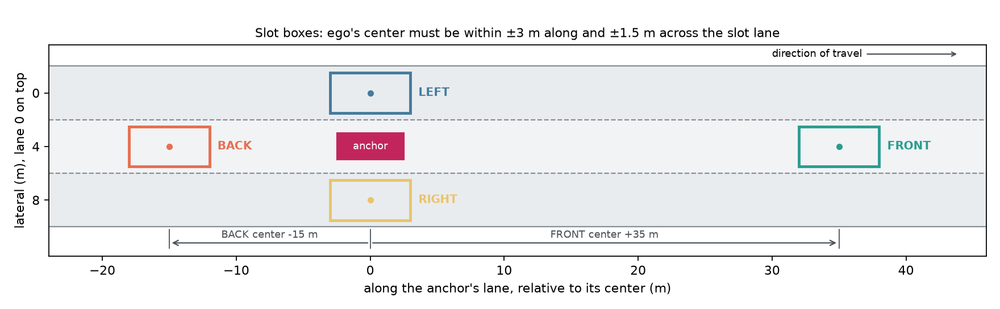
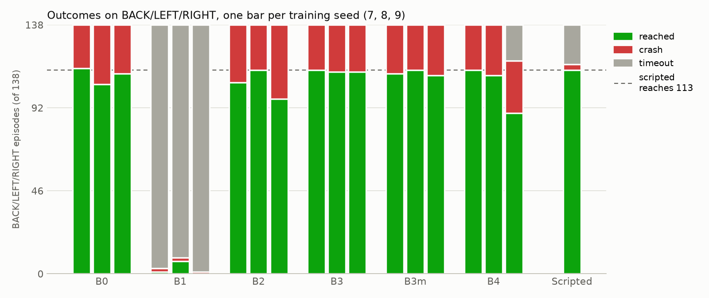
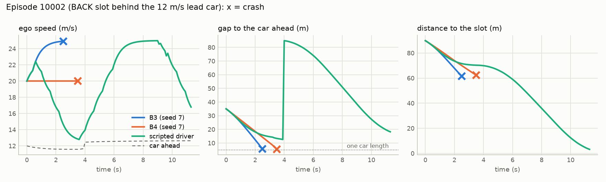
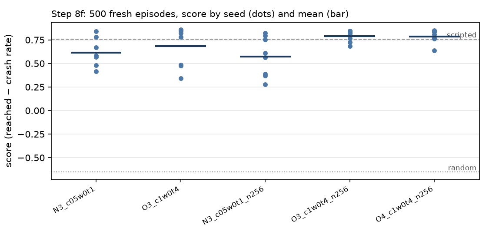
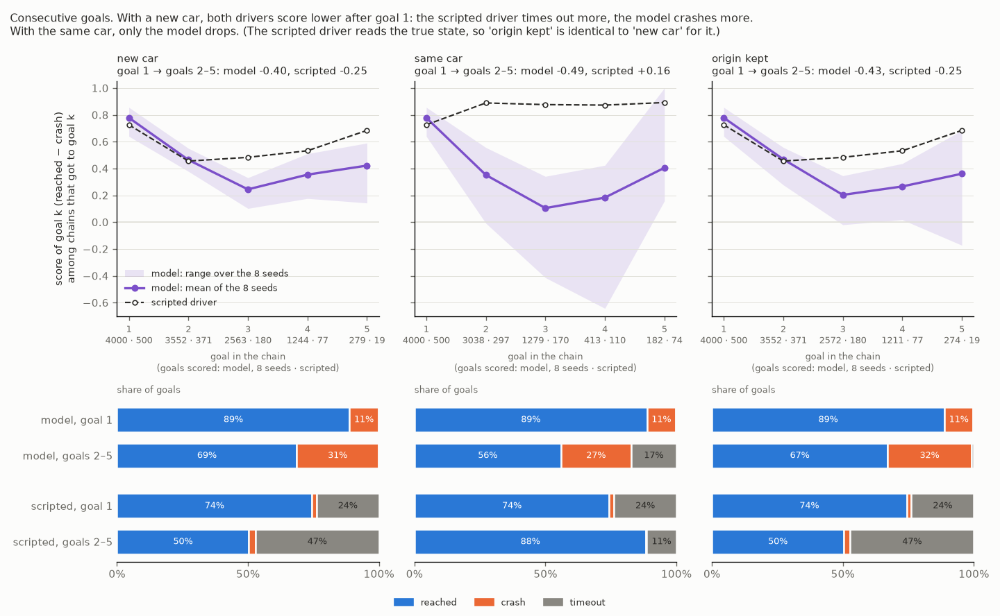

# Reaching a slot of a moving car with PPO: report

*Branch `reach-step7`, updated 2026-11-23 through Step 9. Sections 1–4 describe the first chain of arms (B0–B4, Steps 1–6, written 2026-11-09). Section 5 covers Steps 7 and 8, and **section 5b gives the adopted recipe exactly: every reward term, task and setting**. Section 7 covers Steps 8g and 9 (consecutive goals). Terms are defined at the end. The full log, with every prediction as written before the run, is [`EXPERIMENT_NOTES.md`](EXPERIMENT_NOTES.md). The tables in sections 3–4 are produced by [`report.py`](report.py), those in section 5 by [`grid.py`](grid.py), and those in section 7 by [`chain.py`](chain.py), all from the saved evaluations.*

## Summary

- **Task.** Ego must drive into a slot of a moving traffic car within 25 s. The slot is FRONT, BACK, LEFT or RIGHT. One decision inside the slot box counts as success ("reach"; holding comes later).
- **Method.** Every change is tested alone: a run differs from the one it is compared with in exactly one setting, checked automatically on the saved configurations.
  - Runs are replicated over training seeds.
  - They are evaluated on fixed episodes, the same as a rule-based scripted driver.
  - Predictions and pass bars are written before each run.
- **Where we stand (Step 8f, 2026-11-22).** The adopted recipe is **O_c1w0t4 at 256 wide**:
  - training order: practice on blocked episodes first, then the full task;
  - reward: crash cost 1 × goal, plus a small time cost;
  - network: 256-256;
  - training: 6M transitions.
- **How it scores on 500 fresh episodes** (score = reached − crash):
  - **+0.791**, with every one of 8 seeds between +0.68 and +0.84;
  - the scripted driver scores +0.758, so it is level with it (+0.033, p 0.16);
  - the best 64-wide recipe scores +0.614, which it beats by +0.177 (p 0.006, ahead on 8 of 8).
- **How it differs from the scripted driver.**
  - It reaches far more: 89.5% against 78.2%, including 90% of blocked episodes against 60%, and 76% of FRONT against 63%.
  - It almost never gives up: 0.1% timeouts against 19.4%.
  - But it crashes about four times as often: 10.4% against 2.4%, and on FRONT 23% against 4%. Those crashes are the main remaining loss.
- **What got it there** (section 5):
  - success-only training first, which avoids the give-up collapse of B1;
  - practice rounds on blocked episodes, which teach passing, something no B arm ever did;
  - a crash cost and a small time cost added after that;
  - a 256-wide network, which makes the practice rounds work on every seed instead of most.
- **First chain (B0–B4, sections 1–4).** PPO reached the scripted driver's BACK/LEFT/RIGHT success but crashed into slower cars where the scripted driver waited, and it never reached FRONT. A larger crash penalty (B4) did not change that.
- **Consecutive goals (Step 9, section 7, no training).** When the goal in the observation is replaced by the next one after each reached slot, later goals score about 0.4 lower than the first.
  - With a new car, the scripted driver also drops by 0.25, so the model's own part is about 0.16, and it is all crashes. The model reaches each slot at full speed, then rams a car right after the switch.
  - Around one car, the model also cannot drop back to a slot behind.
  - The next step is not decided yet.

## 1. How the experiments are built

### Task and episode

| Part | Setting |
|---|---|
| Road and traffic | highway-env 1.12.1 `highway-v0`, 3 lanes, 8 traffic cars with preferred speeds of 12–17 m/s, driven by highway-env's IDM (speed, following) and MOBIL (lane changes). They react to ego. |
| Lead car | Inherited from Marcos's baseline: the traffic is shifted so one car starts 35 m ahead of ego, in ego's lane, at 12 m/s. Ego starts at 20 m/s. |
| Anchor and slot | The anchor is a random traffic car 30–120 m ahead; its lane changes are switched off. The slot is drawn among those on the road: FRONT 35 m ahead of the anchor, BACK 15 m behind, LEFT/RIGHT beside it. |
| Success | Ego's center within ±3 m along the slot's lane and ±1.5 m across, for one decision. Other ends: crash, timeout at 25 s, anchor lost. |
| Actions | 10 decisions per second: LANE_LEFT, IDLE, LANE_RIGHT, FASTER, SLOWER. FASTER/SLOWER move the target speed one step on a 10–25 m/s grid in 2.5 m/s steps; the low-level controller does steering and throttle. |

### What ego observes (53 numbers, one snapshot per decision)

| Input | Size | Content |
|---|---:|---|
| `vehicles` | 7 × 5 | Ego, then the 6 nearest cars within 200 m, nearest first: presence, x and y relative to ego (÷ 200 m, ÷ 12 m), speed relative to ego (÷ 30 m/s), lateral speed |
| `desired_goal`, `achieved_goal`, `goal_delta` | 6 | Slot, ego, and slot minus ego, on the same 200 m scale |
| `anchor` | 4 | The anchor's position and velocity relative to ego |
| `slot` | 4 | Slot type, one-hot |
| `slot_error` | 3 | Slot minus ego along the lane ÷ 10 m and across ÷ 4 m, anchor minus ego speed ÷ 10 m/s, clipped to ±1 |
| `hold_progress` | 1 | Inherited from the hold task; 0 or 1 here |

There is no map, no other car's intention, and no history. The car rows use a ±200 m scale, so the last 30 m before a rear-end change the input only from 0.17 to 0.03 (section 4).

### Training and evaluation

- **PPO** (Stable-Baselines3 2.9.2), separate 64-64 policy and value networks, lr 3e-4, 3 environments × 256 steps per update, batch 256, 5 epochs, γ 0.99, λ 0.95, clip 0.2, entropy 0.01. 1M transitions per run (about 9,500 episodes, 30 min). From B2 on, each run starts from B0's trained policy of the same seed.
- **Evaluation:** 200 fixed episodes (seeds 10,000–10,199; 62 FRONT, 61 BACK, 40 LEFT, 37 RIGHT), deterministic policy. A uniform-random policy and the scripted driver run on the same episodes.
- **The scripted driver** ([`scripted.py`](../baseline_dynamic_waypoint/scripted.py)) reads the true simulator state. It (1) targets the slot's lane, for FRONT first a lane beside the anchor until 10 m past it; (2) changes one lane at a time if no car is within 6 m behind to 12 m ahead; (3) drives 25 m/s on the way and anchor speed + 0.5 × distance once in the slot's lane; (4) caps its speed at the anchor's speed (10 m/s if under 9 m) when the car ahead is closer than 12 m + 0.8 s × speed. It never passes a car in the slot's lane.

### Method

- **One change per arm.** An arm is its parent plus one setting ([`config.py`](config.py)). [`ivcheck.py`](ivcheck.py) compares the saved configurations of parent and child, including package versions and the machine, and refuses to train or compare if anything else differs.
- **Seeds.** Each arm is trained 3 times (seeds 7, 8, 9). A seed fixes the training episodes, PPO's action sampling and minibatch order, and the starting weights. Same seed on the same machine reproduces a run exactly. Caveat: run N's three environments use seeds N, N+1, N+2, so neighbouring runs share 1–2 of their 3 streams of training episodes; the spread between seeds may understate the true run-to-run spread.
- **Predictions first, failures kept.** Every prediction is written before the run and checked afterwards; no run is repeated or deleted.

## 2. The chain and its incentives

Every arm's reward is 50 × success plus the terms below. The argument in each row is what made the change worth testing.

| Arm | Change from parent | Incentive argument | Prediction | Outcome |
|---|---|---|---|---|
| B0 | Reward = 50 × success | Simplest reward; the root | Learns, 35–60% | 55%; crashes 44% |
| B1 | Crash −50, from scratch | B0 fails only by crashing; a crash cost the same as a timeout | Crashes under 20%, success at least B0's | **Collapse:** 1% success, 98% timeouts |
| B2 | B1, starting from B0's policy | From scratch, trying was worth about −34 against 0 for giving up; from B0 it is about +5 | No collapse; crashes under 20%; BACK/LEFT/RIGHT at least B0's | No collapse; crashes 16%, **but only because FRONT is abandoned** |
| B3 | + potential-based progress, 0.1 × (0.99 Φ′ − Φ), Φ = −distance | Per-step credit toward the slot for FRONT; cannot change the best policy | FRONT at least 5/62 on two seeds | **FRONT still 0**; BACK/LEFT/RIGHT equal to the scripted driver's successes |
| B3m | B3 trained again on the Mac | Later arms train on the Mac and need a parent there | Within 5 points of B3 | Within 1 point; the same 24 episodes fail on all seeds |
| B4 | Crash −50 → −150 | Ramming at even odds about −40 against 0 for waiting | BACK/LEFT/RIGHT crashes ≤ 10 per seed, success 105–116 | **Failed:** crashes 25–29 per seed, unchanged; one seed turned timid on RIGHT |

**B0: nothing discourages ramming.** With only a success reward, a crash costs exactly what a timeout costs (0), and the discount pays more for arriving early, so the best policy is full speed toward the slot. That is what B0 learned: move to the slot's lane, accelerate to 25 m/s, never brake. Every crash is a rear-end: in FRONT into the anchor itself (the slot is 35 m past it in its own lane), elsewhere into the 12 m/s lead car about 2.6 s in.

**B1: a crash penalty from scratch makes giving up optimal.** From a near-random start a crash is about 7 times likelier than success, so trying is worth about 0.115 × 50 − 0.79 × 50 ≈ −34 while slowing to 10 m/s and timing out is worth 0. Training success is 0 for more than 900k of the 1M transitions; the policy keeps exploring (entropy 0.84–1.04 of 1.61 nats), but random actions from 10 m/s never reach a slot.

**B2: the same reward from a policy that already succeeds.** Starting from B0 (55% success), trying is worth about +5 from the first update, and there is no collapse. The drop in crashes (44% → 16%) comes entirely from FRONT: there every B0 attempt costs −50, so the policy learns to stop pursuing FRONT (62 of 62 time out). BACK/LEFT/RIGHT crashes are unchanged, because at ±50 a gamble that wins about half the time is worth about as much as giving up.

**B3: shaping that cannot change the optimum.** A potential-based term pays for every meter closed toward the slot and telescopes, so it changes how fast credit arrives, not which policy is best. It was the cheapest test of whether FRONT lacked only a learning signal. It did not help: FRONT stays at 0, and BACK/LEFT/RIGHT reach 112–113 of 138, the scripted driver's 113.

**B3m: the noise floor.** Repeating B3 on the Mac changes 3–4 of the 138 BACK/LEFT/RIGHT episodes per seed (seeds of one arm differ by 1–7). An effect is credible only if it is larger than about 5 episodes per seed and has the same sign on all three seeds.

**B4: a larger penalty is priced but not acted on.** With a crash at −150, ramming at even odds is worth about −40 and waiting 0, so the policy should learn to hold back behind the blocking car. It did not. Crashes on BACK/LEFT/RIGHT are 25, 28 and 29 per seed (B3m: 27, 25, 28), and 132–135 of 138 episodes end as under B3m on seeds 7 and 8; seed 9 lost 21 RIGHT successes to timeouts without crashing less. What did change is the critic: its value in blocked episodes fell from about 0 to −5, −50 and −27, and to −13, −70 and −40 just before ramming. The policy's probability of SLOWER behind the blocking car did not rise (7%, 0.5%, 7%). In training, about 30 of the ~6,300 BACK/LEFT/RIGHT episodes per seed end with ego waiting (a timeout) against about 1,460 crashes, so the better outcome is almost never experienced. It is not physically hard: in episode 10002 a single SLOWER at the start, then IDLE, reaches the slot, and braking at any time in the first 1.5 s avoids the crash. Two explanations fit and are not yet separated: the blocked situation looks almost like the clear one to the policy (the same lead car 35 m ahead, on a ±200 m scale, where FASTER is right two thirds of the time), and the avoiding sequence (one SLOWER, then no FASTER for seconds) is rare under a policy that samples FASTER 18–70% of the time.

## 3. Results

| Arm | Change from parent | Success (overall) | Crash | Timeout | BACK/LEFT/RIGHT, seeds 7 · 8 · 9 | FRONT |
|---|---|---:|---:|---:|---|---|
| B0 | 50 x success | 55.2% ± 2.0 | 44.3% | 0.5% | 114/24/0 · 105/33/0 · 111/27/0 | 0 · 1 · 0 |
| B1 | + crash -50, from scratch | 1.3% ± 1.9 | 1.0% | 97.7% | 1/2/135 · 7/2/129 · 0/1/137 | 0 · 0 · 0 |
| B2 | B1, starting from B0's policy | 52.7% ± 4.0 | 16.3% | 31.0% | 106/32/0 · 113/25/0 · 97/41/0 | 0 · 0 · 0 |
| B3 | + potential-based progress | 56.2% ± 0.3 | 14.3% | 29.5% | 113/25/0 · 112/26/0 · 112/26/0 | 0 · 0 · 0 |
| B3m | B3 trained again on the Mac | 55.7% ± 0.8 | 14.3% | 30.0% | 111/27/0 · 113/25/0 · 110/28/0 | 0 · 0 · 0 |
| B4 | crash -50 -> -150 | 52.0% ± 6.5 | 15.5% | 32.5% | 113/25/0 · 110/28/0 · 89/29/20 | 0 · 0 · 0 |
| Scripted | rule-based, reads the true state | 76.5% | 2.5% | 21.0% | 113/3/22 | 40 |
| Random | uniform random actions | 11.5% | 79.0% | 9.5% | 21/105/12 | 2 |

Overall success is out of 200 per seed; ± is the standard deviation over seeds. Random's BACK/LEFT/RIGHT cell is its only run.

Learning curves are flat from about 200k transitions in every arm from B0 on ([B3m](results/B3m_learning_curves.png)); more training would not change these numbers.

## 4. Why BACK/LEFT/RIGHT still fail (diagnosis, no training)

An episode is **blocked** if at reset a car is in the slot's lane between ego and the slot. The tag depends only on the episode, not on the policy.

| Arm | Clear: reached / crash / timeout (of 279) | Blocked: reached / crash / timeout (of 135) |
|---|---|---|
| B0 | 263/16/0 | 67/68/0 |
| B1 | 8/4/267 | 0/1/134 |
| B2 | 247/32/0 | 69/66/0 |
| B3 | 269/10/0 | 68/67/0 |
| B3m | 266/13/0 | 68/67/0 |
| B4 | 251/16/12 | 61/66/8 |
| Scripted | 87/1/5 (one run, of 93) | 26/2/17 (one run, of 45) |

- **Clear episodes are solved:** B3 reaches 96%, more than the scripted driver (87 of 93), because it is faster.
- **Blocked episodes are half lost by every arm**, and the losses are crashes into the blocking car (B3: 20–21 of the 22–23 blocked crashes per seed hit a car tagged at reset). 22 of the 24 episodes that fail on all three seeds are blocked; the other 2 are cars that move into the slot's lane after reset.
- **PPO never passes a blocking car** (0 of 45) and almost never brakes. A blocked episode is reached only when the blocking car changes lane by itself (20–21 of 26 when it does, 2 of 19 when it does not).
- **The value function sees it; the policy does not act on it.** The critic's value at reset separates blocked from clear episodes (AUC 0.85–0.88), and in episode 10106 it jumps from about 0 to 22 at the moment the blocking car leaves. Yet the probability of SLOWER stays at 1–9% while the gap closes from 29 m to 0 at 13 m/s.
- **Why: under crash weight 50, ramming and waiting are worth the same.** Ramming wins about half the time, 50 × ½ − 50 × ½ ≈ 0, which is also what a timeout pays. The critic reflects this: 0.1 s before ramming the value is about −9 to −22, not −50.
- **Braking alone gives the scripted driver, not more.** Overlaying the scripted driver's following rule on B3 gives 113 reached, 3 crashes, 22 timeouts on seed 7, identical to the scripted driver in all 138 episodes. So after four arms PPO has learned the scripted driver's lane choice at full speed without its following rule.
- **The way to beat the scripted driver is passing.** In the 17 blocked episodes where the scripted driver times out, the slot is 30–72 m beyond the blocking car and the anchor is at least as fast as that car, so waiting can never work, while overtaking at 25 m/s against 12 m/s takes a few seconds in the next lane.

*Episode 10002, BACK slot in ego's lane behind the 12 m/s lead car. B3 accelerates to 25 m/s and crashes at 2.6 s; B4 holds 20 m/s (it presses LANE_RIGHT in the rightmost lane, which does nothing) and crashes at 3.6 s. The scripted driver brakes to 13 m/s behind the car; at about 4 s the lead car changes lane by itself (the jump in the gap), and the scripted driver then reaches the slot at 11.4 s. Waiting pays here because the car leaves. Full per-episode figures and videos: [`results/examples/`](results/examples/README.md).*

## 5. Steps 7 and 8: from passing practice to the adopted recipe

The proposals at the end of Step 6 (a safety shield, a local input for the car ahead) were not run. Step 7 attacked the blocked episodes directly, by training on them.

### Step 7: passing practice (2026-11-15 to 2026-11-18)

- **7a, training audit.** Value gradients were large enough that gradient clipping shrank every update. B5, with the reward scaled by 1/50 (goal = +1), fixed that throttle without changing outcomes. Every later run uses the 1/50 scale.
- **7b–7e, practice on blocked episodes from the start.** These are episodes where a slow car is held in ego's lane, between ego and the slot. With crash = −goal from fresh weights, P1s, P2 and P3 gave up from the start, and P1 learned to pass once, then gave up. Most early attempts crash, so stopping is learned first: B1's collapse again.
- **7f, success first.** P4 trains on the practice episodes with a success-only reward. It **passes**: 34–50% of the natural-start practice episodes, where the scripted driver manages 2.5%.
  - P5 adds the crash cost from P4's policy, and passes in 62–64% on two seeds.
- **7g, P6.** The full task, starting from P5's policy.
  - BACK/LEFT/RIGHT: 123–134 of 138 reached on every seed, against the scripted driver's 113.
  - FRONT: 41–48 of 62 reached on two seeds, against the scripted driver's 40.
  - Crashes remained, mostly on FRONT.
- **7h, held-out episodes (40,000–40,199).** P6's success was unchanged on fresh episodes. Only seed 7 beat the scripted driver beyond noise; seeds 8 and 9 crashed 5–6 times as often.

### Step 8: settling the recipe (2026-11-18 to 2026-11-22)

**The score.** Reached − crash per episode: +1 reached, −1 crash, 0 timeout. Its scale runs from −1 to +1.

**The design.** A staged grid. Every pipeline has three 2M rounds; round 1 is always success only.
- Training orders compared:
  - **N:** no practice;
  - **H:** practice in round 1;
  - **E:** practice with easy starts in round 1;
  - **O:** the original P4 → P5 → P6 order, with practice in rounds 1 and 2.
- Rewards: crash cost 0–2 × goal, progress shaping on or off, and a small time cost.
- Seeds: screening on 3 (7, 10, 13), confirmation on 5 new ones (16–28).
- Each set of fresh test episodes is used once. Stages are decided by paired t-tests over seeds, with bars written before each run.

**The selection rule (the user's choice, fixed before 8a).** The highest mean score wins, but a more complex option must beat a simpler one beyond noise: paired t-test over seeds, p < 0.05. Otherwise the simpler one is kept. "Simpler" means no practice before practice, and fewer reward terms before more. Every compared pair is checked by `check_pipeline` to differ only in the factor under test.

**The levels tested.**

| Factor | Levels |
|---|---|
| Training order | **N** full task in all rounds; **H** practice (natural start) in round 1; **E** practice with easy starts in round 1; **O** practice with easy starts in rounds 1 and 2 (the P4 → P5 → P6 order). Round 1 is always success only. |
| Crash cost (× goal) | 0, 0.5, 1, 2 |
| Progress shaping | none, or potential-based 0.002 per m (0.1 per m before the 1/50 scale) |
| Time cost (× goal, per 0.1 s decision) | none, 0.001, 0.004 (added in 8c2, only with crash 0.5 or 1) |
| Network | 64-64 or 256-256, separate policy and value networks |
| Training length | 3 rounds × 2M = 6M, or a 4th round of 3M (9M) |

**The decision trail.** Each bar was written before the runs it judges.

| Stage | Question | Bar written before | Result | Decision |
|---|---|---|---|---|
| 8-0 | Training speed on this PC | Speed-ups only if training stays bit-identical | Bit-identical; 32 runs at once give 2.3× the old throughput | Adopted |
| 8a | 64-64 or 256-256 (order E, 3 seeds) | 256 ≥ +0.10, ahead on all 3 seeds, crashes not higher | +0.067 (p 0.45, 2 of 3) | **64 kept** |
| 8b | Training order (crash 1 + progress, 3 seeds) | The selection rule | All four within 0.12; no one-factor difference beyond noise (p ≥ 0.38) | Rule picks **N**; **O** scores highest, so both go on to 8c |
| 8c | 8 rewards (crash × progress) per order | The selection rule | No reward beats success only (c0w0) beyond noise; best is c1w01 (N +0.107, p 0.095). Any crash cost makes some runs give up on FRONT | Trigger met for a time cost (timeouts ≥ 10%) |
| 8c2 | Time cost 0.001 or 0.004 with crash 0.5 or 1 | The selection rule | No time-cost difference beyond noise | Finalists: the rule's choice, the top 3, and P6's reward |
| 8d | Finalists on 5 new seeds; final test on 50,000–50,499 | The selection rule | **A crash cost is needed:** success only crashes about 25% and loses to every crash-cost reward in order N (p 0.002–0.049). Beyond that, all within 0.07 | Winner **N_c05w0t1** (no practice, crash 0.5, time 0.001). Below the scripted driver on the final test (−0.146, p 0.029); the gap is all FRONT |
| 8e | 256 wide and 3M more training, 3 recipes, 8 seeds | 256: ≥ +0.10, p < 0.05, ahead on ≥ 6 of 8, crashes not higher, on ≥ 2 of 3 recipes. Longer: p < 0.05 on ≥ 2 of 3 | Width +0.06 to +0.13 (p ≥ 0.16); 3M more +0.02 to +0.04 at 64. But 256 removes the FRONT give-up (13 → 2 of 24 runs), and with it O beats N (p 0.023) | By the bars, **nothing changes**; the reliability gain was put to a fresh test |
| 8f | O_c1w0t4 at 256 against the winner, 500 fresh episodes 60,000–60,499 | Gain ≥ +0.10, p < 0.05, ahead on ≥ 6 of 8; crashes not higher beyond noise; at most 1 seed giving up on FRONT | **+0.177 (p 0.006, 8 of 8)**; crashes −1.8 points (p 0.21); 0 seeds give up | **Adopted: O_c1w0t4 at 256 wide, 6M** |

**Why this choice holds up.**
- **The crash cost is backed by new seeds**, not by the screening. Success only crashes about 25% and is beaten beyond noise on the 5 confirmation seeds.
- **The width was not adopted on 8e's own numbers.** 8e's selection episodes had helped pick the recipes, so the 256-wide recipe was confirmed on 500 episodes no one had used, against a bar written first. It passed every condition.
- **The reward inside the adopted recipe (crash 1 + time 0.004) is one of several equal choices.** The reward makes no detectable difference at 256 wide (8e: +0.001). What decides the result is the order and the width together. At 256, the two practice rounds end with every seed passing (86–95% of the practice episodes reached). At 64, practice failed to learn passing on 3 of 8 seeds, and those seeds then gave up on FRONT.
- **One condition was changed before 8f, and it is flagged.** 8e's crash condition ("not higher", failed by any increase) became "not higher beyond noise". On the selection episodes the two recipes crashed equally often, so the 8e version would have decided on noise. The change was made after seeing those rates. 8f also met the stricter 8e version, so the decision does not depend on it.

**Step 8f, the final comparison.** 500 fresh episodes, final models, mean of 8 seeds:

| Model | Score | Seeds | Reached | Crash | FRONT reached | FRONT crash | Seeds giving up on FRONT |
|---|---:|---|---:|---:|---:|---:|---:|
| N3_c05w0t1 (64 wide, no practice) | +0.614 | +0.42 to +0.84 | 73.6% | 12.2% | 39.6% | 16.6% | 6 of 8 |
| O3_c1w0t4 (64 wide, original order) | +0.683 | +0.34 to +0.86 | 76.1% | 7.8% | 50.7% | 13.0% | 3 of 8 |
| N3_c05w0t1_n256 (256 wide, no practice) | +0.573 | +0.28 to +0.82 | 76.8% | 19.6% | 58.4% | 32.5% | 1 of 8 |
| **O3_c1w0t4_n256 (adopted)** | **+0.791** | +0.68 to +0.84 | 89.5% | 10.4% | 76.1% | 23.4% | 0 of 8 |
| Scripted driver | +0.758 | | 78.2% | 2.4% | 62.7% | 3.9% | |
| Random actions | −0.652 | | 14.0% | 79.2% | 2.6% | 88.2% | |

**What the rows show.**
- **The network size helps only together with practice.**
  - With the original order, 256 wide fixes the 3 seeds where 64-wide practice failed to learn passing (about +0.35 each). On the other 5 seeds it changes little.
  - Without practice, 256 wide stops giving up on FRONT but crashes instead (−0.041, crashes +7 points).
- **Longer training does not help.** At 256 wide, 9M scores the same as 6M (−0.008). The learning curves are flat by then: [`results/grid8/curves_8e/score.png`](results/grid8/curves_8e/score.png).
- **The adopted recipe, round by round.** Each round is 2M transitions.
  1. Success only, on practice episodes with easy starts.
  2. Practice episodes, with crash cost 1 + time cost 0.004 per decision.
  3. The full task, with the same reward.

## 5b. The adopted recipe, exactly (O_c1w0t4, 256 wide, 6M)

Every value below is read from the saved configuration of `O3_c1w0t4_n256` and its parent runs; the page [`attempts/O_c1w0t4_n256.md`](attempts/O_c1w0t4_n256.md) has the same with per-seed results and demos.

**Training stages.** Each round starts from the previous round's trained policy, same seed; round 1 starts from fresh weights.

| Round | Run | Task | Reward per decision (goal units) | Transitions |
|---:|---|---|---|---:|
| 1 | `E1_n256` | Practice with easy starts | +1 on reaching the slot; nothing else | 2M |
| 2 | `O2_c1w0t4_n256` | Practice with easy starts | +1 reached, −1 crash, −0.004 per decision | 2M |
| 3 | `O3_c1w0t4_n256` | Full task | +1 reached, −1 crash, −0.004 per decision | 2M |

**The reward, written out** (rounds 2 and 3):

`r_t = 0.02 × ( 50·[reached at t] − 50·[crash at t] − 0.2 )`

- [reached at t] and [crash at t] are 1 on the decision where the episode ends that way, and 0 otherwise. If both happen on the same decision, it counts as a crash.
- A timeout (25 s) or a lost anchor adds nothing; the time cost has already been charged.
- So: reaching = +1, a crash = −1, and each 0.1 s costs 0.004, which is 1.0 over a whole 25 s episode (0.37 after discounting at γ 0.99).
- Why 0.004: it is the largest time cost that keeps waiting out a whole episode cheaper than the smallest crash cost tested (0.5), so crashing never pays better than waiting.
- Terms switched off: progress shaping 0, the hold bonus 0, the inherited per-step progress 0.
- Round 1 is `r_t = 0.02 × 50·[reached at t]`: a crash ends the episode with 0, like a timeout. This avoids the give-up collapse that a crash cost causes from fresh weights (B1, P1–P3).

**The two tasks.**
- **Full task** (round 3 and every test): all four slots, drawn as in section 1. Ego starts at 20 m/s with a 12 m/s car 35 m ahead in its lane. Traffic may change lanes, except the anchor.
- **Practice with easy starts** (rounds 1 and 2):
  - Only BACK, LEFT and RIGHT slots that are blocked at reset, meaning a car sits in the slot's lane between ego and the slot. The episode is redrawn, continuing the seeded stream, until this holds (4.9 draws on average).
  - The blocking cars' lane changes are switched off, so waiting never clears the way: the only way to succeed is to pass.
  - Each episode picks one start uniformly. Ego keeps 20 m/s:
    - **past:** next lane, 10 m ahead of the slow car;
    - **beside:** next lane, level with it;
    - **behind:** next lane, 15 m behind it;
    - **natural:** the normal start.
  - A moved start needs 8 m of clear space in that lane and 10 m before the slot; otherwise the natural start is kept.

**PPO** (Stable-Baselines3 2.9.2), identical in all three rounds:

| Setting | Value | Setting | Value |
|---|---|---|---|
| Policy network | MLP 256-256, tanh | Value network | MLP 256-256, separate |
| Learning rate | 3e-4, constant | Parallel environments | 3 |
| Steps per environment per update | 256 (768 transitions) | Minibatch | 256 |
| Epochs per update | 5 | Discount γ | 0.99 |
| GAE λ | 0.95 | Clip range | 0.2 |
| Entropy coefficient | 0.01 | Value-loss coefficient | 0.5 |
| Gradient-norm clip | 0.5 | Device | CPU |

**Environment:** highway-env 1.12.1 `highway-v0`, 3 lanes, 8 traffic cars (density 0.7, preferred speeds 12–17 m/s, IDM + MOBIL). 10 decisions per second; 25 s limit (250 decisions). Actions LANE_LEFT, IDLE, LANE_RIGHT, FASTER, SLOWER on target speeds 10–25 m/s in 2.5 m/s steps. Observation: the 53 numbers of section 1. Success: ego's center within ±3 m along and ±1.5 m across the slot for one decision.

**Replication and testing.** 8 training seeds: 7, 10, 13, 16, 19, 22, 25, 28. Final models are tested deterministically. Selection used 400 episodes (10,000–10,199 and 40,000–40,199); the adoption test used 500 fresh episodes (60,000–60,499), used once.

**Software:** Python 3.13.1, gymnasium 1.4.0, PyTorch 2.15.0, NumPy 2.5.4, trained on a Windows PC (i9-14900K, CPU only).

## 6. Limitations

- **Seeds.** 8 seeds per Step 8 recipe; the earlier B arms had 3, with partly shared training episodes (section 1).
- **Unequal inputs.** The scripted driver reads the exact simulator state; PPO reads the 53-number observation. The comparison is a yardstick, not a fair contest.
- **Reach only.** One decision in the box, not holding the slot.
- **Machines.** B0–B3 and all of Step 8 were trained on a Windows PC; B3m, B4, B5 and P1–P6 on a Mac. Evaluation is identical on both (`test_replay.py`).
- **Recipe choice.** Recipes were chosen on the selection episodes (10,000–10,199 and 40,000–40,199). The 8f comparison is on fresh episodes, but its candidate was picked after seeing 8e, and one 8f condition was relaxed before the test (section 5, "Why this choice holds up"; the stricter version was also met).
- **Effects smaller than about ±0.07 are not resolved.** With 8 seeds, the rewards from crash 0.5 to 1, with or without a time cost or progress shaping, cannot be told apart. The adopted reward is one of these equal choices.
- **"Reach" is passing through the slot.** One decision inside the box counts, whatever the speed. The adopted model arrives at 25 m/s, about 11 m/s faster than the anchor. This is invisible on single goals and is the main cause of crashes after a goal switch (section 7).
- **Step 9's comparison with the scripted driver is a rough split.** Each driver's later goals start where its own previous goal ended, so the two face different later goals.

## 7. Since then, and next

- **Step 8g (no training): FRONT crashes diagnosed.** 91% are rear-ends at full speed. The policy passes but does not brake.
- **Step 9 (no training): consecutive goals.** When a slot is reached, the goal in the observation is replaced by the next one. Tested on the adopted recipe: 12,000 chains of up to 5 feasible goals, in three conditions ([`results/chains/summary.md`](results/chains/summary.md)).
  - **Setup.**
    - The episode continues after each reached slot. Only the goal inputs change, and each goal has its own 25 s clock.
    - Three conditions:
      - **new car:** the next goal is a random slot of a different car;
      - **same car:** a different slot of the same anchor;
      - **origin kept:** like new car, but the goal coordinates keep the first goal's origin, the most literal "swap only the goal".
    - **Every next goal is feasible.** The time needed to reach it (gap along the road at the speed limits, plus 2 s per lane change) is at most 15.72 s, the 95th percentile of goals drawn at a normal reset.
    - The scripted driver runs the same chains as a yardstick.
    - Chain seeds 70,000–70,499 (500 chains per condition), up to 5 goals each.
  - **The bar (written before the run).** The drop is the score of goal 1 minus the score of goals 2–5, paired over the 8 seeds. "Carries over" if its whole 95% interval is below 0.10; "breaks" if it is 0.10 or more with p < 0.05.
  - **Chaining breaks in every condition.** Later goals score about 0.4 below the first (+0.78 → about +0.37), on every seed.
  - **Part of that drop is not the model's.** With a new car, the scripted driver also scores lower after goal 1 (+0.73 → +0.48, a drop of 0.25), because its later goals time out more (24% → 47%).
    - The model's own extra drop is about 0.16 (95% interval +0.13 to +0.19), and it is all crashes (11% → 31%; scripted 2.5%).
    - Around one car, the scripted driver does better on later goals (+0.88), so there the whole drop (0.49) is the model's.
    - The two drivers face different later goals, since each starts from where its own previous goal ended, so this split is a rough guide.
    - The first write-up gave only the model's drop; this was added after the user asked why the model looked much weaker.
  - **Cause of the model's own part:** it reaches a slot by passing through it at 25 m/s, 11 m/s faster than the anchor. So the next goal starts close behind slower cars, and 63% of later-goal crashes come within 3 s of the switch.
  - **Around one car,** it also cannot drop back to a slot behind it.

*Top: score of goal k among chains that got to it. Purple is the model (line = mean of the 8 seeds, band = lowest to highest seed); the dashed black line is the scripted driver. The numbers under each goal are how many goals were scored (model, 8 seeds · scripted). Bottom: what happened on goal 1 and on goals 2–5, for each driver.*

- **The adopted model is unchanged on single goals.** On goal 1 of every chain it gives exactly the ordinary episode's outcome: +0.778 (88.8% reached, 10.9% crash), against +0.79 on the 200 shared and 500 fresh episodes.
- **Next step: not yet decided.**
  - Two candidates were recorded: train on chained goals, or require the slot to be held.
  - The user dropped holding: it restricts an intermediate task, and the long-term aim is a DFA-conditioned driving policy.
  - The direction will be set at the user's team meeting.

## Where the data is

- **Every attempt, one page each:** [`attempts/README.md`](attempts/README.md). Each page has the full reward function, approach, all hyperparameters, results, training curves, a success and a crash demo, and the analysis. This covers B0–B5, P1–P6 and all 30 Step 8 pipelines.
- **Full log and decisions:** [`EXPERIMENT_NOTES.md`](EXPERIMENT_NOTES.md).
- **Step 8 tables:** `results/grid8/summary_<stage>.md`.
- **Every Step 8 run:**
  - [`results/grid8/registry.csv`](results/grid8/registry.csv), with model hashes and scores;
  - [`results/grid8/checkpoints_manifest.csv`](results/grid8/checkpoints_manifest.csv), listing the checkpoints, which stay on the training PC.
- **B-arm summaries:** `results/<ARM>_summary.md`.
- **Per-episode outcomes** for every B arm and seed, with the blocked tag: [`results/step5_blocked/episodes.csv`](results/step5_blocked/episodes.csv). Diagnosis tables are in the same folder.
- **Videos and figures** of the same 10 episodes for every stage, including the adopted recipe and the 8d winner: [`results/examples/README.md`](results/examples/README.md).
- **Step 8g (FRONT crashes):** [`results/front_crashes/summary.md`](results/front_crashes/summary.md).
- **Step 9 (consecutive goals):**
  - [`results/chains/summary.md`](results/chains/summary.md), with `goals.csv`, `chains.csv` and the figure;
  - crash replay: [`results/chains/crashes_new_car.md`](results/chains/crashes_new_car.md);
  - demo videos: [`results/chains/demos/`](results/chains/demos/).

## Terms

| Term | Meaning |
|---|---|
| Score | Per episode or goal: +1 reached, −1 crash, 0 timeout or lost anchor; averaged over all slots, FRONT included. Runs from −1 to +1. |
| Blocked episode | At reset, a car is in the slot's lane between ego and the slot. |
| Practice task | Blocked BACK/LEFT/RIGHT episodes only, with the blocking car held in its lane (section 5b). |
| Easy starts | Ego placed past, beside or behind the slow car in the next lane, or at the normal start (section 5b). |
| FRONT give-up | A run that times out on 30% or more of FRONT episodes: it stops trying rather than risk a crash. |
| Selection episodes | Seeds 10,000–10,199 and 40,000–40,199, used to choose recipes during Step 8. |
| Fresh test sets | Seeds 50,000–50,499 (8d) and 60,000–60,499 (8f), and chain seeds 70,000–70,499 (Step 9); each used once. |
| Paired over seeds | Two recipes trained on the same seeds and tested on the same episodes; the test is a t-test on the per-seed differences. |
| Order N / H / E / O | No practice / practice from the natural start / practice with easy starts / practice with easy starts for two rounds (P4 → P5 → P6). |
| `c1w0t4` | Crash cost 1, progress weight 0, time cost 0.004 (per decision, in goal units); `_n256` means 256-256 networks. |
