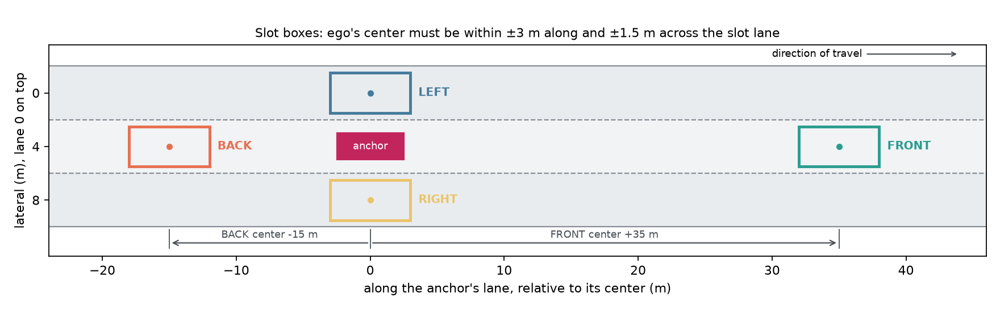
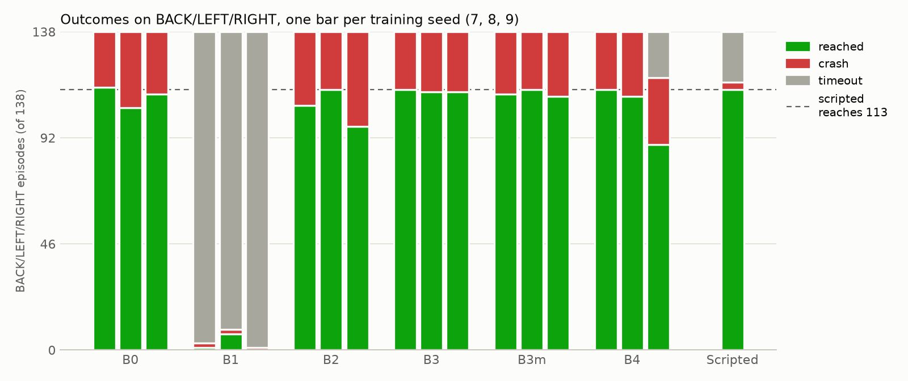
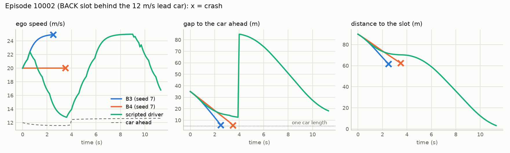

# Reaching a slot of a moving car with PPO: report

*Branch `dynamic-reach-b4` (B3m, B4 and the diagnosis, on top of `dynamic-reach` with B0–B3), 2026-11-09. The full log, with every prediction as written before the run, is [`EXPERIMENT_NOTES.md`](EXPERIMENT_NOTES.md). Tables in this report are produced by [`report.py`](report.py) from the saved evaluations.*

## Summary

- **Task.** Ego must drive into a slot (FRONT, BACK, LEFT or RIGHT) of a moving traffic car within 25 s. One decision inside the slot box counts as success ("reach"; holding comes later).
- **Method.** A chain of PPO arms. Each arm changes exactly one setting of its parent, checked automatically on the saved configurations. Each arm is trained on 3 seeds and evaluated on the same 200 fixed episodes as every other arm and as a rule-based driver. Predictions are written before training.
- **Where we stand (B3/B3m; B4 did not improve on it).** 56% overall against the scripted driver's 76.5%. The whole gap is FRONT: 0 of 62 for every arm, against 40 for the scripted driver. FRONT is now set aside. On BACK/LEFT/RIGHT, PPO reaches as many episodes as the scripted driver (110–113 of 138 against 113), but it **crashes in all the others (25–28), where the scripted driver waits (22 timeouts, 3 crashes).**
- **Main finding.** BACK/LEFT/RIGHT has one failure: a slower car in the slot's lane between ego and the slot. PPO's value function recognises it, but the policy keeps accelerating, because under the current reward ramming (wins about half the time) and waiting are worth about the same.
- **B4 (crash penalty 50 → 150) failed.** The value function learned the higher price of a crash, but the policy still does not brake: crashes on BACK/LEFT/RIGHT stayed at 25–29 per seed. The incentive was not the missing piece.
- **Proposed next (waiting for review):** a safety shield (the scripted driver's following rule enforced in training), so that training time goes to **passing** the slower car, which is where a lead over the scripted driver has to come from; or, as the alternative, a local input for the car ahead.

## 1. How the experiments are built

### Task and episode

| Part | Setting |
|---|---|
| Road and traffic | highway-env 1.12.1 `highway-v0`, 3 lanes, 8 traffic cars with preferred speeds of 12–17 m/s, driven by highway-env's IDM (speed, following) and MOBIL (lane changes). They react to ego. |
| Lead car | Inherited from Marcos's baseline: the traffic is shifted so one car starts 35 m ahead of ego, in ego's lane, at 12 m/s. Ego starts at 20 m/s. |
| Anchor and slot | The anchor is a random traffic car 30–120 m ahead; its lane changes are switched off. The slot is drawn among those on the road: FRONT 35 m ahead of the anchor, BACK 15 m behind, LEFT/RIGHT beside it. |
| Success | Ego's center within ±3 m along the slot's lane and ±1.5 m across, for one decision. Other ends: crash, timeout at 25 s, anchor lost. |
| Actions | 10 decisions per second: LANE_LEFT, IDLE, LANE_RIGHT, FASTER, SLOWER. FASTER/SLOWER move the target speed one step on a 10–25 m/s grid in 2.5 m/s steps; the low-level controller does steering and throttle. |

### What ego observes (53 numbers, one snapshot per decision)

| Input | Size | Content |
|---|---:|---|
| `vehicles` | 7 × 5 | Ego, then the 6 nearest cars within 200 m, nearest first: presence, x and y relative to ego (÷ 200 m, ÷ 12 m), speed relative to ego (÷ 30 m/s), lateral speed |
| `desired_goal`, `achieved_goal`, `goal_delta` | 6 | Slot, ego, and slot minus ego, on the same 200 m scale |
| `anchor` | 4 | The anchor's position and velocity relative to ego |
| `slot` | 4 | Slot type, one-hot |
| `slot_error` | 3 | Slot minus ego along the lane ÷ 10 m and across ÷ 4 m, anchor minus ego speed ÷ 10 m/s, clipped to ±1 |
| `hold_progress` | 1 | Inherited from the hold task; 0 or 1 here |

There is no map, no other car's intention, and no history. The car rows use a ±200 m scale, so the last 30 m before a rear-end change the input only from 0.17 to 0.03 (section 4).

### Training and evaluation

- **PPO** (Stable-Baselines3 2.9.2), separate 64-64 policy and value networks, lr 3e-4, 3 environments × 256 steps per update, batch 256, 5 epochs, γ 0.99, λ 0.95, clip 0.2, entropy 0.01. 1M transitions per run (about 9,500 episodes, 30 min). From B2 on, each run starts from B0's trained policy of the same seed.
- **Evaluation:** 200 fixed episodes (seeds 10,000–10,199; 62 FRONT, 61 BACK, 40 LEFT, 37 RIGHT), deterministic policy. A uniform-random policy and the scripted driver run on the same episodes.
- **The scripted driver** ([`scripted.py`](../baseline_dynamic_waypoint/scripted.py)) reads the true simulator state. It (1) targets the slot's lane, for FRONT first a lane beside the anchor until 10 m past it; (2) changes one lane at a time if no car is within 6 m behind to 12 m ahead; (3) drives 25 m/s on the way and anchor speed + 0.5 × distance once in the slot's lane; (4) caps its speed at the anchor's speed (10 m/s if under 9 m) when the car ahead is closer than 12 m + 0.8 s × speed. It never passes a car in the slot's lane.

### Method

- **One change per arm.** An arm is its parent plus one setting ([`config.py`](config.py)). [`ivcheck.py`](ivcheck.py) compares the saved configurations of parent and child, including package versions and the machine, and refuses to train or compare if anything else differs.
- **Seeds.** Each arm is trained 3 times (seeds 7, 8, 9). A seed fixes the training episodes, PPO's action sampling and minibatch order, and the starting weights. Same seed on the same machine reproduces a run exactly. Caveat: run N's three environments use seeds N, N+1, N+2, so neighbouring runs share 1–2 of their 3 streams of training episodes; the spread between seeds may understate the true run-to-run spread.
- **Predictions first, failures kept.** Every prediction is written before the run and checked afterwards; no run is repeated or deleted.

## 2. The chain and its incentives

Every arm's reward is 50 × success plus the terms below. The argument in each row is what made the change worth testing.

| Arm | Change from parent | Incentive argument | Prediction | Outcome |
|---|---|---|---|---|
| B0 | Reward = 50 × success | Simplest reward; the root | Learns, 35–60% | 55%; crashes 44% |
| B1 | Crash −50, from scratch | B0 fails only by crashing; a crash cost the same as a timeout | Crashes under 20%, success at least B0's | **Collapse:** 1% success, 98% timeouts |
| B2 | B1, starting from B0's policy | From scratch, trying was worth about −34 against 0 for giving up; from B0 it is about +5 | No collapse; crashes under 20%; BACK/LEFT/RIGHT at least B0's | No collapse; crashes 16%, **but only because FRONT is abandoned** |
| B3 | + potential-based progress, 0.1 × (0.99 Φ′ − Φ), Φ = −distance | Per-step credit toward the slot for FRONT; cannot change the best policy | FRONT at least 5/62 on two seeds | **FRONT still 0**; BACK/LEFT/RIGHT equal to the scripted driver's successes |
| B3m | B3 trained again on the Mac | Later arms train on the Mac and need a parent there | Within 5 points of B3 | Within 1 point; the same 24 episodes fail on all seeds |
| B4 | Crash −50 → −150 | Ramming at even odds about −40 against 0 for waiting | BACK/LEFT/RIGHT crashes ≤ 10 per seed, success 105–116 | **Failed:** crashes 25–29 per seed, unchanged; one seed turned timid on RIGHT |

**B0: nothing discourages ramming.** With only a success reward, a crash costs exactly what a timeout costs (0), and the discount pays more for arriving early, so the best policy is full speed toward the slot. That is what B0 learned: move to the slot's lane, accelerate to 25 m/s, never brake. Every crash is a rear-end: in FRONT into the anchor itself (the slot is 35 m past it in its own lane), elsewhere into the 12 m/s lead car about 2.6 s in.

**B1: a crash penalty from scratch makes giving up optimal.** From a near-random start a crash is about 7 times likelier than success, so trying is worth about 0.115 × 50 − 0.79 × 50 ≈ −34 while slowing to 10 m/s and timing out is worth 0. Training success is 0 for more than 900k of the 1M transitions; the policy keeps exploring (entropy 0.84–1.04 of 1.61 nats), but random actions from 10 m/s never reach a slot.

**B2: the same reward from a policy that already succeeds.** Starting from B0 (55% success), trying is worth about +5 from the first update, and there is no collapse. The drop in crashes (44% → 16%) comes entirely from FRONT: there every B0 attempt costs −50, so the policy learns to stop pursuing FRONT (62 of 62 time out). BACK/LEFT/RIGHT crashes are unchanged, because at ±50 a gamble that wins about half the time is worth about as much as giving up.

**B3: shaping that cannot change the optimum.** A potential-based term pays for every meter closed toward the slot and telescopes, so it changes how fast credit arrives, not which policy is best. It was the cheapest test of whether FRONT lacked only a learning signal. It did not help: FRONT stays at 0, and BACK/LEFT/RIGHT reach 112–113 of 138, the scripted driver's 113.

**B3m: the noise floor.** Repeating B3 on the Mac changes 3–4 of the 138 BACK/LEFT/RIGHT episodes per seed (seeds of one arm differ by 1–7). An effect is credible only if it is larger than about 5 episodes per seed and has the same sign on all three seeds.

**B4: a larger penalty is priced but not acted on.** With a crash at −150, ramming at even odds is worth about −40 and waiting 0, so the policy should learn to hold back behind the blocking car. It did not. Crashes on BACK/LEFT/RIGHT are 25, 28 and 29 per seed (B3m: 27, 25, 28), and 132–135 of 138 episodes end as under B3m on seeds 7 and 8; seed 9 lost 21 RIGHT successes to timeouts without crashing less. What did change is the critic: its value in blocked episodes fell from about 0 to −5, −50 and −27, and to −13, −70 and −40 just before ramming. The policy's probability of SLOWER behind the blocking car did not rise (7%, 0.5%, 7%). In training, about 30 of the ~6,300 BACK/LEFT/RIGHT episodes per seed end with ego waiting (a timeout) against about 1,460 crashes, so the better outcome is almost never experienced. It is not physically hard: in episode 10002 a single SLOWER at the start, then IDLE, reaches the slot, and braking at any time in the first 1.5 s avoids the crash. Two explanations fit and are not yet separated: the blocked situation looks almost like the clear one to the policy (the same lead car 35 m ahead, on a ±200 m scale, where FASTER is right two thirds of the time), and the avoiding sequence (one SLOWER, then no FASTER for seconds) is rare under a policy that samples FASTER 18–70% of the time.

## 3. Results

| Arm | Change from parent | Success (overall) | Crash | Timeout | BACK/LEFT/RIGHT, seeds 7 · 8 · 9 | FRONT |
|---|---|---:|---:|---:|---|---|
| B0 | 50 x success | 55.2% ± 2.0 | 44.3% | 0.5% | 114/24/0 · 105/33/0 · 111/27/0 | 0 · 1 · 0 |
| B1 | + crash -50, from scratch | 1.3% ± 1.9 | 1.0% | 97.7% | 1/2/135 · 7/2/129 · 0/1/137 | 0 · 0 · 0 |
| B2 | B1, starting from B0's policy | 52.7% ± 4.0 | 16.3% | 31.0% | 106/32/0 · 113/25/0 · 97/41/0 | 0 · 0 · 0 |
| B3 | + potential-based progress | 56.2% ± 0.3 | 14.3% | 29.5% | 113/25/0 · 112/26/0 · 112/26/0 | 0 · 0 · 0 |
| B3m | B3 trained again on the Mac | 55.7% ± 0.8 | 14.3% | 30.0% | 111/27/0 · 113/25/0 · 110/28/0 | 0 · 0 · 0 |
| B4 | crash -50 -> -150 | 52.0% ± 6.5 | 15.5% | 32.5% | 113/25/0 · 110/28/0 · 89/29/20 | 0 · 0 · 0 |
| Scripted | rule-based, reads the true state | 76.5% | 2.5% | 21.0% | 113/3/22 | 40 |
| Random | uniform random actions | 11.5% | 79.0% | 9.5% | 21/105/12 | 2 |

Overall success is out of 200 per seed; ± is the standard deviation over seeds. Random's BACK/LEFT/RIGHT cell is its only run.

Learning curves are flat from about 200k transitions in every arm from B0 on ([B3m](results/B3m_learning_curves.png)); more training would not change these numbers.

## 4. Why BACK/LEFT/RIGHT still fail (diagnosis, no training)

An episode is **blocked** if at reset a car is in the slot's lane between ego and the slot. The tag depends only on the episode, not on the policy.

| Arm | Clear: reached / crash / timeout (of 279) | Blocked: reached / crash / timeout (of 135) |
|---|---|---|
| B0 | 263/16/0 | 67/68/0 |
| B1 | 8/4/267 | 0/1/134 |
| B2 | 247/32/0 | 69/66/0 |
| B3 | 269/10/0 | 68/67/0 |
| B3m | 266/13/0 | 68/67/0 |
| B4 | 251/16/12 | 61/66/8 |
| Scripted | 87/1/5 (one run, of 93) | 26/2/17 (one run, of 45) |

- **Clear episodes are solved:** B3 reaches 96%, more than the scripted driver (87 of 93), because it is faster.
- **Blocked episodes are half lost by every arm**, and the losses are crashes into the blocking car (B3: 20–21 of the 22–23 blocked crashes per seed hit a car tagged at reset). 22 of the 24 episodes that fail on all three seeds are blocked; the other 2 are cars that move into the slot's lane after reset.
- **PPO never passes a blocking car** (0 of 45) and almost never brakes. A blocked episode is reached only when the blocking car changes lane by itself (20–21 of 26 when it does, 2 of 19 when it does not).
- **The value function sees it; the policy does not act on it.** The critic's value at reset separates blocked from clear episodes (AUC 0.85–0.88), and in episode 10106 it jumps from about 0 to 22 at the moment the blocking car leaves. Yet the probability of SLOWER stays at 1–9% while the gap closes from 29 m to 0 at 13 m/s.
- **Why: under crash weight 50, ramming and waiting are worth the same.** Ramming wins about half the time, 50 × ½ − 50 × ½ ≈ 0, which is also what a timeout pays. The critic reflects this: 0.1 s before ramming the value is about −9 to −22, not −50.
- **Braking alone gives the scripted driver, not more.** Overlaying the scripted driver's following rule on B3 gives 113 reached, 3 crashes, 22 timeouts on seed 7, identical to the scripted driver in all 138 episodes. So after four arms PPO has learned the scripted driver's lane choice at full speed without its following rule.
- **The way to beat the scripted driver is passing.** In the 17 blocked episodes where the scripted driver times out, the slot is 30–72 m beyond the blocking car and the anchor is at least as fast as that car, so waiting can never work, while overtaking at 25 m/s against 12 m/s takes a few seconds in the next lane.

*Episode 10002, BACK slot in ego's lane behind the 12 m/s lead car. B3 accelerates to 25 m/s and crashes at 2.6 s; B4 holds 20 m/s (it presses LANE_RIGHT in the rightmost lane, which does nothing) and crashes at 3.6 s. The scripted driver brakes to 13 m/s behind the car; at about 4 s the lead car changes lane by itself (the jump in the gap), and the scripted driver then reaches the slot at 11.4 s. Waiting pays here because the car leaves. Full per-episode figures and videos: [`results/examples/`](results/examples/README.md).*

## 5. Limitations

- Three seeds per arm, with partly shared training episodes (section 1).
- The scripted driver reads the exact simulator state; PPO reads the 53-number observation. The comparison is a yardstick, not a fair contest.
- FRONT is set aside; all arms still train on it (31% of training episodes) and report it.
- Reach (one decision in the box), not holding the slot.
- B0–B3 were trained on a Windows PC, B3m and B4 on a Mac. Evaluation gives identical results on both; training differs within the noise floor above.

## 6. Next (proposed, waiting for review)

One change from B4 each; every arm still starts from B0's weights.

1. **Recommended: a safety shield.** The scripted driver's following rule is enforced in training and evaluation: FASTER becomes IDLE, and SLOWER is forced, when the car ahead is closer than 12 m + 0.8 s × speed. The policy learns from its own choices; the shield's overrides are logged. This removes the failure PPO could not learn its way out of, so training time goes to the situation where passing pays: behind a slow car with time left. A pass there needs a lane change and FASTER, which the policy already samples. The agent becomes "policy + rule", the standard shielding approach in safe RL. *Prediction:* crashes ≤ 8 per seed, reached ≥ 113 on two seeds, passes in ≥ 5 of 45 blocked episodes on two seeds.
2. **Alternative: a local input for the car ahead** in ego's lane (gap ÷ 30 m, closing speed ÷ 10 m/s), with zero initial weights so the start is unchanged. It tests the representation explanation and keeps everything learned. *Prediction:* crashes ≤ 15 per seed; no passing expected.

## Where the data is

- Full log and decisions: [`EXPERIMENT_NOTES.md`](EXPERIMENT_NOTES.md); per-arm summaries: `results/<ARM>_summary.md`.
- Per-episode outcomes for every arm and seed, with the blocked tag: [`results/step5_blocked/episodes.csv`](results/step5_blocked/episodes.csv); diagnosis tables in the same folder.
- Videos and figures of the same 10 episodes for every arm: [`results/examples/README.md`](results/examples/README.md).
