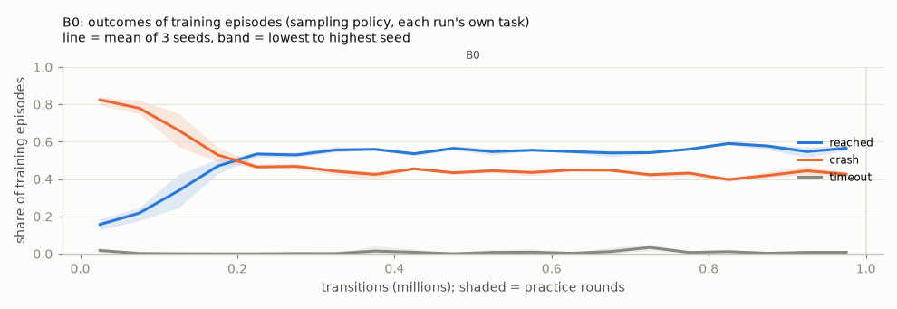
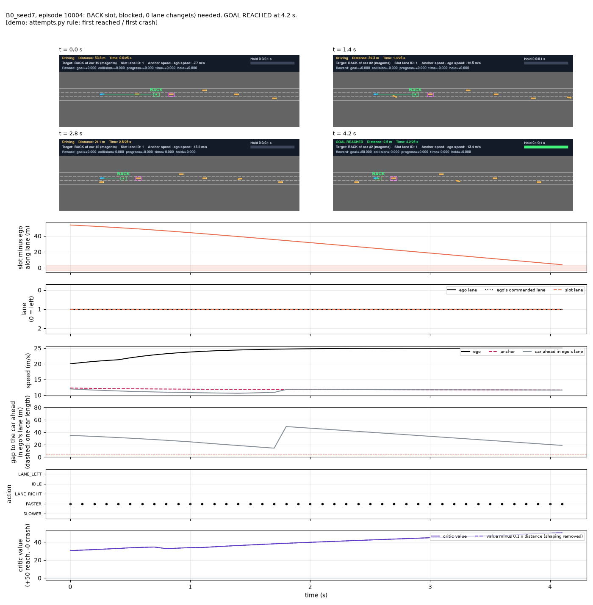
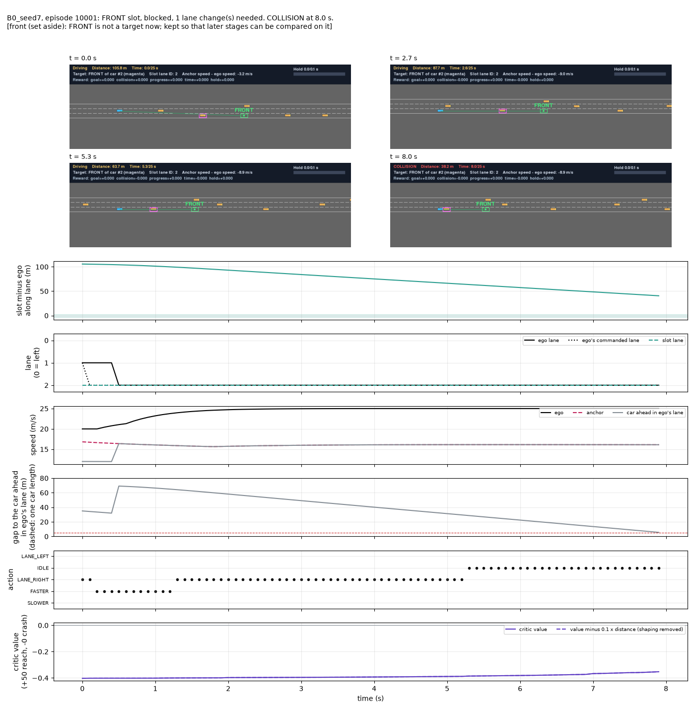

# B0: success only (the root)

*Step 1, trained 2026-11-08. Seeds: 7, 8, 9. [All attempts](README.md) · [Experiment notes](../EXPERIMENT_NOTES.md)*

**Status:** Root of the chain. Learns to reach by driving at full speed; crashes in about 44% of episodes.

## Idea

The simplest reward that equals what is scored: +50 for reaching the slot, nothing else. Every later arm changes
exactly one setting of its parent, so every effect can be traced to one change. Marcos's reward has more terms; each
can be added alone later.

*Prediction (written before the run):* it learns, with 35–60% success.

## Approach

Fresh weights, the full task, 1M transitions, seeds 7, 8, 9 on the Windows PC.

| Run | Arm | Task | Reward | Transitions | Starts from | Trained on |
|---|---|---|---:|---:|---|---|
| 1 | `B0` | full task | +50 reach, crash 0 | 1M | fresh weights | PC |

## Reward function

Of the last run, `B0` (per decision, in goal units after the reward scale):

- +50 when ego reaches the slot (the episode ends)
- 0 on a crash: a crash ends the episode with nothing, like a timeout
- 0 on a timeout (25 s) or a lost anchor

Written out: `r = 50·[reached]`, where [reached] and [crash] are 1 on the decision the episode ends that way and 0 otherwise.

## Hyperparameters

From `B0`'s saved configuration (identical for every run of the pipeline except the task, reward and starting weights shown above).

| Setting | Value |
|---|---|
| Algorithm | PPO, Stable-Baselines3 2.9.2 |
| Policy network | MLP 64-64 (tanh), separate from the value network |
| Value network | MLP 64-64 |
| Learning rate | 0.0003 (constant) |
| Environments in parallel | 3 |
| Steps per environment per update (n_steps) | 256 |
| Transitions per update | 768 |
| Minibatch size | 256 |
| Epochs per update | 5 |
| Discount γ | 0.99 |
| GAE λ | 0.95 |
| Clip range | 0.2 |
| Entropy coefficient | 0.01 |
| Value-loss coefficient | 0.5 |
| Gradient-norm clip (policy and value together) | 0.5 |
| Device | cpu |

Environment and task settings

| Setting | Value |
|---|---|
| Simulator | highway-env 1.12.1, highway-v0, 3 lanes |
| Traffic | 8 cars, density 0.7, preferred speeds 12–17 m/s (IDM and MOBIL) |
| Start | ego at 20 m/s; a car 35 m ahead in ego's lane |
| Decisions | 10 per second; episode limit 25 s (250 decisions) |
| Actions | LANE_LEFT, IDLE, LANE_RIGHT, FASTER, SLOWER; target speeds 10, 12.5, 15, 17.5, 20, 22.5, 25 m/s |
| Observation | 7 cars × 5 (presence, x, y, vx, vy), x ±200 m, plus goal, anchor, slot type, slot error and hold progress (53 numbers) |
| Anchor and slot | anchor: a random car 30–120 m ahead, held in its lane; FRONT 35 m ahead of it, BACK 15 m behind, LEFT/RIGHT beside |
| Success | ego's center within ±3 m along and ±1.5 m across the slot for 0.1 s (one decision) |
| Reward scale | 1 |
| Task | the full task: all four slots, natural start (ego at 20 m/s, a 12 m/s car 35 m ahead), traffic free to change lanes |

Software: highway-env 1.12.1, gymnasium 1.4.0, Stable-Baselines3 2.9.2, PyTorch 2.15.0, NumPy 2.5.4, Python 3.13.1.

## Results

Score = reached − crash per episode (+1, −1, 0 for a timeout), the study's measure since Step 8.

### Full task: 200 fixed episodes (10,000–10,199), final model of every seed

|  | Reached | Crash | Timeout | Score | B/L/R reached | B/L/R crash | FRONT reached | FRONT crash |
|---|---:|---:|---:|---:|---:|---:|---:|---:|
| seed 7 | 57.0% | 42.5% | 0.5% | +0.145 | 82.6% | 17.4% | 0.0% | 98.4% |
| seed 8 | 53.0% | 47.0% | 0.0% | +0.060 | 76.1% | 23.9% | 1.6% | 98.4% |
| seed 9 | 55.5% | 43.5% | 1.0% | +0.120 | 80.4% | 19.6% | 0.0% | 96.8% |
| **mean of 3** | **55.2%** | **44.3%** | 0.5% | **+0.108** | 79.7% | 20.3% | 0.5% | 97.8% |
| scripted driver | 76.5% | 2.5% | 21.0% | +0.740 | 81.9% | 2.2% | 64.5% | 3.2% |
| random driver | 11.5% | 79.0% | 9.5% | -0.675 | 15.2% | 76.1% | 3.2% | 85.5% |

## Training curves

## Demos

Training seed 7's final model on its own evaluation episodes (the full task), chosen by a fixed rule: the first FRONT episode it reaches (else the first blocked BACK/LEFT/RIGHT episode, else the first it reaches; on practice episodes simply the first), and the first it crashes in; a timeout fills either place if it never happens. Each figure shows four frames, then per decision the slot error, lanes, speeds, gap to the car ahead, the action and the critic's value. In the videos the anchor is outlined in magenta and the slot is the green box.

**Reached: episode 10004, BACK slot, success at 4.2 s.** [Video](../results/examples/B0_seed7/back_seed10004.mp4)

**Crash: episode 10001, FRONT slot, collision at 8.0 s.** [Video](../results/examples/B0_seed7/front_seed10001.mp4)

## Analysis

- **Prediction held:** 55% success.
- **Why it rams.** With only a success reward, a crash costs exactly what a timeout costs (0), and the discount pays
  more for arriving early. So the best policy is full speed toward the slot. That is what B0 learned: move to the
  slot's lane, accelerate to 25 m/s, never brake.
- **Every crash is a rear-end:** on FRONT into the anchor itself (the slot is 35 m past it, in its own lane),
  elsewhere into the 12 m/s lead car about 2.6 s in.
- FRONT is reached in 0–1 of 62 episodes.

