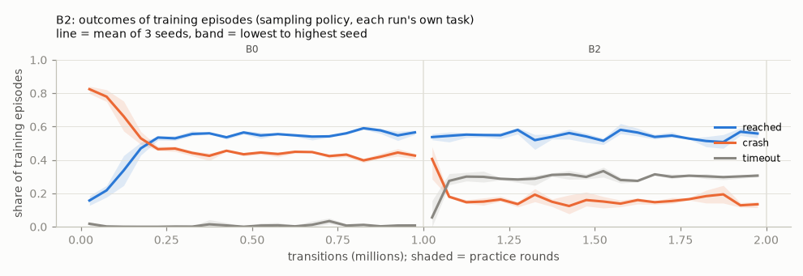
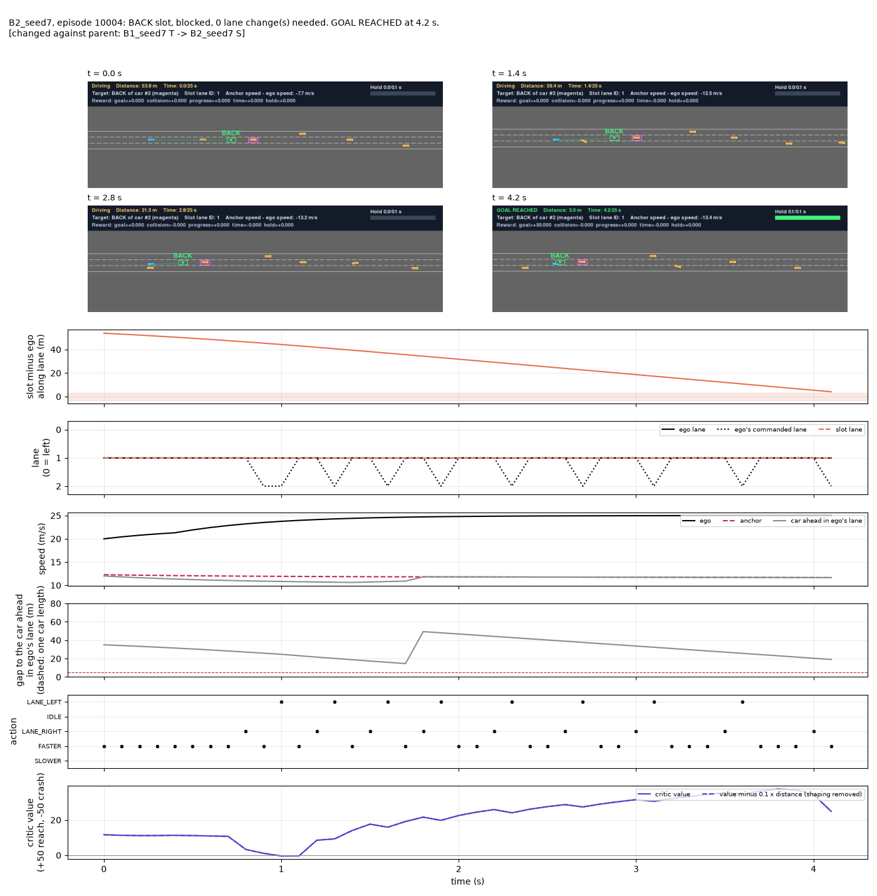
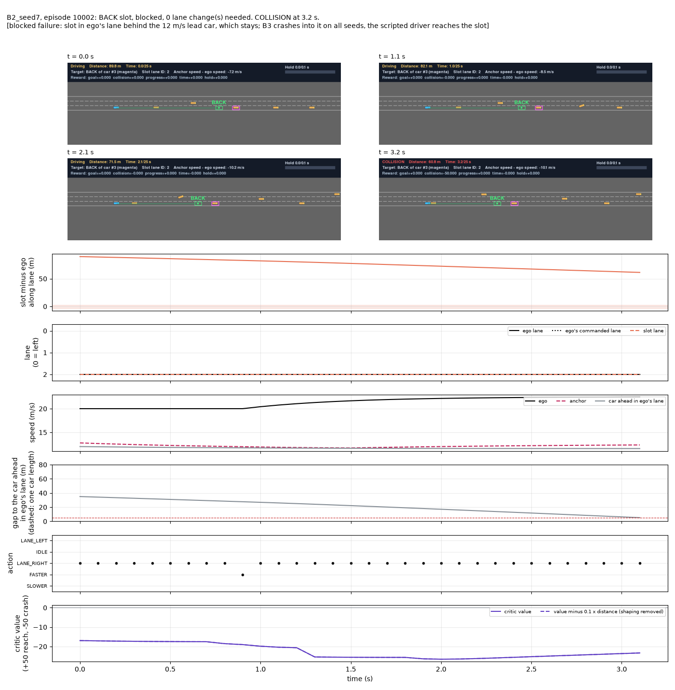

# B2: crash penalty, from B0's trained policy

*Step 3, trained 2026-11-08. Seeds: 7, 8, 9. [All attempts](README.md) · [Experiment notes](../EXPERIMENT_NOTES.md)*

**Status:** No collapse; crashes fall from 44% to 16%, but only by giving up FRONT.

## Idea

The same reward as B1, but starting from B0's trained policy (55% success). From there trying is worth about +5 from
the first update, so the crash cost should not make giving up the best option. One change from B1: the starting
weights.

*Prediction:* no collapse; crashes under 20%; BACK/LEFT/RIGHT at least B0's.

## Approach

B1's reward, starting from B0's trained policy (same seed); full task, 1M transitions.

| Run | Arm | Task | Reward | Transitions | Starts from | Trained on |
|---|---|---|---:|---:|---|---|
| 1 | `B0` | full task | +50 reach, crash 0 | 1M | fresh weights | PC |
| 2 | `B2` | full task | +50 reach, −50 crash | 1M | `B0`'s trained policy (same seed) | PC |

## Reward function

Of the last run, `B2` (per decision, in goal units after the reward scale):

- +50 when ego reaches the slot (the episode ends)
- −50 on a crash (the episode ends)
- 0 on a timeout (25 s) or a lost anchor

Written out: `r = 50·[reached] − 50·[crash]`, where [reached] and [crash] are 1 on the decision the episode ends that way and 0 otherwise.

Earlier runs of the pipeline used:

- `B0`: +50 reach, crash 0 (`r = 50·[reached]`)

## Hyperparameters

From `B2`'s saved configuration (identical for every run of the pipeline except the task, reward and starting weights shown above).

| Setting | Value |
|---|---|
| Algorithm | PPO, Stable-Baselines3 2.9.2 |
| Policy network | MLP 64-64 (tanh), separate from the value network |
| Value network | MLP 64-64 |
| Learning rate | 0.0003 (constant) |
| Environments in parallel | 3 |
| Steps per environment per update (n_steps) | 256 |
| Transitions per update | 768 |
| Minibatch size | 256 |
| Epochs per update | 5 |
| Discount γ | 0.99 |
| GAE λ | 0.95 |
| Clip range | 0.2 |
| Entropy coefficient | 0.01 |
| Value-loss coefficient | 0.5 |
| Gradient-norm clip (policy and value together) | 0.5 |
| Device | cpu |

Environment and task settings

| Setting | Value |
|---|---|
| Simulator | highway-env 1.12.1, highway-v0, 3 lanes |
| Traffic | 8 cars, density 0.7, preferred speeds 12–17 m/s (IDM and MOBIL) |
| Start | ego at 20 m/s; a car 35 m ahead in ego's lane |
| Decisions | 10 per second; episode limit 25 s (250 decisions) |
| Actions | LANE_LEFT, IDLE, LANE_RIGHT, FASTER, SLOWER; target speeds 10, 12.5, 15, 17.5, 20, 22.5, 25 m/s |
| Observation | 7 cars × 5 (presence, x, y, vx, vy), x ±200 m, plus goal, anchor, slot type, slot error and hold progress (53 numbers) |
| Anchor and slot | anchor: a random car 30–120 m ahead, held in its lane; FRONT 35 m ahead of it, BACK 15 m behind, LEFT/RIGHT beside |
| Success | ego's center within ±3 m along and ±1.5 m across the slot for 0.1 s (one decision) |
| Reward scale | 1 |
| Task | the full task: all four slots, natural start (ego at 20 m/s, a 12 m/s car 35 m ahead), traffic free to change lanes |

Software: highway-env 1.12.1, gymnasium 1.4.0, Stable-Baselines3 2.9.2, PyTorch 2.15.0, NumPy 2.5.4, Python 3.13.1.

## Results

Score = reached − crash per episode (+1, −1, 0 for a timeout), the study's measure since Step 8.

### Full task: 200 fixed episodes (10,000–10,199), final model of every seed

|  | Reached | Crash | Timeout | Score | B/L/R reached | B/L/R crash | FRONT reached | FRONT crash |
|---|---:|---:|---:|---:|---:|---:|---:|---:|
| seed 7 | 53.0% | 16.0% | 31.0% | +0.370 | 76.8% | 23.2% | 0.0% | 0.0% |
| seed 8 | 56.5% | 12.5% | 31.0% | +0.440 | 81.9% | 18.1% | 0.0% | 0.0% |
| seed 9 | 48.5% | 20.5% | 31.0% | +0.280 | 70.3% | 29.7% | 0.0% | 0.0% |
| **mean of 3** | **52.7%** | **16.3%** | 31.0% | **+0.363** | 76.3% | 23.7% | 0.0% | 0.0% |
| scripted driver | 76.5% | 2.5% | 21.0% | +0.740 | 81.9% | 2.2% | 64.5% | 3.2% |
| random driver | 11.5% | 79.0% | 9.5% | -0.675 | 15.2% | 76.1% | 3.2% | 85.5% |

## Training curves

## Demos

Training seed 7's final model on its own evaluation episodes (the full task), chosen by a fixed rule: the first FRONT episode it reaches (else the first blocked BACK/LEFT/RIGHT episode, else the first it reaches; on practice episodes simply the first), and the first it crashes in; a timeout fills either place if it never happens. Each figure shows four frames, then per decision the slot error, lanes, speeds, gap to the car ahead, the action and the critic's value. In the videos the anchor is outlined in magenta and the slot is the green box.

**Reached: episode 10004, BACK slot, success at 4.2 s.** [Video](../results/examples/B2_seed7/back_seed10004.mp4)

**Crash: episode 10002, BACK slot, collision at 3.2 s.** [Video](../results/examples/B2_seed7/back_seed10002.mp4)

## Analysis

- **No collapse**, and crashes fall from 44% to 16%.
- **The whole drop comes from FRONT:** there every B0 attempt cost −50, so the policy stopped pursuing FRONT. All 62
  FRONT episodes time out.
- **BACK/LEFT/RIGHT crashes are unchanged.** At ±50, a gamble that wins about half the time is worth about as much as
  giving up, so nothing pushes the policy to brake behind a slower car.

