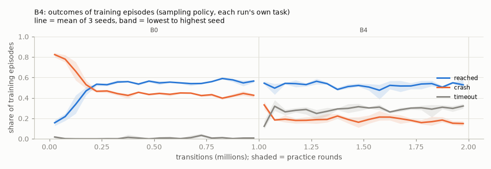
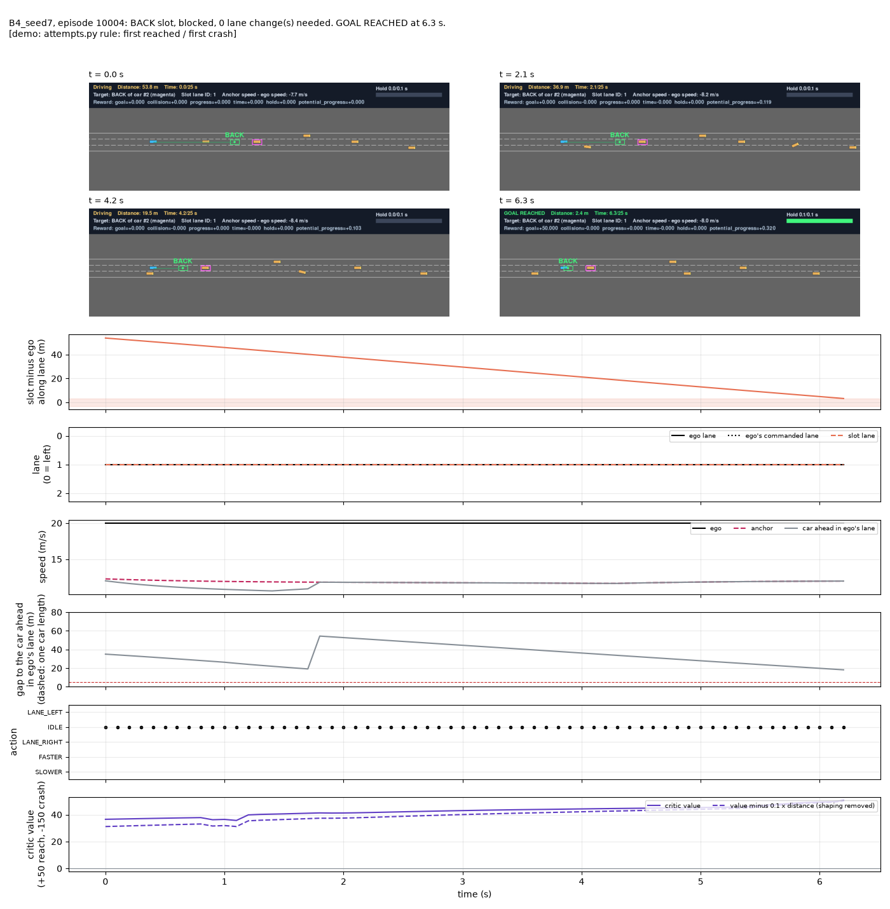
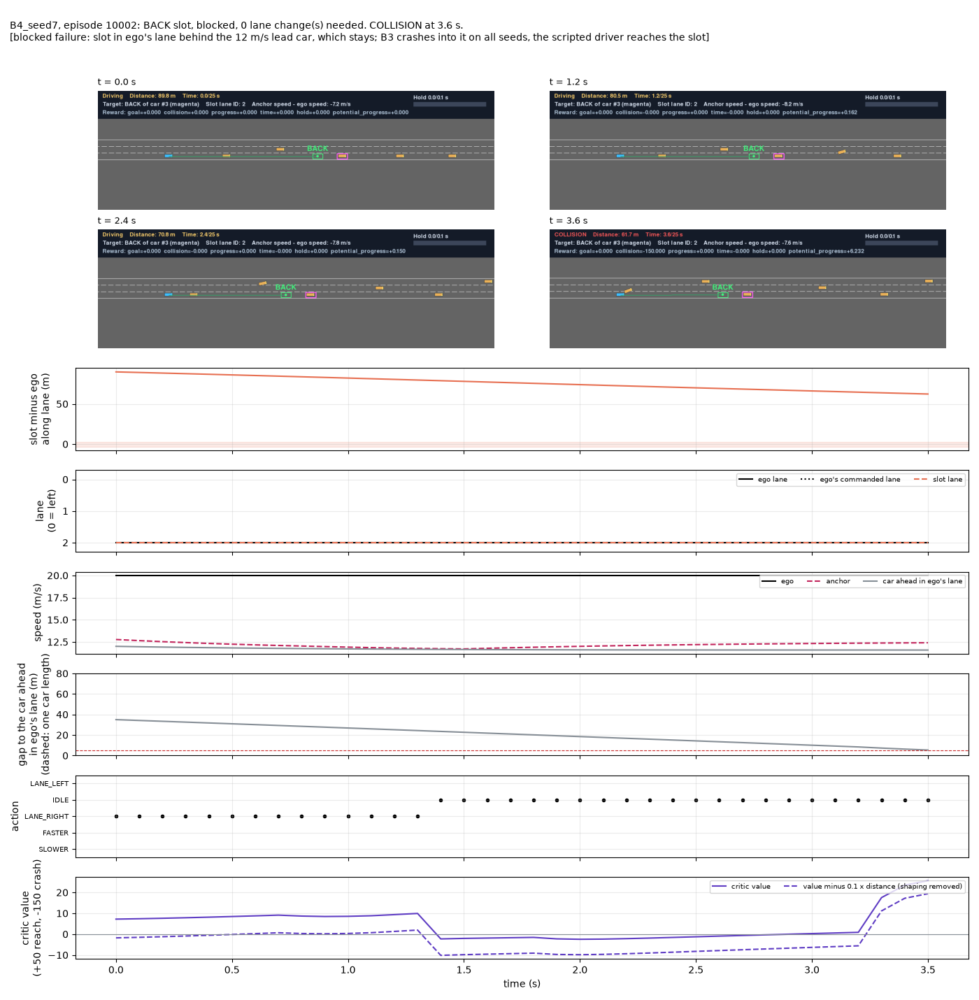

# B4: crash penalty ×3 (50 → 150)

*Step 6, trained 2026-11-09. Seeds: 7, 8, 9. [All attempts](README.md) · [Experiment notes](../EXPERIMENT_NOTES.md)*

**Status:** Failed: crashes unchanged. The critic learned the price; the policy did not brake.

## Idea

Step 5's diagnosis: every BACK/LEFT/RIGHT failure is a crash into a slower car in the slot's lane. At ±50, ramming
(which wins about half the time) and waiting are worth about the same. At −150, ramming is worth about −40 against 0
for waiting, so the policy should learn to hold back.

*Prediction:* BACK/LEFT/RIGHT crashes at most 10 per seed, success 105–116.

## Approach

B3m with the crash cost tripled, starting from B0's trained policy; full task, 1M transitions, Mac.

| Run | Arm | Task | Reward | Transitions | Starts from | Trained on |
|---|---|---|---:|---:|---|---|
| 1 | `B0` | full task | +50 reach, crash 0 | 1M | fresh weights | PC |
| 2 | `B4` | full task | +50 reach, −150 crash, progress 0.1/m | 1M | `B0`'s trained policy (same seed) | Mac |

## Reward function

Of the last run, `B4` (per decision, in goal units after the reward scale):

- +50 when ego reaches the slot (the episode ends)
- −150 on a crash (the episode ends)
- +0.1 × (γ·Φ(next) − Φ(now)) per decision, Φ = −(distance to the slot in m), γ = 0.99: potential-based progress, which cannot change the best policy
- 0 on a timeout (25 s) or a lost anchor

Written out: `r = 50·[reached] − 150·[crash] + 0.1·(0.99·Φ′ − Φ)`, where [reached] and [crash] are 1 on the decision the episode ends that way and 0 otherwise.

Earlier runs of the pipeline used:

- `B0`: +50 reach, crash 0 (`r = 50·[reached]`)

## Hyperparameters

From `B4`'s saved configuration (identical for every run of the pipeline except the task, reward and starting weights shown above).

| Setting | Value |
|---|---|
| Algorithm | PPO, Stable-Baselines3 2.9.2 |
| Policy network | MLP 64-64 (tanh), separate from the value network |
| Value network | MLP 64-64 |
| Learning rate | 0.0003 (constant) |
| Environments in parallel | 3 |
| Steps per environment per update (n_steps) | 256 |
| Transitions per update | 768 |
| Minibatch size | 256 |
| Epochs per update | 5 |
| Discount γ | 0.99 |
| GAE λ | 0.95 |
| Clip range | 0.2 |
| Entropy coefficient | 0.01 |
| Value-loss coefficient | 0.5 |
| Gradient-norm clip (policy and value together) | 0.5 |
| Device | cpu |

Environment and task settings

| Setting | Value |
|---|---|
| Simulator | highway-env 1.12.1, highway-v0, 3 lanes |
| Traffic | 8 cars, density 0.7, preferred speeds 12–17 m/s (IDM and MOBIL) |
| Start | ego at 20 m/s; a car 35 m ahead in ego's lane |
| Decisions | 10 per second; episode limit 25 s (250 decisions) |
| Actions | LANE_LEFT, IDLE, LANE_RIGHT, FASTER, SLOWER; target speeds 10, 12.5, 15, 17.5, 20, 22.5, 25 m/s |
| Observation | 7 cars × 5 (presence, x, y, vx, vy), x ±200 m, plus goal, anchor, slot type, slot error and hold progress (53 numbers) |
| Anchor and slot | anchor: a random car 30–120 m ahead, held in its lane; FRONT 35 m ahead of it, BACK 15 m behind, LEFT/RIGHT beside |
| Success | ego's center within ±3 m along and ±1.5 m across the slot for 0.1 s (one decision) |
| Reward scale | 1 |
| Task | the full task: all four slots, natural start (ego at 20 m/s, a 12 m/s car 35 m ahead), traffic free to change lanes |

Software: highway-env 1.12.1, gymnasium 1.4.0, Stable-Baselines3 2.9.2, PyTorch 2.15.0, NumPy 2.5.4, Python 3.12.13.

## Results

Score = reached − crash per episode (+1, −1, 0 for a timeout), the study's measure since Step 8.

### Full task: 200 fixed episodes (10,000–10,199), final model of every seed

|  | Reached | Crash | Timeout | Score | B/L/R reached | B/L/R crash | FRONT reached | FRONT crash |
|---|---:|---:|---:|---:|---:|---:|---:|---:|
| seed 7 | 56.5% | 15.0% | 28.5% | +0.415 | 81.9% | 18.1% | 0.0% | 8.1% |
| seed 8 | 55.0% | 14.0% | 31.0% | +0.410 | 79.7% | 20.3% | 0.0% | 0.0% |
| seed 9 | 44.5% | 17.5% | 38.0% | +0.270 | 64.5% | 21.0% | 0.0% | 9.7% |
| **mean of 3** | **52.0%** | **15.5%** | 32.5% | **+0.365** | 75.4% | 19.8% | 0.0% | 5.9% |
| scripted driver | 76.5% | 2.5% | 21.0% | +0.740 | 81.9% | 2.2% | 64.5% | 3.2% |
| random driver | 11.5% | 79.0% | 9.5% | -0.675 | 15.2% | 76.1% | 3.2% | 85.5% |

## Training curves

## Demos

Training seed 7's final model on its own evaluation episodes (the full task), chosen by a fixed rule: the first FRONT episode it reaches (else the first blocked BACK/LEFT/RIGHT episode, else the first it reaches; on practice episodes simply the first), and the first it crashes in; a timeout fills either place if it never happens. Each figure shows four frames, then per decision the slot error, lanes, speeds, gap to the car ahead, the action and the critic's value. In the videos the anchor is outlined in magenta and the slot is the green box.

**Reached: episode 10004, BACK slot, success at 6.3 s.** [Video](../results/examples/B4_seed7/back_seed10004.mp4)

**Crash: episode 10002, BACK slot, collision at 3.6 s.** [Video](../results/examples/B4_seed7/back_seed10002.mp4)

## Analysis

- **Failed.** Crashes on BACK/LEFT/RIGHT are 25, 28 and 29 per seed (B3m: 27, 25, 28). Seed 9 lost 21 RIGHT successes to
  timeouts without crashing less.
- **The critic learned the price**: its value in blocked episodes fell from about 0 to −5, −50 and −27, and lower just
  before ramming. But the policy's probability of SLOWER behind the blocking car did not rise (7%, 0.5%, 7%).
- **The better outcome is almost never tried:** about 30 of the ~6,300 BACK/LEFT/RIGHT training episodes per seed end
  with ego waiting, against about 1,460 crashes.
- Found later (Step 7a): the shared gradient clip throttled every update, and tripling the penalty tripled the value
  gradient that caused it.

