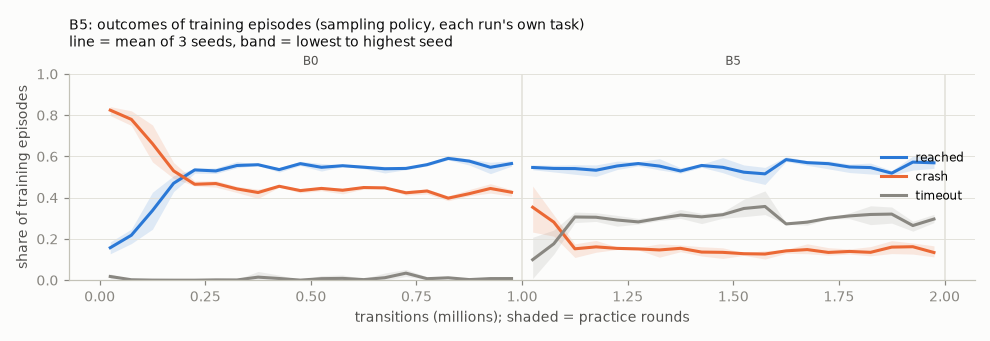
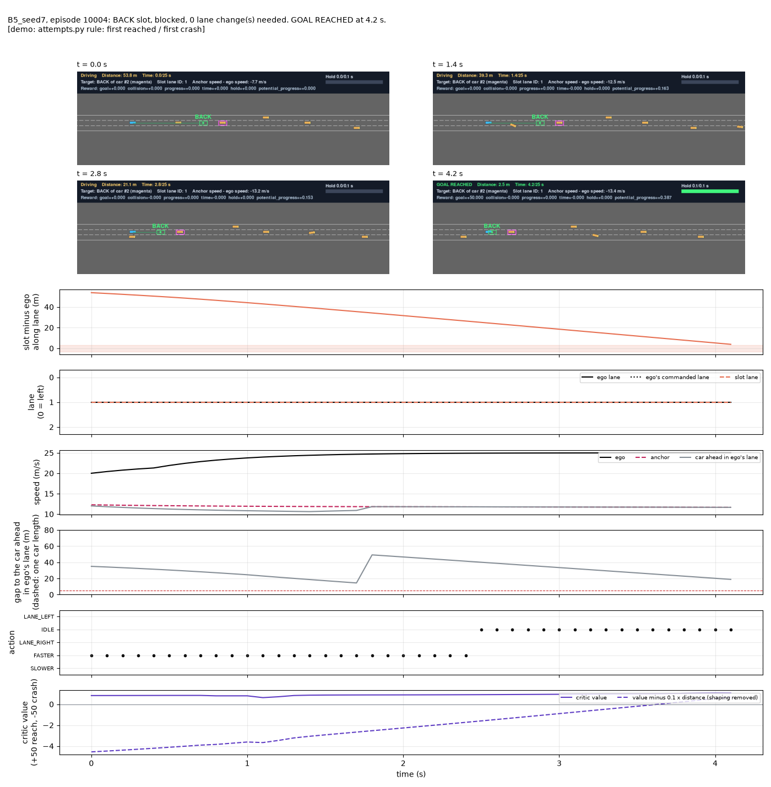
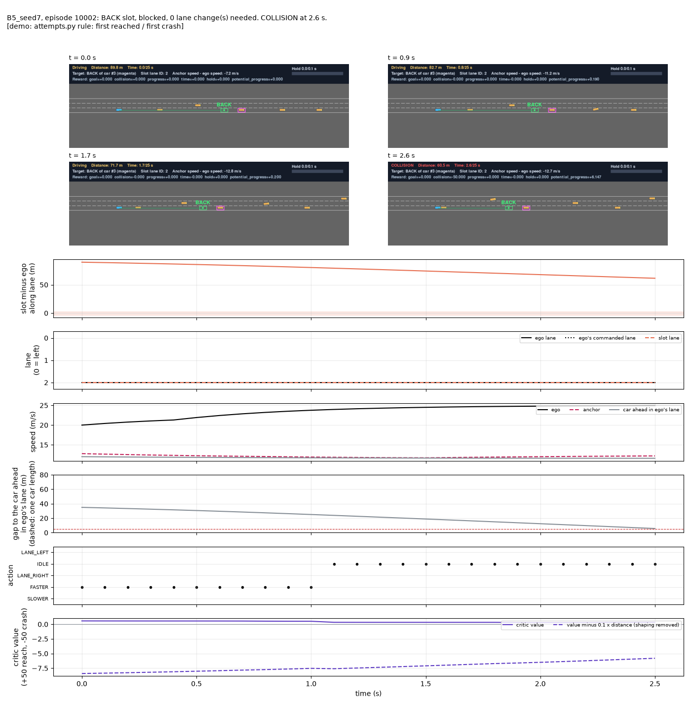

# B5: reward scaled by 1/50 (fixes a training throttle)

*Step 7a, trained 2026-11-15. Seeds: 7, 8, 9. [All attempts](README.md) · [Experiment notes](../EXPERIMENT_NOTES.md)*

**Status:** The throttle is fixed, outcomes unchanged. Every later run uses this scale.

## Idea

The Step 7a audit found that one gradient-norm clip (0.5) covers the policy and value networks together. With rewards
of ±50, the value gradient is 30–120 times the policy gradient, so every update was scaled down to 1–4% (median KL
≈ 0.001, clip fraction ≈ 0). Multiplying the whole reward by a positive constant cannot change the best policy, so
scale 0.02 (goal = +1) removes the throttle without changing the task. B0's critic output is multiplied by 0.02 at
load, so the starting policy is identical.

*Prediction:* normal-sized updates (KL 0.005–0.02); BACK/LEFT/RIGHT crashes below B3m's on two seeds.

## Approach

B3m with the reward multiplied by 0.02, starting from B0's trained policy; full task, 1M transitions, Mac.

| Run | Arm | Task | Reward | Transitions | Starts from | Trained on |
|---|---|---|---:|---:|---|---|
| 1 | `B0` | full task | +50 reach, crash 0 | 1M | fresh weights | PC |
| 2 | `B5` | full task | +1 reach, −1 crash, progress 0.002/m | 1M | `B0`'s trained policy (same seed) | Mac |

## Reward function

Of the last run, `B5` (per decision, in goal units after the reward scale):

- +1 when ego reaches the slot (the episode ends)
- −1 on a crash (the episode ends)
- +0.002 × (γ·Φ(next) − Φ(now)) per decision, Φ = −(distance to the slot in m), γ = 0.99: potential-based progress, which cannot change the best policy
- 0 on a timeout (25 s) or a lost anchor

Written out: `r = 0.02 × (50·[reached] − 50·[crash] + 0.1·(0.99·Φ′ − Φ))`, where [reached] and [crash] are 1 on the decision the episode ends that way and 0 otherwise.

Earlier runs of the pipeline used:

- `B0`: +50 reach, crash 0 (`r = 50·[reached]`)

## Hyperparameters

From `B5`'s saved configuration (identical for every run of the pipeline except the task, reward and starting weights shown above).

| Setting | Value |
|---|---|
| Algorithm | PPO, Stable-Baselines3 2.9.2 |
| Policy network | MLP 64-64 (tanh), separate from the value network |
| Value network | MLP 64-64 |
| Learning rate | 0.0003 (constant) |
| Environments in parallel | 3 |
| Steps per environment per update (n_steps) | 256 |
| Transitions per update | 768 |
| Minibatch size | 256 |
| Epochs per update | 5 |
| Discount γ | 0.99 |
| GAE λ | 0.95 |
| Clip range | 0.2 |
| Entropy coefficient | 0.01 |
| Value-loss coefficient | 0.5 |
| Gradient-norm clip (policy and value together) | 0.5 |
| Device | cpu |

Environment and task settings

| Setting | Value |
|---|---|
| Simulator | highway-env 1.12.1, highway-v0, 3 lanes |
| Traffic | 8 cars, density 0.7, preferred speeds 12–17 m/s (IDM and MOBIL) |
| Start | ego at 20 m/s; a car 35 m ahead in ego's lane |
| Decisions | 10 per second; episode limit 25 s (250 decisions) |
| Actions | LANE_LEFT, IDLE, LANE_RIGHT, FASTER, SLOWER; target speeds 10, 12.5, 15, 17.5, 20, 22.5, 25 m/s |
| Observation | 7 cars × 5 (presence, x, y, vx, vy), x ±200 m, plus goal, anchor, slot type, slot error and hold progress (53 numbers) |
| Anchor and slot | anchor: a random car 30–120 m ahead, held in its lane; FRONT 35 m ahead of it, BACK 15 m behind, LEFT/RIGHT beside |
| Success | ego's center within ±3 m along and ±1.5 m across the slot for 0.1 s (one decision) |
| Reward scale | 0.02 |
| Task | the full task: all four slots, natural start (ego at 20 m/s, a 12 m/s car 35 m ahead), traffic free to change lanes |

Software: highway-env 1.12.1, gymnasium 1.4.0, Stable-Baselines3 2.9.2, PyTorch 2.15.0, NumPy 2.5.4, Python 3.12.13.

## Results

Score = reached − crash per episode (+1, −1, 0 for a timeout), the study's measure since Step 8.

### Full task: 200 fixed episodes (10,000–10,199), final model of every seed

|  | Reached | Crash | Timeout | Score | B/L/R reached | B/L/R crash | FRONT reached | FRONT crash |
|---|---:|---:|---:|---:|---:|---:|---:|---:|
| seed 7 | 56.5% | 14.5% | 29.0% | +0.420 | 81.9% | 18.1% | 0.0% | 6.5% |
| seed 8 | 56.5% | 13.0% | 30.5% | +0.435 | 81.9% | 18.1% | 0.0% | 1.6% |
| seed 9 | 56.5% | 17.0% | 26.5% | +0.395 | 81.9% | 18.1% | 0.0% | 14.5% |
| **mean of 3** | **56.5%** | **14.8%** | 28.7% | **+0.417** | 81.9% | 18.1% | 0.0% | 7.5% |
| scripted driver | 76.5% | 2.5% | 21.0% | +0.740 | 81.9% | 2.2% | 64.5% | 3.2% |
| random driver | 11.5% | 79.0% | 9.5% | -0.675 | 15.2% | 76.1% | 3.2% | 85.5% |

## Training curves

## Demos

Training seed 7's final model on its own evaluation episodes (the full task), chosen by a fixed rule: the first FRONT episode it reaches (else the first blocked BACK/LEFT/RIGHT episode, else the first it reaches; on practice episodes simply the first), and the first it crashes in; a timeout fills either place if it never happens. Each figure shows four frames, then per decision the slot error, lanes, speeds, gap to the car ahead, the action and the critic's value. In the videos the anchor is outlined in magenta and the slot is the green box.

**Reached: episode 10004, BACK slot, success at 4.2 s.** [Video](../results/examples/B5_seed7/back_seed10004.mp4)

**Crash: episode 10002, BACK slot, collision at 2.6 s.** [Video](../results/examples/B5_seed7/back_seed10002.mp4)

## Analysis

- **The mechanism is fixed:** the value network's share of the gradient falls from 100% to 3–19%, and updates are 5
  times larger (still below the predicted range).
- **Outcomes are unchanged:** 113 / 25 / 0 on BACK/LEFT/RIGHT on every seed. The throttle was real but was not what
  held the policy in place.
- **Reading:** every arm from B0 to B5 reaches essentially the same episodes. About 25 BACK/LEFT/RIGHT episodes need a
  pass, and no arm learned one. That led to Step 7's passing practice.

