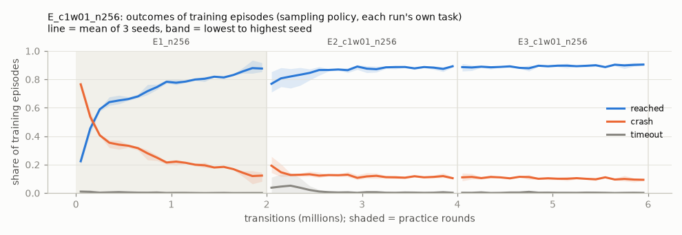
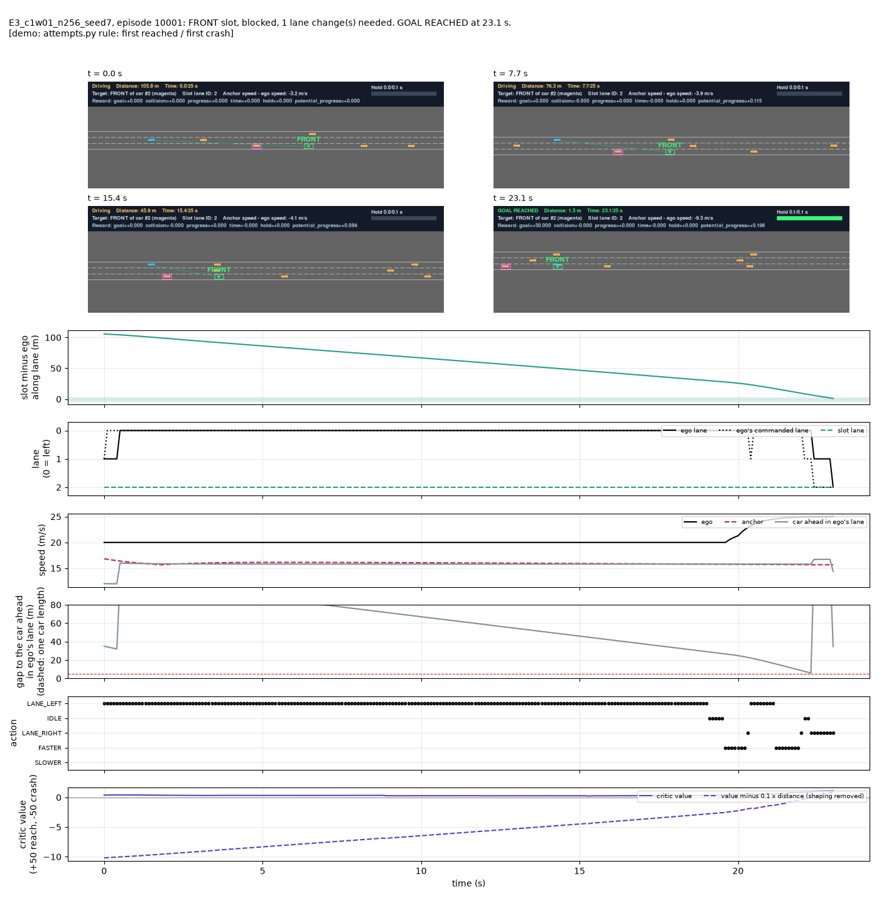
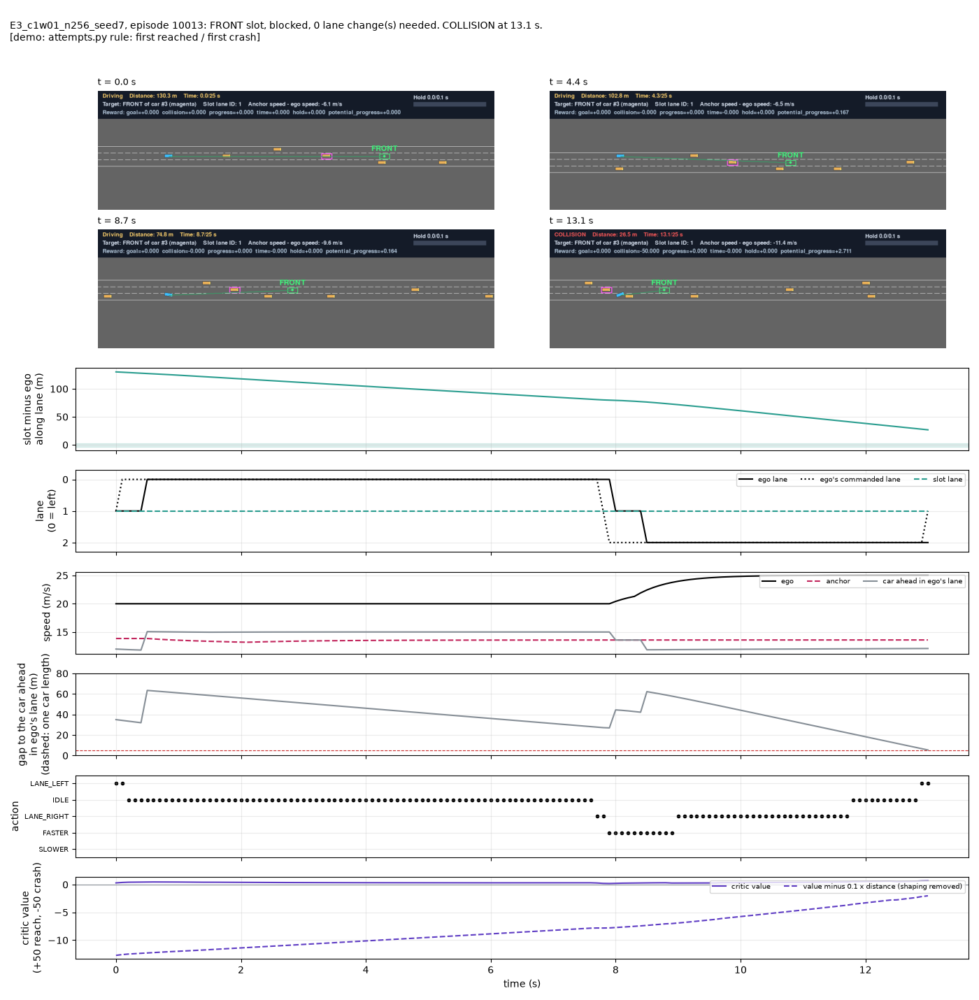

# E_c1w01_n256: practice with easy starts, c1w01, 256 wide

*Step 8a, trained 2026-11-18 to 2026-11-20. Seeds: 7, 10, 13. [All attempts](README.md) · [Experiment notes](../EXPERIMENT_NOTES.md)*

**Status:** Screened in Step 8a on 3 seeds; not a finalist.

## Idea

**Order E, practice with easy starts.** Round 1 is success only on P4's practice task (easy starts); rounds 2 and 3 are the full task. P4 → P6 without P5's second practice round.

**Crash cost 1 × goal**, P6's level: a crash costs as much as a goal.

**Progress shaping 0.1 per m** (potential-based; it cannot change the best policy). P6 had it by inheritance and it was never tested on this path.

**256-256 networks** instead of 64-64 (about 160k weights instead of 16k). The user's rule: a larger model only for a large measured gain.

Step 8a tested network width at P6's reward on order E (3 seeds). The bar, written before: 256 is adopted only if it adds +0.10 on all 3 seeds with no more crashes.

## Approach

Three rounds of 2M transitions on the Windows PC, each starting from the previous round's trained policy (same seed); round 1 from fresh weights, success only.

| Run | Arm | Task | Reward | Transitions | Starts from | Trained on |
|---|---|---|---:|---:|---|---|
| 1 | `E1_n256` | practice with easy starts | +1 reach, crash 0 | 2M | fresh weights | PC |
| 2 | `E2_c1w01_n256` | full task | +1 reach, −1 crash, progress 0.002/m | 2M | `E1_n256`'s trained policy (same seed) | PC |
| 3 | `E3_c1w01_n256` | full task | +1 reach, −1 crash, progress 0.002/m | 2M | `E2_c1w01_n256`'s trained policy (same seed) | PC |

## Reward function

Of the last run, `E3_c1w01_n256` (per decision, in goal units after the reward scale):

- +1 when ego reaches the slot (the episode ends)
- −1 on a crash (the episode ends)
- +0.002 × (γ·Φ(next) − Φ(now)) per decision, Φ = −(distance to the slot in m), γ = 0.99: potential-based progress, which cannot change the best policy
- 0 on a timeout (25 s) or a lost anchor

Written out: `r = 0.02 × (50·[reached] − 50·[crash] + 0.1·(0.99·Φ′ − Φ))`, where [reached] and [crash] are 1 on the decision the episode ends that way and 0 otherwise.

Earlier runs of the pipeline used:

- `E1_n256`: +1 reach, crash 0 (`r = 0.02 × (50·[reached])`)

## Hyperparameters

From `E3_c1w01_n256`'s saved configuration (identical for every run of the pipeline except the task, reward and starting weights shown above).

| Setting | Value |
|---|---|
| Algorithm | PPO, Stable-Baselines3 2.9.2 |
| Policy network | MLP 256-256 (tanh), separate from the value network |
| Value network | MLP 256-256 |
| Learning rate | 0.0003 (constant) |
| Environments in parallel | 3 |
| Steps per environment per update (n_steps) | 256 |
| Transitions per update | 768 |
| Minibatch size | 256 |
| Epochs per update | 5 |
| Discount γ | 0.99 |
| GAE λ | 0.95 |
| Clip range | 0.2 |
| Entropy coefficient | 0.01 |
| Value-loss coefficient | 0.5 |
| Gradient-norm clip (policy and value together) | 0.5 |
| Device | cpu |

Environment and task settings

| Setting | Value |
|---|---|
| Simulator | highway-env 1.12.1, highway-v0, 3 lanes |
| Traffic | 8 cars, density 0.7, preferred speeds 12–17 m/s (IDM and MOBIL) |
| Start | ego at 20 m/s; a car 35 m ahead in ego's lane |
| Decisions | 10 per second; episode limit 25 s (250 decisions) |
| Actions | LANE_LEFT, IDLE, LANE_RIGHT, FASTER, SLOWER; target speeds 10, 12.5, 15, 17.5, 20, 22.5, 25 m/s |
| Observation | 7 cars × 5 (presence, x, y, vx, vy), x ±200 m, plus goal, anchor, slot type, slot error and hold progress (53 numbers) |
| Anchor and slot | anchor: a random car 30–120 m ahead, held in its lane; FRONT 35 m ahead of it, BACK 15 m behind, LEFT/RIGHT beside |
| Success | ego's center within ±3 m along and ±1.5 m across the slot for 0.1 s (one decision) |
| Reward scale | 0.02 |
| Task | the full task: all four slots, natural start (ego at 20 m/s, a 12 m/s car 35 m ahead), traffic free to change lanes |

Software: highway-env 1.12.1, gymnasium 1.4.0, Stable-Baselines3 2.9.2, PyTorch 2.15.0, NumPy 2.5.4, Python 3.13.1.

## Results

Score = reached − crash per episode (+1, −1, 0 for a timeout), the study's measure since Step 8.

### Full task: 200 fixed episodes (10,000–10,199), final model of every seed

|  | Reached | Crash | Timeout | Score | B/L/R reached | B/L/R crash | FRONT reached | FRONT crash |
|---|---:|---:|---:|---:|---:|---:|---:|---:|
| seed 7 | 87.5% | 11.0% | 1.5% | +0.765 | 94.2% | 5.8% | 72.6% | 22.6% |
| seed 10 | 86.5% | 13.0% | 0.5% | +0.735 | 91.3% | 8.7% | 75.8% | 22.6% |
| seed 13 | 84.5% | 15.0% | 0.5% | +0.695 | 91.3% | 8.7% | 69.4% | 29.0% |
| **mean of 3** | **86.2%** | **13.0%** | 0.8% | **+0.732** | 92.3% | 7.7% | 72.6% | 24.7% |
| scripted driver | 76.5% | 2.5% | 21.0% | +0.740 | 81.9% | 2.2% | 64.5% | 3.2% |
| random driver | 11.5% | 79.0% | 9.5% | -0.675 | 15.2% | 76.1% | 3.2% | 85.5% |

### Practice task: 200 fixed practice episodes, final model

Step 8 measures every practice round on one practice task: the 200 natural-start practice episodes (blocked BACK/LEFT/RIGHT, blocker held), whatever starts the round trained on.

| Run | Task | Reached | Crash | Timeout | Reached, by seed |
|---|---|---:|---:|---:|---:|
| `E1_n256` | practice, natural start (blocker held) | 52.8% | 47.2% | 0.0% | 92%, 28%, 38% |

### Step 8's own measure: 400 selection episodes (10,000–10,199 and 40,000–40,199), full task

Every round's model on the full task. Rounds 3 and 4 are the mean of the final model and the checkpoints 400k and 200k before the end, as the grid scored them; rounds 1–2 are the final model.

| Model | Score | Reached | Crash | Timeout | FRONT reached | Seeds giving up on FRONT (≥ 30% timeouts) | Score by seed |
|---|---:|---:|---:|---:|---:|---:|---:|
| `E1_n256` (after 2M) | +0.367 | 68.2% | 31.5% | 0.2% | 44.9% | 0 of 3 | +0.76, +0.28, +0.06 |
| `E2_c1w01_n256` (after 4M) | +0.754 | 87.6% | 12.2% | 0.2% | 73.4% | 0 of 3 | +0.64, +0.79, +0.84 |
| `E3_c1w01_n256` (after 6M) | +0.752 | 87.3% | 12.1% | 0.5% | 75.2% | 0 of 3 | +0.80, +0.74, +0.71 |

## Training curves

## Demos

Training seed 7's final model on its own evaluation episodes (the full task), chosen by a fixed rule: the first FRONT episode it reaches (else the first blocked BACK/LEFT/RIGHT episode, else the first it reaches; on practice episodes simply the first), and the first it crashes in; a timeout fills either place if it never happens. Each figure shows four frames, then per decision the slot error, lanes, speeds, gap to the car ahead, the action and the critic's value. In the videos the anchor is outlined in magenta and the slot is the green box.

**Reached: episode 10001, FRONT slot, success at 23.1 s.** [Video](../results/examples/E3_c1w01_n256_seed7/front_seed10001.mp4)

**Crash: episode 10013, FRONT slot, collision at 13.1 s.** [Video](../results/examples/E3_c1w01_n256_seed7/front_seed10013.mp4)

## Analysis

- On the screening seeds (7, 10, 13) it ranks 2 of the 4 256-256 pipelines (score +0.752; the best is O_c1w0t4_n256, +0.810).
- Against the same pipeline at 64-64 (`E3_c1w01`): +0.067 (95% interval -0.245 to +0.379, p 0.45, ahead on 2 of 3 seeds; crash rate +2.4 points).

Across 8a: 256 − 64 = +0.067 (p 0.45, ahead on 2 of 3 seeds), so 64-64 stayed. The 64-wide pipeline's weak seed (10) never learned to pass in round 1; 256-wide gave up on no seed.

**The first 256-wide pipeline (8a).** +0.752 against +0.685 at 64-64, but not beyond noise (p 0.45) and not ahead on
every seed, so 64 stayed. Every seed landed between +0.71 and +0.80, and no seed gave up on FRONT: the first sign of
what 8e confirmed.

