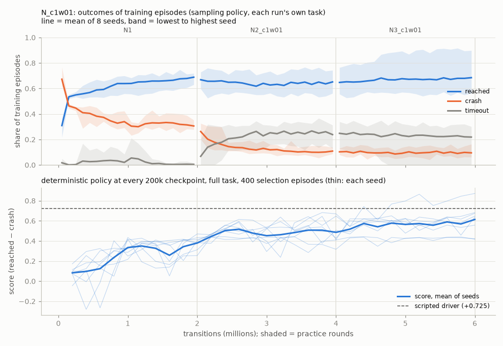
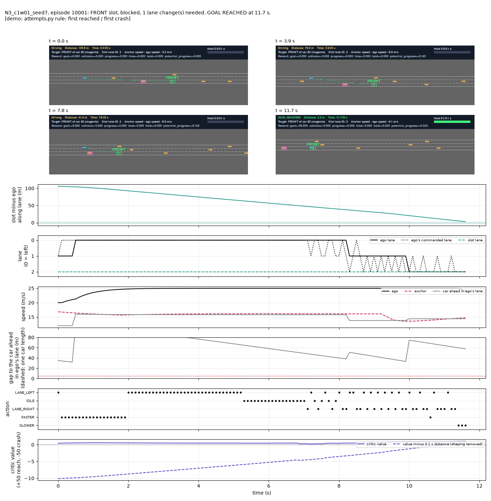
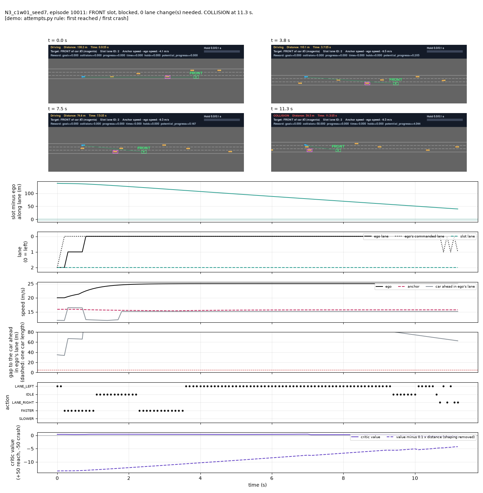

# N_c1w01: no practice, c1w01

*Step 8b, trained 2026-11-18 to 2026-11-20. Seeds: 7, 10, 13, 16, 19, 22, 25, 28. [All attempts](README.md) · [Experiment notes](../EXPERIMENT_NOTES.md)*

**Status:** 8d finalist: confirmed on 5 new seeds (8 in all); not chosen.

## Idea

**Order N, no practice.** All three rounds are on the full task. Round 1 is success only (B0's lesson: learn to reach before any crash cost); rounds 2 and 3 use the reward under test. It asks whether practice is needed at all.

**Crash cost 1 × goal**, P6's level: a crash costs as much as a goal.

**Progress shaping 0.1 per m** (potential-based; it cannot change the best policy). P6 had it by inheritance and it was never tested on this path.

Step 8b compared the four training orders at P6's reward (crash 1, progress 0.1), 64-64, 3 seeds.

## Approach

Three rounds of 2M transitions on the Windows PC, each starting from the previous round's trained policy (same seed); round 1 from fresh weights, success only.

| Run | Arm | Task | Reward | Transitions | Starts from | Trained on |
|---|---|---|---:|---:|---|---|
| 1 | `N1` | full task | +1 reach, crash 0 | 2M | fresh weights | PC |
| 2 | `N2_c1w01` | full task | +1 reach, −1 crash, progress 0.002/m | 2M | `N1`'s trained policy (same seed) | PC |
| 3 | `N3_c1w01` | full task | +1 reach, −1 crash, progress 0.002/m | 2M | `N2_c1w01`'s trained policy (same seed) | PC |

## Reward function

Of the last run, `N3_c1w01` (per decision, in goal units after the reward scale):

- +1 when ego reaches the slot (the episode ends)
- −1 on a crash (the episode ends)
- +0.002 × (γ·Φ(next) − Φ(now)) per decision, Φ = −(distance to the slot in m), γ = 0.99: potential-based progress, which cannot change the best policy
- 0 on a timeout (25 s) or a lost anchor

Written out: `r = 0.02 × (50·[reached] − 50·[crash] + 0.1·(0.99·Φ′ − Φ))`, where [reached] and [crash] are 1 on the decision the episode ends that way and 0 otherwise.

Earlier runs of the pipeline used:

- `N1`: +1 reach, crash 0 (`r = 0.02 × (50·[reached])`)

## Hyperparameters

From `N3_c1w01`'s saved configuration (identical for every run of the pipeline except the task, reward and starting weights shown above).

| Setting | Value |
|---|---|
| Algorithm | PPO, Stable-Baselines3 2.9.2 |
| Policy network | MLP 64-64 (tanh), separate from the value network |
| Value network | MLP 64-64 |
| Learning rate | 0.0003 (constant) |
| Environments in parallel | 3 |
| Steps per environment per update (n_steps) | 256 |
| Transitions per update | 768 |
| Minibatch size | 256 |
| Epochs per update | 5 |
| Discount γ | 0.99 |
| GAE λ | 0.95 |
| Clip range | 0.2 |
| Entropy coefficient | 0.01 |
| Value-loss coefficient | 0.5 |
| Gradient-norm clip (policy and value together) | 0.5 |
| Device | cpu |

Environment and task settings

| Setting | Value |
|---|---|
| Simulator | highway-env 1.12.1, highway-v0, 3 lanes |
| Traffic | 8 cars, density 0.7, preferred speeds 12–17 m/s (IDM and MOBIL) |
| Start | ego at 20 m/s; a car 35 m ahead in ego's lane |
| Decisions | 10 per second; episode limit 25 s (250 decisions) |
| Actions | LANE_LEFT, IDLE, LANE_RIGHT, FASTER, SLOWER; target speeds 10, 12.5, 15, 17.5, 20, 22.5, 25 m/s |
| Observation | 7 cars × 5 (presence, x, y, vx, vy), x ±200 m, plus goal, anchor, slot type, slot error and hold progress (53 numbers) |
| Anchor and slot | anchor: a random car 30–120 m ahead, held in its lane; FRONT 35 m ahead of it, BACK 15 m behind, LEFT/RIGHT beside |
| Success | ego's center within ±3 m along and ±1.5 m across the slot for 0.1 s (one decision) |
| Reward scale | 0.02 |
| Task | the full task: all four slots, natural start (ego at 20 m/s, a 12 m/s car 35 m ahead), traffic free to change lanes |

Software: highway-env 1.12.1, gymnasium 1.4.0, Stable-Baselines3 2.9.2, PyTorch 2.15.0, NumPy 2.5.4, Python 3.13.1.

## Results

Score = reached − crash per episode (+1, −1, 0 for a timeout), the study's measure since Step 8.

### Full task: 200 fixed episodes (10,000–10,199), final model of every seed

|  | Reached | Crash | Timeout | Score | B/L/R reached | B/L/R crash | FRONT reached | FRONT crash |
|---|---:|---:|---:|---:|---:|---:|---:|---:|
| seed 7 | 92.5% | 7.5% | 0.0% | +0.850 | 97.1% | 2.9% | 82.3% | 17.7% |
| seed 10 | 56.5% | 12.5% | 31.0% | +0.440 | 81.9% | 18.1% | 0.0% | 0.0% |
| seed 13 | 70.0% | 4.5% | 25.5% | +0.655 | 87.7% | 3.6% | 30.6% | 6.5% |
| seed 16 | 71.0% | 6.5% | 22.5% | +0.645 | 88.4% | 6.5% | 32.3% | 6.5% |
| seed 19 | 56.5% | 14.5% | 29.0% | +0.420 | 81.9% | 18.1% | 0.0% | 6.5% |
| seed 22 | 70.5% | 3.0% | 26.5% | +0.675 | 85.5% | 3.6% | 37.1% | 1.6% |
| seed 25 | 74.0% | 11.0% | 15.0% | +0.630 | 92.8% | 3.6% | 32.3% | 27.4% |
| seed 28 | 67.5% | 13.5% | 19.0% | +0.540 | 83.3% | 8.7% | 32.3% | 24.2% |
| **mean of 8** | **69.8%** | **9.1%** | 21.1% | **+0.607** | 87.3% | 8.2% | 30.8% | 11.3% |
| scripted driver | 76.5% | 2.5% | 21.0% | +0.740 | 81.9% | 2.2% | 64.5% | 3.2% |
| random driver | 11.5% | 79.0% | 9.5% | -0.675 | 15.2% | 76.1% | 3.2% | 85.5% |

### Step 8's own measure: 400 selection episodes (10,000–10,199 and 40,000–40,199), full task

Every round's model on the full task. Rounds 3 and 4 are the mean of the final model and the checkpoints 400k and 200k before the end, as the grid scored them; rounds 1–2 are the final model.

| Model | Score | Reached | Crash | Timeout | FRONT reached | Seeds giving up on FRONT (≥ 30% timeouts) | Score by seed |
|---|---:|---:|---:|---:|---:|---:|---:|
| `N1` (after 2M) | +0.380 | 68.5% | 30.5% | 1.1% | 34.7% | 0 of 8 | +0.41, +0.26, +0.37, +0.47, +0.31, +0.38, +0.40, +0.43 |
| `N2_c1w01` (after 4M) | +0.486 | 65.9% | 17.3% | 16.8% | 26.8% | 6 of 8 | +0.65, +0.41, +0.51, +0.67, +0.32, +0.41, +0.43, +0.49 |
| `N3_c1w01` (after 6M) | +0.591 | 68.5% | 9.4% | 22.0% | 32.5% | 7 of 8 | +0.84, +0.43, +0.65, +0.61, +0.43, +0.64, +0.58, +0.55 |

## Training curves

## Demos

Training seed 7's final model on its own evaluation episodes (the full task), chosen by a fixed rule: the first FRONT episode it reaches (else the first blocked BACK/LEFT/RIGHT episode, else the first it reaches; on practice episodes simply the first), and the first it crashes in; a timeout fills either place if it never happens. Each figure shows four frames, then per decision the slot error, lanes, speeds, gap to the car ahead, the action and the critic's value. In the videos the anchor is outlined in magenta and the slot is the green box.

**Reached: episode 10001, FRONT slot, success at 11.7 s.** [Video](../results/examples/N3_c1w01_seed7/front_seed10001.mp4)

**Crash: episode 10011, FRONT slot, collision at 11.3 s.** [Video](../results/examples/N3_c1w01_seed7/front_seed10011.mp4)

## Analysis

- On the screening seeds (7, 10, 13) it ranks 8 of the 26 64-64 pipelines (score +0.641; the best is O_c1w01, +0.697).
- Against success only, same order (`N3_c0w0`): +0.097 (95% interval +0.043 to +0.150, p 0.00, ahead on 7 of 8 seeds; crash rate -15.8 points).
- Against order O, same reward (`O3_c1w01`): -0.054 (95% interval -0.209 to +0.100, p 0.43, ahead on 3 of 8 seeds; crash rate +0.1 points).

Across 8b: all four orders lie within 0.12 of each other and no one-factor difference is beyond noise with 3 seeds. The rule chose N (simplest); O scored highest. What practice changed was FRONT: reached 54–55% with practice against 40% without.

**P6's reward without practice.** An 8d finalist; +0.561 on the confirmation seeds.

