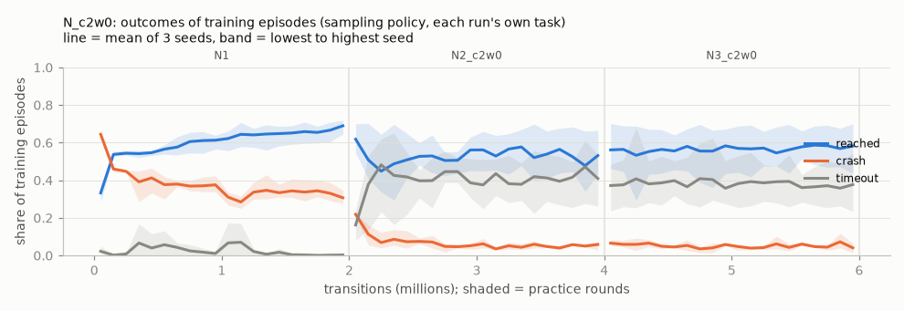
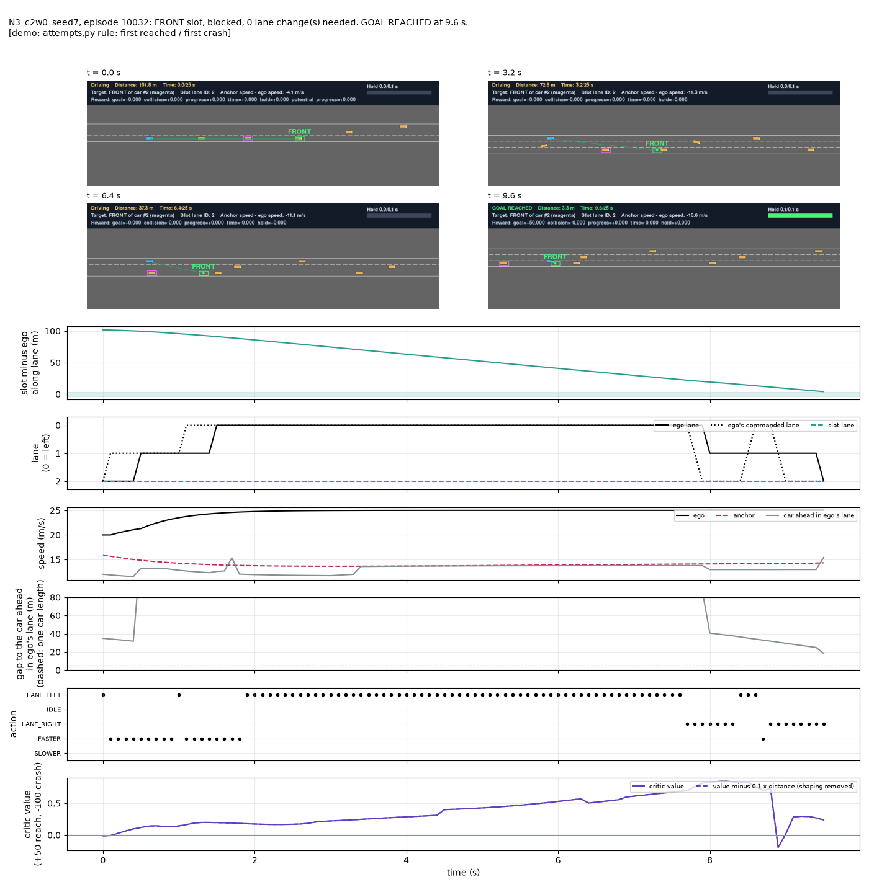
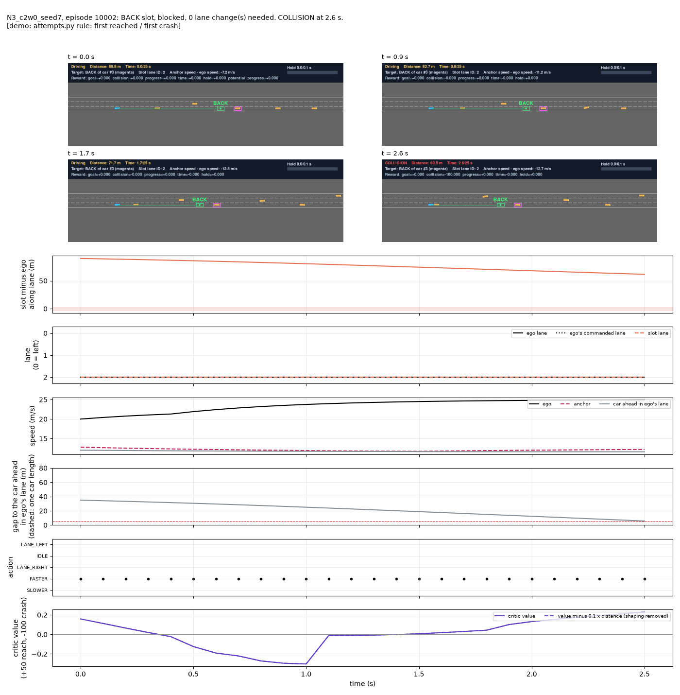

# N_c2w0: no practice, c2w0

*Step 8c, trained 2026-11-18 to 2026-11-20. Seeds: 7, 10, 13. [All attempts](README.md) · [Experiment notes](../EXPERIMENT_NOTES.md)*

**Status:** Screened in Step 8c on 3 seeds; not a finalist.

## Idea

**Order N, no practice.** All three rounds are on the full task. Round 1 is success only (B0's lesson: learn to reach before any crash cost); rounds 2 and 3 use the reward under test. It asks whether practice is needed at all.

**Crash cost 2 × goal**, the safety direction.

Step 8c was the reward grid on orders N and O: crash 0 / 0.5 / 1 / 2 × progress 0 / 0.1, 3 seeds. The rule picks the simplest reward that the best one does not beat beyond noise.

## Approach

Three rounds of 2M transitions on the Windows PC, each starting from the previous round's trained policy (same seed); round 1 from fresh weights, success only.

| Run | Arm | Task | Reward | Transitions | Starts from | Trained on |
|---|---|---|---:|---:|---|---|
| 1 | `N1` | full task | +1 reach, crash 0 | 2M | fresh weights | PC |
| 2 | `N2_c2w0` | full task | +1 reach, −2 crash | 2M | `N1`'s trained policy (same seed) | PC |
| 3 | `N3_c2w0` | full task | +1 reach, −2 crash | 2M | `N2_c2w0`'s trained policy (same seed) | PC |

## Reward function

Of the last run, `N3_c2w0` (per decision, in goal units after the reward scale):

- +1 when ego reaches the slot (the episode ends)
- −2 on a crash (the episode ends)
- 0 on a timeout (25 s) or a lost anchor

Written out: `r = 0.02 × (50·[reached] − 100·[crash])`, where [reached] and [crash] are 1 on the decision the episode ends that way and 0 otherwise.

Earlier runs of the pipeline used:

- `N1`: +1 reach, crash 0 (`r = 0.02 × (50·[reached])`)

## Hyperparameters

From `N3_c2w0`'s saved configuration (identical for every run of the pipeline except the task, reward and starting weights shown above).

| Setting | Value |
|---|---|
| Algorithm | PPO, Stable-Baselines3 2.9.2 |
| Policy network | MLP 64-64 (tanh), separate from the value network |
| Value network | MLP 64-64 |
| Learning rate | 0.0003 (constant) |
| Environments in parallel | 3 |
| Steps per environment per update (n_steps) | 256 |
| Transitions per update | 768 |
| Minibatch size | 256 |
| Epochs per update | 5 |
| Discount γ | 0.99 |
| GAE λ | 0.95 |
| Clip range | 0.2 |
| Entropy coefficient | 0.01 |
| Value-loss coefficient | 0.5 |
| Gradient-norm clip (policy and value together) | 0.5 |
| Device | cpu |

Environment and task settings

| Setting | Value |
|---|---|
| Simulator | highway-env 1.12.1, highway-v0, 3 lanes |
| Traffic | 8 cars, density 0.7, preferred speeds 12–17 m/s (IDM and MOBIL) |
| Start | ego at 20 m/s; a car 35 m ahead in ego's lane |
| Decisions | 10 per second; episode limit 25 s (250 decisions) |
| Actions | LANE_LEFT, IDLE, LANE_RIGHT, FASTER, SLOWER; target speeds 10, 12.5, 15, 17.5, 20, 22.5, 25 m/s |
| Observation | 7 cars × 5 (presence, x, y, vx, vy), x ±200 m, plus goal, anchor, slot type, slot error and hold progress (53 numbers) |
| Anchor and slot | anchor: a random car 30–120 m ahead, held in its lane; FRONT 35 m ahead of it, BACK 15 m behind, LEFT/RIGHT beside |
| Success | ego's center within ±3 m along and ±1.5 m across the slot for 0.1 s (one decision) |
| Reward scale | 0.02 |
| Task | the full task: all four slots, natural start (ego at 20 m/s, a 12 m/s car 35 m ahead), traffic free to change lanes |

Software: highway-env 1.12.1, gymnasium 1.4.0, Stable-Baselines3 2.9.2, PyTorch 2.15.0, NumPy 2.5.4, Python 3.13.1.

## Results

Score = reached − crash per episode (+1, −1, 0 for a timeout), the study's measure since Step 8.

### Full task: 200 fixed episodes (10,000–10,199), final model of every seed

|  | Reached | Crash | Timeout | Score | B/L/R reached | B/L/R crash | FRONT reached | FRONT crash |
|---|---:|---:|---:|---:|---:|---:|---:|---:|
| seed 7 | 60.0% | 8.5% | 31.5% | +0.515 | 76.8% | 8.7% | 22.6% | 8.1% |
| seed 10 | 44.5% | 2.0% | 53.5% | +0.425 | 64.5% | 2.9% | 0.0% | 0.0% |
| seed 13 | 63.0% | 5.0% | 32.0% | +0.580 | 79.7% | 4.3% | 25.8% | 6.5% |
| **mean of 3** | **55.8%** | **5.2%** | 39.0% | **+0.507** | 73.7% | 5.3% | 16.1% | 4.8% |
| scripted driver | 76.5% | 2.5% | 21.0% | +0.740 | 81.9% | 2.2% | 64.5% | 3.2% |
| random driver | 11.5% | 79.0% | 9.5% | -0.675 | 15.2% | 76.1% | 3.2% | 85.5% |

### Step 8's own measure: 400 selection episodes (10,000–10,199 and 40,000–40,199), full task

Every round's model on the full task. Rounds 3 and 4 are the mean of the final model and the checkpoints 400k and 200k before the end, as the grid scored them; rounds 1–2 are the final model.

| Model | Score | Reached | Crash | Timeout | FRONT reached | Seeds giving up on FRONT (≥ 30% timeouts) | Score by seed |
|---|---:|---:|---:|---:|---:|---:|---:|
| `N1` (after 2M) | +0.347 | 67.2% | 32.5% | 0.3% | 32.8% | 0 of 3 | +0.41, +0.26, +0.37 |
| `N2_c2w0` (after 4M) | +0.432 | 53.3% | 10.1% | 36.6% | 13.3% | 3 of 3 | +0.64, +0.39, +0.27 |
| `N3_c2w0` (after 6M) | +0.490 | 54.5% | 5.5% | 40.0% | 17.1% | 3 of 3 | +0.56, +0.39, +0.52 |

## Training curves

## Demos

Training seed 7's final model on its own evaluation episodes (the full task), chosen by a fixed rule: the first FRONT episode it reaches (else the first blocked BACK/LEFT/RIGHT episode, else the first it reaches; on practice episodes simply the first), and the first it crashes in; a timeout fills either place if it never happens. Each figure shows four frames, then per decision the slot error, lanes, speeds, gap to the car ahead, the action and the critic's value. In the videos the anchor is outlined in magenta and the slot is the green box.

**Reached: episode 10032, FRONT slot, success at 9.6 s.** [Video](../results/examples/N3_c2w0_seed7/front_seed10032.mp4)

**Crash: episode 10002, BACK slot, collision at 2.6 s.** [Video](../results/examples/N3_c2w0_seed7/back_seed10002.mp4)

## Analysis

- On the screening seeds (7, 10, 13) it ranks 24 of the 26 64-64 pipelines (score +0.490; the best is O_c1w01, +0.697).
- Against success only, same order (`N3_c0w0`): -0.044 (95% interval -0.482 to +0.394, p 0.71, ahead on 2 of 3 seeds; crash rate -17.8 points).
- Against P6's reward, same order (`N3_c1w01`): -0.151 (95% interval -0.443 to +0.142, p 0.16, ahead on 0 of 3 seeds; crash rate -2.9 points).
- Against order O, same reward (`O3_c2w0`): +0.038 (95% interval -0.229 to +0.306, p 0.60, ahead on 2 of 3 seeds; crash rate -7.5 points).

Across 8c: any crash cost brings the FRONT give-up, and success only never does. The score swaps crashes for timeouts almost one for one. Nothing beat success only by the rule with 3 seeds; P6's reward scored highest in both orders.

