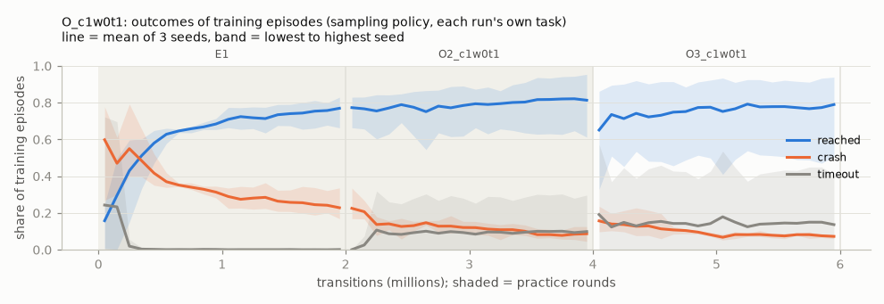
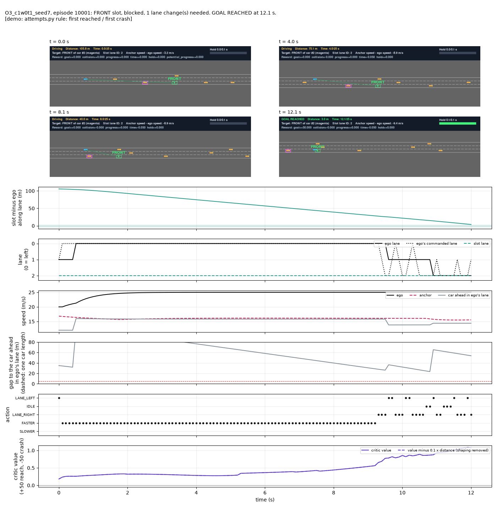
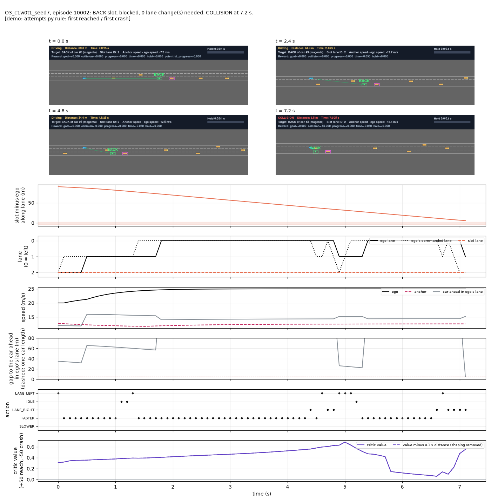

# O_c1w0t1: original order, c1w0t1

*Step 8c2, trained 2026-11-18 to 2026-11-20. Seeds: 7, 10, 13. [All attempts](README.md) · [Experiment notes](../EXPERIMENT_NOTES.md)*

**Status:** Screened in Step 8c2 on 3 seeds; not a finalist.

## Idea

**Order O, the original order.** P4 → P5 → P6 at 2M per round: round 1 practice with easy starts, success only (P4); round 2 the same practice with the reward under test (P5); round 3 the full task (P6).

**Crash cost 1 × goal**, P6's level: a crash costs as much as a goal.

**Time cost 0.001 per decision** (Marcos's time term at the 1/50 scale): a whole timed-out episode costs 0.25 goals. Added in 8c2 because every crash cost made runs give up on FRONT.

Step 8c2 added a time cost, because 8c measured that every crash cost makes runs give up on FRONT (timeouts of 10% or more).

## Approach

Three rounds of 2M transitions on the Windows PC, each starting from the previous round's trained policy (same seed); round 1 from fresh weights, success only.

| Run | Arm | Task | Reward | Transitions | Starts from | Trained on |
|---|---|---|---:|---:|---|---|
| 1 | `E1` | practice with easy starts | +1 reach, crash 0 | 2M | fresh weights | PC |
| 2 | `O2_c1w0t1` | practice with easy starts | +1 reach, −1 crash, −0.001/decision | 2M | `E1`'s trained policy (same seed) | PC |
| 3 | `O3_c1w0t1` | full task | +1 reach, −1 crash, −0.001/decision | 2M | `O2_c1w0t1`'s trained policy (same seed) | PC |

## Reward function

Of the last run, `O3_c1w0t1` (per decision, in goal units after the reward scale):

- +1 when ego reaches the slot (the episode ends)
- −1 on a crash (the episode ends)
- −0.001 per decision (0.1 s); a whole 25 s episode costs 0.25
- 0 on a timeout (25 s) or a lost anchor

Written out: `r = 0.02 × (50·[reached] − 50·[crash] − 0.05 per decision)`, where [reached] and [crash] are 1 on the decision the episode ends that way and 0 otherwise.

Earlier runs of the pipeline used:

- `E1`: +1 reach, crash 0 (`r = 0.02 × (50·[reached])`)

## Hyperparameters

From `O3_c1w0t1`'s saved configuration (identical for every run of the pipeline except the task, reward and starting weights shown above).

| Setting | Value |
|---|---|
| Algorithm | PPO, Stable-Baselines3 2.9.2 |
| Policy network | MLP 64-64 (tanh), separate from the value network |
| Value network | MLP 64-64 |
| Learning rate | 0.0003 (constant) |
| Environments in parallel | 3 |
| Steps per environment per update (n_steps) | 256 |
| Transitions per update | 768 |
| Minibatch size | 256 |
| Epochs per update | 5 |
| Discount γ | 0.99 |
| GAE λ | 0.95 |
| Clip range | 0.2 |
| Entropy coefficient | 0.01 |
| Value-loss coefficient | 0.5 |
| Gradient-norm clip (policy and value together) | 0.5 |
| Device | cpu |

Environment and task settings

| Setting | Value |
|---|---|
| Simulator | highway-env 1.12.1, highway-v0, 3 lanes |
| Traffic | 8 cars, density 0.7, preferred speeds 12–17 m/s (IDM and MOBIL) |
| Start | ego at 20 m/s; a car 35 m ahead in ego's lane |
| Decisions | 10 per second; episode limit 25 s (250 decisions) |
| Actions | LANE_LEFT, IDLE, LANE_RIGHT, FASTER, SLOWER; target speeds 10, 12.5, 15, 17.5, 20, 22.5, 25 m/s |
| Observation | 7 cars × 5 (presence, x, y, vx, vy), x ±200 m, plus goal, anchor, slot type, slot error and hold progress (53 numbers) |
| Anchor and slot | anchor: a random car 30–120 m ahead, held in its lane; FRONT 35 m ahead of it, BACK 15 m behind, LEFT/RIGHT beside |
| Success | ego's center within ±3 m along and ±1.5 m across the slot for 0.1 s (one decision) |
| Reward scale | 0.02 |
| Task | the full task: all four slots, natural start (ego at 20 m/s, a 12 m/s car 35 m ahead), traffic free to change lanes |

Software: highway-env 1.12.1, gymnasium 1.4.0, Stable-Baselines3 2.9.2, PyTorch 2.15.0, NumPy 2.5.4, Python 3.13.1.

## Results

Score = reached − crash per episode (+1, −1, 0 for a timeout), the study's measure since Step 8.

### Full task: 200 fixed episodes (10,000–10,199), final model of every seed

|  | Reached | Crash | Timeout | Score | B/L/R reached | B/L/R crash | FRONT reached | FRONT crash |
|---|---:|---:|---:|---:|---:|---:|---:|---:|
| seed 7 | 85.0% | 15.0% | 0.0% | +0.700 | 89.9% | 10.1% | 74.2% | 25.8% |
| seed 10 | 39.5% | 1.0% | 59.5% | +0.385 | 57.2% | 1.4% | 0.0% | 0.0% |
| seed 13 | 83.0% | 17.0% | 0.0% | +0.660 | 95.7% | 4.3% | 54.8% | 45.2% |
| **mean of 3** | **69.2%** | **11.0%** | 19.8% | **+0.582** | 80.9% | 5.3% | 43.0% | 23.7% |
| scripted driver | 76.5% | 2.5% | 21.0% | +0.740 | 81.9% | 2.2% | 64.5% | 3.2% |
| random driver | 11.5% | 79.0% | 9.5% | -0.675 | 15.2% | 76.1% | 3.2% | 85.5% |

### Practice task: 200 fixed practice episodes, final model

Step 8 measures every practice round on one practice task: the 200 natural-start practice episodes (blocked BACK/LEFT/RIGHT, blocker held), whatever starts the round trained on.

| Run | Task | Reached | Crash | Timeout | Reached, by seed |
|---|---|---:|---:|---:|---:|
| `E1` | practice, natural start (blocker held) | 41.5% | 58.5% | 0.0% | 58%, 6%, 60% |
| `O2_c1w0t1` | practice, natural start (blocker held) | 52.3% | 14.3% | 33.3% | 70%, 0%, 87% |

### Step 8's own measure: 400 selection episodes (10,000–10,199 and 40,000–40,199), full task

Every round's model on the full task. Rounds 3 and 4 are the mean of the final model and the checkpoints 400k and 200k before the end, as the grid scored them; rounds 1–2 are the final model.

| Model | Score | Reached | Crash | Timeout | FRONT reached | Seeds giving up on FRONT (≥ 30% timeouts) | Score by seed |
|---|---:|---:|---:|---:|---:|---:|---:|
| `E1` (after 2M) | +0.171 | 58.4% | 41.3% | 0.2% | 25.8% | 0 of 3 | +0.30, -0.12, +0.33 |
| `O2_c1w0t1` (after 4M) | +0.407 | 54.9% | 14.2% | 30.9% | 37.3% | 1 of 3 | +0.59, +0.02, +0.61 |
| `O3_c1w0t1` (after 6M) | +0.662 | 74.5% | 8.3% | 17.2% | 51.8% | 1 of 3 | +0.77, +0.42, +0.80 |

## Training curves

## Demos

Training seed 7's final model on its own evaluation episodes (the full task), chosen by a fixed rule: the first FRONT episode it reaches (else the first blocked BACK/LEFT/RIGHT episode, else the first it reaches; on practice episodes simply the first), and the first it crashes in; a timeout fills either place if it never happens. Each figure shows four frames, then per decision the slot error, lanes, speeds, gap to the car ahead, the action and the critic's value. In the videos the anchor is outlined in magenta and the slot is the green box.

**Reached: episode 10001, FRONT slot, success at 12.1 s.** [Video](../results/examples/O3_c1w0t1_seed7/front_seed10001.mp4)

**Crash: episode 10002, BACK slot, collision at 7.2 s.** [Video](../results/examples/O3_c1w0t1_seed7/back_seed10002.mp4)

## Analysis

- On the screening seeds (7, 10, 13) it ranks 6 of the 26 64-64 pipelines (score +0.662; the best is O_c1w01, +0.697).
- Against success only, same order (`O3_c0w0`): -0.018 (95% interval -0.162 to +0.126, p 0.64, ahead on 1 of 3 seeds; crash rate -7.7 points).
- Against P6's reward, same order (`O3_c1w01`): -0.035 (95% interval -0.172 to +0.102, p 0.39, ahead on 1 of 3 seeds; crash rate +0.1 points).
- Against order N, same reward (`N3_c1w0t1`): +0.097 (95% interval -0.154 to +0.348, p 0.24, ahead on 2 of 3 seeds; crash rate -0.4 points).

Across 8c2: a time cost moves the give-up but does not remove the trade. Where t4 ends it (crash 0.5), part of the timeouts become reaches and part crashes. No time-cost cell is beyond noise of its no-time-cost cell.

