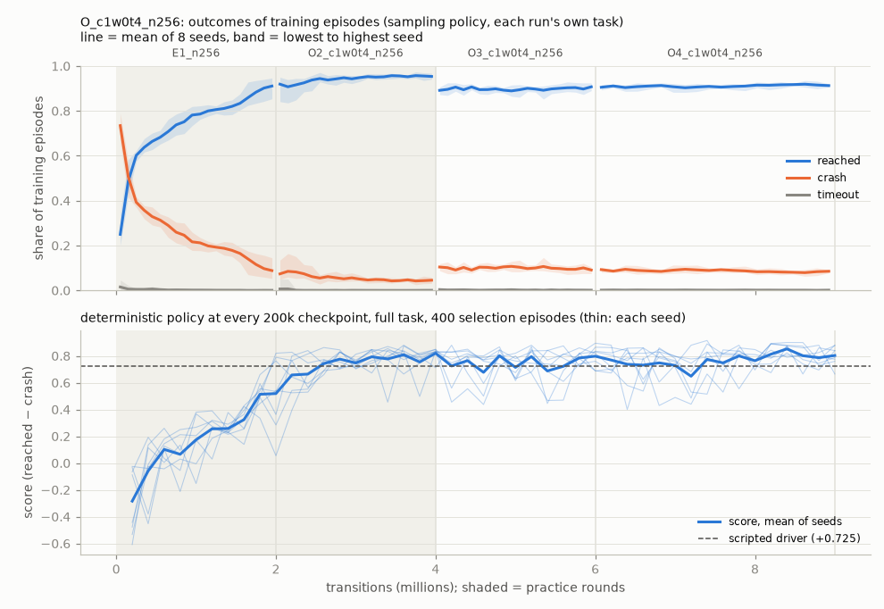
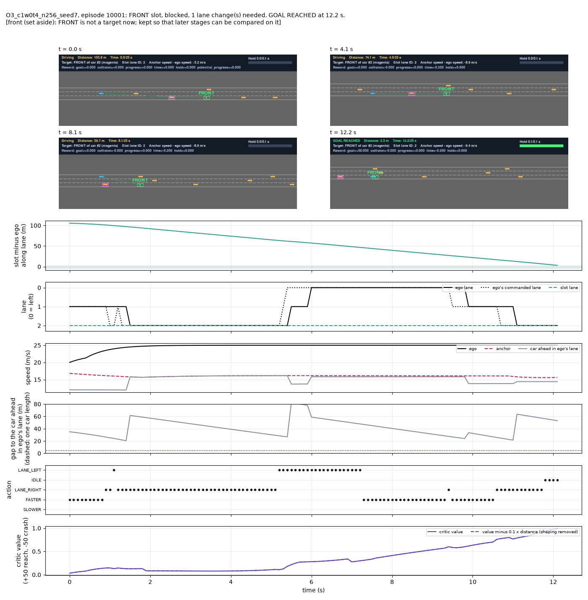
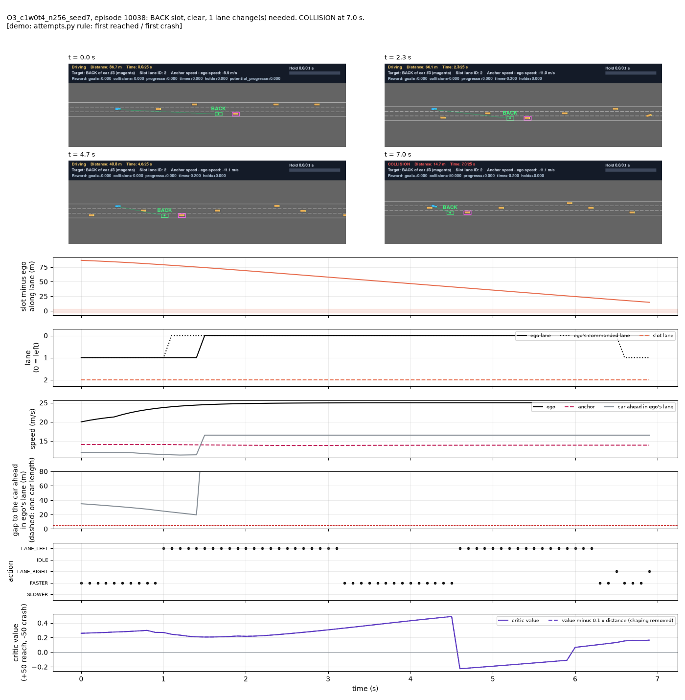

# O_c1w0t4_n256: original order, c1w0t4, 256 wide

*Step 8e, trained 2026-11-18 to 2026-11-20. Seeds: 7, 10, 13, 16, 19, 22, 25, 28. [All attempts](README.md) · [Experiment notes](../EXPERIMENT_NOTES.md)*

**Status:** **Adopted in Step 8f** as the Step 8 recipe.

## Idea

**Order O, the original order.** P4 → P5 → P6 at 2M per round: round 1 practice with easy starts, success only (P4); round 2 the same practice with the reward under test (P5); round 3 the full task (P6).

**Crash cost 1 × goal**, P6's level: a crash costs as much as a goal.

**Time cost 0.004 per decision:** a whole timed-out episode costs 1 goal, the largest level that keeps waiting cheaper than the smallest crash cost tested (0.5). Aimed at the FRONT give-up.

**256-256 networks** instead of 64-64 (about 160k weights instead of 16k). The user's rule: a larger model only for a large measured gain.

Step 8e trained three finalists 256 wide on all 8 seeds, with a fourth round of 3M; Step 8f then tested the best on 500 fresh episodes.

## Approach

Three rounds of 2M transitions on the Windows PC, each starting from the previous round's trained policy (same seed); round 1 from fresh weights, success only. A fourth round of 3M (9M in all) continued round 3 in Step 8e.

| Run | Arm | Task | Reward | Transitions | Starts from | Trained on |
|---|---|---|---:|---:|---|---|
| 1 | `E1_n256` | practice with easy starts | +1 reach, crash 0 | 2M | fresh weights | PC |
| 2 | `O2_c1w0t4_n256` | practice with easy starts | +1 reach, −1 crash, −0.004/decision | 2M | `E1_n256`'s trained policy (same seed) | PC |
| 3 | `O3_c1w0t4_n256` | full task | +1 reach, −1 crash, −0.004/decision | 2M | `O2_c1w0t4_n256`'s trained policy (same seed) | PC |
| 4 | `O4_c1w0t4_n256` | full task | +1 reach, −1 crash, −0.004/decision | 3M | `O3_c1w0t4_n256`'s trained policy (same seed) | PC |

## Reward function

Of the last run, `O3_c1w0t4_n256` (per decision, in goal units after the reward scale):

- +1 when ego reaches the slot (the episode ends)
- −1 on a crash (the episode ends)
- −0.004 per decision (0.1 s); a whole 25 s episode costs 1
- 0 on a timeout (25 s) or a lost anchor

Written out: `r = 0.02 × (50·[reached] − 50·[crash] − 0.2 per decision)`, where [reached] and [crash] are 1 on the decision the episode ends that way and 0 otherwise.

Earlier runs of the pipeline used:

- `E1_n256`: +1 reach, crash 0 (`r = 0.02 × (50·[reached])`)

## Hyperparameters

From `O3_c1w0t4_n256`'s saved configuration (identical for every run of the pipeline except the task, reward and starting weights shown above).

| Setting | Value |
|---|---|
| Algorithm | PPO, Stable-Baselines3 2.9.2 |
| Policy network | MLP 256-256 (tanh), separate from the value network |
| Value network | MLP 256-256 |
| Learning rate | 0.0003 (constant) |
| Environments in parallel | 3 |
| Steps per environment per update (n_steps) | 256 |
| Transitions per update | 768 |
| Minibatch size | 256 |
| Epochs per update | 5 |
| Discount γ | 0.99 |
| GAE λ | 0.95 |
| Clip range | 0.2 |
| Entropy coefficient | 0.01 |
| Value-loss coefficient | 0.5 |
| Gradient-norm clip (policy and value together) | 0.5 |
| Device | cpu |

Environment and task settings

| Setting | Value |
|---|---|
| Simulator | highway-env 1.12.1, highway-v0, 3 lanes |
| Traffic | 8 cars, density 0.7, preferred speeds 12–17 m/s (IDM and MOBIL) |
| Start | ego at 20 m/s; a car 35 m ahead in ego's lane |
| Decisions | 10 per second; episode limit 25 s (250 decisions) |
| Actions | LANE_LEFT, IDLE, LANE_RIGHT, FASTER, SLOWER; target speeds 10, 12.5, 15, 17.5, 20, 22.5, 25 m/s |
| Observation | 7 cars × 5 (presence, x, y, vx, vy), x ±200 m, plus goal, anchor, slot type, slot error and hold progress (53 numbers) |
| Anchor and slot | anchor: a random car 30–120 m ahead, held in its lane; FRONT 35 m ahead of it, BACK 15 m behind, LEFT/RIGHT beside |
| Success | ego's center within ±3 m along and ±1.5 m across the slot for 0.1 s (one decision) |
| Reward scale | 0.02 |
| Task | the full task: all four slots, natural start (ego at 20 m/s, a 12 m/s car 35 m ahead), traffic free to change lanes |

Software: highway-env 1.12.1, gymnasium 1.4.0, Stable-Baselines3 2.9.2, PyTorch 2.15.0, NumPy 2.5.4, Python 3.13.1.

## Results

Score = reached − crash per episode (+1, −1, 0 for a timeout), the study's measure since Step 8.

### Full task: 200 fixed episodes (10,000–10,199), final model of every seed

|  | Reached | Crash | Timeout | Score | B/L/R reached | B/L/R crash | FRONT reached | FRONT crash |
|---|---:|---:|---:|---:|---:|---:|---:|---:|
| seed 7 | 89.5% | 9.5% | 1.0% | +0.800 | 96.4% | 3.6% | 74.2% | 22.6% |
| seed 10 | 95.0% | 5.0% | 0.0% | +0.900 | 99.3% | 0.7% | 85.5% | 14.5% |
| seed 13 | 90.5% | 9.5% | 0.0% | +0.810 | 98.6% | 1.4% | 72.6% | 27.4% |
| seed 16 | 94.5% | 5.5% | 0.0% | +0.890 | 96.4% | 3.6% | 90.3% | 9.7% |
| seed 19 | 89.0% | 11.0% | 0.0% | +0.780 | 94.9% | 5.1% | 75.8% | 24.2% |
| seed 22 | 91.0% | 9.0% | 0.0% | +0.820 | 96.4% | 3.6% | 79.0% | 21.0% |
| seed 25 | 84.0% | 16.0% | 0.0% | +0.680 | 91.3% | 8.7% | 67.7% | 32.3% |
| seed 28 | 83.0% | 17.0% | 0.0% | +0.660 | 91.3% | 8.7% | 64.5% | 35.5% |
| **mean of 8** | **89.6%** | **10.3%** | 0.1% | **+0.792** | 95.6% | 4.4% | 76.2% | 23.4% |
| scripted driver | 76.5% | 2.5% | 21.0% | +0.740 | 81.9% | 2.2% | 64.5% | 3.2% |
| random driver | 11.5% | 79.0% | 9.5% | -0.675 | 15.2% | 76.1% | 3.2% | 85.5% |

### Practice task: 200 fixed practice episodes, final model

Step 8 measures every practice round on one practice task: the 200 natural-start practice episodes (blocked BACK/LEFT/RIGHT, blocker held), whatever starts the round trained on.

| Run | Task | Reached | Crash | Timeout | Reached, by seed |
|---|---|---:|---:|---:|---:|
| `E1_n256` | practice, natural start (blocker held) | 64.9% | 34.9% | 0.2% | 92%, 28%, 38%, 90%, 46%, 90%, 68%, 68% |
| `O2_c1w0t4_n256` | practice, natural start (blocker held) | 91.5% | 8.5% | 0.0% | 92%, 95%, 94%, 92%, 94%, 86%, 88%, 92% |

### Step 8's own measure: 400 selection episodes (10,000–10,199 and 40,000–40,199), full task

Every round's model on the full task. Rounds 3 and 4 are the mean of the final model and the checkpoints 400k and 200k before the end, as the grid scored them; rounds 1–2 are the final model.

| Model | Score | Reached | Crash | Timeout | FRONT reached | Seeds giving up on FRONT (≥ 30% timeouts) | Score by seed |
|---|---:|---:|---:|---:|---:|---:|---:|
| `E1_n256` (after 2M) | +0.519 | 75.8% | 23.9% | 0.3% | 56.4% | 0 of 8 | +0.76, +0.28, +0.06, +0.79, +0.36, +0.82, +0.54, +0.54 |
| `O2_c1w0t4_n256` (after 4M) | +0.820 | 90.9% | 8.9% | 0.2% | 78.9% | 0 of 8 | +0.82, +0.84, +0.83, +0.83, +0.85, +0.85, +0.71, +0.83 |
| `O3_c1w0t4_n256` (after 6M) | +0.768 | 88.4% | 11.5% | 0.1% | 77.2% | 0 of 8 | +0.83, +0.79, +0.81, +0.81, +0.70, +0.78, +0.76, +0.66 |
| `O4_c1w0t4_n256` (after 9M) | +0.797 | 89.8% | 10.1% | 0.2% | 80.1% | 0 of 8 | +0.84, +0.85, +0.80, +0.76, +0.77, +0.79, +0.79, +0.79 |

### 8f test: 500 fresh episodes (60,000–60,499)

| Model | Score | Reached | Crash | Timeout | FRONT reached | Score by seed |
|---|---:|---:|---:|---:|---:|---:|
| O_c1w0t4_n256 (8 seeds) | +0.791 | 89.5% | 10.4% | 0.1% | 76.1% | +0.82, +0.83, +0.84, +0.84, +0.77, +0.82, +0.73, +0.68 |
| scripted driver | +0.758 | 78.2% | 2.4% | 19.4% | 62.7% |  |
| random driver | -0.652 | 14.0% | 79.2% | 6.8% | 2.6% |  |

## Training curves

## Demos

Training seed 7's final model on its own evaluation episodes (the full task), chosen by a fixed rule: the first FRONT episode it reaches (else the first blocked BACK/LEFT/RIGHT episode, else the first it reaches; on practice episodes simply the first), and the first it crashes in; a timeout fills either place if it never happens. Each figure shows four frames, then per decision the slot error, lanes, speeds, gap to the car ahead, the action and the critic's value. In the videos the anchor is outlined in magenta and the slot is the green box.

**Reached: episode 10001, FRONT slot, success at 12.2 s.** [Video](../results/examples/O3_c1w0t4_n256_seed7/front_seed10001.mp4)

**Crash: episode 10038, BACK slot, collision at 7.0 s.** [Video](../results/examples/O3_c1w0t4_n256_seed7/back_seed10038.mp4)

## Analysis

- On the screening seeds (7, 10, 13) it ranks 1 of the 4 256-256 pipelines (score +0.810).
- Against the same pipeline at 64-64 (`O3_c1w0t4`): +0.116 (95% interval -0.032 to +0.265, p 0.11, ahead on 5 of 8 seeds; crash rate +1.8 points).

Across 8e: by the bars written before, nothing changed on average (+0.06 to +0.13 for 256, not beyond noise). But 256 removed the FRONT give-up (13 → 2 of 24 runs) and made practice work on every seed.

**The adopted recipe (Step 8f).** On 500 fresh episodes (60,000–60,499) it beat the 64-wide winner by +0.177 (p 0.006,
ahead on 8 of 8 seeds), crashed no more (−1.8 points), and no seed gave up on FRONT: all three conditions of the bar
written before the test. It is level with the scripted driver (+0.033, p 0.16): it reaches far more (89.5% against
78.2%) but crashes about four times as often (10.4% against 2.4%), mostly on FRONT.

**Why it works.** 256 wide helps only together with practice: within order O it fixes the three seeds whose 64-wide
practice never learned to pass (+0.35 each) and changes little on the others. At 256 the practice rounds alone already
reach +0.795 on the full task at 4M; the full-task round adds nothing more, and a fourth round (9M) neither (−0.008).

**What is left (Step 8g).** 91% of its FRONT crashes are rear-ends at full speed (25 m/s, 12 m/s faster than the car
hit), with SLOWER chosen in the last 2 s in only 2%. It passes, but does not brake.

**Consecutive goals (Step 9).** When the goal in the observation is replaced by the next one after each reached slot,
later goals score about 0.4 below the first (+0.78 → about +0.37), in every condition and on every seed. Part of
that is not the model's: with a new car the scripted driver drops too (+0.73 → +0.48), by timing out more, so the
model's own extra drop is about 0.16, and it is all crashes (11% → 31%; scripted 2.5%). Around one car the scripted
driver does better on later goals, so there the whole drop is the model's. It reaches slots at 25 m/s, 11 m/s faster
than the anchor, so the next goal starts in a rear-end course: 63% of later-goal crashes come within 3 s of the
switch. Around one car it also cannot drop back to a slot behind it. On single goals it is unchanged: goal 1 of
every chain matches the ordinary episode exactly. Details:
[`results/chains/summary.md`](../results/chains/summary.md).

