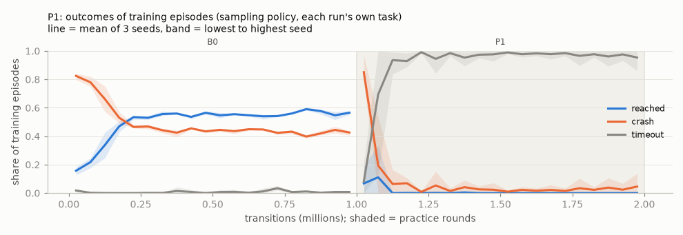
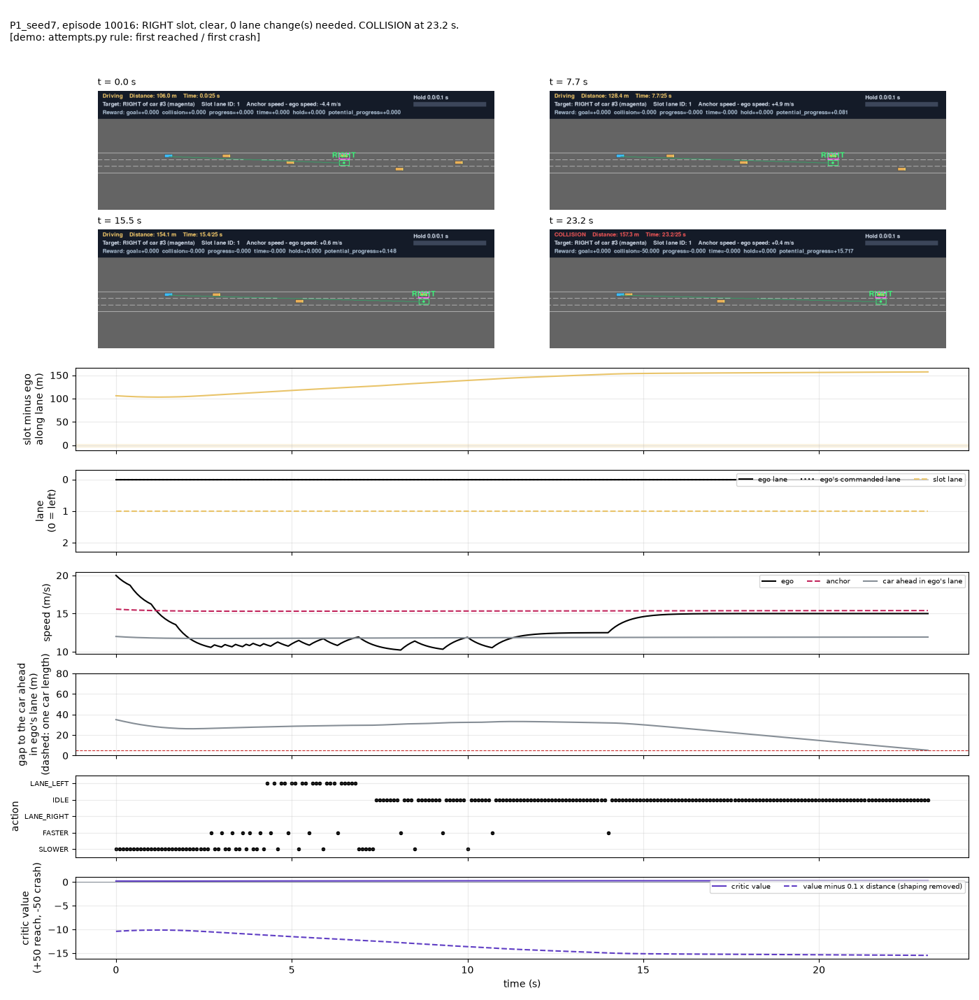
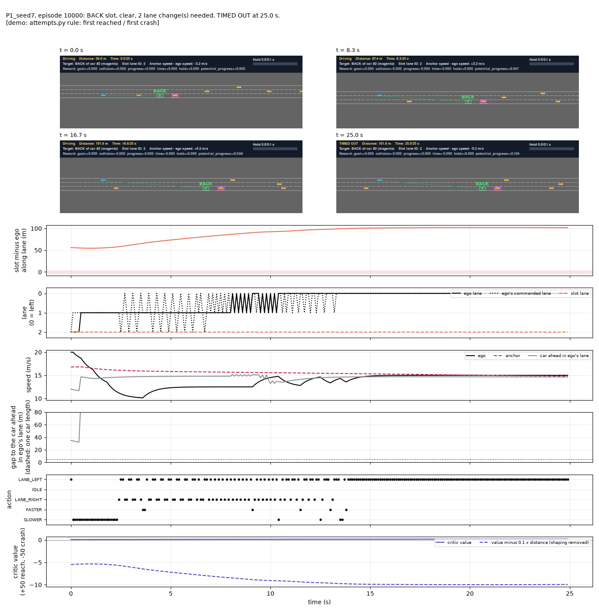

# P1: passing practice, from B0's policy

*Step 7b, trained 2026-11-15. Seeds: 7, 8, 9. [All attempts](README.md) · [Experiment notes](../EXPERIMENT_NOTES.md)*

**Status:** Ends by waiting. One seed learned to pass, then gave it up.

## Idea

The user's hypothesis: the training mix is too diverse. "Go to the slot's lane and accelerate" is right in most
episodes, and that habit traps PPO in the few that need a pass. So train only on passing situations: blocked
BACK/LEFT/RIGHT episodes, with the blocking car held in its lane, so waiting never clears the way.

*Prediction:* it stops ramming first (crashes from 99% to under 30%, mostly into timeouts); success 0–15%.

## Approach

B5's reward on the practice task, starting from B0's trained policy; 1M transitions, Mac.

| Run | Arm | Task | Reward | Transitions | Starts from | Trained on |
|---|---|---|---:|---:|---|---|
| 1 | `B0` | full task | +50 reach, crash 0 | 1M | fresh weights | PC |
| 2 | `P1` | practice | +1 reach, −1 crash, progress 0.002/m | 1M | `B0`'s trained policy (same seed) | Mac |

## Reward function

Of the last run, `P1` (per decision, in goal units after the reward scale):

- +1 when ego reaches the slot (the episode ends)
- −1 on a crash (the episode ends)
- +0.002 × (γ·Φ(next) − Φ(now)) per decision, Φ = −(distance to the slot in m), γ = 0.99: potential-based progress, which cannot change the best policy
- 0 on a timeout (25 s) or a lost anchor

Written out: `r = 0.02 × (50·[reached] − 50·[crash] + 0.1·(0.99·Φ′ − Φ))`, where [reached] and [crash] are 1 on the decision the episode ends that way and 0 otherwise.

Earlier runs of the pipeline used:

- `B0`: +50 reach, crash 0 (`r = 50·[reached]`)

## Hyperparameters

From `P1`'s saved configuration (identical for every run of the pipeline except the task, reward and starting weights shown above).

| Setting | Value |
|---|---|
| Algorithm | PPO, Stable-Baselines3 2.9.2 |
| Policy network | MLP 64-64 (tanh), separate from the value network |
| Value network | MLP 64-64 |
| Learning rate | 0.0003 (constant) |
| Environments in parallel | 3 |
| Steps per environment per update (n_steps) | 256 |
| Transitions per update | 768 |
| Minibatch size | 256 |
| Epochs per update | 5 |
| Discount γ | 0.99 |
| GAE λ | 0.95 |
| Clip range | 0.2 |
| Entropy coefficient | 0.01 |
| Value-loss coefficient | 0.5 |
| Gradient-norm clip (policy and value together) | 0.5 |
| Device | cpu |

Environment and task settings

| Setting | Value |
|---|---|
| Simulator | highway-env 1.12.1, highway-v0, 3 lanes |
| Traffic | 8 cars, density 0.7, preferred speeds 12–17 m/s (IDM and MOBIL) |
| Start | ego at 20 m/s; a car 35 m ahead in ego's lane |
| Decisions | 10 per second; episode limit 25 s (250 decisions) |
| Actions | LANE_LEFT, IDLE, LANE_RIGHT, FASTER, SLOWER; target speeds 10, 12.5, 15, 17.5, 20, 22.5, 25 m/s |
| Observation | 7 cars × 5 (presence, x, y, vx, vy), x ±200 m, plus goal, anchor, slot type, slot error and hold progress (53 numbers) |
| Anchor and slot | anchor: a random car 30–120 m ahead, held in its lane; FRONT 35 m ahead of it, BACK 15 m behind, LEFT/RIGHT beside |
| Success | ego's center within ±3 m along and ±1.5 m across the slot for 0.1 s (one decision) |
| Reward scale | 0.02 |
| Task | practice: only BACK/LEFT/RIGHT episodes in which a car sits in the slot's lane between ego and the slot, and that car is held in its lane (redrawn at reset until such an episode comes up), natural start |

Software: highway-env 1.12.1, gymnasium 1.4.0, Stable-Baselines3 2.9.2, PyTorch 2.15.0, NumPy 2.5.4, Python 3.12.13.

## Results

Score = reached − crash per episode (+1, −1, 0 for a timeout), the study's measure since Step 8.

### Full task: 200 fixed episodes (10,000–10,199), final model of every seed

|  | Reached | Crash | Timeout | Score | B/L/R reached | B/L/R crash | FRONT reached | FRONT crash |
|---|---:|---:|---:|---:|---:|---:|---:|---:|
| seed 7 | 0.0% | 0.5% | 99.5% | -0.005 | 0.0% | 0.7% | 0.0% | 0.0% |
| seed 8 | 0.5% | 3.5% | 96.0% | -0.030 | 0.7% | 5.1% | 0.0% | 0.0% |
| seed 9 | 3.0% | 1.0% | 96.0% | +0.020 | 4.3% | 0.7% | 0.0% | 1.6% |
| **mean of 3** | **1.2%** | **1.7%** | 97.2% | **-0.005** | 1.7% | 2.2% | 0.0% | 0.5% |
| scripted driver | 76.5% | 2.5% | 21.0% | +0.740 | 81.9% | 2.2% | 64.5% | 3.2% |
| random driver | 11.5% | 79.0% | 9.5% | -0.675 | 15.2% | 76.1% | 3.2% | 85.5% |

P1 was trained only on practice episodes; this is the full task it never trained on (evaluated with `--environment-of B5`).

### Practice task: 200 fixed practice episodes, final model

| Run | Task | Reached | Crash | Timeout | Reached, by seed |
|---|---|---:|---:|---:|---:|
| `P1` | practice | 0.0% | 3.2% | 96.8% | 0%, 0%, 0% |

## Training curves

## Demos

Training seed 7's final model on its own evaluation episodes (practice), chosen by a fixed rule: the first FRONT episode it reaches (else the first blocked BACK/LEFT/RIGHT episode, else the first it reaches; on practice episodes simply the first), and the first it crashes in; a timeout fills either place if it never happens. Each figure shows four frames, then per decision the slot error, lanes, speeds, gap to the car ahead, the action and the critic's value. In the videos the anchor is outlined in magenta and the slot is the green box.

**Crash: episode 10016, RIGHT slot, collision at 23.2 s.** [Video](../results/examples/P1_seed7/right_seed10016.mp4)

**Timeout: episode 10000, BACK slot, timeout at 25.0 s.** [Video](../results/examples/P1_seed7/back_seed10000.mp4)

## Analysis

- **It ends by waiting** behind the blocking car (about 0 / 7 / 193 of the 200 practice episodes).
- **But seed 8 learned to pass, then gave it up.** Its training success rose to 41% at 60k transitions (its 50k
  checkpoint really passes in 58 of 200 practice episodes), then switched to waiting within 30k transitions.
- **Why:** with +1 / −1, "30% reached, 70% crash" is worth about −0.4, and waiting is worth 0. Discounting makes it
  worse: a failed pass crashes at about 2–3 s (weight 0.74), a pass succeeds at about 8 s (0.45), so trying beats waiting
  only above about 62% success. B1's trap again.
- The hypothesis held in part: on passing-only data PPO *can* find the pass. What stops it is the reward.

