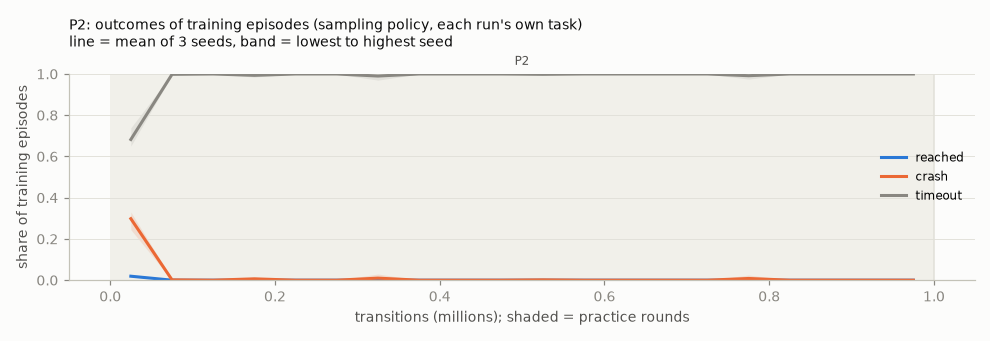
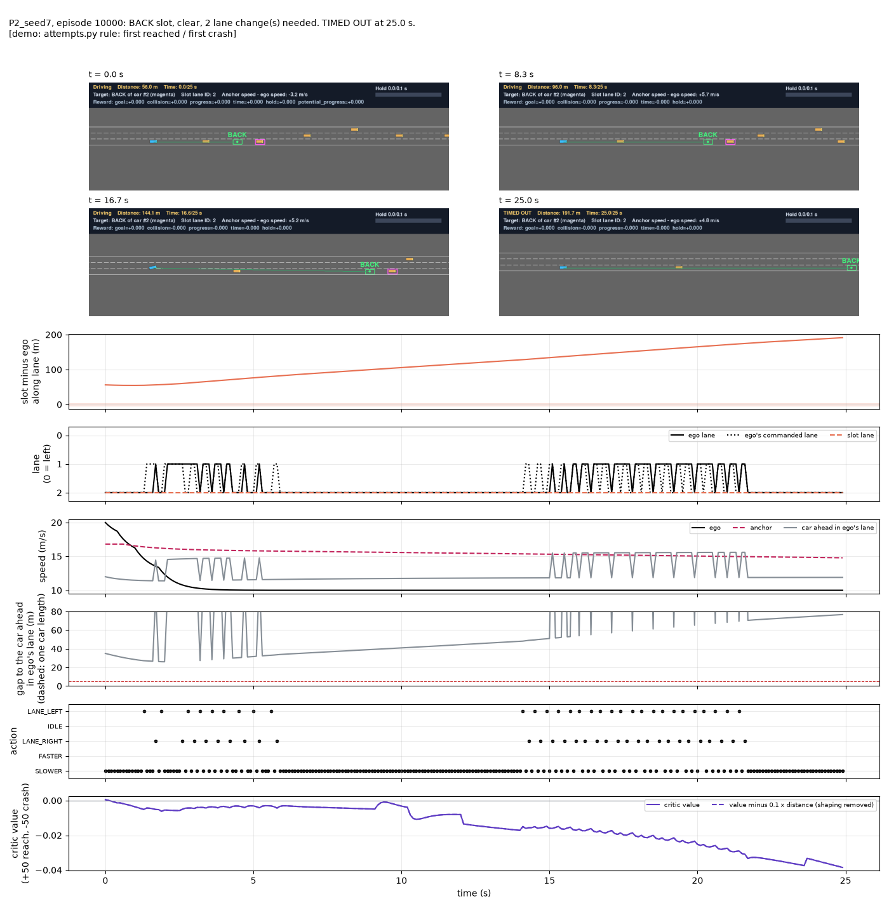

# P2: practice without progress shaping

*Step 7c, trained 2026-11-15. Seeds: 7, 8, 9. [All attempts](README.md) · [Experiment notes](../EXPERIMENT_NOTES.md)*

**Status:** Collapsed like P1s; progress shaping is dropped from here (no measured effect).

## Idea

The user asked to test one hypothesis at a time, to stop starting from B0's weights, and to check first whether the
progress reward is needed. One change from P1s: progress 0.1 → 0, so the reward is only +1 reach / −1 crash.

*Prediction:* it also ends by waiting, which would be a floor effect: it could not show whether progress matters.

## Approach

P1s without the progress term; practice task, fresh weights, 1M transitions, Mac.

| Run | Arm | Task | Reward | Transitions | Starts from | Trained on |
|---|---|---|---:|---:|---|---|
| 1 | `P2` | practice | +1 reach, −1 crash | 1M | fresh weights | Mac |

## Reward function

Of the last run, `P2` (per decision, in goal units after the reward scale):

- +1 when ego reaches the slot (the episode ends)
- −1 on a crash (the episode ends)
- 0 on a timeout (25 s) or a lost anchor

Written out: `r = 0.02 × (50·[reached] − 50·[crash])`, where [reached] and [crash] are 1 on the decision the episode ends that way and 0 otherwise.

## Hyperparameters

From `P2`'s saved configuration (identical for every run of the pipeline except the task, reward and starting weights shown above).

| Setting | Value |
|---|---|
| Algorithm | PPO, Stable-Baselines3 2.9.2 |
| Policy network | MLP 64-64 (tanh), separate from the value network |
| Value network | MLP 64-64 |
| Learning rate | 0.0003 (constant) |
| Environments in parallel | 3 |
| Steps per environment per update (n_steps) | 256 |
| Transitions per update | 768 |
| Minibatch size | 256 |
| Epochs per update | 5 |
| Discount γ | 0.99 |
| GAE λ | 0.95 |
| Clip range | 0.2 |
| Entropy coefficient | 0.01 |
| Value-loss coefficient | 0.5 |
| Gradient-norm clip (policy and value together) | 0.5 |
| Device | cpu |

Environment and task settings

| Setting | Value |
|---|---|
| Simulator | highway-env 1.12.1, highway-v0, 3 lanes |
| Traffic | 8 cars, density 0.7, preferred speeds 12–17 m/s (IDM and MOBIL) |
| Start | ego at 20 m/s; a car 35 m ahead in ego's lane |
| Decisions | 10 per second; episode limit 25 s (250 decisions) |
| Actions | LANE_LEFT, IDLE, LANE_RIGHT, FASTER, SLOWER; target speeds 10, 12.5, 15, 17.5, 20, 22.5, 25 m/s |
| Observation | 7 cars × 5 (presence, x, y, vx, vy), x ±200 m, plus goal, anchor, slot type, slot error and hold progress (53 numbers) |
| Anchor and slot | anchor: a random car 30–120 m ahead, held in its lane; FRONT 35 m ahead of it, BACK 15 m behind, LEFT/RIGHT beside |
| Success | ego's center within ±3 m along and ±1.5 m across the slot for 0.1 s (one decision) |
| Reward scale | 0.02 |
| Task | practice: only BACK/LEFT/RIGHT episodes in which a car sits in the slot's lane between ego and the slot, and that car is held in its lane (redrawn at reset until such an episode comes up), natural start |

Software: highway-env 1.12.1, gymnasium 1.4.0, Stable-Baselines3 2.9.2, PyTorch 2.15.0, NumPy 2.5.4, Python 3.12.13.

## Results

Score = reached − crash per episode (+1, −1, 0 for a timeout), the study's measure since Step 8.

### Full task: 200 fixed episodes (10,000–10,199), final model of every seed

|  | Reached | Crash | Timeout | Score | B/L/R reached | B/L/R crash | FRONT reached | FRONT crash |
|---|---:|---:|---:|---:|---:|---:|---:|---:|
| seed 7 | 0.0% | 0.0% | 100.0% | +0.000 | 0.0% | 0.0% | 0.0% | 0.0% |
| seed 8 | 0.0% | 0.0% | 100.0% | +0.000 | 0.0% | 0.0% | 0.0% | 0.0% |
| seed 9 | 0.0% | 0.0% | 100.0% | +0.000 | 0.0% | 0.0% | 0.0% | 0.0% |
| **mean of 3** | **0.0%** | **0.0%** | 100.0% | **+0.000** | 0.0% | 0.0% | 0.0% | 0.0% |
| scripted driver | 76.5% | 2.5% | 21.0% | +0.740 | 81.9% | 2.2% | 64.5% | 3.2% |
| random driver | 11.5% | 79.0% | 9.5% | -0.675 | 15.2% | 76.1% | 3.2% | 85.5% |

P2 was trained only on practice episodes; this is the full task it never trained on (evaluated with `--environment-of B5`).

### Practice task: 200 fixed practice episodes, final model

| Run | Task | Reached | Crash | Timeout | Reached, by seed |
|---|---|---:|---:|---:|---:|
| `P2` | practice | 0.0% | 0.2% | 99.8% | 0%, 0%, 0% |

## Training curves

## Demos

Training seed 7's final model on its own evaluation episodes (practice), chosen by a fixed rule: the first FRONT episode it reaches (else the first blocked BACK/LEFT/RIGHT episode, else the first it reaches; on practice episodes simply the first), and the first it crashes in; a timeout fills either place if it never happens. Each figure shows four frames, then per decision the slot error, lanes, speeds, gap to the car ahead, the action and the critic's value. In the videos the anchor is outlined in magenta and the slot is the green box.

**Timeout: episode 10000, BACK slot, timeout at 25.0 s.** [Video](../results/examples/P2_seed7/back_seed10000.mp4)

## Analysis

- **Same as P1s:** 0 reached on every seed.
- **The collapse is fast:** within about 20k transitions (25 PPO updates) crashes go from 80% to 0% and timeouts to 100%.
  From random weights a crash is 15–20 times likelier than a success, so stopping is learned long before a pass.
- Progress shaping neither prevents nor causes this collapse, so it is left out from here (simpler).

