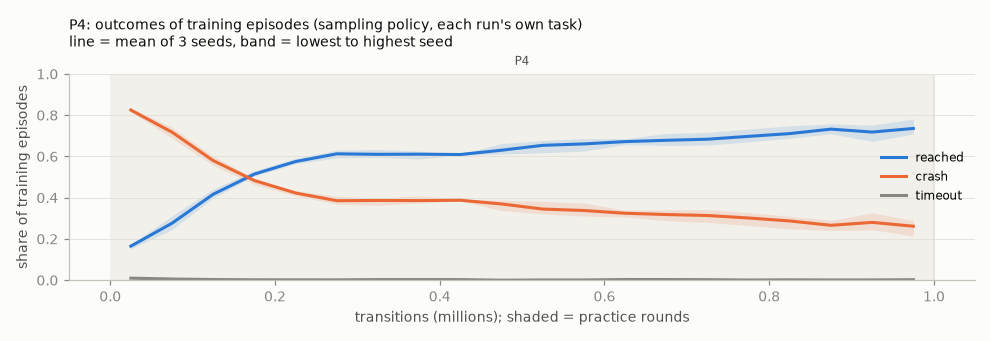
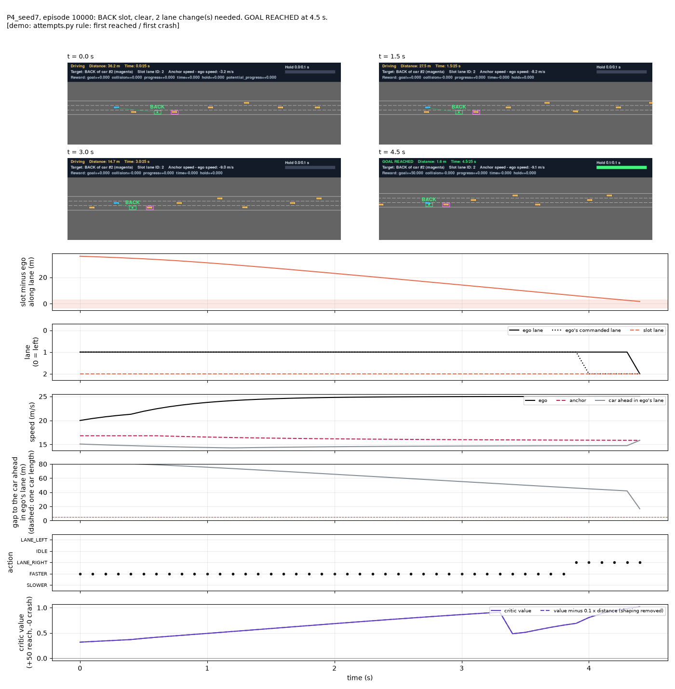
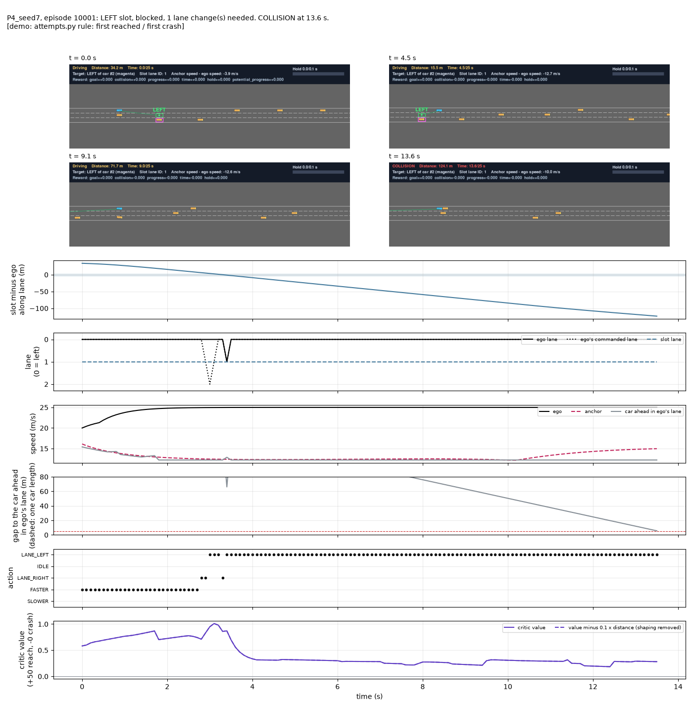

# P4: practice with easy starts, success only

*Step 7f, trained 2026-11-15. Seeds: 7, 8, 9. [All attempts](README.md) · [Experiment notes](../EXPERIMENT_NOTES.md)*

**Status:** Passes: 34–50% of natural-start practice episodes (scripted driver 2.5%), but crashes in most others.

## Idea

Repeat B0 → B2 on the practice task: first learn to pass with success as the only reward (a crash simply ends the
episode with 0), then add the crash cost from that policy (P5). One change from P3: crash cost 1 → 0.

*Prediction:* no collapse; easy starts reached in at least 50%; natural start at least 10% on two seeds; crashes at
least 30%.

## Approach

P3 without the crash cost; practice with easy starts, fresh weights, 1M transitions, Mac.

| Run | Arm | Task | Reward | Transitions | Starts from | Trained on |
|---|---|---|---:|---:|---|---|
| 1 | `P4` | practice with easy starts | +1 reach, crash 0 | 1M | fresh weights | Mac |

## Reward function

Of the last run, `P4` (per decision, in goal units after the reward scale):

- +1 when ego reaches the slot (the episode ends)
- 0 on a crash: a crash ends the episode with nothing, like a timeout
- 0 on a timeout (25 s) or a lost anchor

Written out: `r = 0.02 × (50·[reached])`, where [reached] and [crash] are 1 on the decision the episode ends that way and 0 otherwise.

## Hyperparameters

From `P4`'s saved configuration (identical for every run of the pipeline except the task, reward and starting weights shown above).

| Setting | Value |
|---|---|
| Algorithm | PPO, Stable-Baselines3 2.9.2 |
| Policy network | MLP 64-64 (tanh), separate from the value network |
| Value network | MLP 64-64 |
| Learning rate | 0.0003 (constant) |
| Environments in parallel | 3 |
| Steps per environment per update (n_steps) | 256 |
| Transitions per update | 768 |
| Minibatch size | 256 |
| Epochs per update | 5 |
| Discount γ | 0.99 |
| GAE λ | 0.95 |
| Clip range | 0.2 |
| Entropy coefficient | 0.01 |
| Value-loss coefficient | 0.5 |
| Gradient-norm clip (policy and value together) | 0.5 |
| Device | cpu |

Environment and task settings

| Setting | Value |
|---|---|
| Simulator | highway-env 1.12.1, highway-v0, 3 lanes |
| Traffic | 8 cars, density 0.7, preferred speeds 12–17 m/s (IDM and MOBIL) |
| Start | ego at 20 m/s; a car 35 m ahead in ego's lane |
| Decisions | 10 per second; episode limit 25 s (250 decisions) |
| Actions | LANE_LEFT, IDLE, LANE_RIGHT, FASTER, SLOWER; target speeds 10, 12.5, 15, 17.5, 20, 22.5, 25 m/s |
| Observation | 7 cars × 5 (presence, x, y, vx, vy), x ±200 m, plus goal, anchor, slot type, slot error and hold progress (53 numbers) |
| Anchor and slot | anchor: a random car 30–120 m ahead, held in its lane; FRONT 35 m ahead of it, BACK 15 m behind, LEFT/RIGHT beside |
| Success | ego's center within ±3 m along and ±1.5 m across the slot for 0.1 s (one decision) |
| Reward scale | 0.02 |
| Task | practice with easy starts: the practice episodes, but ego starts in the next lane 10 m past, level with, or 15 m behind the blocking car, or at its natural start (one of the four at random) |

Software: highway-env 1.12.1, gymnasium 1.4.0, Stable-Baselines3 2.9.2, PyTorch 2.15.0, NumPy 2.5.4, Python 3.12.13.

## Results

Score = reached − crash per episode (+1, −1, 0 for a timeout), the study's measure since Step 8.

### Full task: 200 fixed episodes (10,000–10,199), final model of every seed

|  | Reached | Crash | Timeout | Score | B/L/R reached | B/L/R crash | FRONT reached | FRONT crash |
|---|---:|---:|---:|---:|---:|---:|---:|---:|
| seed 7 | 55.5% | 44.5% | 0.0% | +0.110 | 62.3% | 37.7% | 40.3% | 59.7% |
| seed 8 | 62.5% | 37.5% | 0.0% | +0.250 | 73.9% | 26.1% | 37.1% | 62.9% |
| seed 9 | 56.0% | 44.0% | 0.0% | +0.120 | 76.1% | 23.9% | 11.3% | 88.7% |
| **mean of 3** | **58.0%** | **42.0%** | 0.0% | **+0.160** | 70.8% | 29.2% | 29.6% | 70.4% |
| scripted driver | 76.5% | 2.5% | 21.0% | +0.740 | 81.9% | 2.2% | 64.5% | 3.2% |
| random driver | 11.5% | 79.0% | 9.5% | -0.675 | 15.2% | 76.1% | 3.2% | 85.5% |

P4 was trained only on practice episodes; this is the full task it never trained on (evaluated with `--environment-of B5`).

### Practice task: 200 fixed practice episodes, final model

| Run | Task | Reached | Crash | Timeout | Reached, by seed |
|---|---|---:|---:|---:|---:|
| `P4` | practice with easy starts | 75.2% | 24.8% | 0.0% | 70%, 80%, 74% |

## Training curves

## Demos

Training seed 7's final model on its own evaluation episodes (practice with easy starts), chosen by a fixed rule: the first FRONT episode it reaches (else the first blocked BACK/LEFT/RIGHT episode, else the first it reaches; on practice episodes simply the first), and the first it crashes in; a timeout fills either place if it never happens. Each figure shows four frames, then per decision the slot error, lanes, speeds, gap to the car ahead, the action and the critic's value. In the videos the anchor is outlined in magenta and the slot is the green box.

**Reached: episode 10000, BACK slot, success at 4.5 s.** [Video](../results/examples/P4_seed7/back_seed10000.mp4)

**Crash: episode 10001, LEFT slot, collision at 13.6 s.** [Video](../results/examples/P4_seed7/left_seed10001.mp4)

## Analysis

- **All four predictions held.** No collapse: training success rose steadily, with 0–1% timeouts.
- **Natural-start practice episodes: 34–50.5% reached on every seed**, against 0 for P1–P3 and 2.5% for the scripted
  driver. All but one success per seed is a real pass (ego more than 5 m ahead of every blocking car).
- Crashes 49.5–66%, mostly into the blocking car.
- **The deterministic policy swings** between ~0 and ~110 reached from one 50k checkpoint to the next while training is
  smooth: the arg-max action flips between "pass" and "ram" in many episodes at once.
- **Reading:** without a crash cost, trying is never worse than waiting, so attempts continue and passes are learned.

