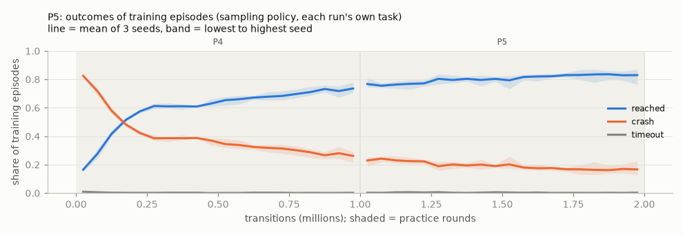
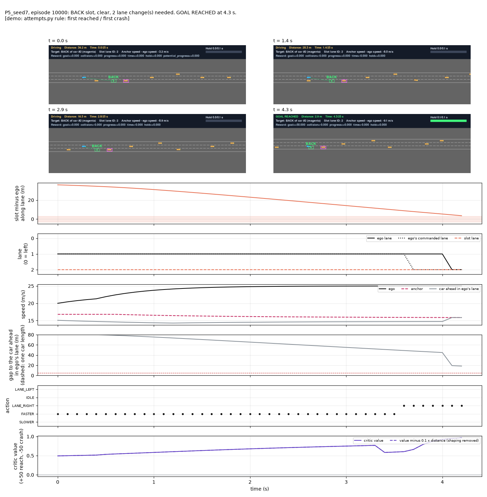
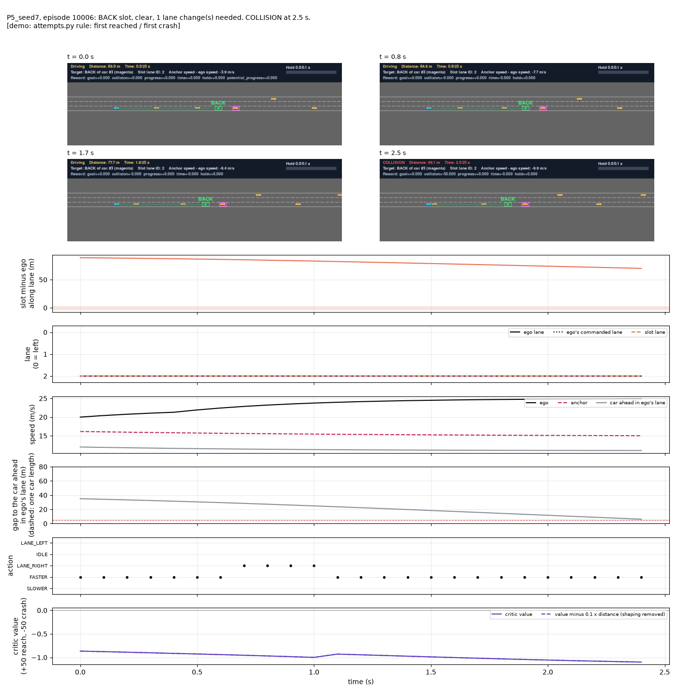

# P5: practice with the crash cost, from P4's policy

*Step 7f, trained 2026-11-15. Seeds: 7, 8, 9. [All attempts](README.md) · [Experiment notes](../EXPERIMENT_NOTES.md)*

**Status:** Keeps passing (62–64% on two seeds); on the full task it beats the scripted driver on BACK/LEFT/RIGHT.

## Idea

B1 → B2 on the practice task: P3's reward (+1 / −1), starting from P4's passing policy. One change from P3: the
starting weights.

*Prediction:* no collapse (at least 20% on two seeds); crashes fall below P4's; it may wait in some natural starts.

## Approach

P3's reward, starting from P4's trained policy (same seed); practice with easy starts, 1M transitions, Mac.

| Run | Arm | Task | Reward | Transitions | Starts from | Trained on |
|---|---|---|---:|---:|---|---|
| 1 | `P4` | practice with easy starts | +1 reach, crash 0 | 1M | fresh weights | Mac |
| 2 | `P5` | practice with easy starts | +1 reach, −1 crash | 1M | `P4`'s trained policy (same seed) | Mac |

## Reward function

Of the last run, `P5` (per decision, in goal units after the reward scale):

- +1 when ego reaches the slot (the episode ends)
- −1 on a crash (the episode ends)
- 0 on a timeout (25 s) or a lost anchor

Written out: `r = 0.02 × (50·[reached] − 50·[crash])`, where [reached] and [crash] are 1 on the decision the episode ends that way and 0 otherwise.

Earlier runs of the pipeline used:

- `P4`: +1 reach, crash 0 (`r = 0.02 × (50·[reached])`)

## Hyperparameters

From `P5`'s saved configuration (identical for every run of the pipeline except the task, reward and starting weights shown above).

| Setting | Value |
|---|---|
| Algorithm | PPO, Stable-Baselines3 2.9.2 |
| Policy network | MLP 64-64 (tanh), separate from the value network |
| Value network | MLP 64-64 |
| Learning rate | 0.0003 (constant) |
| Environments in parallel | 3 |
| Steps per environment per update (n_steps) | 256 |
| Transitions per update | 768 |
| Minibatch size | 256 |
| Epochs per update | 5 |
| Discount γ | 0.99 |
| GAE λ | 0.95 |
| Clip range | 0.2 |
| Entropy coefficient | 0.01 |
| Value-loss coefficient | 0.5 |
| Gradient-norm clip (policy and value together) | 0.5 |
| Device | cpu |

Environment and task settings

| Setting | Value |
|---|---|
| Simulator | highway-env 1.12.1, highway-v0, 3 lanes |
| Traffic | 8 cars, density 0.7, preferred speeds 12–17 m/s (IDM and MOBIL) |
| Start | ego at 20 m/s; a car 35 m ahead in ego's lane |
| Decisions | 10 per second; episode limit 25 s (250 decisions) |
| Actions | LANE_LEFT, IDLE, LANE_RIGHT, FASTER, SLOWER; target speeds 10, 12.5, 15, 17.5, 20, 22.5, 25 m/s |
| Observation | 7 cars × 5 (presence, x, y, vx, vy), x ±200 m, plus goal, anchor, slot type, slot error and hold progress (53 numbers) |
| Anchor and slot | anchor: a random car 30–120 m ahead, held in its lane; FRONT 35 m ahead of it, BACK 15 m behind, LEFT/RIGHT beside |
| Success | ego's center within ±3 m along and ±1.5 m across the slot for 0.1 s (one decision) |
| Reward scale | 0.02 |
| Task | practice with easy starts: the practice episodes, but ego starts in the next lane 10 m past, level with, or 15 m behind the blocking car, or at its natural start (one of the four at random) |

Software: highway-env 1.12.1, gymnasium 1.4.0, Stable-Baselines3 2.9.2, PyTorch 2.15.0, NumPy 2.5.4, Python 3.12.13.

## Results

Score = reached − crash per episode (+1, −1, 0 for a timeout), the study's measure since Step 8.

### Full task: 200 fixed episodes (10,000–10,199), final model of every seed

|  | Reached | Crash | Timeout | Score | B/L/R reached | B/L/R crash | FRONT reached | FRONT crash |
|---|---:|---:|---:|---:|---:|---:|---:|---:|
| seed 7 | 73.0% | 27.0% | 0.0% | +0.460 | 86.2% | 13.8% | 43.5% | 56.5% |
| seed 8 | 71.0% | 29.0% | 0.0% | +0.420 | 87.7% | 12.3% | 33.9% | 66.1% |
| seed 9 | 44.0% | 47.0% | 9.0% | -0.030 | 60.1% | 27.5% | 8.1% | 90.3% |
| **mean of 3** | **62.7%** | **34.3%** | 3.0% | **+0.283** | 78.0% | 17.9% | 28.5% | 71.0% |
| scripted driver | 76.5% | 2.5% | 21.0% | +0.740 | 81.9% | 2.2% | 64.5% | 3.2% |
| random driver | 11.5% | 79.0% | 9.5% | -0.675 | 15.2% | 76.1% | 3.2% | 85.5% |

P5 was trained only on practice episodes; this is the full task it never trained on (evaluated with `--environment-of B5`).

### Practice task: 200 fixed practice episodes, final model

| Run | Task | Reached | Crash | Timeout | Reached, by seed |
|---|---|---:|---:|---:|---:|
| `P4` | practice with easy starts | 75.2% | 24.8% | 0.0% | 70%, 80%, 74% |
| `P5` | practice with easy starts | 79.8% | 17.8% | 2.3% | 88%, 89%, 62% |

## Training curves

## Demos

Training seed 7's final model on its own evaluation episodes (practice with easy starts), chosen by a fixed rule: the first FRONT episode it reaches (else the first blocked BACK/LEFT/RIGHT episode, else the first it reaches; on practice episodes simply the first), and the first it crashes in; a timeout fills either place if it never happens. Each figure shows four frames, then per decision the slot error, lanes, speeds, gap to the car ahead, the action and the critic's value. In the videos the anchor is outlined in magenta and the slot is the green box.

**Reached: episode 10000, BACK slot, success at 4.3 s.** [Video](../results/examples/P5_seed7/back_seed10000.mp4)

**Crash: episode 10006, BACK slot, collision at 2.5 s.** [Video](../results/examples/P5_seed7/back_seed10006.mp4)

## Analysis

- **No collapse:** seeds 7 and 8 reach 62–64% of the natural-start practice episodes (P4: 44–50.5%). The crash cost
  turned into more success, not waiting.
- Seed 9's final model is a dip: its checkpoints swing between 6 and 104 reached.
- **On the full task, never trained on:** seeds 7 and 8 reach 119 and 121 of 138 BACK/LEFT/RIGHT, the first arms above
  the scripted driver's 113.
- **FRONT opens** (21–27 of 62 on seeds 7 and 8): a FRONT slot is a pass of the anchor itself, so the skill carries over.
- Remaining failure: ramming the blocking car.

