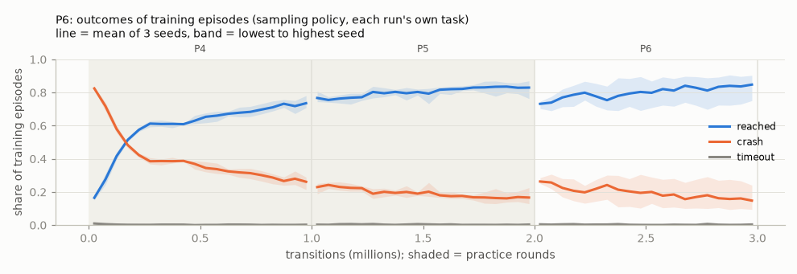
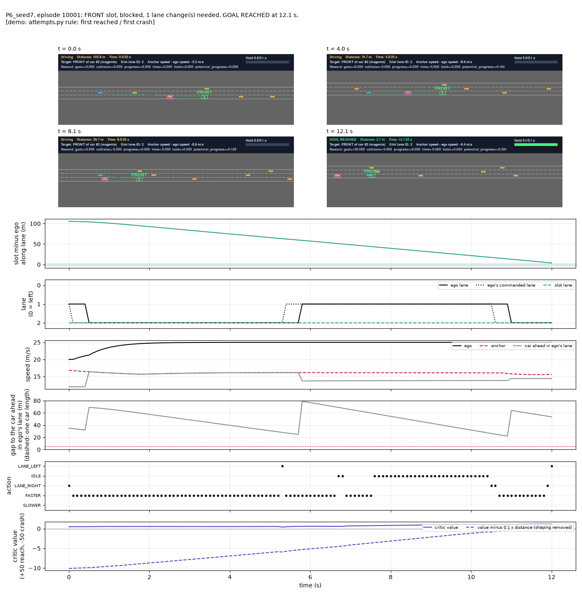
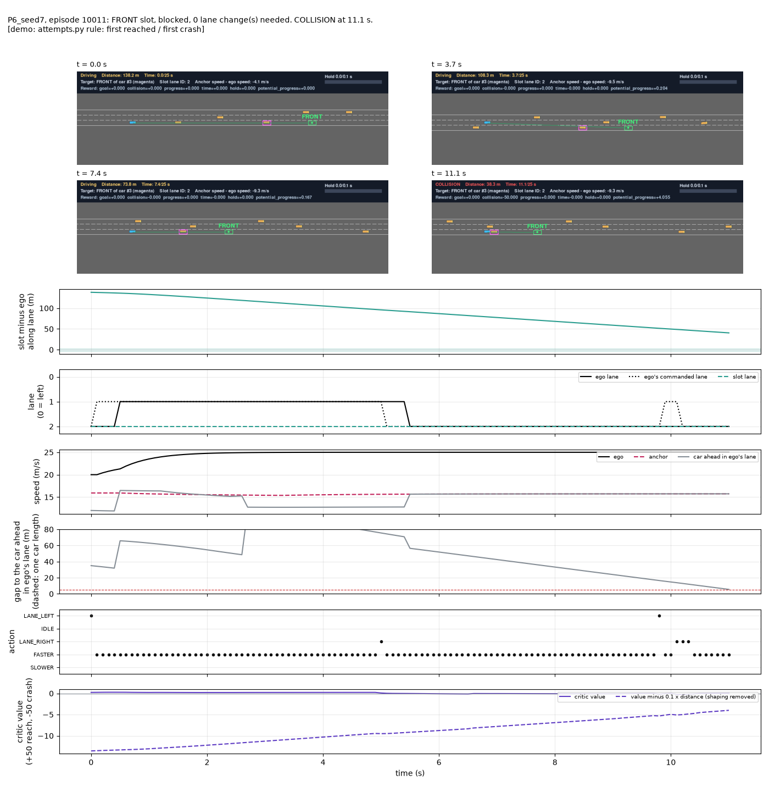

# P6: the full task from P5's passing policy

*Step 7g, trained 2026-11-15. Seeds: 7, 8, 9. [All attempts](README.md) · [Experiment notes](../EXPERIMENT_NOTES.md)*

**Status:** First policies above the scripted driver on BACK/LEFT/RIGHT on every seed; its order became Step 8's order O.

## Idea

Fine-tune the passing policy on the normal mix of episodes, so it learns when a pass is needed and when to drive
straight to the slot, with FRONT back in the data. Parent B5 (the full task, +1 / −1, progress 0.1); one change: start
from P5's policy instead of B0's.

*Prediction:* it keeps the pass (blocked episodes at least 27 of 45); BACK/LEFT/RIGHT at least 115 of 138; FRONT at
least 20 of 62 on two seeds.

## Approach

B5's reward on the full task, starting from P5's trained policy (P4 → P5 → P6, 1M each), Mac.

| Run | Arm | Task | Reward | Transitions | Starts from | Trained on |
|---|---|---|---:|---:|---|---|
| 1 | `P4` | practice with easy starts | +1 reach, crash 0 | 1M | fresh weights | Mac |
| 2 | `P5` | practice with easy starts | +1 reach, −1 crash | 1M | `P4`'s trained policy (same seed) | Mac |
| 3 | `P6` | full task | +1 reach, −1 crash, progress 0.002/m | 1M | `P5`'s trained policy (same seed) | Mac |

## Reward function

Of the last run, `P6` (per decision, in goal units after the reward scale):

- +1 when ego reaches the slot (the episode ends)
- −1 on a crash (the episode ends)
- +0.002 × (γ·Φ(next) − Φ(now)) per decision, Φ = −(distance to the slot in m), γ = 0.99: potential-based progress, which cannot change the best policy
- 0 on a timeout (25 s) or a lost anchor

Written out: `r = 0.02 × (50·[reached] − 50·[crash] + 0.1·(0.99·Φ′ − Φ))`, where [reached] and [crash] are 1 on the decision the episode ends that way and 0 otherwise.

Earlier runs of the pipeline used:

- `P4`: +1 reach, crash 0 (`r = 0.02 × (50·[reached])`)
- `P5`: +1 reach, −1 crash (`r = 0.02 × (50·[reached] − 50·[crash])`)

## Hyperparameters

From `P6`'s saved configuration (identical for every run of the pipeline except the task, reward and starting weights shown above).

| Setting | Value |
|---|---|
| Algorithm | PPO, Stable-Baselines3 2.9.2 |
| Policy network | MLP 64-64 (tanh), separate from the value network |
| Value network | MLP 64-64 |
| Learning rate | 0.0003 (constant) |
| Environments in parallel | 3 |
| Steps per environment per update (n_steps) | 256 |
| Transitions per update | 768 |
| Minibatch size | 256 |
| Epochs per update | 5 |
| Discount γ | 0.99 |
| GAE λ | 0.95 |
| Clip range | 0.2 |
| Entropy coefficient | 0.01 |
| Value-loss coefficient | 0.5 |
| Gradient-norm clip (policy and value together) | 0.5 |
| Device | cpu |

Environment and task settings

| Setting | Value |
|---|---|
| Simulator | highway-env 1.12.1, highway-v0, 3 lanes |
| Traffic | 8 cars, density 0.7, preferred speeds 12–17 m/s (IDM and MOBIL) |
| Start | ego at 20 m/s; a car 35 m ahead in ego's lane |
| Decisions | 10 per second; episode limit 25 s (250 decisions) |
| Actions | LANE_LEFT, IDLE, LANE_RIGHT, FASTER, SLOWER; target speeds 10, 12.5, 15, 17.5, 20, 22.5, 25 m/s |
| Observation | 7 cars × 5 (presence, x, y, vx, vy), x ±200 m, plus goal, anchor, slot type, slot error and hold progress (53 numbers) |
| Anchor and slot | anchor: a random car 30–120 m ahead, held in its lane; FRONT 35 m ahead of it, BACK 15 m behind, LEFT/RIGHT beside |
| Success | ego's center within ±3 m along and ±1.5 m across the slot for 0.1 s (one decision) |
| Reward scale | 0.02 |
| Task | the full task: all four slots, natural start (ego at 20 m/s, a 12 m/s car 35 m ahead), traffic free to change lanes |

Software: highway-env 1.12.1, gymnasium 1.4.0, Stable-Baselines3 2.9.2, PyTorch 2.15.0, NumPy 2.5.4, Python 3.12.13.

## Results

Score = reached − crash per episode (+1, −1, 0 for a timeout), the study's measure since Step 8.

### Full task: 200 fixed episodes (10,000–10,199), final model of every seed

|  | Reached | Crash | Timeout | Score | B/L/R reached | B/L/R crash | FRONT reached | FRONT crash |
|---|---:|---:|---:|---:|---:|---:|---:|---:|
| seed 7 | 91.0% | 9.0% | 0.0% | +0.820 | 97.1% | 2.9% | 77.4% | 22.6% |
| seed 8 | 83.0% | 17.0% | 0.0% | +0.660 | 90.6% | 9.4% | 66.1% | 33.9% |
| seed 9 | 71.5% | 28.5% | 0.0% | +0.430 | 89.1% | 10.9% | 32.3% | 67.7% |
| **mean of 3** | **81.8%** | **18.2%** | 0.0% | **+0.637** | 92.3% | 7.7% | 58.6% | 41.4% |
| scripted driver | 76.5% | 2.5% | 21.0% | +0.740 | 81.9% | 2.2% | 64.5% | 3.2% |
| random driver | 11.5% | 79.0% | 9.5% | -0.675 | 15.2% | 76.1% | 3.2% | 85.5% |

### Practice task: 200 fixed practice episodes, final model

| Run | Task | Reached | Crash | Timeout | Reached, by seed |
|---|---|---:|---:|---:|---:|
| `P4` | practice with easy starts | 75.2% | 24.8% | 0.0% | 70%, 80%, 74% |
| `P5` | practice with easy starts | 79.8% | 17.8% | 2.3% | 88%, 89%, 62% |

### 8d final test: 500 fresh episodes (50,000–50,499)

| Model | Score | Reached | Crash | Timeout | FRONT reached | Score by seed |
|---|---:|---:|---:|---:|---:|---:|
| P6 (3 seeds) | +0.677 | 83.7% | 16.1% | 0.2% | 57.8% | +0.85, +0.65, +0.53 |
| scripted driver | +0.774 | 79.2% | 1.8% | 19.0% | 76.5% |  |
| random driver | -0.662 | 12.8% | 79.0% | 8.2% | 5.1% |  |

## Training curves

## Demos

Training seed 7's final model on its own evaluation episodes (the full task), chosen by a fixed rule: the first FRONT episode it reaches (else the first blocked BACK/LEFT/RIGHT episode, else the first it reaches; on practice episodes simply the first), and the first it crashes in; a timeout fills either place if it never happens. Each figure shows four frames, then per decision the slot error, lanes, speeds, gap to the car ahead, the action and the critic's value. In the videos the anchor is outlined in magenta and the slot is the green box.

**Reached: episode 10001, FRONT slot, success at 12.1 s.** [Video](../results/examples/P6_seed7/front_seed10001.mp4)

**Crash: episode 10011, FRONT slot, collision at 11.1 s.** [Video](../results/examples/P6_seed7/front_seed10011.mp4)

## Analysis

- **All five predictions held.** Blocked episodes 42, 33, 33 of 45; BACK/LEFT/RIGHT 134, 125, 123 of 138 (scripted 113);
  FRONT 48, 41, 20 of 62 (scripted 40).
- **On held-out episodes (Step 7h)** its own level held (within ±1.6 points), but only seed 7 beat the scripted driver
  beyond noise; seeds 8 and 9 crash 5–6 times as often.
- **Under Step 8's score** (reached − crash), P6 is level with the scripted driver at best: −0.097 on the 8d final test
  (p 0.40), because it crashes in 16% of episodes against 2%.
- Its pipeline (practice, practice with the crash cost, full task) became Step 8's order O.

