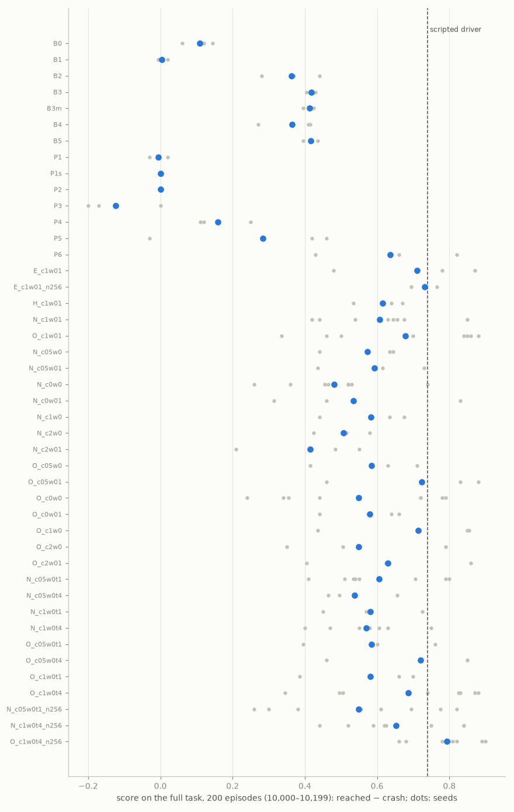

# Every attempt, with its reward, approach, settings, results, curves and demos

*Generated by [`attempts.py`](../attempts.py) from the saved configurations, evaluations and training logs; do not edit by hand. The full log, with every prediction written before its run, is [`EXPERIMENT_NOTES.md`](../EXPERIMENT_NOTES.md); the summary is [`REPORT.md`](../REPORT.md).*

**Task.** Ego must drive into a slot (FRONT, BACK, LEFT or RIGHT) of a moving traffic car within 25 s; one decision inside the slot box counts. **Score** = reached − crash per episode (+1, −1, 0 for a timeout).

**An attempt** is one training pipeline: one or more runs, each starting from the previous run's trained policy. Its name says what it is:

- **B0–B5** (Steps 1–7a): one reward change at a time on the full task, 1M transitions per run.
- **P1–P6** (Step 7): practice on blocked episodes (a slow car in the slot's lane), then the full task.
- **Step 8 pipelines**, named `<order>_<reward>[_n256]`, three rounds of 2M transitions:
  - order: **N** no practice; **H** practice in round 1; **E** practice with easy starts in round 1; **O** the original P4 → P5 → P6 order (practice in rounds 1 and 2). Round 1 is always success only.
  - reward: **c** crash cost (c0, c05 = 0.5, c1, c2 times the goal), **w** progress shaping (w0 none, w01 0.1 per m), **t** time cost (t1 = 0.001, t4 = 0.004 per decision);
  - `_n256`: 256-256 networks instead of 64-64.

Every page has the full reward function, the approach and every hyperparameter, the results (percentages and score), training curves, a success and a crash demo, and the idea and analysis behind it.

## All attempts on the same 200 episodes

Full task, episodes 10,000–10,199, final model, mean over seeds. The scripted driver reads the true simulator state: 76.5% reached, 2.5% crash, score +0.740.

### Steps 1–7: B0–B5 and P1–P6

| Attempt | Step | Approach | Reward (last run) | Network | Training, whole pipeline | Seeds | Reached | Crash | Timeout | Score | Status |
|---|---:|---|---:|---:|---:|---:|---:|---:|---:|---:|---|
| [B0](B0.md) | 1 | success only (the root) | +50 reach, crash 0 | 64-64 | 1M | 3 | 55.2% | 44.3% | 0.5% | **+0.108** | root |
| [B1](B1.md) | 2 | crash penalty, from fresh weights | +50 reach, −50 crash | 64-64 | 1M | 3 | 1.3% | 1.0% | 97.7% | **+0.003** | collapse |
| [B2](B2.md) | 3 | crash penalty, from B0's trained policy | +50 reach, −50 crash | 64-64 | 2M | 3 | 52.7% | 16.3% | 31.0% | **+0.363** | gives up FRONT |
| [B3](B3.md) | 4 | potential-based progress shaping | +50 reach, −50 crash, progress 0.1/m | 64-64 | 2M | 3 | 56.2% | 14.3% | 29.5% | **+0.418** | no FRONT |
| [B3m](B3m.md) | 5b | B3 trained again on the Mac (the noise floor) | +50 reach, −50 crash, progress 0.1/m | 64-64 | 2M | 3 | 55.7% | 14.3% | 30.0% | **+0.413** | noise floor |
| [B4](B4.md) | 6 | crash penalty ×3 (50 → 150) | +50 reach, −150 crash, progress 0.1/m | 64-64 | 2M | 3 | 52.0% | 15.5% | 32.5% | **+0.365** | no effect |
| [B5](B5.md) | 7a | reward scaled by 1/50 (fixes a training throttle) | +1 reach, −1 crash, progress 0.002/m | 64-64 | 2M | 3 | 56.5% | 14.8% | 28.7% | **+0.417** | fixes training |
| [P1](P1.md) | 7b | passing practice, from B0's policy | +1 reach, −1 crash, progress 0.002/m | 64-64 | 2M | 3 | 1.2% | 1.7% | 97.2% | **-0.005** | gives up |
| [P1s](P1s.md) | 7b | passing practice, from fresh weights | +1 reach, −1 crash, progress 0.002/m | 64-64 | 1M | 3 | 0.0% | 0.0% | 100.0% | **+0.000** | collapse |
| [P2](P2.md) | 7c | practice without progress shaping | +1 reach, −1 crash | 64-64 | 1M | 3 | 0.0% | 0.0% | 100.0% | **+0.000** | collapse |
| [P3](P3.md) | 7e | practice with easy starts | +1 reach, −1 crash | 64-64 | 1M | 3 | 0.5% | 12.8% | 86.7% | **-0.123** | gives up |
| [P4](P4.md) | 7f | practice with easy starts, success only | +1 reach, crash 0 | 64-64 | 1M | 3 | 58.0% | 42.0% | 0.0% | **+0.160** | learns to pass |
| [P5](P5.md) | 7f | practice with the crash cost, from P4's policy | +1 reach, −1 crash | 64-64 | 2M | 3 | 62.7% | 34.3% | 3.0% | **+0.283** | passes, safer |
| [P6](P6.md) | 7g | the full task from P5's passing policy | +1 reach, −1 crash, progress 0.002/m | 64-64 | 3M | 3 | 81.8% | 18.2% | 0.0% | **+0.637** | beats scripted on B/L/R |

### Step 8a: network width

| Attempt | Step | Approach | Reward (last run) | Network | Training, whole pipeline | Seeds | Reached | Crash | Timeout | Score | Status |
|---|---:|---|---:|---:|---:|---:|---:|---:|---:|---:|---|
| [E_c1w01](E_c1w01.md) | 8a | practice with easy starts, c1w01 | +1 reach, −1 crash, progress 0.002/m | 64-64 | 6M | 3 | 79.7% | 8.7% | 11.7% | **+0.710** | screened |
| [E_c1w01_n256](E_c1w01_n256.md) | 8a | practice with easy starts, c1w01, 256 wide | +1 reach, −1 crash, progress 0.002/m | 256-256 | 6M | 3 | 86.2% | 13.0% | 0.8% | **+0.732** | screened |

### Step 8b: training order

| Attempt | Step | Approach | Reward (last run) | Network | Training, whole pipeline | Seeds | Reached | Crash | Timeout | Score | Status |
|---|---:|---|---:|---:|---:|---:|---:|---:|---:|---:|---|
| [H_c1w01](H_c1w01.md) | 8b | practice (natural start), c1w01 | +1 reach, −1 crash, progress 0.002/m | 64-64 | 6M | 3 | 66.2% | 4.7% | 29.2% | **+0.615** | screened |
| [N_c1w01](N_c1w01.md) | 8b | no practice, c1w01 | +1 reach, −1 crash, progress 0.002/m | 64-64 | 6M | 8 | 69.8% | 9.1% | 21.1% | **+0.607** | 8d finalist |
| [O_c1w01](O_c1w01.md) | 8b | original order, c1w01 | +1 reach, −1 crash, progress 0.002/m | 64-64 | 6M | 8 | 75.1% | 7.3% | 17.6% | **+0.678** | 8d finalist |

### Step 8c: reward grid

| Attempt | Step | Approach | Reward (last run) | Network | Training, whole pipeline | Seeds | Reached | Crash | Timeout | Score | Status |
|---|---:|---|---:|---:|---:|---:|---:|---:|---:|---:|---|
| [N_c05w0](N_c05w0.md) | 8c | no practice, c05w0 | +1 reach, −0.5 crash | 64-64 | 6M | 3 | 67.5% | 10.2% | 22.3% | **+0.573** | screened |
| [N_c05w01](N_c05w01.md) | 8c | no practice, c05w01 | +1 reach, −0.5 crash, progress 0.002/m | 64-64 | 6M | 3 | 70.7% | 11.3% | 18.0% | **+0.593** | screened |
| [N_c0w0](N_c0w0.md) | 8c | no practice, c0w0 | +1 reach, crash 0 | 64-64 | 6M | 8 | 74.0% | 25.9% | 0.1% | **+0.481** | 8d finalist |
| [N_c0w01](N_c0w01.md) | 8c | no practice, c0w01 | +1 reach, crash 0, progress 0.002/m | 64-64 | 6M | 3 | 76.3% | 22.8% | 0.8% | **+0.535** | screened |
| [N_c1w0](N_c1w0.md) | 8c | no practice, c1w0 | +1 reach, −1 crash | 64-64 | 6M | 3 | 66.7% | 8.3% | 25.0% | **+0.583** | screened |
| [N_c2w0](N_c2w0.md) | 8c | no practice, c2w0 | +1 reach, −2 crash | 64-64 | 6M | 3 | 55.8% | 5.2% | 39.0% | **+0.507** | screened |
| [N_c2w01](N_c2w01.md) | 8c | no practice, c2w01 | +1 reach, −2 crash, progress 0.002/m | 64-64 | 6M | 3 | 51.8% | 10.3% | 37.8% | **+0.415** | screened |
| [O_c05w0](O_c05w0.md) | 8c | original order, c05w0 | +1 reach, −0.5 crash | 64-64 | 6M | 3 | 72.8% | 14.3% | 12.8% | **+0.585** | screened |
| [O_c05w01](O_c05w01.md) | 8c | original order, c05w01 | +1 reach, −0.5 crash, progress 0.002/m | 64-64 | 6M | 3 | 79.0% | 6.7% | 14.3% | **+0.723** | screened |
| [O_c0w0](O_c0w0.md) | 8c | original order, c0w0 | +1 reach, crash 0 | 64-64 | 6M | 8 | 77.4% | 22.6% | 0.1% | **+0.548** | 8d finalist |
| [O_c0w01](O_c0w01.md) | 8c | original order, c0w01 | +1 reach, crash 0, progress 0.002/m | 64-64 | 6M | 3 | 79.0% | 21.0% | 0.0% | **+0.580** | screened |
| [O_c1w0](O_c1w0.md) | 8c | original order, c1w0 | +1 reach, −1 crash | 64-64 | 6M | 3 | 76.7% | 5.3% | 18.0% | **+0.713** | screened |
| [O_c2w0](O_c2w0.md) | 8c | original order, c2w0 | +1 reach, −2 crash | 64-64 | 6M | 3 | 67.3% | 12.5% | 20.2% | **+0.548** | screened |
| [O_c2w01](O_c2w01.md) | 8c | original order, c2w01 | +1 reach, −2 crash, progress 0.002/m | 64-64 | 6M | 3 | 71.2% | 8.2% | 20.7% | **+0.630** | screened |

### Step 8c2: time cost

| Attempt | Step | Approach | Reward (last run) | Network | Training, whole pipeline | Seeds | Reached | Crash | Timeout | Score | Status |
|---|---:|---|---:|---:|---:|---:|---:|---:|---:|---:|---|
| [N_c05w0t1](N_c05w0t1.md) | 8c2 | no practice, c05w0t1 | +1 reach, −0.5 crash, −0.001/decision | 64-64 | 6M | 8 | 73.1% | 12.6% | 14.2% | **+0.605** | 8d winner |
| [N_c05w0t4](N_c05w0t4.md) | 8c2 | no practice, c05w0t4 | +1 reach, −0.5 crash, −0.004/decision | 64-64 | 6M | 3 | 72.2% | 18.3% | 9.5% | **+0.538** | screened |
| [N_c1w0t1](N_c1w0t1.md) | 8c2 | no practice, c1w0t1 | +1 reach, −1 crash, −0.001/decision | 64-64 | 6M | 3 | 65.5% | 7.3% | 27.2% | **+0.582** | screened |
| [N_c1w0t4](N_c1w0t4.md) | 8c2 | no practice, c1w0t4 | +1 reach, −1 crash, −0.004/decision | 64-64 | 6M | 8 | 70.6% | 13.7% | 15.7% | **+0.569** | 8d finalist |
| [O_c05w0t1](O_c05w0t1.md) | 8c2 | original order, c05w0t1 | +1 reach, −0.5 crash, −0.001/decision | 64-64 | 6M | 3 | 74.8% | 16.3% | 8.8% | **+0.585** | screened |
| [O_c05w0t4](O_c05w0t4.md) | 8c2 | original order, c05w0t4 | +1 reach, −0.5 crash, −0.004/decision | 64-64 | 6M | 3 | 86.0% | 14.0% | 0.0% | **+0.720** | screened |
| [O_c1w0t1](O_c1w0t1.md) | 8c2 | original order, c1w0t1 | +1 reach, −1 crash, −0.001/decision | 64-64 | 6M | 3 | 69.2% | 11.0% | 19.8% | **+0.582** | screened |
| [O_c1w0t4](O_c1w0t4.md) | 8c2 | original order, c1w0t4 | +1 reach, −1 crash, −0.004/decision | 64-64 | 6M | 8 | 76.2% | 7.6% | 16.2% | **+0.686** | 8d finalist |

### Step 8e: 256 wide on 8 seeds (8f adopted one)

| Attempt | Step | Approach | Reward (last run) | Network | Training, whole pipeline | Seeds | Reached | Crash | Timeout | Score | Status |
|---|---:|---|---:|---:|---:|---:|---:|---:|---:|---:|---|
| [N_c05w0t1_n256](N_c05w0t1_n256.md) | 8e | no practice, c05w0t1, 256 wide | +1 reach, −0.5 crash, −0.001/decision | 256-256 | 6M | 8 | 75.8% | 20.8% | 3.4% | **+0.549** | 8e |
| [N_c1w0t4_n256](N_c1w0t4_n256.md) | 8e | no practice, c1w0t4, 256 wide | +1 reach, −1 crash, −0.004/decision | 256-256 | 6M | 8 | 80.6% | 15.3% | 4.1% | **+0.653** | 8e |
| [O_c1w0t4_n256](O_c1w0t4_n256.md) | 8e | original order, c1w0t4, 256 wide | +1 reach, −1 crash, −0.004/decision | 256-256 | 6M | 8 | 89.6% | 10.3% | 0.1% | **+0.792** | **adopted** |

