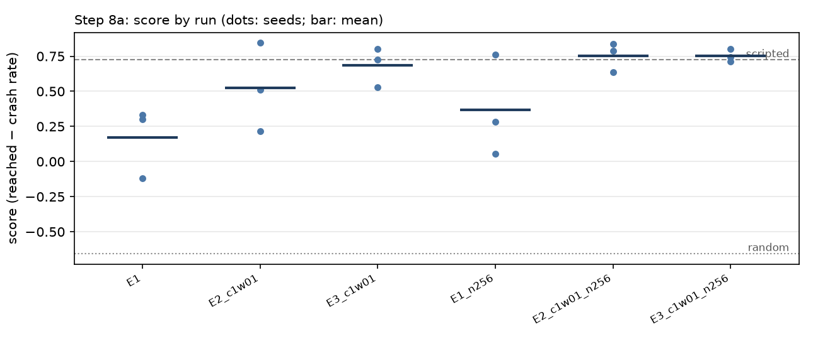

# Step 8a: network width (E order, P6's reward, seeds 7, 10, 13)

Bar, written before the runs: 256-256 replaces 64-64 only if the mean score rises by at least 0.10, it is ahead on all 3 seeds, and crashes do not rise.

| Cell | Score (mean of seeds) | Per seed | Reached | Crash | Timeout | B/L/R reached | Blocked reached | FRONT reached | FRONT crash | Final snapshot score |
|---|---:|---|---:|---:|---:|---:|---:|---:|---:|---:|
| E1 | **+0.171** | +0.300, -0.117, +0.330 | 58.4% | 41.3% | 0.2% | 74.7% | 57.1% | 25.8% | 73.9% | +0.171 |
| E2_c1w01 | **+0.525** | +0.845, +0.217, +0.512 | 71.6% | 19.1% | 9.3% | 86.8% | 74.2% | 41.1% | 35.8% | +0.525 |
| E3_c1w01 | **+0.685** | +0.801, +0.531, +0.723 | 78.3% | 9.8% | 11.9% | 89.8% | 81.0% | 55.2% | 17.5% | +0.719 |
| E1_n256 | **+0.367** | +0.762, +0.285, +0.055 | 68.2% | 31.5% | 0.2% | 79.9% | 65.1% | 44.9% | 54.6% | +0.367 |
| E2_c1w01_n256 | **+0.754** | +0.635, +0.790, +0.838 | 87.6% | 12.2% | 0.2% | 94.6% | 89.7% | 73.4% | 25.8% | +0.754 |
| E3_c1w01_n256 | **+0.752** | +0.802, +0.743, +0.712 | 87.3% | 12.1% | 0.5% | 93.4% | 86.9% | 75.2% | 23.5% | +0.728 |
| Scripted driver (reference) | +0.725 | | 75.8% | 3.2% | 21.0% | 83.9% | 58.3% | 59.4% | 4.5% | |
| Random driver (reference) | -0.655 | | 13.8% | 79.2% | 7.0% | 17.2% | 8.3% | 6.8% | 85.7% | |
| P6 (Mac; mean of seeds 7, 8, 9) (reference) | +0.628 | | 81.3% | 18.5% | 0.2% | 92.6% | 81.7% | 58.6% | 40.9% | |
| P6 seed 7 (reference) | +0.800 | | 90.0% | 10.0% | 0.0% | 97.8% | 96.4% | 74.4% | 25.6% | |
| P6 seed 8 (reference) | +0.635 | | 81.8% | 18.2% | 0.0% | 90.3% | 76.2% | 64.7% | 35.3% | |
| P6 seed 9 (reference) | +0.450 | | 72.2% | 27.3% | 0.5% | 89.9% | 72.6% | 36.8% | 61.7% | |

| Comparison (a − b) | Factor | Per-seed differences | Mean | 95% interval | p (paired t) | a ahead | Crash rate change |
|---|---|---|---:|---|---:|---:|---:|
| E3_c1w01_n256 − E3_c1w01 | width | +0.001, +0.212, -0.012 | +0.067 | [-0.245, +0.379] | 0.453 | 2 of 3 | +2.4% |

**Keep 64-64** (the larger network is not needed): change +0.067 (bar +0.1), ahead on 2 of 3 seeds, crash rate +2.4%.

