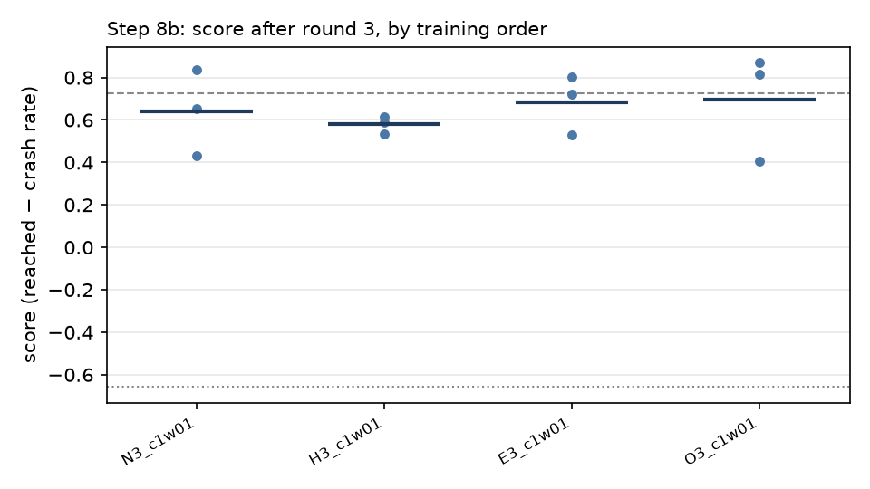

# Step 8b: training order at P6's reward (width n64, seeds 7, 10, 13)

Simplicity order N < H < E < O. A more complex order replaces a simpler one only if its per-seed score difference has paired t-test p < 0.05 and it is ahead on at least 2 of 3 seeds.

## Last round of each order

| Cell | Score (mean of seeds) | Per seed | Reached | Crash | Timeout | B/L/R reached | Blocked reached | FRONT reached | FRONT crash | Final snapshot score |
|---|---:|---|---:|---:|---:|---:|---:|---:|---:|---:|
| N3_c1w01 | **+0.641** | +0.838, +0.430, +0.653 | 72.5% | 8.4% | 19.1% | 88.6% | 71.3% | 40.1% | 7.2% | +0.659 |
| H3_c1w01 | **+0.580** | +0.532, +0.591, +0.617 | 66.2% | 8.3% | 25.5% | 83.7% | 65.3% | 31.2% | 8.4% | +0.627 |
| E3_c1w01 | **+0.685** | +0.801, +0.531, +0.723 | 78.3% | 9.8% | 11.9% | 89.8% | 81.0% | 55.2% | 17.5% | +0.719 |
| O3_c1w01 | **+0.697** | +0.869, +0.406, +0.817 | 77.9% | 8.2% | 13.9% | 89.9% | 77.1% | 53.9% | 15.1% | +0.716 |
| Scripted driver (reference) | +0.725 | | 75.8% | 3.2% | 21.0% | 83.9% | 58.3% | 59.4% | 4.5% | |
| Random driver (reference) | -0.655 | | 13.8% | 79.2% | 7.0% | 17.2% | 8.3% | 6.8% | 85.7% | |
| P6 (Mac; mean of seeds 7, 8, 9) (reference) | +0.628 | | 81.3% | 18.5% | 0.2% | 92.6% | 81.7% | 58.6% | 40.9% | |
| P6 seed 7 (reference) | +0.800 | | 90.0% | 10.0% | 0.0% | 97.8% | 96.4% | 74.4% | 25.6% | |
| P6 seed 8 (reference) | +0.635 | | 81.8% | 18.2% | 0.0% | 90.3% | 76.2% | 64.7% | 35.3% | |
| P6 seed 9 (reference) | +0.450 | | 72.2% | 27.3% | 0.5% | 89.9% | 72.6% | 36.8% | 61.7% | |

## Every round

| Cell | Score (mean of seeds) | Per seed | Reached | Crash | Timeout | B/L/R reached | Blocked reached | FRONT reached | FRONT crash | Final snapshot score |
|---|---:|---|---:|---:|---:|---:|---:|---:|---:|---:|
| N1 | **+0.347** | +0.412, +0.255, +0.372 | 67.2% | 32.5% | 0.3% | 84.3% | 62.7% | 32.8% | 66.2% | +0.347 |
| N2_c1w01 | **+0.522** | +0.647, +0.410, +0.507 | 65.9% | 13.7% | 20.3% | 86.0% | 64.7% | 25.6% | 17.3% | +0.522 |
| N3_c1w01 | **+0.641** | +0.838, +0.430, +0.653 | 72.5% | 8.4% | 19.1% | 88.6% | 71.3% | 40.1% | 7.2% | +0.659 |
| H1 | **-0.063** | -0.470, +0.110, +0.170 | 46.8% | 53.2% | 0.0% | 58.8% | 41.3% | 22.8% | 77.2% | -0.063 |
| H2_c1w01 | **+0.566** | +0.458, +0.677, +0.562 | 63.4% | 6.8% | 29.8% | 80.3% | 61.1% | 29.6% | 6.0% | +0.566 |
| H3_c1w01 | **+0.580** | +0.532, +0.591, +0.617 | 66.2% | 8.3% | 25.5% | 83.7% | 65.3% | 31.2% | 8.4% | +0.627 |
| E1 | **+0.171** | +0.300, -0.117, +0.330 | 58.4% | 41.3% | 0.2% | 74.7% | 57.1% | 25.8% | 73.9% | +0.171 |
| E2_c1w01 | **+0.525** | +0.845, +0.217, +0.512 | 71.6% | 19.1% | 9.3% | 86.8% | 74.2% | 41.1% | 35.8% | +0.525 |
| E3_c1w01 | **+0.685** | +0.801, +0.531, +0.723 | 78.3% | 9.8% | 11.9% | 89.8% | 81.0% | 55.2% | 17.5% | +0.719 |
| O2_c1w01 | **+0.416** | +0.613, +0.125, +0.510 | 56.7% | 15.1% | 28.2% | 68.3% | 55.6% | 33.3% | 33.8% | +0.416 |
| O3_c1w01 | **+0.697** | +0.869, +0.406, +0.817 | 77.9% | 8.2% | 13.9% | 89.9% | 77.1% | 53.9% | 15.1% | +0.716 |

## Comparisons

| Comparison (a − b) | Factor | Per-seed differences | Mean | 95% interval | p (paired t) | a ahead | Crash rate change |
|---|---|---|---:|---|---:|---:|---:|
| H3_c1w01 − N3_c1w01 | practice | -0.307, +0.161, -0.037 | -0.061 | [-0.644, +0.522] | 0.697 | 1 of 3 | -0.1% |
| E3_c1w01 − H3_c1w01 | easy starts | +0.269, -0.060, +0.107 | +0.105 | [-0.304, +0.514] | 0.383 | 2 of 3 | +1.5% |
| E3_c1w01 − N3_c1w01 | practice | -0.038, +0.101, +0.070 | +0.044 | [-0.136, +0.225] | 0.400 | 2 of 3 | +1.4% |
| O3_c1w01 − E3_c1w01 | round-2 task | +0.068, -0.125, +0.093 | +0.012 | [-0.285, +0.309] | 0.876 | 2 of 3 | -1.6% |

**Rule choice: order N.** Highest mean score: order O (+0.697). Order O scores higher but does not beat order N by the rule (within noise); per the plan, both get the reward grid in 8c unless the review decides otherwise.

