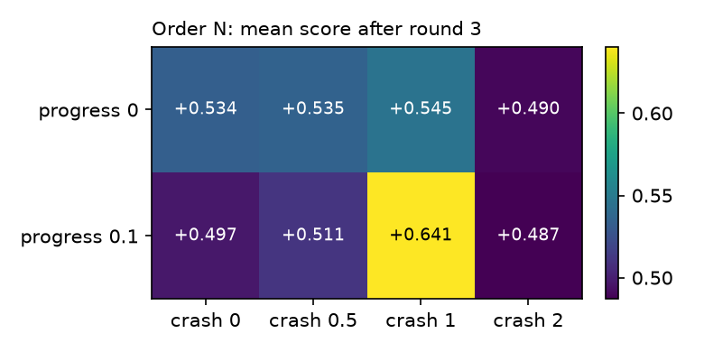
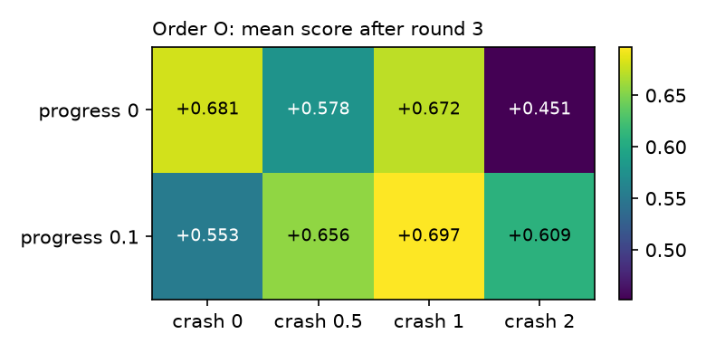

# Step 8c: reward grid, order N (width n64, seeds 7, 10, 13)

Reward from round 2 on: crash cost (× goal) and potential-based progress (per m). Simplicity: fewer non-zero terms first. The simplest reward that the best-scoring reward does not beat by the rule (paired t p < 0.05, ahead on ≥ 2 of 3 seeds) is chosen.

| Cell | Score (mean of seeds) | Per seed | Reached | Crash | Timeout | B/L/R reached | Blocked reached | FRONT reached | FRONT crash | Final snapshot score |
|---|---:|---|---:|---:|---:|---:|---:|---:|---:|---:|
| N3_c0w0 | **+0.534** | +0.803, +0.285, +0.513 | 76.6% | 23.3% | 0.1% | 89.3% | 71.2% | 51.3% | 48.5% | +0.528 |
| N3_c0w01 | **+0.497** | +0.752, +0.256, +0.482 | 74.4% | 24.8% | 0.8% | 89.4% | 72.1% | 44.4% | 53.1% | +0.540 |
| N3_c05w0 | **+0.535** | +0.543, +0.437, +0.625 | 65.7% | 12.2% | 22.2% | 85.5% | 63.2% | 25.9% | 12.0% | +0.570 |
| N3_c05w01 | **+0.511** | +0.546, +0.373, +0.612 | 65.2% | 14.2% | 20.6% | 84.3% | 66.1% | 27.0% | 16.5% | +0.598 |
| N3_c1w0 | **+0.545** | +0.612, +0.418, +0.605 | 64.7% | 10.2% | 25.1% | 85.3% | 64.9% | 23.5% | 8.3% | +0.578 |
| N3_c1w01 | **+0.641** | +0.838, +0.430, +0.653 | 72.5% | 8.4% | 19.1% | 88.6% | 71.3% | 40.1% | 7.2% | +0.659 |
| N3_c2w0 | **+0.490** | +0.563, +0.389, +0.517 | 54.5% | 5.5% | 40.0% | 73.1% | 49.5% | 17.1% | 7.0% | +0.527 |
| N3_c2w01 | **+0.487** | +0.567, +0.378, +0.517 | 55.2% | 6.6% | 38.2% | 75.4% | 51.7% | 14.9% | 5.1% | +0.420 |
| Scripted driver (reference) | +0.725 | | 75.8% | 3.2% | 21.0% | 83.9% | 58.3% | 59.4% | 4.5% | |
| Random driver (reference) | -0.655 | | 13.8% | 79.2% | 7.0% | 17.2% | 8.3% | 6.8% | 85.7% | |
| P6 (Mac; mean of seeds 7, 8, 9) (reference) | +0.628 | | 81.3% | 18.5% | 0.2% | 92.6% | 81.7% | 58.6% | 40.9% | |
| P6 seed 7 (reference) | +0.800 | | 90.0% | 10.0% | 0.0% | 97.8% | 96.4% | 74.4% | 25.6% | |
| P6 seed 8 (reference) | +0.635 | | 81.8% | 18.2% | 0.0% | 90.3% | 76.2% | 64.7% | 35.3% | |
| P6 seed 9 (reference) | +0.450 | | 72.2% | 27.3% | 0.5% | 89.9% | 72.6% | 36.8% | 61.7% | |

## Main effects (neighbouring cells)

| Comparison (a − b) | Factor | Per-seed differences | Mean | 95% interval | p (paired t) | a ahead | Crash rate change |
|---|---|---|---:|---|---:|---:|---:|
| N3_c05w0 − N3_c0w0 | crash cost | -0.259, +0.152, +0.112 | +0.001 | [-0.561, +0.564] | 0.992 | 2 of 3 | -11.1% |
| N3_c1w0 − N3_c05w0 | crash cost | +0.069, -0.018, -0.020 | +0.010 | [-0.116, +0.137] | 0.760 | 1 of 3 | -2.0% |
| N3_c2w0 − N3_c1w0 | crash cost | -0.049, -0.029, -0.088 | -0.056 | [-0.130, +0.019] | 0.085 | 0 of 3 | -4.7% |
| N3_c05w01 − N3_c0w01 | crash cost | -0.206, +0.117, +0.130 | +0.014 | [-0.459, +0.487] | 0.911 | 2 of 3 | -10.6% |
| N3_c1w01 − N3_c05w01 | crash cost | +0.292, +0.057, +0.041 | +0.130 | [-0.220, +0.480] | 0.251 | 3 of 3 | -5.8% |
| N3_c2w01 − N3_c1w01 | crash cost | -0.272, -0.052, -0.137 | -0.154 | [-0.428, +0.121] | 0.138 | 0 of 3 | -1.9% |
| N3_c0w01 − N3_c0w0 | progress | -0.051, -0.029, -0.031 | -0.037 | [-0.067, -0.007] | 0.034 | 0 of 3 | +1.5% |
| N3_c05w01 − N3_c05w0 | progress | +0.003, -0.063, -0.013 | -0.024 | [-0.110, +0.061] | 0.345 | 1 of 3 | +2.0% |
| N3_c1w01 − N3_c1w0 | progress | +0.226, +0.012, +0.048 | +0.095 | [-0.189, +0.380] | 0.286 | 3 of 3 | -1.8% |
| N3_c2w01 − N3_c2w0 | progress | +0.003, -0.012, +0.000 | -0.003 | [-0.022, +0.017] | 0.603 | 1 of 3 | +1.0% |

**Best score: c1w01 (+0.641). Rule choice: c0w0. Finalists for 8d: c0w0, c1w01, c1w0, c05w0.**

# Step 8c: reward grid, order O (width n64, seeds 7, 10, 13)

Reward from round 2 on: crash cost (× goal) and potential-based progress (per m). Simplicity: fewer non-zero terms first. The simplest reward that the best-scoring reward does not beat by the rule (paired t p < 0.05, ahead on ≥ 2 of 3 seeds) is chosen.

| Cell | Score (mean of seeds) | Per seed | Reached | Crash | Timeout | B/L/R reached | Blocked reached | FRONT reached | FRONT crash | Final snapshot score |
|---|---:|---|---:|---:|---:|---:|---:|---:|---:|---:|
| O3_c0w0 | **+0.681** | +0.831, +0.463, +0.748 | 84.0% | 15.9% | 0.1% | 93.0% | 84.8% | 65.9% | 33.9% | +0.659 |
| O3_c0w01 | **+0.553** | +0.605, +0.450, +0.605 | 77.6% | 22.3% | 0.1% | 90.1% | 77.5% | 52.7% | 47.1% | +0.590 |
| O3_c05w0 | **+0.578** | +0.782, +0.425, +0.527 | 71.2% | 13.4% | 15.4% | 86.1% | 67.9% | 41.1% | 26.0% | +0.552 |
| O3_c05w01 | **+0.656** | +0.707, +0.438, +0.823 | 74.2% | 8.6% | 17.1% | 87.3% | 72.9% | 48.0% | 18.0% | +0.728 |
| O3_c1w0 | **+0.672** | +0.844, +0.438, +0.736 | 75.2% | 8.0% | 16.8% | 87.5% | 72.5% | 50.6% | 16.9% | +0.723 |
| O3_c1w01 | **+0.697** | +0.869, +0.406, +0.817 | 77.9% | 8.2% | 13.9% | 89.9% | 77.1% | 53.9% | 15.1% | +0.716 |
| O3_c2w0 | **+0.451** | +0.560, +0.230, +0.564 | 58.1% | 13.0% | 28.9% | 72.8% | 55.3% | 28.7% | 22.1% | +0.566 |
| O3_c2w01 | **+0.609** | +0.799, +0.416, +0.613 | 69.9% | 8.9% | 21.2% | 84.1% | 65.9% | 41.3% | 13.8% | +0.637 |
| Scripted driver (reference) | +0.725 | | 75.8% | 3.2% | 21.0% | 83.9% | 58.3% | 59.4% | 4.5% | |
| Random driver (reference) | -0.655 | | 13.8% | 79.2% | 7.0% | 17.2% | 8.3% | 6.8% | 85.7% | |
| P6 (Mac; mean of seeds 7, 8, 9) (reference) | +0.628 | | 81.3% | 18.5% | 0.2% | 92.6% | 81.7% | 58.6% | 40.9% | |
| P6 seed 7 (reference) | +0.800 | | 90.0% | 10.0% | 0.0% | 97.8% | 96.4% | 74.4% | 25.6% | |
| P6 seed 8 (reference) | +0.635 | | 81.8% | 18.2% | 0.0% | 90.3% | 76.2% | 64.7% | 35.3% | |
| P6 seed 9 (reference) | +0.450 | | 72.2% | 27.3% | 0.5% | 89.9% | 72.6% | 36.8% | 61.7% | |

## Main effects (neighbouring cells)

| Comparison (a − b) | Factor | Per-seed differences | Mean | 95% interval | p (paired t) | a ahead | Crash rate change |
|---|---|---|---:|---|---:|---:|---:|
| O3_c05w0 − O3_c0w0 | crash cost | -0.049, -0.038, -0.221 | -0.103 | [-0.357, +0.152] | 0.224 | 0 of 3 | -2.6% |
| O3_c1w0 − O3_c05w0 | crash cost | +0.062, +0.013, +0.209 | +0.095 | [-0.159, +0.349] | 0.250 | 3 of 3 | -5.4% |
| O3_c2w0 − O3_c1w0 | crash cost | -0.284, -0.208, -0.172 | -0.221 | [-0.364, -0.078] | 0.022 | 0 of 3 | +5.0% |
| O3_c05w01 − O3_c0w01 | crash cost | +0.102, -0.012, +0.218 | +0.103 | [-0.183, +0.388] | 0.262 | 2 of 3 | -13.7% |
| O3_c1w01 − O3_c05w01 | crash cost | +0.162, -0.032, -0.007 | +0.041 | [-0.222, +0.304] | 0.571 | 1 of 3 | -0.4% |
| O3_c2w01 − O3_c1w01 | crash cost | -0.070, +0.010, -0.203 | -0.088 | [-0.355, +0.180] | 0.294 | 1 of 3 | +0.7% |
| O3_c0w01 − O3_c0w0 | progress | -0.226, -0.013, -0.143 | -0.127 | [-0.393, +0.139] | 0.176 | 0 of 3 | +6.4% |
| O3_c05w01 − O3_c05w0 | progress | -0.075, +0.013, +0.297 | +0.078 | [-0.404, +0.561] | 0.557 | 2 of 3 | -4.8% |
| O3_c1w01 − O3_c1w0 | progress | +0.025, -0.032, +0.081 | +0.025 | [-0.115, +0.164] | 0.526 | 2 of 3 | +0.2% |
| O3_c2w01 − O3_c2w0 | progress | +0.239, +0.186, +0.049 | +0.158 | [-0.085, +0.401] | 0.108 | 3 of 3 | -4.1% |

**Best score: c1w01 (+0.697). Rule choice: c0w0. Finalists for 8d: c0w0, c1w01, c1w0.**

