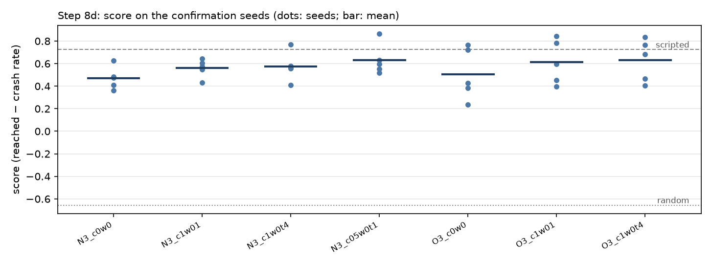
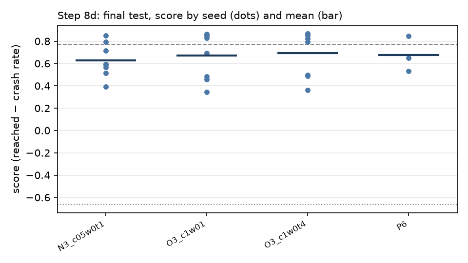

# Step 8d: confirmation of the finalists (width n64)

Finalists from 8c, retrained from fresh weights on 5 new seeds (16, 19, 22, 25, 28). They are ranked on these seeds only: the screening seeds (7, 10, 13) chose them, so scores there are biased upward. Rule: the simplest finalist (fewer special training rounds, then fewer reward terms) that the best-scoring one does not beat (paired t p < 0.05 and ahead on at least 4 of 5 seeds).

## Confirmation seeds

| Cell | Score (mean of seeds) | Per seed | Reached | Crash | Timeout | B/L/R reached | Blocked reached | FRONT reached | FRONT crash | Final snapshot score |
|---|---:|---|---:|---:|---:|---:|---:|---:|---:|---:|
| N3_c0w0 | **+0.471** | +0.628, +0.361, +0.483, +0.473, +0.409 | 73.4% | 26.3% | 0.3% | 87.1% | 67.2% | 46.0% | 53.3% | +0.438 |
| N3_c1w01 | **+0.561** | +0.606, +0.432, +0.644, +0.575, +0.550 | 66.2% | 10.0% | 23.8% | 85.2% | 63.7% | 28.0% | 10.2% | +0.587 |
| N3_c1w0t4 | **+0.576** | +0.770, +0.412, +0.557, +0.563, +0.580 | 70.6% | 13.0% | 16.4% | 87.7% | 72.1% | 36.3% | 18.6% | +0.620 |
| N3_c05w0t1 | **+0.633** | +0.865, +0.553, +0.631, +0.595, +0.519 | 74.3% | 11.1% | 14.6% | 89.9% | 75.6% | 43.1% | 16.5% | +0.637 |
| O3_c0w0 | **+0.507** | +0.235, +0.425, +0.767, +0.721, +0.386 | 75.3% | 24.6% | 0.1% | 88.3% | 70.9% | 49.2% | 50.5% | +0.502 |
| O3_c1w01 | **+0.614** | +0.452, +0.842, +0.782, +0.597, +0.397 | 71.5% | 10.1% | 18.5% | 85.5% | 68.0% | 43.2% | 18.1% | +0.638 |
| O3_c1w0t4 | **+0.632** | +0.466, +0.834, +0.685, +0.768, +0.406 | 73.7% | 10.5% | 15.8% | 87.8% | 72.2% | 45.4% | 15.3% | +0.671 |
| Scripted driver (reference) | +0.725 | | 75.8% | 3.2% | 21.0% | 83.9% | 58.3% | 59.4% | 4.5% | |
| Random driver (reference) | -0.655 | | 13.8% | 79.2% | 7.0% | 17.2% | 8.3% | 6.8% | 85.7% | |
| P6 (Mac; mean of seeds 7, 8, 9) (reference) | +0.628 | | 81.3% | 18.5% | 0.2% | 92.6% | 81.7% | 58.6% | 40.9% | |
| P6 seed 7 (reference) | +0.800 | | 90.0% | 10.0% | 0.0% | 97.8% | 96.4% | 74.4% | 25.6% | |
| P6 seed 8 (reference) | +0.635 | | 81.8% | 18.2% | 0.0% | 90.3% | 76.2% | 64.7% | 35.3% | |
| P6 seed 9 (reference) | +0.450 | | 72.2% | 27.3% | 0.5% | 89.9% | 72.6% | 36.8% | 61.7% | |

## All 8 seeds (screening + confirmation), for reference

| Cell | Score (mean of seeds) | Per seed | Reached | Crash | Timeout | B/L/R reached | Blocked reached | FRONT reached | FRONT crash | Final snapshot score |
|---|---:|---|---:|---:|---:|---:|---:|---:|---:|---:|
| N3_c0w0 | **+0.494** | +0.803, +0.285, +0.513, +0.628, +0.361, +0.483, +0.473, +0.409 | 74.6% | 25.2% | 0.2% | 87.9% | 68.7% | 48.0% | 51.5% | +0.472 |
| N3_c1w01 | **+0.591** | +0.838, +0.430, +0.653, +0.606, +0.432, +0.644, +0.575, +0.550 | 68.5% | 9.4% | 22.0% | 86.5% | 66.5% | 32.5% | 9.1% | +0.614 |
| N3_c1w0t4 | **+0.585** | +0.683, +0.489, +0.628, +0.770, +0.412, +0.557, +0.563, +0.580 | 71.4% | 12.9% | 15.7% | 86.8% | 69.9% | 40.5% | 16.4% | +0.585 |
| N3_c05w0t1 | **+0.617** | +0.730, +0.420, +0.627, +0.865, +0.553, +0.631, +0.595, +0.519 | 73.1% | 11.4% | 15.5% | 89.1% | 73.6% | 41.0% | 15.9% | +0.613 |
| O3_c0w0 | **+0.572** | +0.831, +0.463, +0.748, +0.235, +0.425, +0.767, +0.721, +0.386 | 78.5% | 21.4% | 0.1% | 90.0% | 76.1% | 55.5% | 44.3% | +0.561 |
| O3_c1w01 | **+0.645** | +0.869, +0.406, +0.817, +0.452, +0.842, +0.782, +0.597, +0.397 | 73.9% | 9.4% | 16.8% | 87.2% | 71.4% | 47.2% | 17.0% | +0.667 |
| O3_c1w0t4 | **+0.652** | +0.850, +0.449, +0.759, +0.466, +0.834, +0.685, +0.768, +0.406 | 74.9% | 9.7% | 15.4% | 88.5% | 73.9% | 47.5% | 15.7% | +0.689 |

## Comparisons on the confirmation seeds

Factor `recipe`: the two finalists differ in both training order and reward, so the comparison chooses between whole recipes and does not measure either setting's effect.

| Comparison (a − b) | Factor | Per-seed differences | Mean | 95% interval | p (paired t) | a ahead | Crash rate change |
|---|---|---|---:|---|---:|---:|---:|
| N3_c0w0 − N3_c1w01 | reward | +0.022, -0.071, -0.161, -0.102, -0.141 | -0.090 | [-0.180, -0.001] | 0.049 | 1 of 5 | +16.3% |
| N3_c0w0 − N3_c1w0t4 | reward | -0.142, -0.051, -0.073, -0.090, -0.171 | -0.105 | [-0.167, -0.044] | 0.009 | 0 of 5 | +13.4% |
| N3_c0w0 − N3_c05w0t1 | reward | -0.237, -0.193, -0.148, -0.122, -0.110 | -0.162 | [-0.227, -0.096] | 0.002 | 0 of 5 | +15.2% |
| N3_c0w0 − O3_c0w0 | order | +0.393, -0.064, -0.283, -0.247, +0.023 | -0.036 | [-0.373, +0.301] | 0.783 | 2 of 5 | +1.7% |
| N3_c0w0 − O3_c1w01 | recipe | +0.176, -0.481, -0.298, -0.123, +0.012 | -0.143 | [-0.462, +0.176] | 0.281 | 2 of 5 | +16.2% |
| N3_c0w0 − O3_c1w0t4 | recipe | +0.162, -0.473, -0.202, -0.294, +0.003 | -0.161 | [-0.470, +0.149] | 0.223 | 2 of 5 | +15.8% |
| N3_c1w01 − N3_c1w0t4 | reward | -0.164, +0.020, +0.088, +0.012, -0.030 | -0.015 | [-0.131, +0.101] | 0.738 | 3 of 5 | -2.9% |
| N3_c1w01 − N3_c05w0t1 | reward | -0.259, -0.122, +0.013, -0.020, +0.031 | -0.071 | [-0.221, +0.078] | 0.256 | 2 of 5 | -1.0% |
| N3_c1w01 − O3_c0w0 | recipe | +0.371, +0.007, -0.122, -0.146, +0.164 | +0.055 | [-0.213, +0.322] | 0.601 | 3 of 5 | -14.6% |
| N3_c1w01 − O3_c1w01 | order | +0.153, -0.410, -0.137, -0.022, +0.152 | -0.053 | [-0.344, +0.239] | 0.642 | 2 of 5 | -0.0% |
| N3_c1w01 − O3_c1w0t4 | recipe | +0.140, -0.402, -0.041, -0.193, +0.144 | -0.070 | [-0.359, +0.218] | 0.536 | 2 of 5 | -0.5% |
| N3_c1w0t4 − N3_c05w0t1 | reward | -0.095, -0.142, -0.074, -0.032, +0.061 | -0.056 | [-0.151, +0.039] | 0.175 | 1 of 5 | +1.9% |
| N3_c1w0t4 − O3_c0w0 | recipe | +0.535, -0.013, -0.210, -0.157, +0.194 | +0.070 | [-0.307, +0.447] | 0.635 | 2 of 5 | -11.6% |
| N3_c1w0t4 − O3_c1w01 | recipe | +0.318, -0.430, -0.225, -0.033, +0.182 | -0.038 | [-0.412, +0.337] | 0.794 | 2 of 5 | +2.9% |
| N3_c1w0t4 − O3_c1w0t4 | order | +0.304, -0.422, -0.128, -0.204, +0.174 | -0.055 | [-0.420, +0.309] | 0.695 | 2 of 5 | +2.4% |
| N3_c05w0t1 − O3_c0w0 | recipe | +0.630, +0.128, -0.136, -0.126, +0.133 | +0.126 | [-0.260, +0.512] | 0.416 | 3 of 5 | -13.5% |
| N3_c05w0t1 − O3_c1w01 | recipe | +0.412, -0.288, -0.151, -0.002, +0.122 | +0.019 | [-0.315, +0.352] | 0.884 | 2 of 5 | +1.0% |
| N3_c05w0t1 − O3_c1w0t4 | recipe | +0.399, -0.281, -0.054, -0.172, +0.113 | +0.001 | [-0.330, +0.332] | 0.994 | 2 of 5 | +0.5% |
| O3_c0w0 − O3_c1w01 | reward | -0.217, -0.417, -0.015, +0.124, -0.012 | -0.107 | [-0.370, +0.155] | 0.320 | 1 of 5 | +14.5% |
| O3_c0w0 − O3_c1w0t4 | reward | -0.231, -0.409, +0.082, -0.047, -0.020 | -0.125 | [-0.367, +0.117] | 0.225 | 1 of 5 | +14.1% |
| O3_c1w01 − O3_c1w0t4 | reward | -0.013, +0.008, +0.097, -0.171, -0.008 | -0.018 | [-0.138, +0.102] | 0.703 | 2 of 5 | -0.5% |

**Best on the confirmation seeds: N_c05w0t1 (+0.633). Rule choice (the winner): N_c05w0t1 (+0.633).**

## Final test: 500 fresh episodes (seeds 50,000-50,499), final models, every seed

| Cell | Score (mean of seeds) | Per seed | Reached | Crash | Timeout | B/L/R reached | Blocked reached | FRONT reached | FRONT crash | Final snapshot score |
|---|---:|---|---:|---:|---:|---:|---:|---:|---:|---:|
| N3_c05w0t1 | **+0.628** | +0.796, +0.392, +0.592, +0.852, +0.568, +0.714, +0.594, +0.516 | 75.1% | 12.2% | 12.7% | 88.6% | 76.2% | 38.7% | 18.5% | +0.628 |
| O3_c1w01 | **+0.672** | +0.862, +0.456, +0.856, +0.486, +0.828, +0.692, +0.852, +0.346 | 75.4% | 8.2% | 16.4% | 85.3% | 69.0% | 48.8% | 15.2% | +0.672 |
| O3_c1w0t4 | **+0.694** | +0.868, +0.488, +0.852, +0.496, +0.868, +0.824, +0.792, +0.360 | 76.9% | 7.5% | 15.6% | 86.9% | 73.3% | 50.2% | 13.5% | +0.694 |
| P6 | **+0.677** | +0.848, +0.652, +0.530 | 83.7% | 16.1% | 0.2% | 93.4% | 83.9% | 57.8% | 41.7% | +0.677 |
| Scripted driver (reference) | +0.774 | | 79.2% | 1.8% | 19.0% | 80.2% | 54.2% | 76.5% | 0.7% | |
| Random driver (reference) | -0.662 | | 12.8% | 79.0% | 8.2% | 15.7% | 3.3% | 5.1% | 82.4% | |

| Comparison (a − b) | Test | Per-seed values | Mean difference | 95% interval | p | a ahead |
|---|---|---|---:|---|---:|---:|
| N3_c05w0t1 − scripted driver | one-sample t over the winner's 8 seeds (same 500 episodes) | +0.022, -0.382, -0.182, +0.078, -0.206, -0.060, -0.180, -0.258 | -0.146 | [-0.272, -0.020] | 0.029 | 2 of 8 |
| N3_c05w0t1 − random driver | one-sample t over the winner's 8 seeds (same 500 episodes) | +1.458, +1.054, +1.254, +1.514, +1.230, +1.376, +1.256, +1.178 | +1.290 | [+1.164, +1.416] | 0.000 | 8 of 8 |
| N3_c05w0t1 − P6 (Mac) | Welch t, 8 vs 3 seeds (not paired) |  | -0.049 | [-0.365, +0.268] | 0.676 | – |
| N3_c05w0t1 − O3_c1w01 | paired t over seeds (recipe) | -0.066, -0.064, -0.264, +0.366, -0.260, +0.022, -0.258, +0.170 | -0.044 | [-0.234, +0.145] | 0.598 | 3 of 8 |
| N3_c05w0t1 − O3_c1w0t4 | paired t over seeds (recipe) | -0.072, -0.096, -0.260, +0.356, -0.300, -0.110, -0.198, +0.156 | -0.066 | [-0.250, +0.119] | 0.428 | 2 of 8 |

