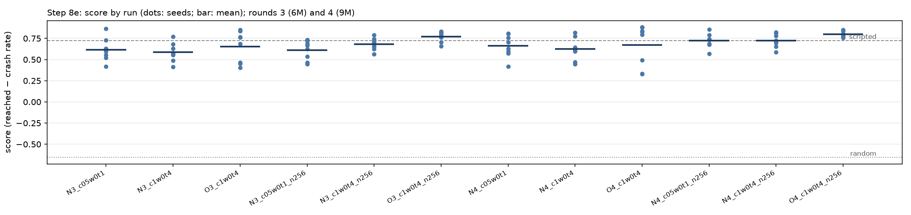

# Step 8e: 256 wide and 3M more training (all 8 seeds)

Cells N_c05w0t1, N_c1w0t4, O_c1w0t4. Round 3 ends at 6M transitions, round 4 (3M more of round 3's training) at 9M. Score = reached − crash on the 400 selection episodes, mean of the last 3 snapshots of the round (final model and the checkpoints 200k and 400k before it). Paired over seeds 7, 10, 13, 16, 19, 22, 25, 28.

Bars, written before the runs: **256-256** is adopted only if, at 9M, on at least 2 of the 3 cells, it scores +0.10 or more above 64-64 with p < 0.05, ahead on at least 6 of 8 seeds and the crash rate not higher. **Longer training** is adopted if round 4 beats round 3 (p < 0.05) on at least 2 of 3 cells at the chosen width.

## Cells

| Cell | Score (mean of seeds) | Per seed | Reached | Crash | Timeout | B/L/R reached | Blocked reached | FRONT reached | FRONT crash | Final snapshot score |
|---|---:|---|---:|---:|---:|---:|---:|---:|---:|---:|
| N3_c05w0t1 | **+0.617** | +0.730, +0.420, +0.627, +0.865, +0.553, +0.631, +0.595, +0.519 | 73.1% | 11.4% | 15.5% | 89.1% | 73.6% | 41.0% | 15.9% | +0.613 |
| N3_c1w0t4 | **+0.585** | +0.683, +0.489, +0.628, +0.770, +0.412, +0.557, +0.563, +0.580 | 71.4% | 12.9% | 15.7% | 86.8% | 69.9% | 40.5% | 16.4% | +0.585 |
| O3_c1w0t4 | **+0.652** | +0.850, +0.449, +0.759, +0.466, +0.834, +0.685, +0.768, +0.406 | 74.9% | 9.7% | 15.4% | 88.5% | 73.9% | 47.5% | 15.7% | +0.689 |
| N3_c05w0t1_n256 | **+0.609** | +0.717, +0.464, +0.685, +0.667, +0.537, +0.733, +0.448, +0.623 | 78.9% | 18.0% | 3.1% | 88.1% | 75.3% | 60.4% | 31.5% | +0.559 |
| N3_c1w0t4_n256 | **+0.682** | +0.789, +0.712, +0.655, +0.659, +0.627, +0.562, +0.743, +0.706 | 81.6% | 13.4% | 5.0% | 90.4% | 78.7% | 64.0% | 24.1% | +0.654 |
| O3_c1w0t4_n256 | **+0.768** | +0.830, +0.789, +0.812, +0.812, +0.703, +0.779, +0.762, +0.660 | 88.4% | 11.5% | 0.1% | 93.9% | 87.5% | 77.2% | 22.6% | +0.798 |
| N4_c05w0t1 | **+0.661** | +0.809, +0.420, +0.572, +0.757, +0.802, +0.704, +0.631, +0.597 | 76.9% | 10.7% | 12.4% | 89.6% | 76.5% | 51.2% | 15.2% | +0.654 |
| N4_c1w0t4 | **+0.624** | +0.775, +0.448, +0.596, +0.820, +0.471, +0.627, +0.646, +0.609 | 73.7% | 11.3% | 15.0% | 88.2% | 72.9% | 44.5% | 16.6% | +0.653 |
| O4_c1w0t4 | **+0.672** | +0.794, +0.334, +0.881, +0.328, +0.838, +0.828, +0.884, +0.492 | 78.2% | 11.0% | 10.8% | 90.3% | 77.8% | 54.0% | 19.8% | +0.707 |
| N4_c05w0t1_n256 | **+0.725** | +0.791, +0.744, +0.857, +0.688, +0.570, +0.735, +0.676, +0.739 | 85.3% | 12.8% | 1.8% | 92.7% | 83.7% | 70.6% | 24.2% | +0.718 |
| N4_c1w0t4_n256 | **+0.723** | +0.723, +0.821, +0.812, +0.713, +0.782, +0.589, +0.697, +0.651 | 85.2% | 12.8% | 2.0% | 92.4% | 83.3% | 70.7% | 24.2% | +0.767 |
| O4_c1w0t4_n256 | **+0.797** | +0.836, +0.848, +0.802, +0.758, +0.768, +0.787, +0.789, +0.788 | 89.8% | 10.1% | 0.2% | 94.6% | 88.4% | 80.1% | 19.4% | +0.803 |
| Scripted driver (reference) | +0.725 | | 75.8% | 3.2% | 21.0% | 83.9% | 58.3% | 59.4% | 4.5% | |
| Random driver (reference) | -0.655 | | 13.8% | 79.2% | 7.0% | 17.2% | 8.3% | 6.8% | 85.7% | |
| P6 (Mac; mean of seeds 7, 8, 9) (reference) | +0.628 | | 81.3% | 18.5% | 0.2% | 92.6% | 81.7% | 58.6% | 40.9% | |
| P6 seed 7 (reference) | +0.800 | | 90.0% | 10.0% | 0.0% | 97.8% | 96.4% | 74.4% | 25.6% | |
| P6 seed 8 (reference) | +0.635 | | 81.8% | 18.2% | 0.0% | 90.3% | 76.2% | 64.7% | 35.3% | |
| P6 seed 9 (reference) | +0.450 | | 72.2% | 27.3% | 0.5% | 89.9% | 72.6% | 36.8% | 61.7% | |

| Cell | FRONT timed out | Seeds with ≥ 30% FRONT timeouts |
|---|---:|---|
| N3_c05w0t1 | 43.1% | 10, 13, 19, 22, 25, 28 |
| N3_c1w0t4 | 43.1% | 10, 13, 19, 22, 25, 28 |
| O3_c1w0t4 | 36.8% | 10, 16, 28 |
| N3_c05w0t1_n256 | 8.1% | 19 |
| N3_c1w0t4_n256 | 11.9% | 19, 22 |
| O3_c1w0t4_n256 | 0.3% | none |
| N4_c05w0t1 | 33.6% | 10, 13, 22, 25, 28 |
| N4_c1w0t4 | 38.8% | 13, 19, 22, 25, 28 |
| O4_c1w0t4 | 26.3% | 10, 16, 28 |
| N4_c05w0t1_n256 | 5.3% | 19 |
| N4_c1w0t4_n256 | 5.1% | 22 |
| O4_c1w0t4_n256 | 0.4% | none |

## Width at the same training

At 9M (primary):

| Comparison (a − b) | Factor | Per-seed differences | Mean | 95% interval | p (paired t) | a ahead | Crash rate change |
|---|---|---|---:|---|---:|---:|---:|
| N4_c05w0t1_n256 − N4_c05w0t1 | width | -0.018, +0.324, +0.285, -0.069, -0.232, +0.031, +0.045, +0.143 | +0.063 | [-0.090, +0.217] | 0.362 | 5 of 8 | +2.1% |
| N4_c1w0t4_n256 − N4_c1w0t4 | width | -0.052, +0.373, +0.217, -0.107, +0.311, -0.037, +0.051, +0.042 | +0.100 | [-0.050, +0.249] | 0.159 | 5 of 8 | +1.5% |
| O4_c1w0t4_n256 − O4_c1w0t4 | width | +0.042, +0.514, -0.079, +0.431, -0.070, -0.041, -0.095, +0.297 | +0.125 | [-0.084, +0.334] | 0.201 | 4 of 8 | -0.9% |

At 6M (secondary):

| Comparison (a − b) | Factor | Per-seed differences | Mean | 95% interval | p (paired t) | a ahead | Crash rate change |
|---|---|---|---:|---|---:|---:|---:|
| N3_c05w0t1_n256 − N3_c05w0t1 | width | -0.013, +0.044, +0.058, -0.198, -0.017, +0.103, -0.148, +0.104 | -0.008 | [-0.102, +0.085] | 0.839 | 4 of 8 | +6.6% |
| N3_c1w0t4_n256 − N3_c1w0t4 | width | +0.106, +0.222, +0.027, -0.111, +0.215, +0.006, +0.179, +0.126 | +0.096 | [-0.001, +0.193] | 0.051 | 7 of 8 | +0.6% |
| O3_c1w0t4_n256 − O3_c1w0t4 | width | -0.020, +0.340, +0.052, +0.347, -0.131, +0.094, -0.006, +0.254 | +0.116 | [-0.032, +0.265] | 0.107 | 5 of 8 | +1.8% |

Bar met on: none. **Keep 64-64.**

## 3M more training (round 4 − round 3, same runs)

| Comparison (a − b) | Factor | Per-seed differences | Mean | 95% interval | p (paired t) | a ahead | Crash rate change |
|---|---|---|---:|---|---:|---:|---:|
| N4_c05w0t1 − N3_c05w0t1 | 3M more training | +0.079, +0.000, -0.055, -0.108, +0.249, +0.073, +0.036, +0.078 | +0.044 | [-0.046, +0.134] | 0.284 | 5 of 8 | -0.6% |
| N4_c1w0t4 − N3_c1w0t4 | 3M more training | +0.092, -0.042, -0.032, +0.050, +0.059, +0.070, +0.083, +0.029 | +0.039 | [-0.004, +0.081] | 0.068 | 6 of 8 | -1.6% |
| O4_c1w0t4 − O3_c1w0t4 | 3M more training | -0.056, -0.115, +0.122, -0.138, +0.004, +0.143, +0.117, +0.086 | +0.020 | [-0.074, +0.114] | 0.625 | 5 of 8 | +1.3% |
| N4_c05w0t1_n256 − N3_c05w0t1_n256 | 3M more training | +0.074, +0.280, +0.172, +0.021, +0.033, +0.002, +0.228, +0.116 | +0.116 | [+0.030, +0.201] | 0.015 | 8 of 8 | -5.1% |
| N4_c1w0t4_n256 − N3_c1w0t4_n256 | 3M more training | -0.067, +0.109, +0.158, +0.054, +0.155, +0.027, -0.046, -0.055 | +0.042 | [-0.035, +0.119] | 0.241 | 5 of 8 | -0.6% |
| O4_c1w0t4_n256 − O3_c1w0t4_n256 | 3M more training | +0.006, +0.059, -0.010, -0.054, +0.065, +0.008, +0.027, +0.128 | +0.029 | [-0.018, +0.075] | 0.186 | 6 of 8 | -1.4% |

At the chosen width (64), round 4 beats round 3 beyond noise on: none. **Keep 6M.**

## Order and reward at each width and length

| Comparison (a − b) | Factor | Per-seed differences | Mean | 95% interval | p (paired t) | a ahead | Crash rate change |
|---|---|---|---:|---|---:|---:|---:|
| O4_c1w0t4_n256 − N4_c1w0t4_n256 | order | +0.113, +0.027, -0.011, +0.045, -0.013, +0.198, +0.093, +0.138 | +0.074 | [+0.011, +0.136] | 0.027 | 6 of 8 | -2.8% |
| O3_c1w0t4_n256 − N3_c1w0t4_n256 | order | +0.041, +0.078, +0.157, +0.153, +0.077, +0.217, +0.019, -0.046 | +0.087 | [+0.016, +0.158] | 0.023 | 7 of 8 | -1.9% |
| O4_c1w0t4 − N4_c1w0t4 | order | +0.019, -0.113, +0.285, -0.492, +0.367, +0.202, +0.238, -0.118 | +0.049 | [-0.189, +0.286] | 0.644 | 5 of 8 | -0.3% |
| O3_c1w0t4 − N3_c1w0t4 | order | +0.167, -0.040, +0.131, -0.304, +0.422, +0.128, +0.204, -0.174 | +0.067 | [-0.126, +0.259] | 0.439 | 5 of 8 | -3.2% |
| N4_c05w0t1_n256 − N4_c1w0t4_n256 | reward | +0.068, -0.077, +0.044, -0.026, -0.212, +0.146, -0.021, +0.088 | +0.001 | [-0.092, +0.095] | 0.972 | 4 of 8 | -0.0% |
| N3_c05w0t1_n256 − N3_c1w0t4_n256 | reward | -0.073, -0.247, +0.030, +0.007, -0.090, +0.171, -0.295, -0.083 | -0.072 | [-0.197, +0.053] | 0.213 | 3 of 8 | +4.5% |
| N4_c05w0t1 − N4_c1w0t4 | reward | +0.034, -0.028, -0.024, -0.063, +0.332, +0.078, -0.015, -0.013 | +0.038 | [-0.068, +0.143] | 0.427 | 3 of 8 | -0.6% |
| N3_c05w0t1 − N3_c1w0t4 | reward | +0.047, -0.069, -0.002, +0.095, +0.142, +0.074, +0.032, -0.061 | +0.032 | [-0.029, +0.094] | 0.256 | 5 of 8 | -1.5% |

**Recipe at the chosen width and length (O3_c1w0t4 scores highest, +0.652): rule choice N3_c05w0t1 (+0.617).**

