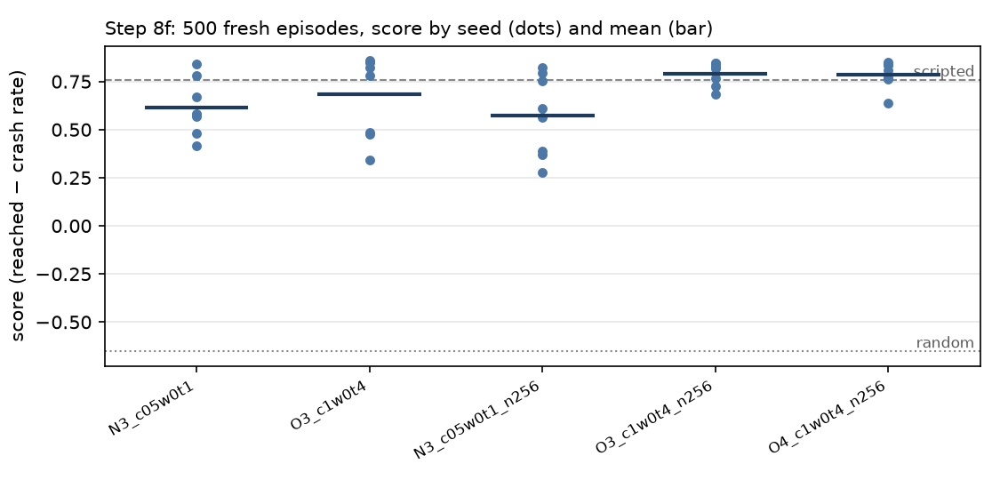

# Step 8f: the 256-wide recipe on 500 fresh episodes (seeds 60,000-60,499)

Final models, seeds 7, 10, 13, 16, 19, 22, 25, 28. Score = reached − crash per episode, mean over the episodes. Candidate O3_c1w0t4_n256 (original order, crash 1 + time cost 0.004, 256 wide, 6M); current winner N3_c05w0t1 (no practice, crash 0.5 + time cost 0.001, 64 wide, 6M). Bar and predictions written before the evaluation (EXPERIMENT_NOTES.md, Step 8f).

## Cells

| Cell | Score (mean of seeds) | Per seed | Reached | Crash | Timeout | B/L/R reached | Blocked reached | FRONT reached | FRONT crash | Final snapshot score |
|---|---:|---|---:|---:|---:|---:|---:|---:|---:|---:|
| N3_c05w0t1 | **+0.614** | +0.780, +0.416, +0.568, +0.840, +0.576, +0.672, +0.580, +0.482 | 73.6% | 12.2% | 14.3% | 88.5% | 72.7% | 39.6% | 16.6% | +0.614 |
| O3_c1w0t4 | **+0.683** | +0.860, +0.486, +0.848, +0.474, +0.852, +0.824, +0.780, +0.340 | 76.1% | 7.8% | 16.1% | 87.3% | 72.2% | 50.7% | 13.0% | +0.683 |
| N3_c05w0t1_n256 | **+0.573** | +0.752, +0.372, +0.612, +0.796, +0.562, +0.824, +0.388, +0.276 | 76.8% | 19.6% | 3.6% | 84.9% | 70.9% | 58.4% | 32.5% | +0.573 |
| O3_c1w0t4_n256 | **+0.791** | +0.822, +0.832, +0.844, +0.844, +0.766, +0.816, +0.726, +0.682 | 89.5% | 10.4% | 0.1% | 95.4% | 90.4% | 76.1% | 23.4% | +0.791 |
| O4_c1w0t4_n256 | **+0.783** | +0.836, +0.852, +0.636, +0.834, +0.764, +0.768, +0.768, +0.810 | 89.1% | 10.8% | 0.1% | 94.2% | 87.7% | 77.5% | 22.1% | +0.783 |
| Scripted driver (reference) | +0.758 | | 78.2% | 2.4% | 19.4% | 85.0% | 59.6% | 62.7% | 3.9% | |
| Random driver (reference) | -0.652 | | 14.0% | 79.2% | 6.8% | 19.0% | 11.5% | 2.6% | 88.2% | |

| Cell | FRONT timed out | Seeds with ≥ 30% FRONT timeouts |
|---|---:|---|
| N3_c05w0t1 | 43.8% | 10, 13, 19, 22, 25, 28 |
| O3_c1w0t4 | 36.3% | 10, 16, 28 |
| N3_c05w0t1_n256 | 9.1% | 19 |
| O3_c1w0t4_n256 | 0.5% | none |
| O4_c1w0t4_n256 | 0.3% | none |

## The bar: candidate against the winner

Factor `recipe and width`: order, reward and width all differ, so this chooses between whole recipes and does not measure any one setting's effect.

| Comparison (a − b) | Factor | Per-seed differences | Mean | 95% interval | p (paired t) | a ahead | Crash rate change |
|---|---|---|---:|---|---:|---:|---:|
| O3_c1w0t4_n256 − N3_c05w0t1 | recipe and width | +0.042, +0.416, +0.276, +0.004, +0.190, +0.144, +0.146, +0.200 | +0.177 | [+0.069, +0.286] | 0.006 | 8 of 8 | -1.8% |

| Condition | Measured | Result |
|---|---|---|
| 1. Gain ≥ +0.10, p < 0.05, ahead on ≥ 6 of 8 | +0.177 (95% [+0.069, +0.286]), p 0.0062, ahead on 8 of 8 | **met** |
| 2. Crash rate not higher beyond noise | -1.8% (95% [-4.9%, +1.3%]), p 0.209 | **met** (8e's stricter version, any increase fails: met) |
| 3. At most 1 of 8 seeds with ≥ 30% FRONT timeouts | 0 (none) | **met** |

**All three met: adopt O3_c1w0t4_n256's recipe (O_c1w0t4 at 256 wide, 6M).**

## Against the reference drivers (reported, no decision)

| Comparison (a − b) | Test | Per-seed values | Mean difference | 95% interval | p | a ahead |
|---|---|---|---:|---|---:|---:|
| O3_c1w0t4_n256 − scripted driver | one-sample t over 8 seeds (same 500 episodes) | +0.064, +0.074, +0.086, +0.086, +0.008, +0.058, -0.032, -0.076 | +0.033 | [-0.017, +0.084] | 0.161 | 6 of 8 |
| O3_c1w0t4_n256 − random driver | one-sample t over 8 seeds (same 500 episodes) | +1.474, +1.484, +1.496, +1.496, +1.418, +1.468, +1.378, +1.334 | +1.444 | [+1.393, +1.494] | 0.000 | 8 of 8 |
| N3_c05w0t1 − scripted driver | one-sample t over 8 seeds (same 500 episodes) | +0.022, -0.342, -0.190, +0.082, -0.182, -0.086, -0.178, -0.276 | -0.144 | [-0.263, -0.024] | 0.025 | 2 of 8 |
| N3_c05w0t1 − random driver | one-sample t over 8 seeds (same 500 episodes) | +1.432, +1.068, +1.220, +1.492, +1.228, +1.324, +1.232, +1.134 | +1.266 | [+1.147, +1.386] | 0.000 | 8 of 8 |
| O4_c1w0t4_n256 − scripted driver | one-sample t over 8 seeds (same 500 episodes) | +0.078, +0.094, -0.122, +0.076, +0.006, +0.010, +0.010, +0.052 | +0.025 | [-0.032, +0.083] | 0.331 | 7 of 8 |
| O4_c1w0t4_n256 − random driver | one-sample t over 8 seeds (same 500 episodes) | +1.488, +1.504, +1.288, +1.486, +1.416, +1.420, +1.420, +1.462 | +1.435 | [+1.378, +1.493] | 0.000 | 8 of 8 |

## One-factor rows (reported, no decision)

| Comparison (a − b) | Factor | Per-seed differences | Mean | 95% interval | p (paired t) | a ahead | Crash rate change |
|---|---|---|---:|---|---:|---:|---:|
| O3_c1w0t4_n256 − O3_c1w0t4 | width | -0.038, +0.346, -0.004, +0.370, -0.086, -0.008, -0.054, +0.342 | +0.108 | [-0.062, +0.279] | 0.176 | 3 of 8 | +2.5% |
| N3_c05w0t1_n256 − N3_c05w0t1 | width | -0.028, -0.044, +0.044, -0.044, -0.014, +0.152, -0.192, -0.206 | -0.041 | [-0.139, +0.056] | 0.348 | 2 of 8 | +7.4% |
| O4_c1w0t4_n256 − O3_c1w0t4_n256 | 3M more training | +0.014, +0.020, -0.208, -0.010, -0.002, -0.048, +0.042, +0.128 | -0.008 | [-0.088, +0.072] | 0.820 | 4 of 8 | +0.4% |

