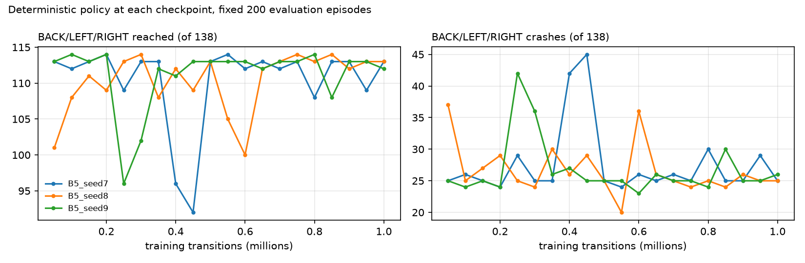

# Checkpoint evaluations: B5_seed7, B5_seed8, B5_seed9

| Run | Transitions | Reached | Crash | Timeout | BACK/LEFT/RIGHT reached / crash / timeout |
|---|---:|---:|---:|---:|---|
| B5_seed7 | 49,998 | 113 | 61 | 26 | 113/25/0 |
| B5_seed7 | 99,996 | 112 | 27 | 61 | 112/26/0 |
| B5_seed7 | 149,994 | 113 | 26 | 61 | 113/25/0 |
| B5_seed7 | 199,992 | 114 | 24 | 62 | 114/24/0 |
| B5_seed7 | 249,990 | 109 | 35 | 56 | 109/29/0 |
| B5_seed7 | 299,988 | 113 | 37 | 50 | 113/25/0 |
| B5_seed7 | 349,986 | 113 | 28 | 59 | 113/25/0 |
| B5_seed7 | 399,984 | 96 | 49 | 55 | 96/42/0 |
| B5_seed7 | 449,982 | 92 | 45 | 63 | 92/45/1 |
| B5_seed7 | 499,980 | 113 | 28 | 59 | 113/25/0 |
| B5_seed7 | 549,978 | 114 | 25 | 61 | 114/24/0 |
| B5_seed7 | 599,976 | 112 | 29 | 59 | 112/26/0 |
| B5_seed7 | 649,974 | 113 | 30 | 57 | 113/25/0 |
| B5_seed7 | 699,972 | 112 | 27 | 61 | 112/26/0 |
| B5_seed7 | 749,970 | 113 | 29 | 58 | 113/25/0 |
| B5_seed7 | 799,968 | 108 | 34 | 58 | 108/30/0 |
| B5_seed7 | 849,966 | 113 | 28 | 59 | 113/25/0 |
| B5_seed7 | 899,964 | 113 | 37 | 50 | 113/25/0 |
| B5_seed7 | 949,962 | 109 | 34 | 57 | 109/29/0 |
| B5_seed7 | 999,960 | 113 | 30 | 57 | 113/25/0 |
| B5_seed8 | 49,998 | 101 | 96 | 3 | 101/37/0 |
| B5_seed8 | 99,996 | 108 | 25 | 67 | 108/25/5 |
| B5_seed8 | 149,994 | 111 | 31 | 58 | 111/27/0 |
| B5_seed8 | 199,992 | 109 | 50 | 41 | 109/29/0 |
| B5_seed8 | 249,990 | 113 | 29 | 58 | 113/25/0 |
| B5_seed8 | 299,988 | 114 | 24 | 62 | 114/24/0 |
| B5_seed8 | 349,986 | 108 | 47 | 45 | 108/30/0 |
| B5_seed8 | 399,984 | 112 | 26 | 62 | 112/26/0 |
| B5_seed8 | 449,982 | 109 | 29 | 62 | 109/29/0 |
| B5_seed8 | 499,980 | 113 | 27 | 60 | 113/25/0 |
| B5_seed8 | 549,978 | 105 | 20 | 75 | 105/20/13 |
| B5_seed8 | 599,976 | 100 | 90 | 10 | 100/36/2 |
| B5_seed8 | 649,974 | 112 | 29 | 59 | 112/26/0 |
| B5_seed8 | 699,972 | 113 | 30 | 57 | 113/25/0 |
| B5_seed8 | 749,970 | 114 | 27 | 59 | 114/24/0 |
| B5_seed8 | 799,968 | 113 | 25 | 62 | 113/25/0 |
| B5_seed8 | 849,966 | 114 | 40 | 46 | 114/24/0 |
| B5_seed8 | 899,964 | 112 | 29 | 59 | 112/26/0 |
| B5_seed8 | 949,962 | 113 | 28 | 59 | 113/25/0 |
| B5_seed8 | 999,960 | 113 | 25 | 62 | 113/25/0 |
| B5_seed9 | 49,998 | 113 | 35 | 52 | 113/25/0 |
| B5_seed9 | 99,996 | 114 | 27 | 59 | 114/24/0 |
| B5_seed9 | 149,994 | 113 | 25 | 62 | 113/25/0 |
| B5_seed9 | 199,992 | 114 | 24 | 62 | 114/24/0 |
| B5_seed9 | 249,990 | 96 | 62 | 42 | 96/42/0 |
| B5_seed9 | 299,988 | 102 | 39 | 59 | 102/36/0 |
| B5_seed9 | 349,986 | 112 | 26 | 62 | 112/26/0 |
| B5_seed9 | 399,984 | 111 | 28 | 61 | 111/27/0 |
| B5_seed9 | 449,982 | 113 | 25 | 62 | 113/25/0 |
| B5_seed9 | 499,980 | 113 | 25 | 62 | 113/25/0 |
| B5_seed9 | 549,978 | 113 | 25 | 62 | 113/25/0 |
| B5_seed9 | 599,976 | 113 | 23 | 64 | 113/23/2 |
| B5_seed9 | 649,974 | 112 | 26 | 62 | 112/26/0 |
| B5_seed9 | 699,972 | 113 | 25 | 62 | 113/25/0 |
| B5_seed9 | 749,970 | 113 | 26 | 61 | 113/25/0 |
| B5_seed9 | 799,968 | 114 | 24 | 62 | 114/24/0 |
| B5_seed9 | 849,966 | 108 | 36 | 56 | 108/30/0 |
| B5_seed9 | 899,964 | 113 | 25 | 62 | 113/25/0 |
| B5_seed9 | 949,962 | 113 | 25 | 62 | 113/25/0 |
| B5_seed9 | 999,960 | 112 | 34 | 54 | 112/26/0 |
