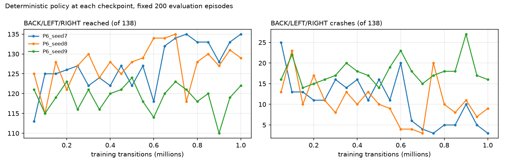

# Checkpoint evaluations: P6_seed7, P6_seed8, P6_seed9

| Run | Transitions | Reached | Crash | Timeout | BACK/LEFT/RIGHT reached / crash / timeout |
|---|---:|---:|---:|---:|---|
| P6_seed7 | 49,998 | 140 | 60 | 0 | 113/25/0 |
| P6_seed7 | 99,996 | 162 | 38 | 0 | 125/13/0 |
| P6_seed7 | 149,994 | 158 | 42 | 0 | 125/13/0 |
| P6_seed7 | 199,992 | 161 | 37 | 2 | 126/11/1 |
| P6_seed7 | 249,990 | 165 | 34 | 1 | 127/11/0 |
| P6_seed7 | 299,988 | 156 | 44 | 0 | 122/16/0 |
| P6_seed7 | 349,986 | 157 | 42 | 1 | 124/14/0 |
| P6_seed7 | 399,984 | 160 | 39 | 1 | 122/16/0 |
| P6_seed7 | 449,982 | 160 | 38 | 2 | 127/11/0 |
| P6_seed7 | 499,980 | 158 | 42 | 0 | 122/16/0 |
| P6_seed7 | 549,978 | 168 | 32 | 0 | 127/11/0 |
| P6_seed7 | 599,976 | 152 | 47 | 1 | 118/20/0 |
| P6_seed7 | 649,974 | 177 | 23 | 0 | 132/6/0 |
| P6_seed7 | 699,972 | 184 | 16 | 0 | 134/4/0 |
| P6_seed7 | 749,970 | 186 | 14 | 0 | 135/3/0 |
| P6_seed7 | 799,968 | 179 | 21 | 0 | 133/5/0 |
| P6_seed7 | 849,966 | 180 | 20 | 0 | 133/5/0 |
| P6_seed7 | 899,964 | 157 | 42 | 1 | 128/10/0 |
| P6_seed7 | 949,962 | 186 | 14 | 0 | 133/5/0 |
| P6_seed7 | 999,960 | 184 | 16 | 0 | 135/3/0 |
| P6_seed8 | 49,998 | 161 | 39 | 0 | 125/13/0 |
| P6_seed8 | 99,996 | 138 | 60 | 2 | 115/23/0 |
| P6_seed8 | 149,994 | 158 | 39 | 3 | 128/10/0 |
| P6_seed8 | 199,992 | 163 | 36 | 1 | 121/17/0 |
| P6_seed8 | 249,990 | 170 | 28 | 2 | 127/11/0 |
| P6_seed8 | 299,988 | 178 | 19 | 3 | 130/8/0 |
| P6_seed8 | 349,986 | 167 | 30 | 3 | 124/13/1 |
| P6_seed8 | 399,984 | 171 | 28 | 1 | 128/10/0 |
| P6_seed8 | 449,982 | 157 | 43 | 0 | 125/13/0 |
| P6_seed8 | 499,980 | 179 | 21 | 0 | 128/10/0 |
| P6_seed8 | 549,978 | 179 | 21 | 0 | 129/9/0 |
| P6_seed8 | 599,976 | 188 | 12 | 0 | 134/4/0 |
| P6_seed8 | 649,974 | 187 | 13 | 0 | 134/4/0 |
| P6_seed8 | 699,972 | 176 | 24 | 0 | 135/3/0 |
| P6_seed8 | 749,970 | 154 | 46 | 0 | 118/20/0 |
| P6_seed8 | 799,968 | 178 | 22 | 0 | 128/10/0 |
| P6_seed8 | 849,966 | 177 | 22 | 1 | 130/8/0 |
| P6_seed8 | 899,964 | 172 | 28 | 0 | 127/11/0 |
| P6_seed8 | 949,962 | 175 | 25 | 0 | 131/7/0 |
| P6_seed8 | 999,960 | 174 | 26 | 0 | 129/9/0 |
| P6_seed9 | 49,998 | 142 | 56 | 2 | 121/16/1 |
| P6_seed9 | 99,996 | 130 | 69 | 1 | 115/22/1 |
| P6_seed9 | 149,994 | 137 | 58 | 5 | 119/14/5 |
| P6_seed9 | 199,992 | 143 | 57 | 0 | 123/15/0 |
| P6_seed9 | 249,990 | 134 | 59 | 7 | 116/16/6 |
| P6_seed9 | 299,988 | 137 | 61 | 2 | 121/17/0 |
| P6_seed9 | 349,986 | 135 | 63 | 2 | 116/20/2 |
| P6_seed9 | 399,984 | 138 | 62 | 0 | 120/18/0 |
| P6_seed9 | 449,982 | 139 | 61 | 0 | 121/17/0 |
| P6_seed9 | 499,980 | 140 | 60 | 0 | 124/14/0 |
| P6_seed9 | 549,978 | 138 | 60 | 2 | 118/19/1 |
| P6_seed9 | 599,976 | 133 | 66 | 1 | 114/23/1 |
| P6_seed9 | 649,974 | 141 | 59 | 0 | 120/18/0 |
| P6_seed9 | 699,972 | 144 | 56 | 0 | 123/15/0 |
| P6_seed9 | 749,970 | 141 | 59 | 0 | 121/17/0 |
| P6_seed9 | 799,968 | 137 | 61 | 2 | 118/18/2 |
| P6_seed9 | 849,966 | 137 | 63 | 0 | 120/18/0 |
| P6_seed9 | 899,964 | 121 | 78 | 1 | 110/27/1 |
| P6_seed9 | 949,962 | 132 | 65 | 3 | 119/17/2 |
| P6_seed9 | 999,960 | 142 | 58 | 0 | 122/16/0 |
