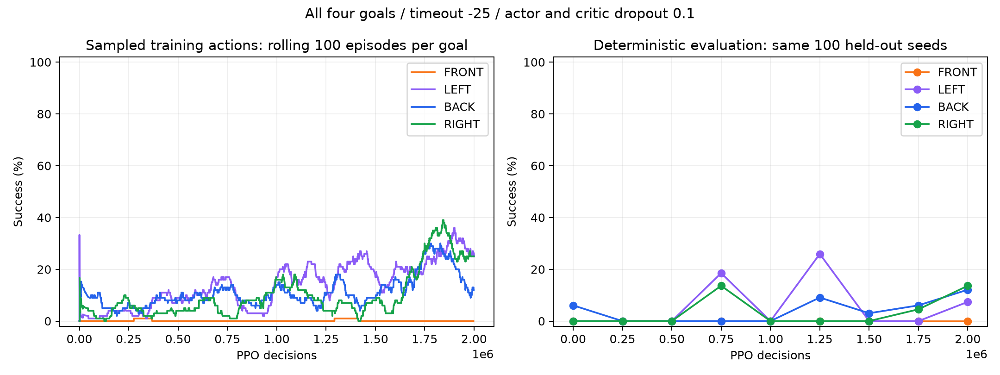

# All goals, timeout -25, actor/critic dropout

Completed exactly **2,000,000 PPO decisions from scratch** in 71.61 minutes, with 2,061,096 physics ticks.

All four goals were sampled uniformly at reset. The 54-input observation, committed lane actions, and success conditions match the preceding experiments. Actor and critic each use two 256-unit Tanh hidden layers, with dropout 0.1 after each activation. Dropout is active during gradient updates and disabled for rollout collection and evaluation.

The timeout25 reward profile adds one terminal -25 cost on timeout. Success, collision, and anchor loss do not receive this timeout cost. Other baseline reward terms are retained.

| Goal | Training episodes | Training successes | Evaluation cases | Success before | Success after | Collisions after |
| --- | ---: | ---: | ---: | ---: | ---: | ---: |
| FRONT | 1972 | 2 | 18 | 0.0% | 0.0% | 27.8% |
| LEFT | 1940 | 270 | 27 | 0.0% | 7.4% | 33.3% |
| BACK | 1966 | 224 | 33 | 6.1% | 12.1% | 3.0% |
| RIGHT | 1986 | 198 | 22 | 0.0% | 13.6% | 13.6% |

Overall held-out success: 2.0% -> 9.0%; final collisions: 18.0%; timeouts: 73.0%.

Deterministic evaluation uses seeds 10000-10099, before training and every 250,000 steps. One training seed and small per-goal evaluation counts limit precision.

[TensorBoard](http://127.0.0.1:6012/live) | [Replays](videos/all_goals.mp4) | [Model](../../models/ppo_allgoals_timeout25_dropout01_seed7_2m.zip) | [Run settings](run.json) | [Evaluation history](evaluation_history.json) | [Verification](verification.json) | [Network architecture](policy_architecture.txt)

Replays use the first held-out seed for each goal; aggregate metrics use all 100 cases.

Best recorded trained checkpoint on these same 100 monitoring seeds: 1,250,000 steps, 10.0% success. [Checkpoint](../../models/ppo_allgoals_timeout25_dropout01_seed7_2m_1250000.zip). This selection does not provide an independent test score.
