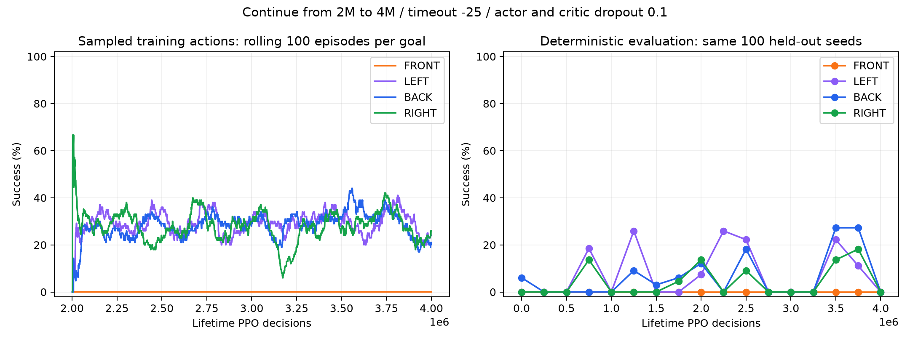

# Continuation from 2 million to 4 million steps

Continued `ppo_allgoals_timeout25_dropout01_seed7_2m.zip` with saved policy and optimizer for exactly **2,000,000 additional PPO decisions**, reaching **4,000,000 lifetime decisions**. This continuation took 54.91 minutes and 2,002,745 physics ticks.

All four goals were sampled uniformly at reset. The 54-input observation, committed lane actions, and success conditions match the preceding experiments. Actor and critic each use two 256-unit Tanh hidden layers, with dropout 0.1 after each activation. Dropout is active during gradient updates and disabled for rollout collection and evaluation.

The timeout25 reward profile adds one terminal -25 cost on timeout. Success, collision, and anchor loss do not receive this timeout cost. Other baseline reward terms are retained.

| Goal | Training episodes | Training successes | Evaluation cases | Success at 2M | Success at 4M | Collisions after |
| --- | ---: | ---: | ---: | ---: | ---: | ---: |
| FRONT | 2034 | 0 | 18 | 0.0% | 0.0% | 33.3% |
| LEFT | 1999 | 588 | 27 | 7.4% | 0.0% | 44.4% |
| BACK | 2047 | 584 | 33 | 12.1% | 0.0% | 27.3% |
| RIGHT | 2077 | 578 | 22 | 13.6% | 0.0% | 45.5% |

Overall held-out success: 9.0% -> 0.0%; final collisions: 37.0%; timeouts: 63.0%.

Deterministic evaluation uses seeds 10000-10099, before training and every 250,000 steps. One training seed and small per-goal evaluation counts limit precision.

[TensorBoard](http://127.0.0.1:6013/live) | [Replays](videos/all_goals.mp4) | [Model](../../models/ppo_allgoals_timeout25_dropout01_seed7_4m.zip) | [Run settings](run.json) | [Evaluation history](evaluation_history.json) | [Verification](verification.json) | [Network architecture](policy_architecture.txt)

Replays use the first held-out seed for each goal; aggregate metrics use all 100 cases.

Best recorded checkpoint during this continuation on the same 100 monitoring seeds: 3,500,000 lifetime steps, 18.0% success. [Checkpoint](../../models/ppo_allgoals_timeout25_dropout01_seed7_4m_1500000.zip). This selection does not provide an independent test score.

[Original 2M video](../ppo_allgoals_timeout25_dropout01_seed7_2m/videos/all_goals.mp4) | [Final 4M video](videos/all_goals.mp4)

TensorBoard shows both runs. The continuation's native step counter is additional steps 0-2M; the combined static evaluation plot uses lifetime steps 0-4M. Goal-specific rolling training metrics restart at the continuation boundary.
