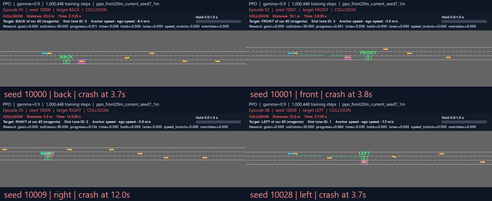

# ppo_front20m_current_seed7_1m

Final PPO model, gamma 0.9, 1,000,448 training steps.

Full saved evaluation: **27/50 collisions (54%)**.

[Watch all eight episodes](all_episodes.mp4) | [Watch collision replays](collisions_only.mp4)

Collision replays show the last six seconds at half speed and hold the terminal frame for two seconds.

These examples deliberately include four crashes. Use the full 50-episode evaluation above for the collision rate.

Every recording reproduced its saved evaluation outcome, reward, duration and policy-step count.

| Episode | Seed | Slot | Outcome | Simulated seconds | Video | Collision replay |
| --- | --- | --- | --- | ---: | --- | --- |
| 1 | 10000 | back | COLLISION | 3.7 | [Watch](episode_01_seed10000_collision.mp4) | [Half speed](collision_01_seed10000_slow.mp4) |
| 2 | 10001 | front | COLLISION | 3.8 | [Watch](episode_02_seed10001_collision.mp4) | [Half speed](collision_02_seed10001_slow.mp4) |
| 3 | 10002 | back | TIMED OUT | 25.0 | [Watch](episode_03_seed10002_timed_out.mp4) |  |
| 4 | 10005 | left | GOAL REACHED | 23.6 | [Watch](episode_04_seed10005_goal_reached.mp4) |  |
| 5 | 10009 | right | COLLISION | 12.0 | [Watch](episode_05_seed10009_collision.mp4) | [Half speed](collision_05_seed10009_slow.mp4) |
| 6 | 10018 | right | GOAL REACHED | 7.0 | [Watch](episode_06_seed10018_goal_reached.mp4) |  |
| 7 | 10026 | back | GOAL REACHED | 10.0 | [Watch](episode_07_seed10026_goal_reached.mp4) |  |
| 8 | 10028 | left | COLLISION | 3.7 | [Watch](episode_08_seed10028_collision.mp4) | [Half speed](collision_08_seed10028_slow.mp4) |

[All evaluation collisions and seeds](collisions.csv) | [Recording metadata](episodes.json)
