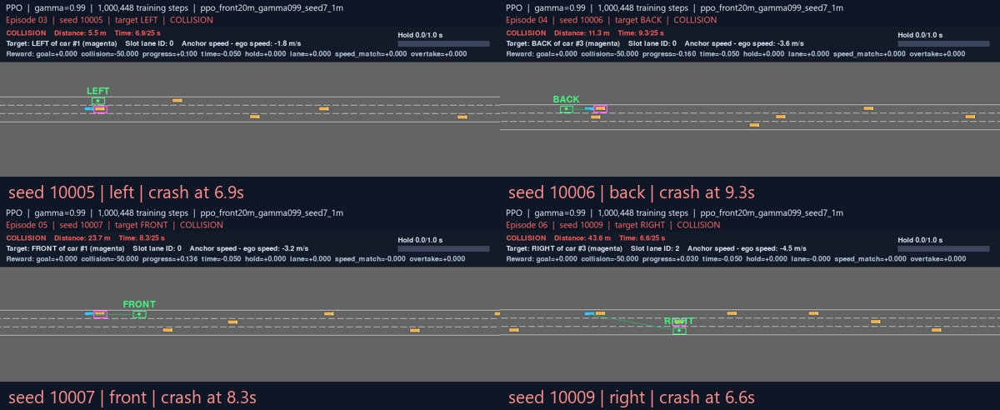

# ppo_front20m_gamma099_seed7_1m

Final PPO model, gamma 0.99, 1,000,448 training steps.

Full saved evaluation: **21/50 collisions (42%)**.

[Watch all eight episodes](all_episodes.mp4) | [Watch collision replays](collisions_only.mp4)

Collision replays show the last six seconds at half speed and hold the terminal frame for two seconds.

These examples deliberately include four crashes. Use the full 50-episode evaluation above for the collision rate.

Every recording reproduced its saved evaluation outcome, reward, duration and policy-step count.

| Episode | Seed | Slot | Outcome | Simulated seconds | Video | Collision replay |
| --- | --- | --- | --- | ---: | --- | --- |
| 1 | 10000 | back | TIMED OUT | 25.0 | [Watch](episode_01_seed10000_timed_out.mp4) |  |
| 2 | 10001 | front | TIMED OUT | 25.0 | [Watch](episode_02_seed10001_timed_out.mp4) |  |
| 3 | 10005 | left | COLLISION | 6.9 | [Watch](episode_03_seed10005_collision.mp4) | [Half speed](collision_03_seed10005_slow.mp4) |
| 4 | 10006 | back | COLLISION | 9.3 | [Watch](episode_04_seed10006_collision.mp4) | [Half speed](collision_04_seed10006_slow.mp4) |
| 5 | 10007 | front | COLLISION | 8.3 | [Watch](episode_05_seed10007_collision.mp4) | [Half speed](collision_05_seed10007_slow.mp4) |
| 6 | 10009 | right | COLLISION | 6.6 | [Watch](episode_06_seed10009_collision.mp4) | [Half speed](collision_06_seed10009_slow.mp4) |
| 7 | 10012 | left | GOAL REACHED | 16.8 | [Watch](episode_07_seed10012_goal_reached.mp4) |  |
| 8 | 10026 | back | GOAL REACHED | 10.1 | [Watch](episode_08_seed10026_goal_reached.mp4) |  |

[All evaluation collisions and seeds](collisions.csv) | [Recording metadata](episodes.json)
