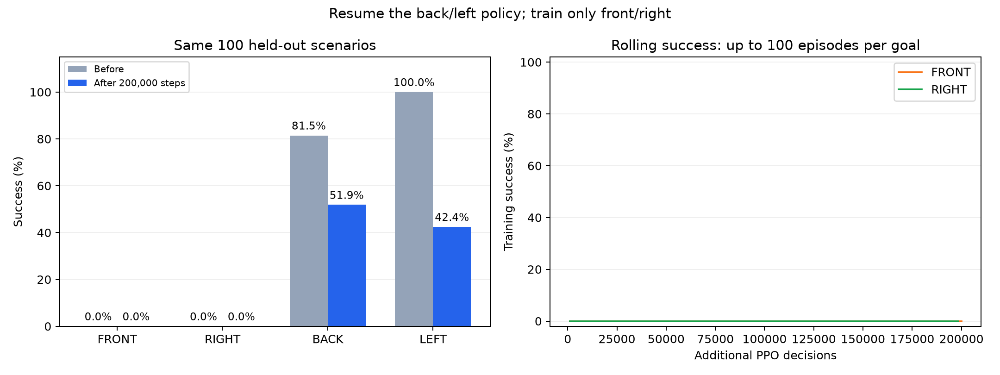

# Front/right-only continuation

Resumed `ppo_singlecar_committed57_seed7_200k.zip` with its saved policy and optimizer. Completed exactly **200,000 additional PPO decisions**, covering 213,784 physics ticks in 5.56 minutes.

Training sampled RIGHT and FRONT uniformly at reset. Rewards, observations, committed lane actions, traffic speeds, and success rules match the source checkpoint. Evaluation samples all four goals to measure retention.

Completed training episodes: FRONT 372, RIGHT 378; BACK 0, LEFT 0. Episode counts need not be exactly equal.

Deterministic evaluation uses the same 100 held-out seeds (10000-10099), with identical initial scenarios before and after.

| Goal | Episodes | Success before | Success after | Collisions after | Timeouts after |
| --- | ---: | ---: | ---: | ---: | ---: |
| FRONT | 18 | 0.0% | 0.0% | 50.0% | 50.0% |
| RIGHT | 22 | 0.0% | 0.0% | 13.6% | 86.4% |
| BACK | 27 | 81.5% | 51.9% | 0.0% | 48.1% |
| LEFT | 33 | 100.0% | 42.4% | 6.1% | 51.5% |

Overall success: 55.0% -> 28.0%. Collisions: 7.0% -> 14.0%.

A single training seed and small per-goal evaluation counts limit precision.



[Watch all four goals](videos/all_goals.mp4). Videos use the first evaluation seed for each goal, with every physics tick retained; outcomes, rewards, lengths, and frame counts were verified.

| Goal | Seed | Outcome | Video |
| --- | ---: | --- | --- |
| FRONT | 10002 | COLLISION | [Watch](videos/front/episode.mp4) |
| RIGHT | 10000 | TIMED OUT | [Watch](videos/right/episode.mp4) |
| BACK | 10009 | GOAL REACHED | [Watch](videos/back/episode.mp4) |
| LEFT | 10004 | GOAL REACHED | [Watch](videos/left/episode.mp4) |

[Model](../../models/ppo_singlecar_front_right_seed7_200k.zip) | [Run settings](run.json) | [Evaluation](evaluation.json) | [Training curves](training_curves.png) | [Verification](verification.json)

Repeat with a fresh run name:

```powershell
.\baseline_waypoint\.venv\Scripts\python.exe -u -B -m baseline_dynamic_waypoint.train_single_car --committed-lanes --training-slots right front --timesteps 200000 --num-envs 4 --rollout-steps 250 --seed 7 --init-model baseline_dynamic_waypoint/models/ppo_singlecar_committed57_seed7_200k.zip --reward-profile baseline --run-name YOUR_NEW_RUN --eval-episodes 100 --eval-seed 10000 --quiet
```
