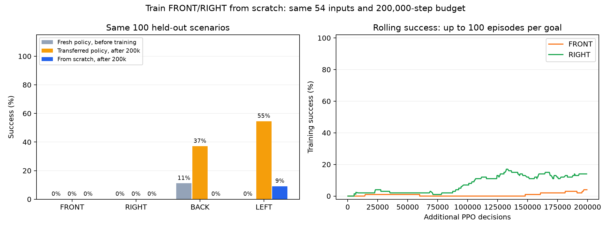

# Front/right training from scratch

PPO began with randomly initialized weights and a fresh optimizer. No checkpoint was loaded. The saved initialization field is null, and the final lifetime counter is exactly 200,000.

Completed exactly **200,000 PPO decisions**, covering 256,739 physics ticks in 5.21 minutes.

The observation has six fields: vehicles (7x6, including lane ID), goal_delta (2), anchor (4), lane_difference (2), desired_goal (3: target car ID plus target-car-relative x/y), and hold_progress (1). Relative goal x/y are divided by [200, 12].

Training sampled RIGHT and FRONT uniformly at reset. The environment, reward weights, PPO hyperparameters, training seed 7, and 200k-step budget match the prior transferred-policy experiment. Initialization differs; action histories and therefore sampled episodes can diverge.

Completed training episodes: FRONT 519, RIGHT 528; BACK 0, LEFT 0. Episode counts need not be exactly equal.

Deterministic evaluation uses the same 100 held-out seeds (10000-10099) and identical initial scenarios. FRONT and RIGHT are the trained objectives; BACK/LEFT provide generalization measurements.

| Goal | Episodes | Fresh before training | Prior transfer after 200k | From scratch after 200k | Collisions after | Timeouts after |
| --- | ---: | ---: | ---: | ---: | ---: | ---: |
| FRONT | 18 | 0.0% | 0.0% | 0.0% | 33.3% | 66.7% |
| RIGHT | 22 | 0.0% | 0.0% | 0.0% | 45.5% | 54.5% |
| BACK | 27 | 11.1% | 37.0% | 0.0% | 40.7% | 59.3% |
| LEFT | 33 | 0.0% | 54.5% | 9.1% | 15.2% | 75.8% |

Overall success: 3.0% -> 3.0%. Collisions: 0.0% -> 32.0%.

A single training seed and small per-goal evaluation counts limit precision.



[Watch all four goals](videos/all_goals.mp4). Videos use the first evaluation seed for each goal, with every physics tick retained; outcomes, rewards, lengths, and frame counts were verified.

| Goal | Seed | Outcome | Video |
| --- | ---: | --- | --- |
| FRONT (first_evaluation_seed) | 10002 | TIMED OUT | [Watch](videos/front/episode.mp4) |
| RIGHT (first_evaluation_seed) | 10000 | COLLISION | [Watch](videos/right/episode.mp4) |
| BACK (first_evaluation_seed) | 10009 | TIMED OUT | [Watch](videos/back/episode.mp4) |
| LEFT (first_evaluation_seed) | 10004 | GOAL REACHED | [Watch](videos/left/episode.mp4) |

The reel contains the four first-seed episodes. Any additional successful FRONT/RIGHT replay is explicitly labeled selected_success and is separate from the reel and aggregate metrics.

On the 40 held-out FRONT/RIGHT cases, target success was 0.0% for the transferred run versus 0.0% from scratch. Overall success was 28.0% for the transferred run versus 3.0% from scratch.

[Model](../../models/ppo_singlecar_lane_goal_v2_front_right_scratch_seed7_200k.zip) | [Run settings](run.json) | [Evaluation](evaluation.json) | [Training curves](training_curves.png) | [Verification](verification.json) | [Comparison](comparison.json)

Repeat with a fresh run name:

```powershell
.\baseline_waypoint\.venv\Scripts\python.exe -u -B -m baseline_dynamic_waypoint.train_single_car --committed-lanes --observation-schema lane_goal_v2 --training-slots right front --timesteps 200000 --num-envs 4 --rollout-steps 250 --seed 7 --reward-profile baseline --run-name YOUR_NEW_RUN --eval-episodes 100 --eval-seed 10000 --quiet
```

FRONT/RIGHT-only collision rate: 0.0% after transfer versus 40.0% from scratch.
