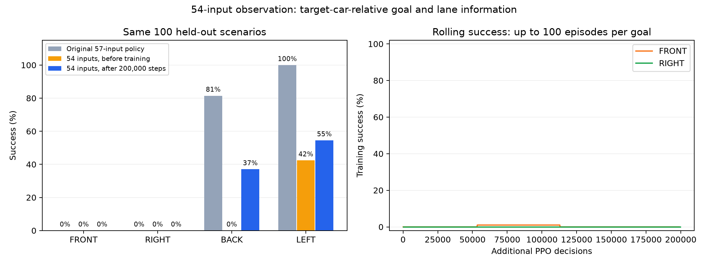

# 54-input front/right experiment

Initialized from `ppo_singlecar_committed57_seed7_200k.zip` by transferring compatible input weights and the remaining network layers. The optimizer was reset. Removed/redefined input columns were omitted and new input connections started at zero, so this changes the policy immediately before training.

Completed exactly **200,000 additional PPO decisions**, covering 217,657 physics ticks in 3.88 minutes.

The observation has six fields: vehicles (7x6, including lane ID), goal_delta (2), anchor (4), lane_difference (2), desired_goal (3: target car ID plus target-car-relative x/y), and hold_progress (1). Relative goal x/y are divided by [200, 12].

Training sampled RIGHT and FRONT uniformly at reset. Physics, rewards, traffic speeds, committed actions, and success rules match the source checkpoint. Evaluation samples all four goals.

Completed training episodes: FRONT 380, RIGHT 386; BACK 0, LEFT 0. Episode counts need not be exactly equal.

Deterministic evaluation uses the same 100 held-out seeds (10000-10099), with identical initial scenarios before and after. The before column measures the transferred 54-input policy, rather than the original 57-input policy.

| Goal | Episodes | Original 57-input policy | Transferred 54-input before | 54-input after 200k | Collisions after | Timeouts after |
| --- | ---: | ---: | ---: | ---: | ---: | ---: |
| FRONT | 18 | 0.0% | 0.0% | 0.0% | 0.0% | 100.0% |
| RIGHT | 22 | 0.0% | 0.0% | 0.0% | 0.0% | 100.0% |
| BACK | 27 | 81.5% | 0.0% | 37.0% | 0.0% | 63.0% |
| LEFT | 33 | 100.0% | 42.4% | 54.5% | 0.0% | 45.5% |

Overall success: 14.0% -> 28.0%. Collisions: 0.0% -> 0.0%.

A single training seed and small per-goal evaluation counts limit precision.



[Watch all four goals](videos/all_goals.mp4). Videos use the first evaluation seed for each goal, with every physics tick retained; outcomes, rewards, lengths, and frame counts were verified.

| Goal | Seed | Outcome | Video |
| --- | ---: | --- | --- |
| FRONT | 10002 | TIMED OUT | [Watch](videos/front/episode.mp4) |
| RIGHT | 10000 | TIMED OUT | [Watch](videos/right/episode.mp4) |
| BACK | 10009 | GOAL REACHED | [Watch](videos/back/episode.mp4) |
| LEFT | 10004 | TIMED OUT | [Watch](videos/left/episode.mp4) |

The previous 57-input front/right-only 200k continuation achieved 28.0% overall success. Its optimizer and inputs were retained; this experiment changed inputs and reset the optimizer, so that comparison does not isolate the effect of lane features.

[Model](../../models/ppo_singlecar_lane_goal_v2_front_right_seed7_200k.zip) | [Run settings](run.json) | [Evaluation](evaluation.json) | [Training curves](training_curves.png) | [Verification](verification.json) | [Comparison](comparison.json)

Repeat with a fresh run name:

```powershell
.\baseline_waypoint\.venv\Scripts\python.exe -u -B -m baseline_dynamic_waypoint.train_single_car --committed-lanes --observation-schema lane_goal_v2 --training-slots right front --timesteps 200000 --num-envs 4 --rollout-steps 250 --seed 7 --init-model baseline_dynamic_waypoint/models/ppo_singlecar_committed57_seed7_200k.zip --reward-profile baseline --run-name YOUR_NEW_RUN --eval-episodes 100 --eval-seed 10000 --quiet
```
