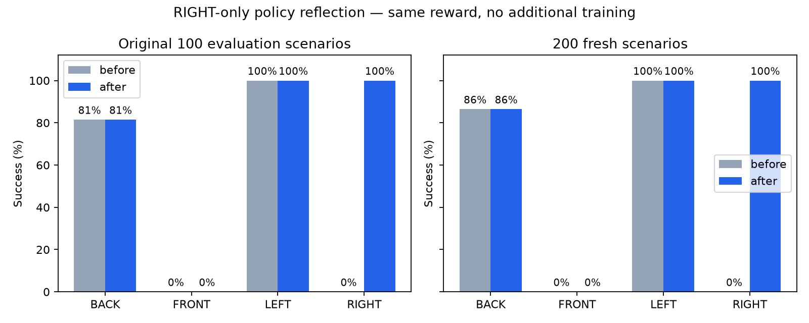

# RIGHT-only reflection experiment

The experiment reuses the existing PPO's successful LEFT strategy for RIGHT objectives. Only RIGHT observations are reflected across the middle lane, and LEFT/RIGHT output actions are swapped back before execution. FRONT, BACK, and LEFT use the original policy directly.

**No additional training was run. Model weights, reward, simulator dynamics, scenario sampling, 30-second episode duration, and committed lane-change execution are unchanged.** This measures an observation/action adapter, not a newly trained policy.

Overall success increased from **55/100 (55.0%) to 77/100 (77.0%)** on the original evaluation seeds, and from **102/200 (51.0%) to 148/200 (74.0%)** on fresh seeds. The tables below give the full outcomes.

## Original 100 scenarios

Paired deterministic evaluation on seeds 10000–10099; each before/after pair uses exactly the same sampled scenario.

| Goal | Episodes | Success before → after | Collisions before → after | Mean return before → after |
| --- | ---: | --- | --- | ---: |
| FRONT | 18 | 0/18 (0.0%) → 0/18 (0.0%) | 2/18 (11.1%) → 2/18 (11.1%) | -15.98 → -15.98 |
| BACK | 27 | 22/27 (81.5%) → 22/27 (81.5%) | 5/27 (18.5%) → 5/27 (18.5%) | 31.33 → 31.33 |
| LEFT | 33 | 33/33 (100.0%) → 33/33 (100.0%) | 0/33 (0.0%) → 0/33 (0.0%) | 50.57 → 50.57 |
| RIGHT | 22 | 0/22 (0.0%) → 22/22 (100.0%) | 0/22 (0.0%) → 0/22 (0.0%) | -14.17 → 50.72 |
| **Overall** | 100 | 55/100 (55.0%) → 77/100 (77.0%) | 7/100 (7.0%) → 7/100 (7.0%) | 19.15 → 33.43 |

Timeouts: 38/100 (38.0%) → 16/100 (16.0%).

## Fresh 200 scenarios

Paired deterministic evaluation on seeds 30000–30199; each before/after pair uses exactly the same sampled scenario.

| Goal | Episodes | Success before → after | Collisions before → after | Mean return before → after |
| --- | ---: | --- | --- | ---: |
| FRONT | 44 | 0/44 (0.0%) → 0/44 (0.0%) | 2/44 (4.5%) → 2/44 (4.5%) | -13.10 → -13.10 |
| BACK | 59 | 51/59 (86.4%) → 51/59 (86.4%) | 8/59 (13.6%) → 8/59 (13.6%) | 36.63 → 36.63 |
| LEFT | 51 | 51/51 (100.0%) → 51/51 (100.0%) | 0/51 (0.0%) → 0/51 (0.0%) | 50.63 → 50.63 |
| RIGHT | 46 | 0/46 (0.0%) → 46/46 (100.0%) | 0/46 (0.0%) → 0/46 (0.0%) | -14.12 → 50.66 |
| **Overall** | 200 | 102/200 (51.0%) → 148/200 (74.0%) | 10/200 (5.0%) → 10/200 (5.0%) | 17.59 → 32.48 |

Timeouts: 88/200 (44.0%) → 42/200 (21.0%).

## What the result establishes

RIGHT benefits from reusing the already learned LEFT behavior under the existing reward. The original network had not learned that reflection on its own. This supports the earlier diagnosis of a learned goal-dependent asymmetry rather than a RIGHT steering or y-sign error.

All **232 non-RIGHT episodes** across the two cohorts were checked against the original policy: success, collision, timeout, decision count, physics ticks, and reward match. The source checkpoint hash was also verified unchanged.

FRONT remains unresolved. Reflection of RIGHT objectives does not supply the overtaking/approach strategy that FRONT requires. These finite deterministic evaluations also do not establish performance on curved roads, more traffic, different lane counts, or different observation scales.

## Videos and plot

[RIGHT before and after, same scenario](videos/right_before_after.mp4) · [All four objectives](videos/all_goals.mp4) · [Outcome comparison plot](results.png)



The RIGHT comparison uses seed 10000: the original policy times out after 30 seconds; the adapter reaches the goal in 7.0 seconds. Videos show every 0.1-second physics tick at simulator speed. In the side-by-side comparison, the shorter video's final frame is held. The four-goal reel uses the first evaluation seed for each objective, without selecting outcomes.

## Scope and reproduction

This is an opt-in experiment in `ppo_singlecar_right_canonical_seed7`. The previous checkpoint and experiment remain available and unchanged. Loading the previous model normally keeps its original behavior; applying `RightCanonicalPolicy(model)` explicitly enables this experiment. No global environment default was changed.

The adapter currently requires the tested three straight 4 m lanes, 12 m y normalization scales, five discrete actions, and 57-input committed-lane observation contract. Unsupported configurations are rejected.

Implementation: [policy adapter](../../reflection_policy.py), [seven passing contract tests](../../test_reflection_policy.py), [experiment runner](../../experiment_right_canonical.py), [video recorder](../../record_reflection_experiment.py).

Raw results: [evaluation summary](evaluation.json), [original-seed adapter episodes](evaluation_episodes.csv), [fresh original episodes](fresh_before_episodes.csv), [fresh adapter episodes](fresh_after_episodes.csv), [run configuration](run.json).

Reproduce in a fresh output directory:

```powershell
.\baseline_waypoint\.venv\Scripts\python.exe -B -m baseline_dynamic_waypoint.experiment_right_canonical --run-name ppo_singlecar_right_canonical_seed7_repeat --fresh-episodes 200
```
