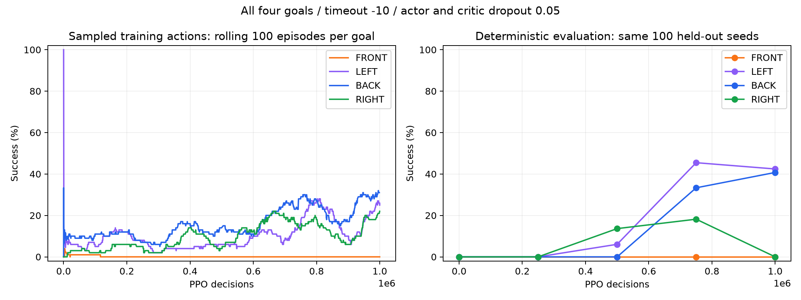

# All goals, timeout -10, actor/critic dropout

Completed exactly **1,000,000 PPO decisions from scratch** in 30.98 minutes, with 1,089,409 physics ticks.

Learning rate is 0.00004 and gamma is 0.97. All four goals were sampled uniformly at reset. The legacy layout retains 57 inputs by replacing achieved_goal (2) with target_lanes (2): [target_car_lane, target_goal_lane], as raw lane IDs 0-2. Other inputs, committed lane actions, and success conditions retain their legacy meanings. Actor and critic each use two 256-unit Tanh hidden layers, with dropout 0.05 after each activation. Dropout is active during gradient updates and disabled for rollout collection and evaluation.

The timeout10 reward profile adds one terminal -10 cost on timeout. Success, collision, and anchor loss do not receive this timeout cost. Per-tick time cost is reduced from -0.05 to -0.045 (10%); other baseline terms are retained.

| Goal | Training episodes | Training successes | Evaluation cases | Success before | Success after | Collisions after |
| --- | ---: | ---: | ---: | ---: | ---: | ---: |
| FRONT | 1144 | 2 | 18 | 0.0% | 0.0% | 33.3% |
| LEFT | 1090 | 119 | 33 | 0.0% | 42.4% | 9.1% |
| BACK | 1114 | 183 | 27 | 0.0% | 40.7% | 0.0% |
| RIGHT | 1150 | 115 | 22 | 0.0% | 0.0% | 0.0% |

Overall held-out success: 0.0% -> 25.0%; final collisions: 9.0%; timeouts: 66.0%.

Deterministic evaluation uses seeds 10000-10099, before training and every 250,000 steps. One training seed and small per-goal evaluation counts limit precision.

[TensorBoard](http://127.0.0.1:6016/live) | [Model](../../models/ppo_targetlanes57_lr4e5_time045_dropout005_gamma097_seed7_1m.zip) | [Run settings](run.json) | [Evaluation history](evaluation_history.json) | [Verification](verification.json) | [Network architecture](policy_architecture.txt)

Aggregate metrics use all 100 fixed evaluation cases.

Best recorded trained checkpoint on these same 100 monitoring seeds: 750,000 steps, 28.0% success. [Checkpoint](../../models/ppo_targetlanes57_lr4e5_time045_dropout005_gamma097_seed7_1m_750000.zip). This selection does not provide an independent test score.

Lane-change evaluation: 0 lanes required: 25/36 successes; 1 lanes required: 0/44 successes; 2 lanes required: 0/20 successes.

All successes started in the goal lane. Explicit target lane inputs were verified, but the deterministic policy did not solve cases requiring a lane change. [Lane observation audit](lane_observation_audit.json).

Compared with the previous completed 1M run (LR 0.00005, time cost -0.05), on the same 100 initial scenarios: final success increased from 20% to 25%, collisions from 5% to 9%, and timeouts decreased from 75% to 66%. The preceding run cancelled by the user has no final 1M score. This is one training seed; the observed difference does not establish a reliable improvement. Reward means use different time costs and should not be compared as an unchanged objective. [Comparison data](comparison.json).
