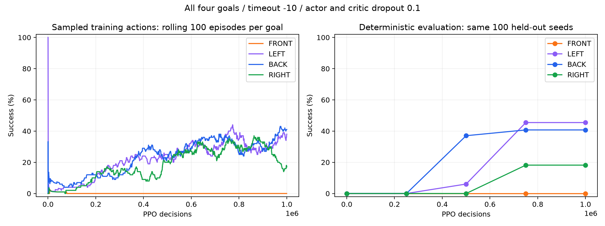

# All goals, timeout -10, actor/critic dropout

Completed exactly **1,000,000 PPO decisions from scratch** in 24.15 minutes, with 1,048,356 physics ticks.

All four goals were sampled uniformly at reset. The legacy layout retains 57 inputs by replacing achieved_goal (2) with target_lanes (2): [target_car_lane, target_goal_lane], as raw lane IDs 0-2. Other inputs, committed lane actions, and success conditions retain their legacy meanings. Actor and critic each use two 256-unit Tanh hidden layers, with dropout 0.1 after each activation. Dropout is active during gradient updates and disabled for rollout collection and evaluation.

The timeout10 reward profile adds one terminal -10 cost on timeout. Success, collision, and anchor loss do not receive this timeout cost. Other baseline reward terms are retained.

| Goal | Training episodes | Training successes | Evaluation cases | Success before | Success after | Collisions after |
| --- | ---: | ---: | ---: | ---: | ---: | ---: |
| FRONT | 1251 | 1 | 18 | 0.0% | 0.0% | 33.3% |
| LEFT | 1190 | 284 | 33 | 0.0% | 45.5% | 15.2% |
| BACK | 1207 | 299 | 27 | 0.0% | 40.7% | 0.0% |
| RIGHT | 1230 | 236 | 22 | 0.0% | 18.2% | 45.5% |

Overall held-out success: 0.0% -> 30.0%; final collisions: 21.0%; timeouts: 49.0%.

All 30 successes started in the goal lane. The policy succeeded in 30/36 cases
requiring no lane change and 0/64 cases requiring a lane change (0/44 requiring
one lane, 0/20 requiring two). Explicit lane inputs are present and correct, but
the deterministic policy has not learned to solve these lane-change cases.
See the [100-case lane observation audit](lane_observation_audit.json).

Deterministic evaluation uses seeds 10000-10099, before training and every 250,000 steps. One training seed and small per-goal evaluation counts limit precision.

[TensorBoard](http://127.0.0.1:6015/live) | [Replays](videos/all_goals.mp4) | [Model](../../models/ppo_targetlanes57_timeout10_dropout01_scratch_seed7_1m.zip) | [Run settings](run.json) | [Evaluation history](evaluation_history.json) | [Verification](verification.json) | [Network architecture](policy_architecture.txt)

Replays use the first held-out seed for each goal; aggregate metrics use all 100 cases.

Best recorded trained checkpoint on these same 100 monitoring seeds: 750,000 steps, 30.0% success. [Checkpoint](../../models/ppo_targetlanes57_timeout10_dropout01_scratch_seed7_1m_750000.zip). This selection does not provide an independent test score.
