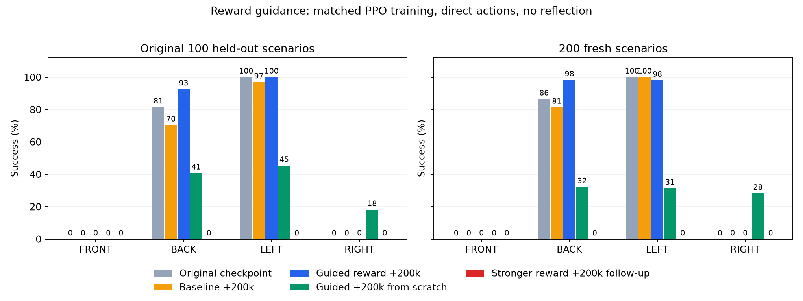

# Reward guidance comparison

Four experiments each trained for **200,000 policy decisions**, totaling **800,000 new decisions**. The first two form a matched reward comparison initialized from the same saved actor and optimizer. The third starts fresh, and the fourth continues that fresh agent for a 400,000-decision lifetime. The training seed, PPO settings, randomized two-car environment, 30-second limit, 57 observations, and completed lane-change execution were kept the same. The guided run changes reward guidance only. **Every evaluation uses the trained PPO directly: no reflection, adapter, or scripted actions.**

In the fresh-scenario matched warm-start comparison, success changes are **RIGHT 0/46 → 0/46; FRONT 0/44 → 0/44**. These measured outcomes, rather than larger shaped returns, determine whether the requested goals improved.

## Results

Success and collision rates are the main comparison. Recorded episode returns use each model's own reward weights, so larger guided returns alone do not establish improvement.

### Original held-out 100 scenarios

| Policy | Success | Collisions | Timeouts | Mean return (own reward) |
| --- | ---: | ---: | ---: | ---: |
| Original checkpoint | 55/100 (55.0%) | 7/100 (7.0%) | 38/100 (38.0%) | 19.15 |
| Baseline +200k | 51/100 (51.0%) | 0/100 (0.0%) | 49/100 (49.0%) | 18.56 |
| Guided reward +200k | 58/100 (58.0%) | 2/100 (2.0%) | 40/100 (40.0%) | 27.23 |
| Guided +200k from scratch | 30/100 (30.0%) | 21/100 (21.0%) | 49/100 (49.0%) | 1.61 |
| Stronger reward +200k follow-up | 0/100 (0.0%) | 6/100 (6.0%) | 94/100 (94.0%) | -2.65 |

| Objective | Original checkpoint | Baseline +200k | Guided reward +200k | Guided +200k from scratch | Stronger reward +200k follow-up |
| --- | ---: | ---: | ---: | ---: | ---: |
| FRONT | 0/18 (0.0%) | 0/18 (0.0%) | 0/18 (0.0%) | 0/18 (0.0%) | 0/18 (0.0%) |
| BACK | 22/27 (81.5%) | 19/27 (70.4%) | 25/27 (92.6%) | 11/27 (40.7%) | 0/27 (0.0%) |
| LEFT | 33/33 (100.0%) | 32/33 (97.0%) | 33/33 (100.0%) | 15/33 (45.5%) | 0/33 (0.0%) |
| RIGHT | 0/22 (0.0%) | 0/22 (0.0%) | 0/22 (0.0%) | 4/22 (18.2%) | 0/22 (0.0%) |

### Fresh scenarios

| Policy | Success | Collisions | Timeouts | Mean return (own reward) |
| --- | ---: | ---: | ---: | ---: |
| Original checkpoint | 102/200 (51.0%) | 10/200 (5.0%) | 88/200 (44.0%) | 17.59 |
| Baseline +200k | 99/200 (49.5%) | 0/200 (0.0%) | 101/200 (50.5%) | 17.59 |
| Guided reward +200k | 108/200 (54.0%) | 2/200 (1.0%) | 90/200 (45.0%) | 26.41 |
| Guided +200k from scratch | 48/200 (24.0%) | 45/200 (22.5%) | 107/200 (53.5%) | -1.87 |
| Stronger reward +200k follow-up | 0/200 (0.0%) | 13/200 (6.5%) | 187/200 (93.5%) | -1.10 |

| Objective | Original checkpoint | Baseline +200k | Guided reward +200k | Guided +200k from scratch | Stronger reward +200k follow-up |
| --- | ---: | ---: | ---: | ---: | ---: |
| FRONT | 0/44 (0.0%) | 0/44 (0.0%) | 0/44 (0.0%) | 0/44 (0.0%) | 0/44 (0.0%) |
| BACK | 51/59 (86.4%) | 48/59 (81.4%) | 58/59 (98.3%) | 19/59 (32.2%) | 0/59 (0.0%) |
| LEFT | 51/51 (100.0%) | 51/51 (100.0%) | 50/51 (98.0%) | 16/51 (31.4%) | 0/51 (0.0%) |
| RIGHT | 0/46 (0.0%) | 0/46 (0.0%) | 0/46 (0.0%) | 13/46 (28.3%) | 0/46 (0.0%) |



## Reward change

Per 0.1-second physics tick, the original reward remains:

`r_base = 50*success - 50*collision + 0.1*(d_previous-d_current) - 0.05 + 0.2*inside_valid_slot`

The guided profile adds:

`r_guided = r_base + 1.0*(L_previous-L_current) + 0.1*(S_previous-S_current) + 0.5*(C_current-C_previous)`

- `L`: lateral error in meters. Side/BACK objectives target the goal lane. For FRONT, lateral guidance initially targets a passing lane, then blends continuously toward the goal lane as ego's lead grows from 5 to 15 m. This avoids an abrupt penalty at a single passing threshold.
- `S`: speed mismatch in m/s, multiplied by `max(0, 1-|longitudinal_error|/30)` so distant ego can catch up before matching speed.
- `C`: ego's longitudinal lead over traffic, clipped to [-150, 20] m, for FRONT only; zero for other objectives.

The reward encourages reaching the appropriate lane rather than paying for RIGHT commands. It also provides FRONT credit for gaining position through a pass. Success/collision bonuses and success tolerances are unchanged. Each committed maneuver still returns the sum of all internal physics-tick rewards. This difference-based guidance changes the learning objective; no claim of discounted policy invariance is made.

## Protocol and limits

Fixed evaluation seeds: 10000–10099. Fresh evaluation seeds: 30000–30199. Before/after comparisons use identical sampled scenarios, verified by goal, initial lanes, anchor gap, and initial distance.

The original checkpoint is included as a reference. The controlled training comparison is **guided +200k versus baseline +200k**; comparing only against the original checkpoint would confound reward changes with extra training. This is one training seed, with deterministic evaluation on finite held-out sets; it is not a multi-seed robustness claim.

Training budgets count PPO policy decisions. Completed lane changes contain multiple 0.1-second physics ticks, so equal decision budgets need not contain equal simulated time; actual physics totals are recorded below.

The pre-existing checkpoint and experiments remain unchanged. Models load their own saved reward profiles and goal settings. Fresh evaluations use saved environments; no canonicalization code is imported.

## Artifacts

[Machine-readable comparison](comparison.json) · [Summary CSV](summary.csv)

The additional **guided +200k from scratch** run uses the same guided reward, environment, PPO settings, and seed, but a fresh actor/critic/optimizer. It tests whether escaping the inherited policy bias helps. Because initialization differs, its comparison is separate from the matched warm-start reward experiment.

The **stronger reward +200k follow-up** starts from the completed from-scratch guided model, then trains another 200,000 decisions (400,000 lifetime decisions). It increases collision cost to 100, distance-progress weight to 0.5, lateral guidance to 2.0, speed-match guidance to 0.5, and FRONT lead guidance to 1.0. Success/holding/time terms and success geometry stay unchanged. This is an exploratory follow-up: both reward and additional training differ from its parent, so it is not the matched causal reward comparison.

Its per-physics-tick reward is:

`r_approach = 50*success - 100*collision + 0.5*(d_previous-d_current) - 0.05 + 0.2*inside_valid_slot + 2.0*(L_previous-L_current) + 0.5*(S_previous-S_current) + 1.0*(C_current-C_previous)`

Saved reward weights (collision/time weights are subtracted):

| Profile | Goal | Collision | Progress | Time | Hold | Lane | Speed match | FRONT lead |
| --- | ---: | ---: | ---: | ---: | ---: | ---: | ---: | ---: |
| baseline | 50 | 50 | 0.1 | 0.05 | 0.2 | 0 | 0 | 0 |
| guided | 50 | 50 | 0.1 | 0.05 | 0.2 | 1 | 0.1 | 0.5 |
| guided_approach | 50 | 100 | 0.5 | 0.05 | 0.2 | 2 | 0.5 | 1 |

- **Original checkpoint:** model `ppo_singlecar_committed57_seed7_200k`; SHA256 `ab501ad9fe303ffa0b7b52ee3eade1170e3dfafc5617045ccfab93d002351b18`; additional training in that run: 200,000 decisions; lifetime counter: 1,400,448 decisions; physics ticks in that run: 252,891.
  [Model](../../models/ppo_singlecar_committed57_seed7_200k.zip) · [Saved environment](../../models/ppo_singlecar_committed57_seed7_200k.json) · [Videos](../ppo_singlecar_committed57_seed7_200k/videos/all_goals.mp4)
- **Baseline +200k:** model `ppo_singlecar_reward_baseline_seed7_200k`; SHA256 `8d57245354dfabcb15117c1e4d29563c9ec64c50e7d0e7376214e3a8a7e76817`; additional training in that run: 200,000 decisions; lifetime counter: 1,600,448 decisions; physics ticks in that run: 238,778.
  [Model](../../models/ppo_singlecar_reward_baseline_seed7_200k.zip) · [Saved environment](../../models/ppo_singlecar_reward_baseline_seed7_200k.json) · [Videos](../ppo_singlecar_reward_baseline_seed7_200k/videos/all_goals.mp4)
- **Guided reward +200k:** model `ppo_singlecar_reward_guided_seed7_200k`; SHA256 `dcc7206b101b0e22579572eb442a675a0a17a386216ae9eb59cc7f8176bb8ced`; additional training in that run: 200,000 decisions; lifetime counter: 1,600,448 decisions; physics ticks in that run: 250,762.
  [Model](../../models/ppo_singlecar_reward_guided_seed7_200k.zip) · [Saved environment](../../models/ppo_singlecar_reward_guided_seed7_200k.json) · [Videos](../ppo_singlecar_reward_guided_seed7_200k/videos/all_goals.mp4)
- **Guided +200k from scratch:** model `ppo_singlecar_reward_guided_fresh_seed7_200k`; SHA256 `23dba758470adf427a03231abf764241ba2a1e3704817e48b3dcca7a47d334b5`; additional training in that run: 200,000 decisions; lifetime counter: 200,000 decisions; physics ticks in that run: 265,095.
  [Model](../../models/ppo_singlecar_reward_guided_fresh_seed7_200k.zip) · [Saved environment](../../models/ppo_singlecar_reward_guided_fresh_seed7_200k.json) · [Videos](../ppo_singlecar_reward_guided_fresh_seed7_200k/videos/all_goals.mp4)
- **Stronger reward +200k follow-up:** model `ppo_singlecar_reward_approach_seed7_200k`; SHA256 `5304e52126d7890a6deedaaff8cb1c940dbf1eadc7e7c952042663821b6da236`; additional training in that run: 200,000 decisions; lifetime counter: 400,000 decisions; physics ticks in that run: 212,766.
  [Model](../../models/ppo_singlecar_reward_approach_seed7_200k.zip) · [Saved environment](../../models/ppo_singlecar_reward_approach_seed7_200k.json) · [Videos](../ppo_singlecar_reward_approach_seed7_200k/videos/all_goals.mp4)

[Comparison runner](../../compare_reward_experiments.py) · [Reward configuration](../../config.py)

Fresh source evaluation provenance:

```json
{
  "method": "cached direct original PPO; no adapter applied",
  "path": "C:\\Users\\marco\\CODE\\Capstone\\HighwayEnv-Automaton-\\baseline_dynamic_waypoint\\results\\ppo_singlecar_right_canonical_seed7\\fresh_before_episodes.csv",
  "sha256": "98decd6b0662eef22107896c9719290cd52de9af184851549b4ee40d68def6d8"
}
```

Run after both training jobs complete:

```powershell
.\baseline_waypoint\.venv\Scripts\python.exe -B -m baseline_dynamic_waypoint.compare_reward_experiments
```

## Final conclusion and sampled-action check

The tested rewards have **not produced a reliable FRONT/RIGHT lane-changing solution**. No weaker model has replaced the previous checkpoint, and reward profiles remain explicit opt-ins.

- In deterministic evaluation, the first guided continuation improves BACK performance but still has zero FRONT/RIGHT successes.
- The fresh guided model's RIGHT successes (4/22 fixed and 13/46 fresh) all start in the goal lane. They do not demonstrate learned rightward lane changes.
- The stronger follow-up fails all deterministic goals (0/100 fixed, 0/200 fresh), so it must not be promoted as a successful fix.

A separate seeded check uses **direct PPO categorical sampling**, with `deterministic=False`, on seeds 10000–10099. This is the behavior mode used during PPO training; no observations or actions are transformed. Torch is seeded with episode seed + 1,000,000 at each reset.

| Sampled policy | Overall success | Collisions | FRONT successes | RIGHT successes |
| --- | ---: | ---: | ---: | ---: |
| Original | 50/100 | 14/100 | 0/18 | 0/22 |
| Stronger follow-up | 28/100 | 18/100 | 4/18 | 0/22 |

This shows some FRONT behavior under sampling, but no RIGHT-goal recovery in this check, and lower overall success with more collisions. Sampling does not turn the result into a reliable fix. One seeded trajectory per scenario is a finite check, not a multi-seed robustness claim.

[Selected sampled FRONT overtake and merge](../ppo_singlecar_reward_approach_seed7_200k/videos/front_sampled_success/episode.mp4) uses seed 10008, succeeds in 11.8 s, and initiates one LEFT and one RIGHT maneuver. The clip is explicitly success-selected. [Selection and reproduction details](../ppo_singlecar_reward_approach_seed7_200k/videos/front_sampled_success/SELECTION.md).

[Sampled evaluation data](stochastic_comparison.json) · [FRONT deterministic comparison videos](videos/front_comparison.mp4) · [RIGHT deterministic comparison videos](videos/right_comparison.mp4) · [Live TensorBoard for all four runs](http://127.0.0.1:6010/live).

Validation: eight new reward checks and thirteen existing single-car/committed-lane checks passed. Each model was checked on the same 100 fixed and 200 additional scenarios; source hashes, saved profiles, parent lineage, and non-reward environment settings were verified. Full-physics recordings match saved evaluations.
